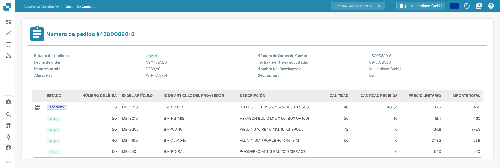
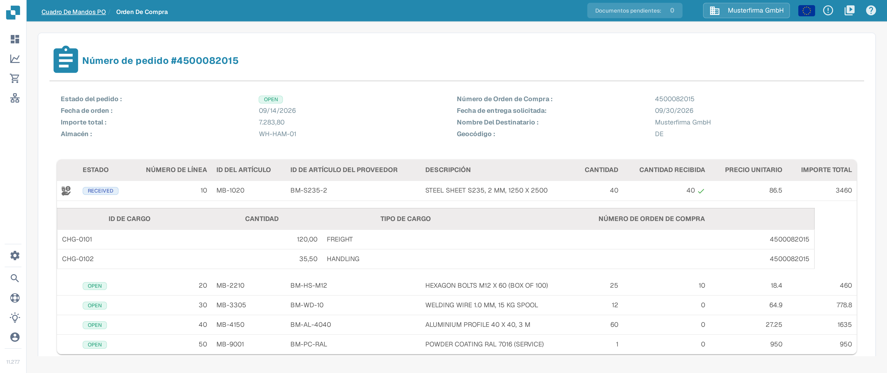

# Detalle de la orden de compra

La página Detalle de la orden de compra ofrece una vista completa de una sola orden de compra. Puedes usarla para consultar los datos de la orden, revisar cada línea pedida y ver el documento original de la orden de compra sin abrir otro sistema.

## Cómo abrir la página Detalle de la orden de compra

1. En el menú principal, selecciona **Orden de Compra** para abrir el [Panel de órdenes de compra](purchase-order-dashboard.md).
2. Busca la orden de compra que quieres revisar, por ejemplo con la barra de búsqueda o los filtros.
3. En la fila de la orden de compra, abre el menú de la columna **Acciones** (los tres puntos) y selecciona **Vista**.

Se abre la página Detalle de la orden de compra y muestra el número de la orden en el encabezado, por ejemplo **Número de pedido #4500082015**.

<figure><figcaption>
Página Detalle de la orden de compra en español con los datos y las líneas de la orden de compra 4500082015.
</figcaption></figure>

La imagen muestra la interfaz en español con la orden de compra sintética `4500082015` del Sandbox. El icono de cargos de una línea solo aparece cuando esa línea tiene cargos; en esta captura la primera línea tiene cargos.

## Datos de la orden

La parte superior de la página muestra los datos generales de la orden de compra:

| Campo | Descripción |
| :-- | :-- |
| **Estado del pedido** | Estado actual de la orden de compra, por ejemplo `OPEN`. |
| **Número de Orden de Compra** | El número único de la orden de compra. |
| **Fecha de orden** | La fecha en la que se realizó el pedido. |
| **Fecha de entrega solicitada** | La fecha de entrega solicitada en la orden de compra. |
| **Importe total** | El valor total de la orden de compra. |
| **Nombre Del Destinatario** | La parte a la que se envían las mercancías. |
| **Almacén** | El almacén para el que se pide la mercancía. |
| **Geocódigo** | El código de ubicación del almacén. |

Los valores de estado se muestran en inglés, por ejemplo `OPEN` o `RECEIVED`.

## Líneas de la orden

La tabla situada debajo de los datos de la orden contiene una fila por cada línea pedida:

| Columna | Descripción |
| :-- | :-- |
| **ESTADO** | Estado de la línea, por ejemplo `OPEN`. Una marca de verificación verde junto a la cantidad recibida indica que se ha recibido la cantidad completa pedida. |
| **NÚMERO DE LÍNEA** | Número de la línea en la orden de compra. |
| **ID DEL ARTÍCULO** | Número interno del artículo pedido. |
| **ID DE ARTÍCULO DEL PROVEEDOR** | Número de artículo que utiliza el proveedor. |
| **DESCRIPCIÓN** | Descripción del artículo o servicio pedido. |
| **CANTIDAD** | Cantidad pedida. |
| **CANTIDAD RECIBIDA** | Cantidad recibida hasta ahora. |
| **PRECIO UNITARIO** | Precio por unidad. |
| **IMPORTE TOTAL** | Valor total de la línea. |

Si la orden de compra no tiene líneas, la tabla muestra **DATOS NO ENCONTRADOS** en lugar de las líneas.

### Cargos de una línea

Si a una línea se le asignan cargos adicionales (por ejemplo, cargos de transporte o de manipulación), aparece un icono de cargos en la primera columna de esa línea. Haz clic en el icono para mostrar u ocultar una sub-tabla con los cargos de la línea. La sub-tabla muestra el **ID DE CARGO**, la **CANTIDAD** (el importe del cargo), el **TIPO DE CARGO** y el **NÚMERO DE ORDEN DE COMPRA** al que pertenece el cargo. Los cargos se extraen del documento de la orden de compra; cómo se comparan con los cargos de la factura se describe en [Herramientas de coincidencia de órdenes de compra](purchase-order-matching/purchase-order-matching-tools.md) y en [Comparar cargos totales](../../administration-and-setup/workflow/and/compare-with-purchase-order/compare-total-charges.md).

<figure><figcaption>
Cargos abiertos debajo de la primera línea: dos cargos de la orden de compra 4500082015.
</figcaption></figure>

## Vista previa del documento

Debajo de las líneas de la orden, la página muestra una vista previa en PDF del documento original de la orden de compra, para que puedas comparar los datos extraídos con el documento de origen en cualquier momento.

## Páginas relacionadas

- [Panel de órdenes de compra](purchase-order-dashboard.md) — buscar y filtrar órdenes de compra.
- [Pantalla de Coincidencia de Órdenes de Compra](purchase-order-matching/README.md) — comparar una factura con una orden de compra.
