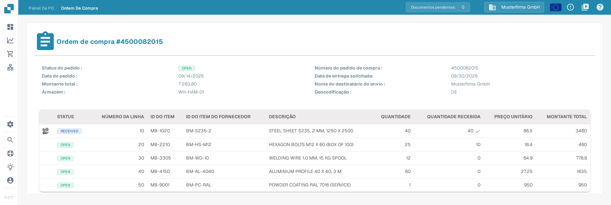
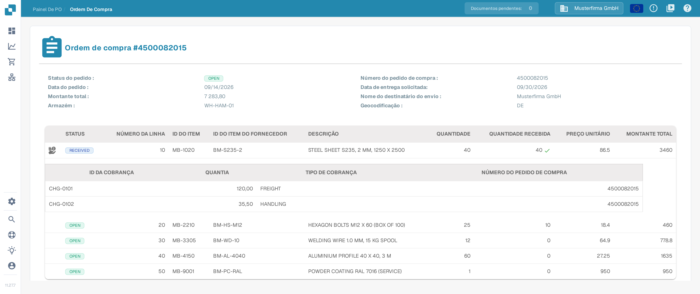

# Detalhes do Pedido de Compra

A página Detalhes do Pedido de Compra mostra o pedido de compra completo. Use-a para conferir os dados do pedido, revisar cada linha pedida e ver o documento original do pedido de compra sem abrir outro sistema.

## Como abrir a página Detalhes do Pedido de Compra

1. No menu principal, selecione **Ordem de Compra** para abrir o [Painel de ordens de compra](purchase-order-dashboard.md).
2. Encontre o pedido de compra que deseja conferir, por exemplo com a barra de pesquisa ou os filtros.
3. Na linha do pedido, abra o menu **Ações** (ícone de três pontos) e escolha **Visualizar** (ícone de olho).

A página Detalhes do Pedido de Compra abre e mostra o número do pedido no título, por exemplo **Ordem de compra #4500082015**.

<figure><figcaption>
A página Detalhes do Pedido de Compra em português com os dados e as linhas do pedido 4500082015.
</figcaption></figure>

A imagem acima mostra a interface em português com o pedido de compra de exemplo `4500082015`. O ícone de cobranças de uma linha só aparece quando a linha tem cobranças; neste exemplo a primeira linha tem cobranças, por isso o ícone aparece nela.

## Dados do pedido

A parte superior da página mostra os dados gerais do pedido de compra:

| Campo | Descrição |
| :-- | :-- |
| **Status do pedido** | Estado atual do pedido de compra, por exemplo `OPEN`. Esses estados aparecem em inglês na interface. |
| **Número do pedido de compra** | O número único do pedido de compra. |
| **Data do pedido** | A data em que o pedido de compra foi feito. |
| **Data de entrega solicitada** | A data de entrega solicitada no pedido de compra. |
| **Montante total** | O valor total do pedido de compra. |
| **Nome do destinatário do envio** | A parte para a qual as mercadorias são enviadas. |
| **Armazém** | O armazém para o qual as mercadorias foram pedidas. |
| **Geocodificação** | O código de localização do armazém. |

## Linhas do pedido

A tabela abaixo dos dados do pedido mostra uma linha para cada item pedido:

| Coluna | Descrição |
| :-- | :-- |
| **STATUS** | Estado da linha, por exemplo `OPEN`. Uma marca de verificação verde ao lado da quantidade recebida indica que a quantidade pedida foi recebida por completo. |
| **NÚMERO DA LINHA** | Número da linha no pedido de compra. |
| **ID DO ITEM** | Número interno do artigo pedido. |
| **ID DO ITEM DO FORNECEDOR** | Número do artigo usado pelo fornecedor. |
| **DESCRIÇÃO** | Descrição do artigo ou serviço pedido. |
| **QUANTIDADE** | Quantidade pedida. |
| **QUANTIDADE RECEBIDA** | Quantidade recebida até agora. |
| **PREÇO UNITÁRIO** | Preço por unidade. |
| **MONTANTE TOTAL** | Valor total da linha. |

### Cobranças de uma linha

Se cobranças adicionais (por exemplo frete ou taxas de manuseio) forem distribuídas para uma linha, um ícone de cobranças aparece na primeira coluna dessa linha. Selecione o ícone para abrir ou ocultar uma subtabela com as cobranças da linha. A subtabela mostra **ID DA COBRANÇA**, **QUANTIA**, **TIPO DE COBRANÇA** e o **NÚMERO DO PEDIDO DE COMPRA** ao qual a cobrança pertence.

<figure><figcaption>
A subtabela de cobranças aberta na primeira linha do pedido de compra 4500082015.
</figcaption></figure>

As cobranças são lidas do documento do pedido de compra. Como elas são comparadas com as cobranças da fatura está descrito em [Ferramentas de Correspondência de Pedidos de Compra](purchase-order-matching/purchase-order-matching-tools.md) e em [Comparar cobranças totais](../../administration-and-setup/workflow/and/compare-with-purchase-order/compare-total-charges.md).

## Pré-visualização do documento

Abaixo das linhas do pedido, a página mostra uma pré-visualização em PDF do documento original do pedido de compra, para você comparar os dados lidos com o original a qualquer momento.

## Pedido de compra sem linhas

Se o pedido de compra não tiver linhas, a tabela mostra apenas um aviso abaixo dos cabeçalhos das colunas, em vez de linhas de pedido. Confira então se o pedido de compra foi importado por completo e abra-o novamente a partir do [Painel de ordens de compra](purchase-order-dashboard.md).

## Páginas relacionadas

- [Painel de ordens de compra](purchase-order-dashboard.md) — encontrar e filtrar pedidos de compra.
- [Tela de Correspondência de Ordem de Compra](purchase-order-matching/README.md) — comparar uma fatura com um pedido de compra.
