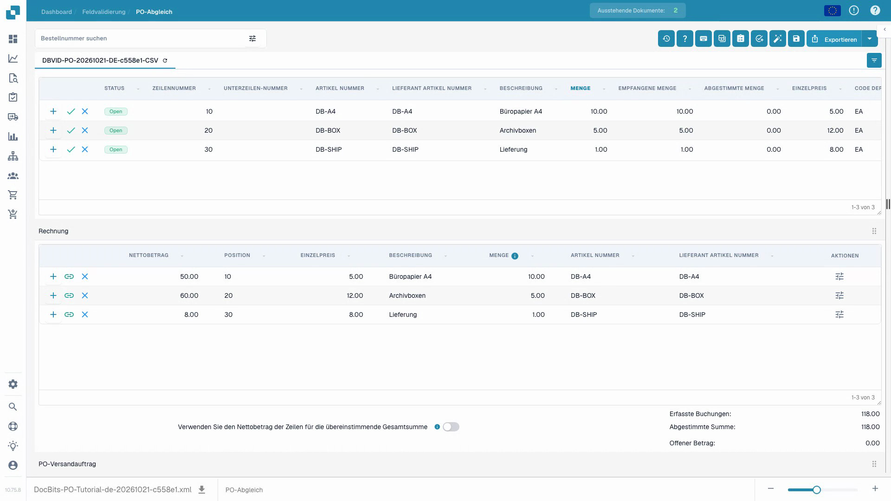
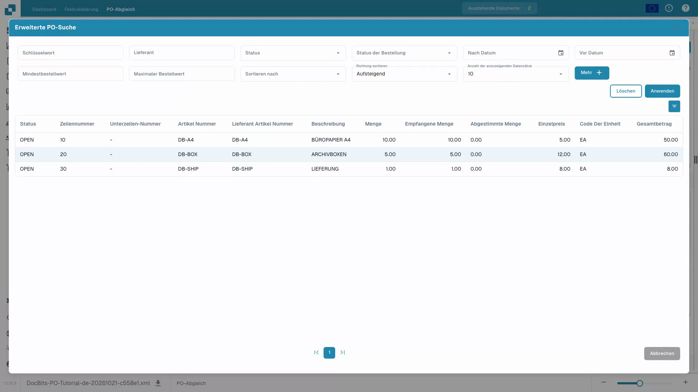
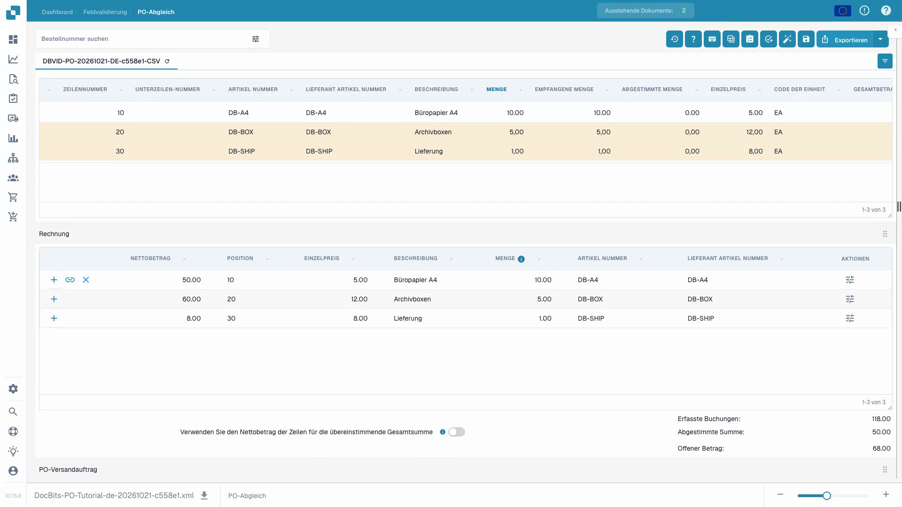

# Bildschirm für den Bestellabgleich

Verwenden Sie **PO Matching**, um die für ein Dokument geladenen Bestellpositionen mit den ausgelesenen Rechnungspositionen zu vergleichen. Die Bestelldaten können aus einer ERP-Integration oder einem anderen konfigurierten Import stammen. Der Bildschirm zeigt das Dokument neben den beiden Tabellen, damit Sie Nummern, Mengen, Preise und Abweichungen prüfen können, bevor Sie speichern oder exportieren.

## Rechnungspositionen prüfen und mit einer Bestellung abgleichen

Der Rundgang beginnt mit einer erkannten Bestellnummer und drei zugeordneten Rechnungspositionen. Danach zeigt er die manuelle Suche als Sonderfall, eine absichtlich falsche Verbindung, einen Teilabgleich, den automatischen Abgleich und das Speichern. Prüfen Sie das Ergebnis nach dem Neuladen; das Speichern eines Abgleichs gibt die Rechnung weder frei noch exportiert es sie.



[Video mit Untertiteln ansehen](https://docbits-videos.fra1.cdn.digitaloceanspaces.com/settings-assistant/po-matching-customer/v4/de.html)


Die Aufnahme verwendet synthetische Testdaten mit drei ausgelesenen Rechnungspositionen und der zugehörigen Bestellung. Papier, Archivboxen und Lieferung ergeben zusammen 118 EUR netto. Der vollständige Abgleich zeigt 118 EUR abgestimmt und nichts offen.


<figure><figcaption>
Vollständiger Abgleich: alle drei Rechnungspositionen sind verbunden, 118 EUR abgestimmt und 0 EUR offen.
</figcaption></figure>

## Eine Bestellung suchen und prüfen

1. Öffnen Sie die Rechnung in **PO Matching**. Ist ihre Bestellnummer erkannt, lädt DocBits die zugehörige Bestellung. Nutzen Sie die manuelle Suche, wenn die Nummer fehlt oder Sie eine andere Bestellung prüfen möchten.
2. Wählen Sie das Filtersymbol neben dem Suchfeld für **Keyword**, **Supplier**, **Status**, **Order Status**, Datumsangaben, Betragsbereich, Sortierung und die Anzahl der angezeigten Datensätze. Wählen Sie **More** für weitere Kriterien. Wählen Sie **Apply** zum Suchen oder **Clear** zum Zurücksetzen der Filter.
3. Wählen Sie eine Bestellnummer oberhalb der Tabelle, um ihre Positionen zu prüfen. Das Aktualisierungssymbol neben der Nummer lädt die Daten dieser Bestellung neu. Ein Neuladen kann von der konfigurierten Integration abhängen.
4. Vergleichen Sie jede Bestellposition mit der Rechnung und ihrer ausgelesenen Tabelle. Das **+** öffnet vorhandene Abgleich-Details; es verbindet die Position nicht selbst mit der Rechnung.

<figure><figcaption>
Die manuelle Suche zeigt die drei Positionen der Testbestellung. Nutzen Sie die Filter bei Bedarf; eine erkannte Bestellnummer erfordert keine zweite Suche.
</figcaption></figure>

<figure><figcaption>
Teilabgleich: Papier ist mit 50 EUR abgestimmt; 68 EUR bleiben offen. Teilabgleich bedeutet keine feste Schwelle von fünfzig Prozent.
</figcaption></figure>

## Positionen zuordnen und das Ergebnis prüfen

Wenn beide Tabellen Positionen enthalten, verbinden Sie eine Rechnungsposition durch Ziehen mit der entsprechenden Bestellposition oder nutzen Sie die Zuordnungsaktionen im Kontextmenü der Position. **Auto Match** versucht, geeignete Positionen nach den Regeln Ihrer Organisation zu verbinden. Prüfen Sie das Ergebnis vor dem Speichern: Eine übereinstimmende Artikelnummer allein belegt nicht, dass Menge, Preis oder Lieferbedingungen übereinstimmen. Siehe [Bestellabgleich-Tools](purchase-order-matching-tools.md) für die Symbolleiste, die Spaltensteuerung und manuelle Aktionen sowie [Tastenkombinationen](keyboard-shortcuts.md) für Tastaturaktionen.

Wird ein Dokument nicht abgeglichen, lesen Sie den Grund oberhalb des Bestellbereichs. Er kann besagen, dass die Bestellnummer fehlt, die Bestellung nicht gefunden wurde, ihre Positionen nicht verfügbar sind oder die Rechnung keine ausgelesenen Positionen hat. Korrigieren Sie das Dokument oder die Konfiguration, die dieser Grund nennt. Administratoren können die [Abgleichregeln](../../../administration-and-setup/settings/global-settings/document-types/more-settings/purchase-order/purchase-order-matching-rules.md) und die [Tabellenerkennung](../../../administration-and-setup/settings/document-processing/classification-and-extraction/) prüfen, wenn keine Rechnungspositionen erscheinen.

### Einer Zuordnung auf einen anderen Bestell-Reiter folgen

Jede Bestellung öffnet sich in einem eigenen Reiter oberhalb der Tabelle, und eine Rechnungsposition kann mit Positionen aus verschiedenen Reitern abgeglichen werden. Das Zuordnungssymbol an der Rechnungsposition wechselt zum Reiter der zugeordneten Bestellung und scrollt zur zugeordneten Position; jeder weitere Klick zeigt die nächste zugeordnete Position. Ist die Position auf mehreren Reitern verbunden, zeigt das Symbol zuerst die Liste unter **Matched on other PO tabs**, in der Sie die Bestellung auswählen, deren Position Sie sehen möchten. Auf der Bestellseite arbeitet das Symbol umgekehrt: Ein Klick führt durch die zugeordneten Rechnungspositionen, und beim Überfahren hebt es sie hervor.

Häufige Meldungen und nächste Schritte:

| Was Sie sehen | Was Sie prüfen sollten |
| --- | --- |
| Keine Bestellnummer | Geben Sie die Bestellnummer im Dokument ein oder korrigieren Sie sie, und speichern Sie anschließend. |
| Keine Bestellung gefunden | Prüfen Sie die Nummer und ob die Bestellung in diese Organisation importiert wurde. |
| Die Bestellung wurde gefunden, aber nicht verbunden | Versuchen Sie **Auto Match**, oder verbinden Sie die Positionen nach Prüfung beider Tabellen manuell. |
| Keine Bestellposition passt | Vergleichen Sie die Rechnungswerte mit der Bestellung und prüfen Sie die Abgleich-Historie. |
| Keine Rechnungspositionen | Prüfen Sie die [Tabellenerkennung](../../../administration-and-setup/settings/document-processing/classification-and-extraction/), bevor Sie abzugleichen versuchen. |
| Keine offenen Bestellpositionen | Prüfen Sie die [Status verbrauchter Bestellpositionen](../../../administration-and-setup/settings/global-settings/document-types/more-settings/purchase-order/consumed-po-line-status.md) und die ausgeschlossenen Status. |


Das Speichern kann den Abgleich erneut auslösen, nachdem eine Bestellnummer geändert oder neu erkannt wurde. Prüfen Sie das angezeigte Ergebnis nach dem Speichern. Kann ein Abgleich nicht gespeichert werden, lesen Sie den auf dem Bildschirm angezeigten Fehler und bitten Sie einen Administrator, die [Transformation](../../../administration-and-setup/settings/global-settings/document-types/transformation-rules/) und die [Abgleichregeln](../../../administration-and-setup/settings/global-settings/document-types/more-settings/purchase-order/purchase-order-matching-rules.md) zu prüfen.


Nutzen Sie die **Matching history** (Uhr-Symbol, soweit Ihre Berechtigungen es erlauben), um nachzuvollziehen, wie ein früherer Abgleich entschieden wurde. Sie ist eine schreibgeschützte Ansicht. Sie können prüfen, welche Regeln liefen und warum ein Kandidat nicht passte; das Öffnen der Historie exportiert das Dokument nicht.

### Mehr als eine Position pro Abgleich

Eine einzelne Rechnungsposition kann mehreren Bestellpositionen entsprechen – oder umgekehrt –, soweit Ihre Abgleichregeln das erlauben. Öffnen Sie die **+**-Details einer Position, um einen vorhandenen Multi-Match zu prüfen. Prüfen Sie die kombinierte Menge und den kombinierten Preis, nicht nur eine einzelne Position. Ein leeres Detailpanel bedeutet, dass kein Multi-Match zu prüfen ist. Siehe [Bestellabgleich-Tools](purchase-order-matching-tools.md) zum Ändern von Verbindungen.

### Mengen, Abweichungen und Rabatte

Abhängig von der Konfiguration kann der Abgleich bestellte, empfangene oder verbleibende Liefermengen sowie Einzelpreis, Artikelnummer und andere zugeordnete Felder vergleichen. Eine Abweichung kann akzeptiert werden, wenn der Dokumenttyp eine konfigurierte Toleranz hat. Prüfen Sie die angezeigte Abweichung, bevor Sie sie akzeptieren. Die [Toleranzeinstellungen](../../../administration-and-setup/settings/global-settings/document-types/more-settings/purchase-order/purchase-order-tolerance-settings-additional-purchase-order-tolerance.md) und die [Rabatt-Hinweise](discounts.md) erläutern diese Fälle.

Der Summenbereich hilft, soweit verfügbar, den Nettobetrag der Rechnung mit den abgeglichenen Positionen und Gebühren abzustimmen. Bleibt ein **Unsettled amount**, prüfen Sie die einzelnen Positionswerte und etwaige [Kostenelemente](../../../administration-and-setup/settings/document-processing/classification-and-extraction/table-extraction-for-costing-element.md) vor dem Export.

## Summen prüfen und speichern

Prüfen Sie die Rechnungsvorschau rechts und vergleichen Sie die Positionssummen und etwaige Gebühren. Eine vollständige Erklärung der Aktionen in der oberen Symbolleiste finden Sie in den [Bestellabgleich-Tools](purchase-order-matching-tools.md). Wählen Sie **Save** nach dem Ändern von Abgleichen. Wählen Sie **Export** erst, nachdem Sie das Dokument und das Abgleichergebnis geprüft haben; der Pfeil neben Export zeigt zusätzliche konfigurierte Exportoptionen. Ihre Organisation kann andere Exportaktionen haben.

Die Symbolleiste der Vorschau erlaubt es, durch die Dokumentseiten zu blättern, zu zoomen, das Original herunterzuladen und eine größere Ansicht zu öffnen. Nutzen Sie sie, um zu prüfen, dass Bestellnummer und Positionswerte wirklich auf der Rechnung erscheinen. Wenn Sie die Seite mit ungespeicherten Abgleich-Änderungen verlassen, können diese verloren gehen.

Die verfügbaren Vergleiche und Toleranzwerte hängen von Ihren Dokumenttyp-Einstellungen ab. Lesen Sie [Regeln für die Übereinstimmung von Bestellungen](../../../administration-and-setup/settings/global-settings/document-types/more-settings/purchase-order/purchase-order-matching-rules.md), [Einstellungen zur Toleranz von Bestellungen](../../../administration-and-setup/settings/global-settings/document-types/more-settings/purchase-order/purchase-order-tolerance-settings-additional-purchase-order-tolerance.md), [PO-Deaktivierungsstatus](../../../administration-and-setup/settings/global-settings/document-types/more-settings/purchase-order/purchase-order-disable-statuses.md) und [Verbrauchter PO-Zeilenstatus](../../../administration-and-setup/settings/global-settings/document-types/more-settings/purchase-order/consumed-po-line-status.md) für Administratoreneinstellungen. Für Viele-zu-eins-Positionen siehe [Rabatte](discounts.md) und die [Abgleich-Tools](purchase-order-matching-tools.md).
