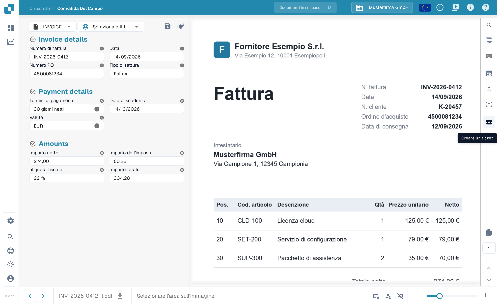
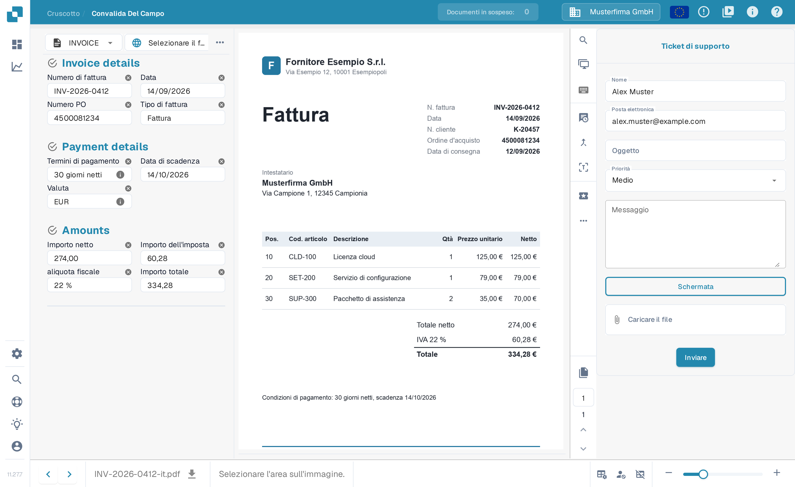

# Crea un ticket

Questo strumento è disponibile nella schermata di convalida, se durante la convalida del documento in DocBits si verifica qualche tipo di problema. Come aprire e usare questa schermata è descritto in [Aprire e usare la schermata di validazione](../validation-screen/README.md).

Questa funzionalità si trova nel menu sopra l'area di anteprima del documento, come mostrato di seguito.

<figure><figcaption>
Il pulsante «Creare un ticket» nella barra delle azioni della schermata di convalida.
</figcaption></figure>

Dopo aver fatto clic, viene mostrato il seguente modulo per il ticket.

<figure><figcaption>
Il modulo «Ticket di supporto».
</figcaption></figure>

Qui inserisci i tuoi dati e descrivi l'errore. Se serve, puoi anche allegare uno screenshot del problema e un file pertinente. Con **Inviare** invii la segnalazione al supporto.
