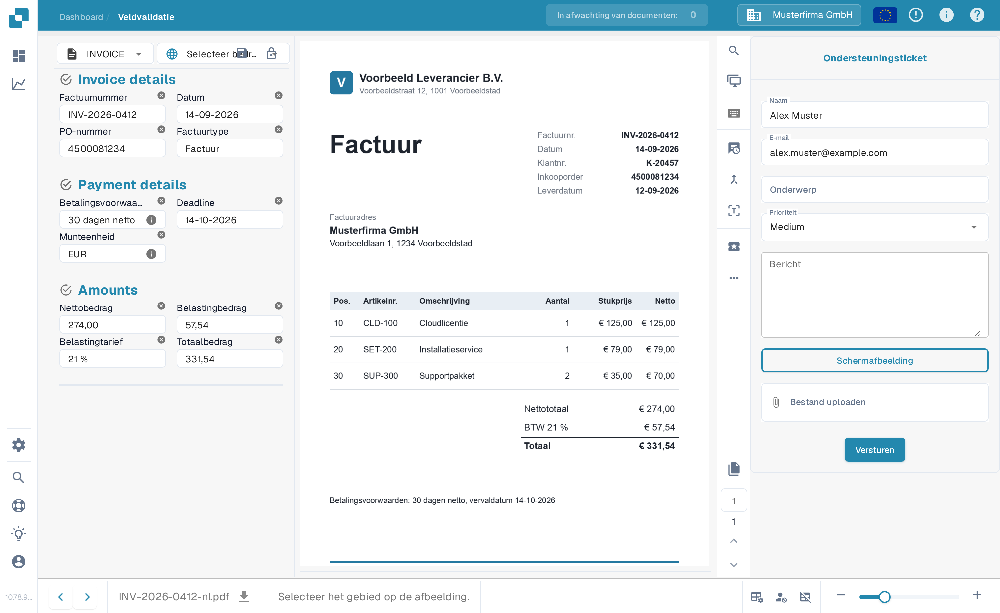

# Maak een ticket aan


DocBits Tutorial voor ondersteuningstickets: rapporteer bugs, voeg bestanden toe en krijg sneller hulp


Zodra u erop klikt, wordt het volgende ticketformulier aan u getoond.

<figure><figcaption>
Het formulier 'Ondersteuningsticket'.
</figcaption></figure>

Hier vult u uw gegevens in en beschrijft u de fout. U kunt ook, indien van toepassing, een schermafbeelding van het probleem bijvoegen en een relevant bestand toevoegen.
