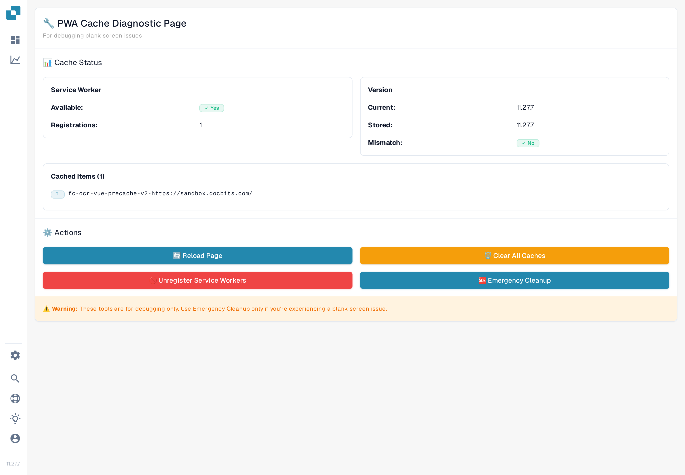

# Stato della cache PWA

La pagina **PWA Cache Status** è uno strumento diagnostico per gli amministratori che indagano su una **schermata bianca** o su un'applicazione che carica file obsoleti. DocBits può usare i Service Worker e la cache del browser per caricare i file dell'applicazione. Questa pagina mostra l'istantanea diagnostica attuale del browser e offre azioni di manutenzione per i problemi legati alla cache. L'istantanea da sola non stabilisce la causa di una schermata bianca né dimostra che un'installazione PWA sia in buono stato.

## Come accedere

La pagina è pensata per gli amministratori e non è collegata nella barra laterale. Ci sono due modi per aprirla:

* Apri l'URL direttamente: `https://app.docbits.com/debug/pwa-cache-status`
* Dall'applicazione principale (per esempio la Dashboard), premi <kbd>Ctrl</kbd> + <kbd>K</kbd> (oppure <kbd>Cmd</kbd> + <kbd>K</kbd> su macOS) per aprire la [Ricerca Rapida Globale](../global-quick-search.md), digita "PWA Cache Status" e premi <kbd>Invio</kbd> su quel risultato.

<figure><figcaption>
La pagina diagnostica PWA Cache in una sessione in italiano: pannelli di stato, le quattro azioni e l'avvertenza di debug. I testi di questa pagina diagnostica restano in inglese perché l'applicazione non li traduce ancora. I valori di versione e i conteggi di registrazioni e cache variano in base al browser e all'ambiente.
</figcaption></figure>

## Leggere i pannelli di stato

* **Service Worker** — **Available: Yes/No** indica se il browser supporta l'API Service Worker. **Registrations** conta le registrazioni sull'origine corrente del browser. Questi valori non dimostrano che DocBits sia installato come PWA, che un worker controlli questa pagina o che l'installazione sia in buono stato.
* **Version** — **Current** è la versione dell'applicazione fornita dalla build caricata. **Stored** è la baseline salvata per questo bundle dell'applicazione nel browser; non è un inventario delle versioni di tutti i file in cache. **Mismatch: Yes** compare solo quando entrambi i valori sono noti e diversi. Una versione corrente vuota o **Stored: Not set** non dimostrano che le cache siano aggiornate, anche se **Mismatch** mostra _No_.
* **Cached Items** — elenca i nomi di tutte le cache CacheStorage sull'origine corrente, non singoli file né solo le cache di DocBits. Il conteggio è il numero di nomi di cache. _No caches found_ significa che questa istantanea non contiene nomi di cache CacheStorage; non dice nulla sugli altri archivi del browser né sulla normale cache HTTP del browser.

Valori vuoti o un conteggio pari a zero possono derivare anche da API non disponibili o da letture diagnostiche fallite; non dimostrano che il browser non abbia risorse in cache.

Un'origine è la combinazione di protocollo, host e porta. Questi strumenti agiscono su tutte le cache e su tutte le registrazioni di quell'origine, comprese quelle usate da altri percorsi dell'applicazione.

## Le quattro azioni

| Azione | Cosa fa |
| --- | --- |
| **Reload Page** | Esegue un normale ricaricamento della pagina. Non cancella esplicitamente le cache né aggira un Service Worker. |
| **Clear All Caches** | Tenta di eliminare tutte le cache CacheStorage di questa origine e aggiorna l'istantanea diagnostica. I caricamenti successivi potrebbero dover scaricare di nuovo i file. |
| **Unregister Service Workers** | Tenta di annullare la registrazione di tutti i Service Worker di questa origine e aggiorna l'istantanea diagnostica. Controlla lo stato risultante prima di dare per riuscita la pulizia. |
| **Emergency Cleanup** | Tenta di eliminare le cache e di annullare la registrazione dei Service Worker insieme, poi pianifica un normale ricaricamento della pagina. Tenta di salvare la baseline della versione attuale solo dopo che entrambi i passaggi di pulizia hanno segnalato successo ed è disponibile una versione attuale dell'applicazione. Un errore di archiviazione del browser può comunque impedire il salvataggio della baseline. Se uno dei due passaggi di pulizia non riesce, la baseline precedente viene mantenuta. |

⚠️ **Attenzione:** questi strumenti servono solo per il debug. Usa **Emergency Cleanup** soltanto in caso di schermata bianca. La cancellazione delle cache può rimuovere dati in cache e risorse offline di applicazioni sulla stessa origine; non dare per scontato che le cache contengano solo file dell'applicazione eliminabili senza conseguenze. Il caricamento successivo può essere più lento o richiedere una connessione di rete funzionante. Una notifica di successo o un ricaricamento pianificato da soli non dimostrano che tutte le operazioni di pulizia siano riuscite.

## Flusso tipico di risoluzione dei problemi

1. Apri la pagina PWA Cache Status e annota **Current**, **Stored**, **Mismatch**, il numero di registrazioni e i nomi delle cache. Una discrepanza è un indizio diagnostico, non una diagnosi completa.
2. Se è adatto alla tua sessione di risoluzione dei problemi, prova **Reload Page**. È un ricaricamento normale e può comunque usare risposte in cache.
3. Se lo schermo resta bianco, controlla l'origine e l'avvertenza qui sopra prima di usare **Clear All Caches**, poi ricarica la pagina e ispeziona di nuovo il suo stato.
4. Usa **Emergency Cleanup** solo se il problema di schermata bianca continua. Tenta entrambe le operazioni di pulizia e pianifica un ricaricamento; la baseline cambia solo alle condizioni di successo descritte sopra. Se la pulizia non riesce, conserva la baseline precedente come indizio e contatta l'assistenza invece di dare per risolto il problema.
5. Se nulla di tutto questo aiuta, raccogli la diagnostica con il **Raccoglitore di debug** (<kbd>Ctrl</kbd> + <kbd>Shift</kbd> + <kbd>P</kbd>) e inviala all'assistenza: vedi [Raccoglitore di debug](../debug-collector.md). Controlla la diagnostica per informazioni riservate prima di condividerla.
