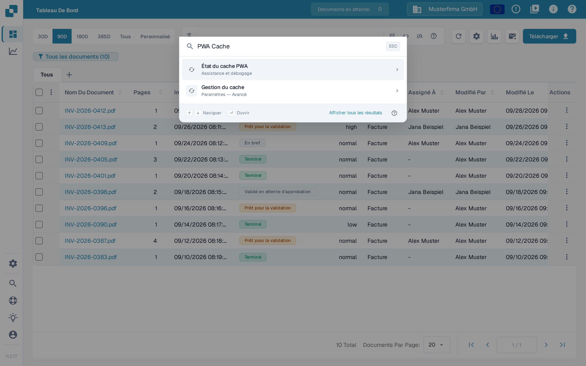

# État du cache PWA

La page **PWA Cache Status** est un outil de diagnostic destiné aux administrateurs qui analysent un **écran blanc** ou une application qui charge des fichiers obsolètes. DocBits peut utiliser des Service Workers et les caches du navigateur pour charger les fichiers de l'application. Cette page affiche l'instantané de diagnostic actuel du navigateur et propose des actions de maintenance pour les problèmes liés au cache. L'instantané seul n'établit pas la cause d'un écran blanc et ne prouve pas qu'une installation PWA est saine.

## Comment y accéder

La page est destinée aux administrateurs et n'est pas liée dans la barre latérale. Il existe deux façons de l'ouvrir :

* Ouvrez directement l'URL : `https://app.docbits.com/debug/pwa-cache-status`
* Depuis l'application principale (par exemple le Tableau de bord), appuyez sur <kbd>Ctrl</kbd> + <kbd>K</kbd> (ou <kbd>Cmd</kbd> + <kbd>K</kbd> sous macOS) pour ouvrir la [Recherche Rapide Globale](../global-quick-search.md), saisissez « État du cache PWA » (ou simplement « PWA Cache ») et appuyez sur <kbd>Entrée</kbd> sur ce résultat.

<figure><figcaption>
La recherche rapide globale dans l'interface française : la saisie « PWA Cache » propose en premier résultat « État du cache PWA » (rubrique Assistance et débogage), avec « Afficher tous les résultats » en bas.
</figcaption></figure>

<figure><figcaption>
La page de diagnostic PWA Cache ouverte dans la même session française : panneaux de statut, les quatre actions et l'avertissement de débogage. Les textes de cette page de diagnostic restent en anglais, car l'application ne les traduit pas encore. Les valeurs de version et les compteurs d'enregistrements et de caches varient selon le navigateur et l'environnement.
</figcaption></figure>

## Lire les panneaux de statut

* **Service Worker** — **Available: Yes/No** indique si le navigateur prend en charge l'API Service Worker. **Registrations** compte les enregistrements sur l'origine actuelle du navigateur. Ces valeurs ne prouvent pas que DocBits est installé comme PWA, qu'un worker contrôle cette page, ni que l'installation est saine.
* **Version** — **Current** est la version de l'application fournie par le build chargé. **Stored** est la référence enregistrée pour ce bundle de l'application dans le navigateur ; ce n'est pas un inventaire des versions de tous les fichiers en cache. **Mismatch: Yes** n'apparaît que lorsque les deux valeurs sont connues et différentes. Une version actuelle vide ou **Stored: Not set** ne prouve pas que les caches sont à jour, même si **Mismatch** affiche _No_.
* **Cached Items** — liste les noms de tous les caches CacheStorage de l'origine actuelle, et non des fichiers individuels ni uniquement les caches DocBits. Le compteur correspond au nombre de noms de cache. _No caches found_ signifie que cet instantané ne contient aucun nom de cache CacheStorage ; cela ne dit rien des autres stockages du navigateur ni du cache HTTP ordinaire du navigateur.

Des valeurs vides ou un compteur à zéro peuvent aussi résulter d'API indisponibles ou de lectures de diagnostic échouées ; elles ne prouvent pas que le navigateur n'a aucune ressource en cache.

Une origine est la combinaison du protocole, de l'hôte et du port. Ces outils agissent sur tous les caches et tous les enregistrements de cette origine, y compris ceux utilisés par d'autres chemins de l'application.

## Les quatre actions

| Action | Ce qu'elle fait |
| --- | --- |
| **Reload Page** | Effectue un rechargement normal de la page. Elle ne vide pas explicitement les caches et ne contourne pas un Service Worker. |
| **Clear All Caches** | Tente de supprimer tous les caches CacheStorage de cette origine et actualise l'instantané de diagnostic. Les chargements suivants peuvent devoir retélécharger les fichiers. |
| **Unregister Service Workers** | Tente de désenregistrer tous les Service Workers de cette origine et actualise l'instantané de diagnostic. Vérifiez le statut obtenu avant de considérer que le nettoyage a réussi. |
| **Emergency Cleanup** | Tente de supprimer les caches et de désenregistrer les Service Workers en une seule fois, puis planifie un rechargement normal de la page. Elle ne tente d'enregistrer la référence de la version actuelle qu'après la réussite des deux étapes de nettoyage et lorsqu'une version actuelle de l'application est disponible. Une défaillance du stockage du navigateur peut malgré tout empêcher l'enregistrement de la référence. Si l'une des deux étapes de nettoyage échoue, la référence précédente est conservée. |

⚠️ **Avertissement :** Ces outils sont réservés au débogage. N'utilisez **Emergency Cleanup** qu'en cas de problème d'écran blanc. La suppression des caches peut effacer des données en cache et des ressources hors ligne d'applications de la même origine ; ne partez pas du principe que les caches ne contiennent que des fichiers applicatifs jetables. Le chargement suivant peut être plus lent ou nécessiter une connexion réseau fonctionnelle. Une notification de réussite ou un rechargement planifié ne prouve pas à lui seul que toutes les opérations de nettoyage ont réussi.

## Déroulement type du dépannage

1. Ouvrez la page PWA Cache Status et notez **Current**, **Stored**, **Mismatch**, le nombre d'enregistrements et les noms des caches. Une divergence est un indice de diagnostic, pas un diagnostic complet.
2. Si cela convient à votre session de dépannage, essayez **Reload Page**. Il s'agit d'un rechargement ordinaire, qui peut encore utiliser des réponses en cache.
3. Si l'écran reste blanc, vérifiez l'origine et l'avertissement ci-dessus avant d'utiliser **Clear All Caches**, puis rechargez la page et inspectez à nouveau son statut.
4. N'utilisez **Emergency Cleanup** qu'en cas de problème d'écran blanc persistant. Elle tente les deux opérations de nettoyage et planifie un rechargement ; la référence ne change que dans les conditions de réussite décrites ci-dessus. Si le nettoyage échoue, conservez la référence précédente comme indice et contactez le support au lieu de considérer le problème comme résolu.
5. Si rien de tout cela n'aide, collectez les diagnostics avec le **Collecteur de débogage** (<kbd>Ctrl</kbd> + <kbd>Shift</kbd> + <kbd>P</kbd>) et envoyez-les au support — voir [Collecteur de débogage](../debug-collector.md). Vérifiez les diagnostics pour toute information sensible avant de les partager.
