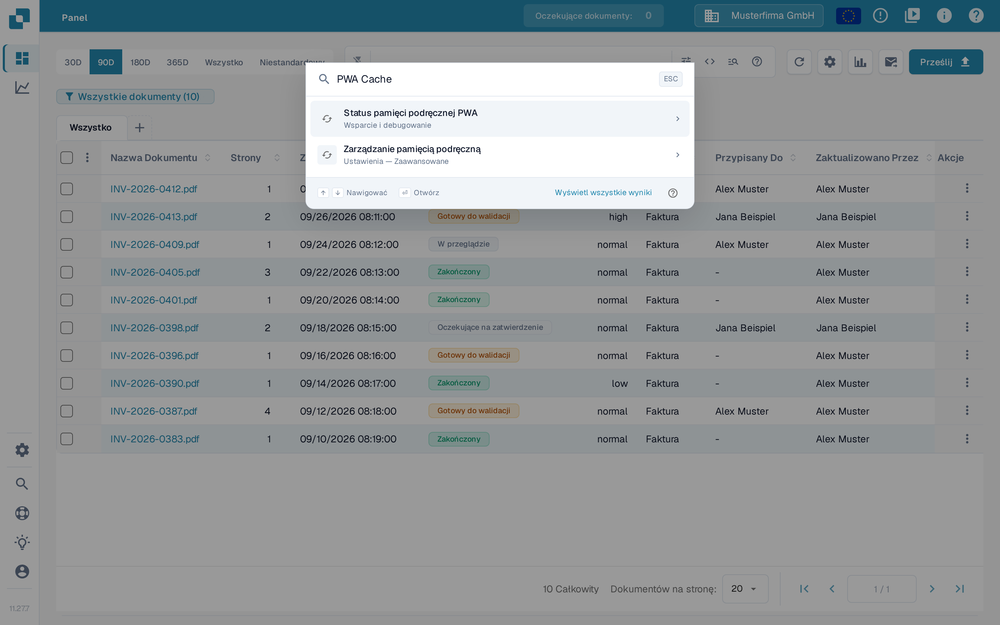

# Stan pamięci podręcznej PWA

Strona **PWA Cache Status** to narzędzie diagnostyczne dla administratorów, którzy badają **biały ekran** lub aplikację ładującą nieaktualne pliki. DocBits może używać Service Workers i pamięci podręcznych przeglądarki do ładowania plików aplikacji. Ta strona pokazuje bieżący zrzut diagnostyczny przeglądarki i udostępnia działania konserwacyjne w przypadku problemów z pamięcią podręczną. Sam zrzut nie ustala przyczyny białego ekranu i nie dowodzi, że instalacja PWA jest sprawna.

## Jak otworzyć stronę

Strona jest przeznaczona dla administratorów i nie jest podlinkowana w pasku bocznym. Można ją otworzyć na dwa sposoby:

* Otwórz bezpośrednio adres URL: `https://app.docbits.com/debug/pwa-cache-status`
* W głównej aplikacji (na przykład na pulpicie) naciśnij <kbd>Ctrl</kbd> + <kbd>K</kbd> (lub <kbd>Cmd</kbd> + <kbd>K</kbd> w systemie macOS), aby otworzyć [Globalne Szybkie Wyszukiwanie](../global-quick-search.md), wpisz „Status pamięci podręcznej PWA” (wystarczy też „PWA Cache”) i naciśnij <kbd>Enter</kbd> na tym wyniku.

<figure><figcaption>
Globalne szybkie wyszukiwanie w polskim interfejsie: po wpisaniu „PWA Cache” pierwszym wynikiem jest „Status pamięci podręcznej PWA” (kategoria Wsparcie i debugowanie), a u dołu widnieje „Wyświetl wszystkie wyniki”.
</figcaption></figure>

<figure><figcaption>
Strona diagnostyczna PWA Cache otwarta w tej samej polskiej sesji: panele stanu, cztery akcje i ostrzeżenie debugowania. Teksty tej strony diagnostycznej pozostają w języku angielskim, ponieważ aplikacja ich jeszcze nie tłumaczy. Wartości wersji oraz liczniki rejestracji i pamięci podręcznych różnią się w zależności od przeglądarki i środowiska.
</figcaption></figure>

## Odczytywanie paneli stanu

* **Service Worker** — **Available: Yes/No** wskazuje, czy przeglądarka obsługuje API Service Worker. **Registrations** liczy rejestracje w bieżącym źródle przeglądarki. Te wartości nie dowodzą, że DocBits jest zainstalowany jako PWA, że worker kontroluje tę stronę ani że instalacja jest sprawna.
* **Version** — **Current** to wersja aplikacji dostarczona przez załadowaną kompilację. **Stored** to punkt odniesienia zapisany dla tego pakietu aplikacji w przeglądarce; nie jest to spis wersji wszystkich plików w pamięci podręcznej. **Mismatch: Yes** pojawia się tylko wtedy, gdy obie wartości są znane i różnią się. Pusta bieżąca wersja lub **Stored: Not set** nie dowodzi, że pamięci podręczne są aktualne, nawet jeśli **Mismatch** pokazuje _No_.
* **Cached Items** — wyświetla nazwy wszystkich pamięci podręcznych CacheStorage w bieżącym źródle, a nie pojedyncze pliki ani wyłącznie pamięci podręczne DocBits. Licznik oznacza liczbę nazw pamięci podręcznych. _No caches found_ znaczy, że ten zrzut nie zawiera żadnych nazw pamięci podręcznych CacheStorage; nie mówi nic o innych magazynach przeglądarki ani o zwykłej pamięci podręcznej HTTP przeglądarki.

Puste wartości lub zerowy licznik mogą też wynikać z niedostępnych API albo nieudanych odczytów diagnostycznych; nie dowodzą, że przeglądarka nie ma żadnych zasobów w pamięci podręcznej.

Źródło (origin) to połączenie protokołu, hosta i portu. Te narzędzia działają na wszystkich pamięciach podręcznych i rejestracjach w tym źródle, również na tych używanych przez inne ścieżki aplikacji.

## Cztery akcje

| Akcja | Co robi |
| --- | --- |
| **Reload Page** | Wykonuje zwykłe przeładowanie strony. Nie czyści jawnie pamięci podręcznych i nie omija Service Workera. |
| **Clear All Caches** | Próbuje usunąć wszystkie pamięci podręczne CacheStorage w tym źródle i odświeża zrzut diagnostyczny. Kolejne ładowania mogą wymagać ponownego pobrania plików. |
| **Unregister Service Workers** | Próbuje wyrejestrować wszystkie rejestracje Service Worker w tym źródle i odświeża zrzut diagnostyczny. Sprawdź wynikowy stan, zanim uznasz, że czyszczenie się powiodło. |
| **Emergency Cleanup** | Próbuje jednocześnie usunąć pamięci podręczne i wyrejestrować Service Workery, a następnie planuje zwykłe przeładowanie strony. Bieżący punkt odniesienia wersji próbuje zapisać dopiero wtedy, gdy oba kroki czyszczenia zgłoszą powodzenie i dostępna jest bieżąca wersja aplikacji. Awaria magazynu przeglądarki nadal może uniemożliwić zapisanie punktu odniesienia. Jeśli którykolwiek krok czyszczenia się nie powiedzie, poprzedni punkt odniesienia pozostaje zachowany. |

⚠️ **Ostrzeżenie:** Te narzędzia służą wyłącznie do debugowania. Używaj **Emergency Cleanup** tylko w przypadku problemu z białym ekranem. Usuwanie pamięci podręcznych może usunąć dane z pamięci podręcznej i zasoby offline aplikacji w tym samym źródle; nie zakładaj, że pamięci podręczne zawierają wyłącznie jednorazowe pliki aplikacji. Następne ładowanie może być wolniejsze lub wymagać działającego połączenia sieciowego. Powiadomienie o powodzeniu lub zaplanowane przeładowanie samo w sobie nie dowodzi, że wszystkie operacje czyszczenia się powiodły.

## Typowy przebieg rozwiązywania problemów

1. Otwórz stronę PWA Cache Status i zanotuj **Current**, **Stored**, **Mismatch**, liczbę rejestracji oraz nazwy pamięci podręcznych. Niezgodność wersji to wskazówka diagnostyczna, a nie pełna diagnoza.
2. Jeśli pasuje to do Twojej sesji diagnostycznej, spróbuj **Reload Page**. To zwykłe przeładowanie, które nadal może korzystać z odpowiedzi z pamięci podręcznej.
3. Jeśli ekran pozostaje biały, sprawdź źródło i powyższe ostrzeżenie, zanim użyjesz **Clear All Caches**, następnie przeładuj stronę i ponownie sprawdź jej stan.
4. Używaj **Emergency Cleanup** tylko w przypadku utrzymującego się problemu z białym ekranem. Narzędzie próbuje wykonać oba działania czyszczenia i planuje przeładowanie; punkt odniesienia zmienia się wyłącznie w opisanych powyżej warunkach powodzenia. Jeśli czyszczenie się nie powiedzie, zachowaj poprzedni punkt odniesienia jako wskazówkę i skontaktuj się z pomocą techniczną, zamiast zakładać, że problem został rozwiązany.
5. Jeśli nic z tego nie pomaga, zbierz dane diagnostyczne za pomocą **Kolektora danych debugowania** (<kbd>Ctrl</kbd> + <kbd>Shift</kbd> + <kbd>P</kbd>) i wyślij je do pomocy technicznej — zobacz [Kolektor danych debugowania](../debug-collector.md). Przed udostępnieniem sprawdź dane diagnostyczne pod kątem informacji wrażliwych.
