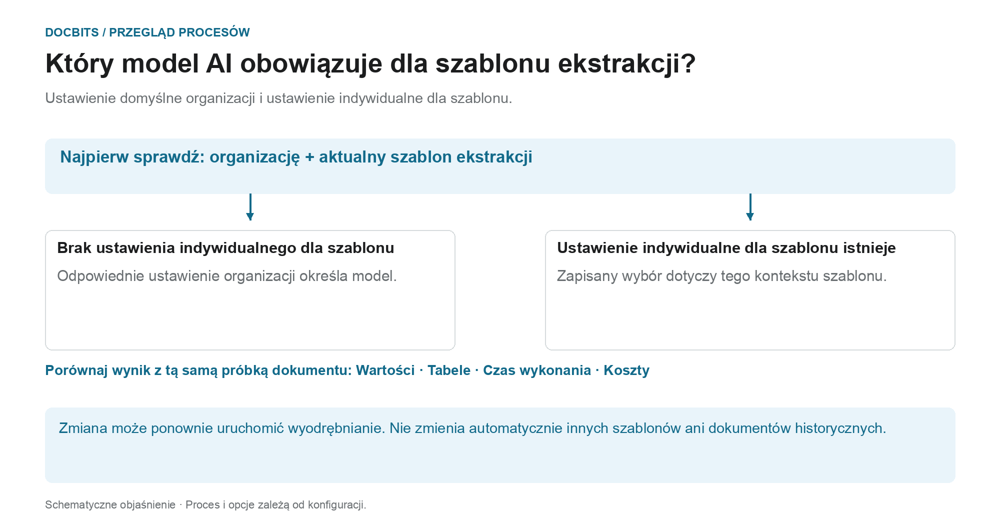

# Wybór modelu AI specyficznego dla dostawcy do ekstrakcji pól i tabel

## Od standardu organizacji do modelu efektywnego

<figure><figcaption>
Domyślne ustawienie organizacji i nadpisanie związane z szablonem ekstrakcji. Schemat jest poglądowy; o rzeczywistym zachowaniu decydują aktywne ustawienia Twojej organizacji.
</figcaption></figure>

Wpis na ekranie walidacji nazywa się modelem AI specyficznym dla dostawcy. Decydujący jest jednak **kontekst bieżącego szablonu ekstrakcji**: nadpisanie jest zapisywane dla organizacji i szablonu ekstrakcji. Jeden dostawca może mieć wiele szablonów ekstrakcji z różnymi ustawieniami.

1. **Ustal kontekst:** przed zmianą modelu sprawdź organizację, dokument i bieżący szablon ekstrakcji.
2. **Sprawdź nadpisanie:** jeśli dla tego szablonu ekstrakcji zapisano model, ten wybór obowiązuje w jego zakresie. Jeśli nadpisania brakuje, obowiązuje odpowiednie ustawienie organizacji.
3. **Potwierdź zmianę świadomie:** wybierz tylko opcję dostępną w Twoim środowisku. Zmiana może wymagać potwierdzenia i ponownie uruchomić ekstrakcję. Samo otwarcie menu nie zmienia wyboru.
4. **Porównaj wyniki:** sprawdź wartości pól, tabele, czas wykonania i koszty na stałej próbce. Inny poziom modelu nie gwarantuje lepszej ekstrakcji, udanej walidacji ani uzgodnienia z zamówieniem.

**Przykład:** dostawca A używa szablonów ekstrakcji „Faktura krajowa” i „Faktura zagraniczna”. Nadpisanie dla „Faktura krajowa” nie zmienia wszystkich faktur tego dostawcy. W przypadku innego dokumentu sprawdź ponownie jego szablon ekstrakcji i obowiązujące ustawienie.

Grafika pokazuje hierarchię wyboru, a nie zalecenie konkretnego poziomu modelu. Informacje o [standardzie organizacji i nadpisaniach](../../../administration-and-setup/settings/document-processing/classification-and-extraction/ai-model.md) oraz diagnostyka [Która ścieżka ekstrakcji została użyta?](../../../overview-and-basics/faq/document-processing/which-extraction-path-was-used.md) pomagają zinterpretować rzeczywisty wynik.

W sekcji narzędzi **ekranu walidacji** możesz wybrać model AI używany do **Field Extraction** i **Table Extraction**.\
Ten punkt wejścia zmienia nadpisanie w kontekście bieżącego szablonu ekstrakcji. Preferencja jest zapisywana dla organizacji i szablonu ekstrakcji (`tfidf_id`); powiązanie z dostawcą nie gwarantuje, że zmieni się każdy szablon ekstrakcji lub dokument historyczny tego dostawcy. Bez nadpisania obowiązuje odpowiednie ustawienie organizacji.

Aby zmienić model, otwórz menu opcji, klikając przycisk **More options** (trzy kropki) po prawej stronie ekranu, a następnie wybierz jeden z dostępnych modeli: 

Menu oferuje obecnie **Full**, **Fast**, **Nexus**, **Nexus Flash**, **Auto** i **Auto Nexus**. Sprawdź bieżące informacje w interfejsie i warunki subskrypcji pod kątem dostępności i kosztów. Nie zakładaj, że jedna opcja jest zawsze najdokładniejsza lub najszybsza ani że każda organizacja domyślnie używa Fast.

Wybór innego modelu może wymagać potwierdzenia i ponownie uruchomić ekstrakcję. Przed potwierdzeniem sprawdź dokument i zakres. Samo otwarcie menu nie zmienia ustawienia; w tych ilustracjach nie wybrano ani nie potwierdzono żadnego modelu.

<figure><figcaption>
Menu opcji dla zilustrowanego kontekstu szablonu ekstrakcji, z syntetyczną fakturą przykładową.
</figcaption></figure>

<figure><figcaption>
Menu rozwijane AI Model z sześcioma opcjami i syntetyczną fakturą przykładową; nie pokazano zmiany modelu.
</figcaption></figure>

Jeśli wyniki ekstrakcji są niezadowalające, porównaj inne dostępne modele na zatwierdzonych dokumentach testowych i sprawdź wyodrębnione wartości, czas przetwarzania i koszty. Zmiana może ponownie przetworzyć dokument i nie gwarantuje poprawy.

Aby skonfigurować **domyślne ustawienie organizacji** lub przejrzeć **nadpisania specyficzne dla szablonu ekstrakcji**, zapoznaj się z odpowiednią dokumentacją [**tutaj**](../../../administration-and-setup/settings/document-processing/classification-and-extraction/ai-model.md).

## Ustawienia i nadpisania

Structured Output ma osobne ustawienie organizacji/szablonu, niezależne od poziomu modelu. Zmień je w More options na dokumencie; potwierdzenie zapisuje nadpisanie i ponownie uruchamia ten dokument. Wskaźniki na liście ustawień są tylko do odczytu. Usunięcie wpisu preferencji może usunąć kilka nadpisań jednocześnie. [Structured Output dla tabel](../ai-table/structured-output.md).
