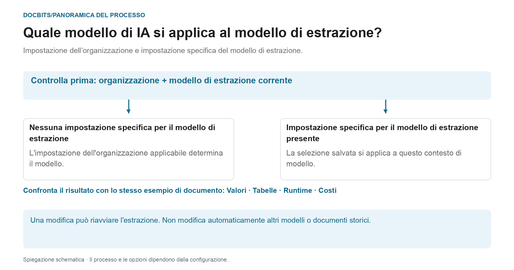

# Selezionare un modello AI specifico del fornitore per l'estrazione di campi e tabelle

## Dallo standard dell'organizzazione al modello effettivo

<figure><figcaption>
Valore predefinito dell'organizzazione e override legato al modello di estrazione. Il diagramma è schematico; le impostazioni attive della tua organizzazione determinano il comportamento reale.
</figcaption></figure>

La voce nella schermata di validazione si chiama modello AI specifico del fornitore. È però decisivo il **contesto del modello di estrazione attuale**: l'override viene salvato per organizzazione e per modello di estrazione. Un fornitore può avere più modelli di estrazione con impostazioni diverse.

1. **Determinare il contesto:** verifica organizzazione, documento e modello di estrazione attuale prima di modificare un modello.
2. **Verificare l'override:** se per questo modello di estrazione è salvato un modello, quella selezione vale nel suo ambito. Se manca un override, vale l'impostazione dell'organizzazione applicabile.
3. **Confermare la modifica in modo consapevole:** seleziona solo un'opzione disponibile nel tuo ambiente. Una modifica può richiedere una conferma e riavviare l'estrazione. Aprire il menu da solo non cambia la selezione.
4. **Confrontare i risultati:** verifica valori dei campi, tabelle, tempo di esecuzione e costi con un campione fisso. Un livello di modello diverso non garantisce un'estrazione migliore, una validazione riuscita o la riconciliazione con gli ordini.

**Esempio:** il fornitore A usa i modelli di estrazione «Fattura nazionale» e «Fattura estera». Un override per «Fattura nazionale» non cambia tutte le fatture di quel fornitore. Per un altro documento, verifica di nuovo il suo modello di estrazione e l'impostazione effettiva.

Il grafico mostra la gerarchia di selezione, non una raccomandazione per un livello di modello specifico. Le informazioni sullo [standard dell'organizzazione e sugli override](../../../administration-and-setup/settings/document-processing/classification-and-extraction/ai-model.md) e la diagnostica [Quale percorso di estrazione è stato usato?](../../../overview-and-basics/faq/document-processing/which-extraction-path-was-used.md) aiutano a inquadrare il risultato reale.

Nella sezione degli strumenti della **schermata di validazione** puoi scegliere il modello AI usato per **Field Extraction** e **Table Extraction**.\
Questo punto di accesso modifica l'override nel contesto del modello di estrazione attuale. La preferenza viene salvata per organizzazione e modello di estrazione (`tfidf_id`); l'associazione al fornitore non garantisce che cambi ogni modello di estrazione o documento storico di quel fornitore. Senza override vale l'impostazione dell'organizzazione applicabile.

Per cambiare modello, apri il menu delle opzioni cliccando sul pulsante **More options** (tre punti) a destra dello schermo, poi scegli uno dei modelli disponibili: 

Il menu offre attualmente **Full**, **Fast**, **Nexus**, **Nexus Flash**, **Auto** e **Auto Nexus**. Verifica le informazioni attuali dell'interfaccia e le condizioni del tuo abbonamento per disponibilità e costi. Non dare per scontato che un'opzione sia sempre la più precisa o la più veloce, né che ogni organizzazione usi Fast per impostazione predefinita.

Selezionare un altro modello può richiedere una conferma e riavviare l'estrazione. Verifica documento e ambito prima di confermare. Aprire il menu da solo non cambia l'impostazione; per queste illustrazioni non è stato selezionato né confermato alcun modello.

<figure><figcaption>
Menu delle opzioni per il contesto del modello di estrazione illustrato, con una fattura di esempio sintetica.
</figcaption></figure>

<figure><figcaption>
Il menu a discesa AI Model con sei opzioni e una fattura di esempio sintetica; non viene mostrato alcun cambio di modello.
</figcaption></figure>

Se i risultati di estrazione non sono soddisfacenti, confronta altri modelli disponibili con documenti di test approvati e verifica i valori estratti, il tempo di elaborazione e i costi. Un cambio può rielaborare un documento e non garantisce un miglioramento.

Per configurare il **valore predefinito dell'organizzazione** o verificare gli **override specifici del modello di estrazione**, consulta la documentazione corrispondente [**qui**](../../../administration-and-setup/settings/document-processing/classification-and-extraction/ai-model.md).

## Impostazioni e override

Structured Output ha un'impostazione di organizzazione/modello separata dal livello di modello. Modificala in More options sul documento; la conferma salva l'override e riavvia quel documento. Gli indicatori nell'elenco delle impostazioni sono di sola lettura. Eliminare una voce di preferenza può rimuovere più override insieme. [Structured Output per le tabelle](../ai-table/structured-output.md).
