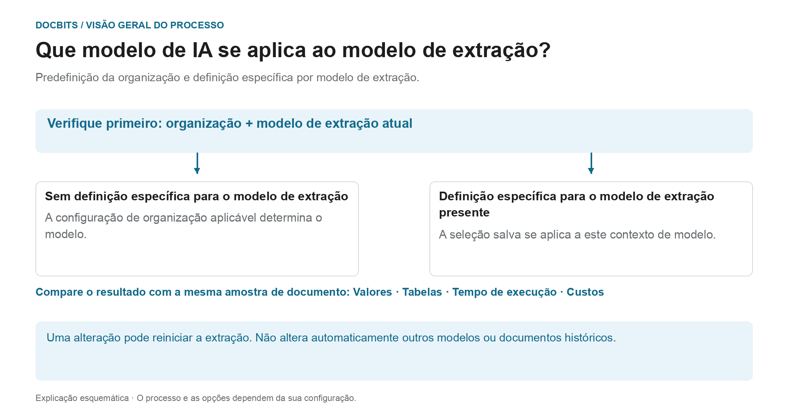

# Selecionar um modelo de IA específico do fornecedor para extração de campos e tabelas

## Do padrão da organização ao modelo efetivo

<figure><figcaption>
Predefinição da organização e sobreposição relacionada com o modelo de extração. O esquema é indicativo; as definições ativas da sua organização determinam o comportamento real.
</figcaption></figure>

A entrada no ecrã de validação chama-se modelo de IA específico do fornecedor. O **contexto do modelo de extração atual** é, no entanto, decisivo: a sobreposição é guardada por organização e por modelo de extração. Um fornecedor pode ter vários modelos de extração com definições diferentes.

1. **Determinar o contexto:** reveja a organização, o documento e o modelo de extração atual antes de alterar um modelo.
2. **Verificar a sobreposição:** se houver um modelo guardado para este modelo de extração, essa seleção aplica-se no seu âmbito. Se faltar a sobreposição, aplica-se a definição da organização aplicável.
3. **Confirmar a alteração de forma consciente:** selecione apenas uma opção disponível no seu ambiente. Uma alteração pode exigir confirmação e voltar a lançar a extração. Abrir o menu por si só não altera a seleção.
4. **Comparar resultados:** verifique os valores dos campos, as tabelas, o tempo de execução e os custos com uma amostra fixa. Um nível de modelo diferente não garante uma extração melhor, uma validação bem-sucedida nem a conciliação com encomendas.

**Exemplo:** o fornecedor A usa os modelos de extração «Fatura nacional» e «Fatura estrangeira». Uma sobreposição para «Fatura nacional» não altera todas as faturas desse fornecedor. Para outro documento, verifique novamente o seu modelo de extração e a definição efetiva.

O gráfico mostra a hierarquia de seleção, não uma recomendação de um nível de modelo específico. As informações sobre o [padrão da organização e as sobreposições](../../../administration-and-setup/settings/document-processing/classification-and-extraction/ai-model.md) e o diagnóstico [Que caminho de extração foi usado?](../../../overview-and-basics/faq/document-processing/which-extraction-path-was-used.md) ajudam a enquadrar o resultado real.

Na secção de ferramentas do **ecrã de validação**, pode escolher o modelo de IA usado para **Field Extraction** e **Table Extraction**.\
Este ponto de entrada altera a sobreposição no contexto do modelo de extração atual. A preferência é guardada por organização e modelo de extração (`tfidf_id`); a associação ao fornecedor não garante que todos os modelos de extração ou documentos históricos desse fornecedor mudem. Sem sobreposição, aplica-se a definição da organização aplicável.

Para alterar o modelo, abra o menu de opções clicando no botão **More options** (três pontos) do lado direito do ecrã e escolha um dos modelos disponíveis: 

O menu oferece atualmente **Full**, **Fast**, **Nexus**, **Nexus Flash**, **Auto** e **Auto Nexus**. Verifique as informações atuais da interface e as condições da sua subscrição para disponibilidade e custos. Não assuma que uma opção é sempre a mais precisa ou a mais rápida, nem que todas as organizações usam Fast por predefinição.

Selecionar outro modelo pode exigir confirmação e reiniciar a extração. Verifique o documento e o âmbito antes de confirmar. Abrir o menu por si só não altera a definição; para estas ilustrações não foi selecionado nem confirmado qualquer modelo.

<figure><figcaption>
Menu de opções para o contexto de modelo de extração ilustrado, com uma fatura de exemplo sintética.
</figcaption></figure>

<figure><figcaption>
O menu pendente AI Model com seis opções e uma fatura de exemplo sintética; não é mostrada qualquer alteração de modelo.
</figcaption></figure>

Se os resultados da extração não forem satisfatórios, compare outros modelos disponíveis com documentos de teste aprovados e verifique os valores extraídos, o tempo de processamento e os custos. Uma mudança pode reprocessar um documento e não garante uma melhoria.

Para configurar a **predefinição da organização** ou rever as **sobreposições específicas do modelo de extração**, consulte a documentação correspondente [**aqui**](../../../administration-and-setup/settings/document-processing/classification-and-extraction/ai-model.md).

## Definições e sobreposições

O Structured Output tem uma definição de organização/modelo separada do nível de modelo. Altere-a em More options no documento; a confirmação guarda a sobreposição e reinicia esse documento. Os indicadores na lista de definições são só de leitura. Eliminar uma entrada de preferência pode remover várias sobreposições de uma vez. [Structured Output para tabelas](../ai-table/structured-output.md).
