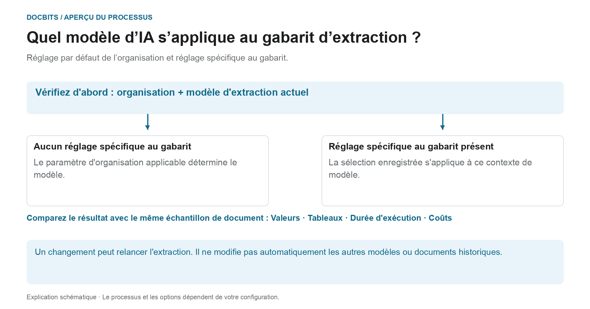

# Choisir un modèle d'IA spécifique au fournisseur pour l'extraction des champs et des tableaux

## Du standard de l'organisation au modèle effectif

<figure><figcaption>
Valeur par défaut de l'organisation et surcharge liée au modèle d'extraction. Le schéma est indicatif ; les paramètres actifs de votre organisation déterminent le comportement réel.
</figcaption></figure>

L'entrée de l'écran de validation s'appelle le modèle d'IA spécifique au fournisseur. Le **contexte du modèle d'extraction actuel** est toutefois déterminant : la surcharge est enregistrée par organisation et par modèle d'extraction. Un fournisseur peut avoir plusieurs modèles d'extraction avec des paramètres différents.

1. **Déterminer le contexte :** vérifiez l'organisation, le document et le modèle d'extraction actuel avant de modifier un modèle.
2. **Vérifier la surcharge :** si un modèle est enregistré pour ce modèle d'extraction, cette sélection s'applique dans son périmètre. Si la surcharge manque, le paramètre d'organisation applicable s'applique.
3. **Confirmer le changement en connaissance de cause :** ne sélectionnez qu'une option disponible dans votre environnement. Un changement peut demander une confirmation et relancer l'extraction. Ouvrir le menu seul ne modifie pas la sélection.
4. **Comparer les résultats :** vérifiez les valeurs de champs, les tableaux, le temps d'exécution et les coûts avec un échantillon fixe. Un autre niveau de modèle ne garantit pas une meilleure extraction, une validation réussie ni un rapprochement avec les commandes.

**Exemple :** le fournisseur A utilise les modèles d'extraction « Facture nationale » et « Facture étrangère ». Une surcharge pour « Facture nationale » ne modifie pas toutes les factures de ce fournisseur. Pour un autre document, vérifiez à nouveau son modèle d'extraction et le paramètre effectif.

Le graphique montre la hiérarchie de sélection, pas une recommandation pour un niveau de modèle précis. Les informations sur le [standard de l'organisation et les surcharges](../../../administration-and-setup/settings/document-processing/classification-and-extraction/ai-model.md) et le diagnostic [Quel chemin d'extraction a été utilisé ?](../../../overview-and-basics/faq/document-processing/which-extraction-path-was-used.md) aident à interpréter le résultat réel.

Dans la section des outils de l'**écran de validation**, vous pouvez choisir le modèle d'IA utilisé pour **Field Extraction** et **Table Extraction**.\
Ce point d'entrée modifie la surcharge du contexte du modèle d'extraction actuel. La préférence est enregistrée par organisation et par modèle d'extraction (`tfidf_id`) ; l'association au fournisseur ne garantit pas que chaque modèle d'extraction ou document historique de ce fournisseur change. Sans surcharge, le paramètre d'organisation applicable est utilisé.

Pour changer de modèle, ouvrez le menu d'options en cliquant sur le bouton **More options** (trois points) à droite de l'écran, puis choisissez l'un des modèles disponibles : 

Le menu propose actuellement **Full**, **Fast**, **Nexus**, **Nexus Flash**, **Auto** et **Auto Nexus**. Vérifiez les informations actuelles de l'interface et les conditions de votre abonnement pour la disponibilité et les coûts. Ne partez pas du principe qu'une option est toujours la plus précise ou la plus rapide, ni que chaque organisation utilise Fast par défaut.

Sélectionner un autre modèle peut demander une confirmation et redémarrer l'extraction. Vérifiez le document et le périmètre avant de confirmer. Ouvrir le menu seul ne modifie pas le paramètre ; aucun modèle n'a été sélectionné ni confirmé pour ces illustrations.

<figure><figcaption>
Menu d'options pour le contexte de modèle d'extraction illustré, avec une facture d'exemple synthétique.
</figcaption></figure>

<figure><figcaption>
Le menu déroulant AI Model avec six options et une facture d'exemple synthétique ; aucun changement de modèle n'est montré.
</figcaption></figure>

Si les résultats d'extraction ne sont pas satisfaisants, comparez d'autres modèles disponibles avec des documents de test approuvés et vérifiez les valeurs extraites, le temps de traitement et les coûts. Un changement peut retraiter un document et ne garantit pas une amélioration.

Pour configurer la **valeur par défaut de l'organisation** ou examiner les **surcharges spécifiques au modèle d'extraction**, consultez la documentation correspondante [**ici**](../../../administration-and-setup/settings/document-processing/classification-and-extraction/ai-model.md).

## Paramètres et surcharges

Structured Output a un paramètre d'organisation/de modèle distinct du niveau de modèle. Modifiez-le dans More options sur le document ; la confirmation enregistre la surcharge et redémarre ce document. Les indicateurs de la liste des paramètres sont en lecture seule. Supprimer une entrée de préférence peut retirer plusieurs surcharges à la fois. [Structured Output pour les tableaux](../ai-table/structured-output.md).
