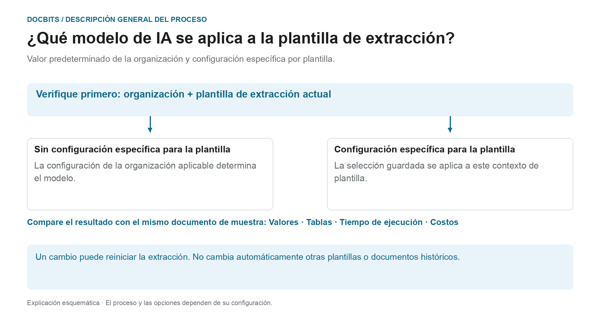

# Seleccionar un modelo de IA específico del proveedor para la extracción de campos y tablas

## Del estándar de la organización al modelo efectivo

<figure><figcaption>
Valor predeterminado de la organización y anulación relacionada con la plantilla. El diagrama es esquemático; los ajustes activos de su organización determinan el comportamiento real.
</figcaption></figure>

La entrada de la pantalla de validación se llama modelo de IA específico del proveedor. Sin embargo, el **contexto de la plantilla de extracción actual** es decisivo: la anulación se guarda por organización y por plantilla. Un proveedor puede tener varias plantillas con ajustes distintos.

1. **Determinar el contexto:** revise la organización, el documento y la plantilla de extracción actual antes de modificar un modelo.
2. **Comprobar la anulación:** si hay un modelo guardado para esta plantilla, esa selección se aplica en su ámbito. Si falta la anulación, se aplica el ajuste de organización correspondiente.
3. **Confirmar el cambio de forma consciente:** seleccione solo una opción disponible en su entorno. Un cambio puede requerir confirmación y volver a lanzar la extracción. Abrir el menú por sí solo no cambia la selección.
4. **Comparar resultados:** compruebe los valores de campo, las tablas, el tiempo de ejecución y los costes con una muestra fija. Un nivel de modelo distinto no garantiza una mejor extracción, una validación correcta ni la conciliación con pedidos.

**Ejemplo:** el proveedor A usa las plantillas «Factura nacional» y «Factura extranjera». Una anulación para «Factura nacional» no cambia todas las facturas de ese proveedor. Para otro documento, compruebe de nuevo su plantilla y el ajuste efectivo.

El gráfico muestra la jerarquía de selección, no una recomendación de un nivel de modelo concreto. La información sobre el [estándar de la organización y las anulaciones](../../../administration-and-setup/settings/document-processing/classification-and-extraction/ai-model.md) y el diagnóstico [¿Qué ruta de extracción se ha usado?](../../../overview-and-basics/faq/document-processing/which-extraction-path-was-used.md) ayudan a clasificar el resultado real.

En la sección de herramientas de la **pantalla de validación** puede elegir el modelo de IA que se usa para **Field Extraction** y **Table Extraction**.\
Este punto de entrada cambia la anulación del contexto de la plantilla de extracción actual. La preferencia se guarda por organización y plantilla (`tfidf_id`); la asociación de proveedor no garantiza que cambien todas las plantillas ni los documentos históricos de ese proveedor. Sin anulación, se aplica el ajuste de organización correspondiente.

Para cambiar el modelo, abra el menú de opciones haciendo clic en el botón **More options** (tres puntos) a la derecha de la pantalla y elija uno de los modelos disponibles: 

El menú ofrece actualmente **Full**, **Fast**, **Nexus**, **Nexus Flash**, **Auto** y **Auto Nexus**. Consulte la información actual de la interfaz y las condiciones de su suscripción para disponibilidad y costes. No dé por hecho que una opción es siempre la más precisa o la más rápida, ni que todas las organizaciones usan Fast de forma predeterminada.

Seleccionar otro modelo puede requerir confirmación y reiniciar la extracción. Compruebe el documento y el ámbito antes de confirmar. Abrir el menú por sí solo no cambia el ajuste; para estas ilustraciones no se ha seleccionado ni confirmado ningún modelo.

<figure><figcaption>
Menú de opciones para el contexto de plantilla de extracción ilustrado, con una factura de ejemplo sintética.
</figcaption></figure>

<figure><figcaption>
El desplegable AI Model con seis opciones y una factura de ejemplo sintética; no se muestra ningún cambio de modelo.
</figcaption></figure>

Si los resultados de extracción no son satisfactorios, compare otros modelos disponibles con documentos de prueba aprobados y compruebe los valores extraídos, el tiempo de procesamiento y los costes. Un cambio puede reprocesar un documento y no garantiza una mejora.

Para configurar el **valor predeterminado de la organización** o revisar las **anulaciones específicas de plantilla**, consulte la documentación correspondiente [**aquí**](../../../administration-and-setup/settings/document-processing/classification-and-extraction/ai-model.md).

## Ajustes y anulaciones

Structured Output tiene un ajuste de organización/plantilla propio, separado del nivel de modelo. Cámbielo en More options del documento; la confirmación guarda la anulación y reinicia ese documento. Los indicadores de la lista de ajustes son de solo lectura. Eliminar una entrada de preferencia puede quitar varias anulaciones a la vez. [Structured Output para tablas](../ai-table/structured-output.md).
