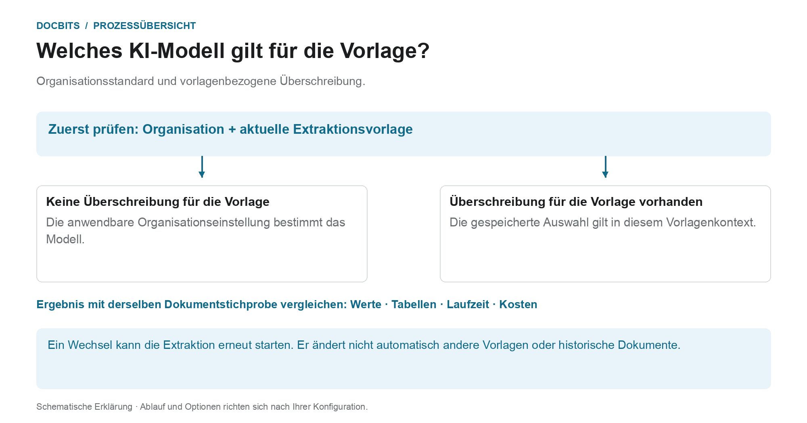
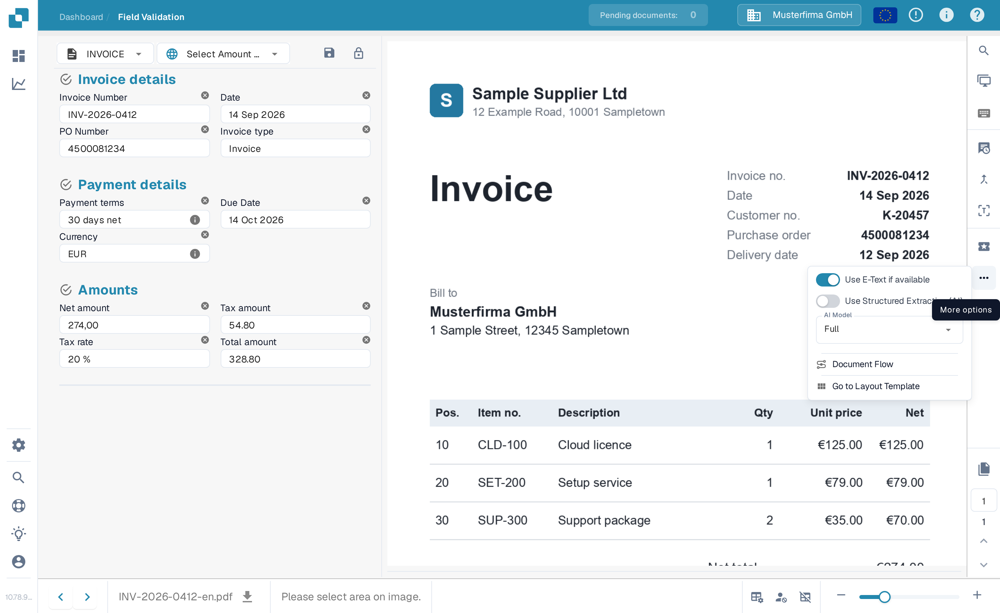
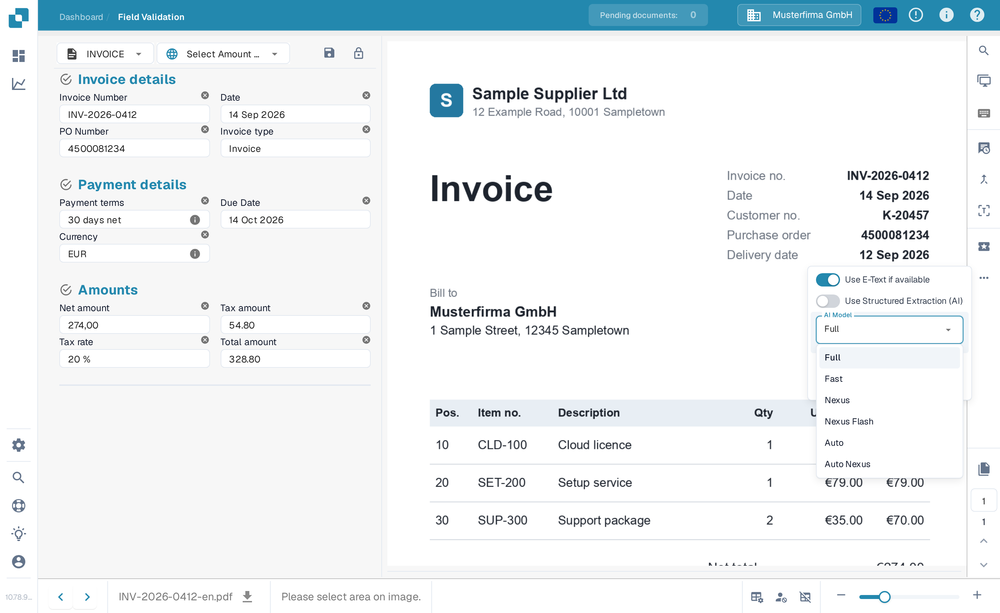

# Lieferantenspezifisches KI-Modell für Feld- und Tabellenextraktion

## Vom Organisationsstandard zum wirksamen Modell

<figure><figcaption>
Organisationsstandard und vorlagenbezogene Überschreibung. Die Grafik ist schematisch; maßgeblich sind die aktiven Einstellungen Ihrer Organisation.
</figcaption></figure>

Der Einstieg im Validierungsbildschirm heißt lieferantenspezifisches KI-Modell. Entscheidend ist jedoch der **aktuelle Extraktionsvorlagen-Kontext**: Die Überschreibung wird je Organisation und Vorlage gespeichert. Ein Lieferant kann mehrere Vorlagen mit unterschiedlichen Einstellungen haben.

1. **Kontext feststellen:** Prüfen Sie Organisation, Dokument und aktuelle Extraktionsvorlage, bevor Sie ein Modell ändern.
2. **Überschreibung prüfen:** Ist für diese Vorlage ein Modell hinterlegt, wirkt diese Auswahl in ihrem Geltungsbereich. Fehlt eine Überschreibung, gilt die anwendbare Organisationseinstellung.
3. **Änderung bewusst bestätigen:** Wählen Sie nur eine in Ihrer Umgebung verfügbare Option. Ein Wechsel kann eine Bestätigung erfordern und eine erneute Extraktion auslösen. Das Öffnen des Menüs allein verändert die Auswahl nicht.
4. **Ergebnis vergleichen:** Prüfen Sie mit einer festen Stichprobe die Feldwerte, Tabellen, Laufzeit und Kosten. Eine andere Modellstufe garantiert weder eine bessere Extraktion noch eine erfolgreiche Validierung oder einen PO-Abgleich.

**Beispiel:** Lieferant A verwendet die Vorlagen „Rechnung Inland“ und „Rechnung Ausland“. Eine Überschreibung für „Rechnung Inland“ ist keine pauschale Umstellung aller Rechnungen dieses Lieferanten. Kontrollieren Sie bei einem weiteren Dokument deshalb dessen Vorlage und wirksame Einstellung erneut.

Die Grafik zeigt die Auswahlhierarchie, keine Empfehlung für eine bestimmte Modellstufe. Informationen zum [Organisationsstandard und zu den Überschreibungen](../../../administration-and-setup/settings/document-processing/classification-and-extraction/ai-model.md) sowie die Diagnose [Welcher Extraktionspfad wurde verwendet?](../../../overview-and-basics/faq/document-processing/which-extraction-path-was-used.md) helfen bei der Einordnung des tatsächlichen Ergebnisses.

Im Werkzeugbereich des **Validierungsbildschirms** können Sie das KI-Modell für die **Feldextraktion** und die **Tabellenextraktion** auswählen.\
Dieser Einstieg ändert die Überschreibung im aktuellen Extraktionsvorlagen-Kontext. Die Präferenz wird je Organisation und Vorlage (`tfidf_id`) gespeichert; die Lieferantenzuordnung garantiert nicht, dass sich jede Vorlage oder jedes historische Dokument dieses Lieferanten ändert. Ohne Überschreibung gilt die anwendbare Organisationseinstellung.

Um das Modell zu ändern, öffnen Sie das Optionsmenü, indem Sie auf die Schaltfläche **More options** (drei Punkte) auf der rechten Seite des Bildschirms klicken, und wählen Sie dann eines der verfügbaren Modelle: 

Das Menü bietet derzeit **Full**, **Fast**, **Nexus**, **Nexus Flash**, **Auto** und **Auto Nexus**. Verfügbarkeit und Kosten entnehmen Sie den aktuellen Angaben der Oberfläche und Ihren Vertragsbedingungen. Gehen Sie nicht davon aus, dass eine Option immer die genaueste oder schnellste ist oder dass jede Organisation standardmäßig Fast verwendet.

Die Auswahl eines anderen Modells kann eine Bestätigung erfordern und die Extraktion neu starten. Prüfen Sie Dokument und Geltungsbereich vor dem Bestätigen. Das bloße Öffnen des Menüs ändert die Einstellung nicht; für diese Abbildungen wurde kein Modell ausgewählt oder bestätigt.

<figure><figcaption>
Optionsmenü für den dargestellten Extraktionsvorlagen-Kontext anhand einer synthetischen Beispielrechnung.
</figcaption></figure>

<figure><figcaption>
Das Dropdown AI Model mit sechs Optionen und einer synthetischen Beispielrechnung; es wird kein Modellwechsel gezeigt.
</figcaption></figure>

Sind die Extraktionsergebnisse unbefriedigend, vergleichen Sie andere verfügbare Modelle mit freigegebenen Testdokumenten und prüfen Sie die extrahierten Werte, die Verarbeitungszeit und die Kosten. Ein Wechsel kann ein Dokument erneut verarbeiten und garantiert keine Verbesserung.

Um den **Organisationsstandard** zu konfigurieren oder **vorlagenbezogene Überschreibungen** zu prüfen, lesen Sie bitte die entsprechende Dokumentation [**hier**](../../../administration-and-setup/settings/document-processing/classification-and-extraction/ai-model.md).

## Einstellungen und Überschreibungen

Structured Output hat eine eigene Organisations-/Vorlageneinstellung, getrennt von der Modellstufe. Ändern Sie sie unter More options am Dokument; die Bestätigung speichert die Überschreibung und startet dieses Dokument neu. Die Anzeigen in der Einstellungsliste sind schreibgeschützt. Das Löschen eines Präferenzeintrags kann mehrere Überschreibungen zugleich entfernen. [Structured Output für Tabellen](../ai-table/structured-output.md).
