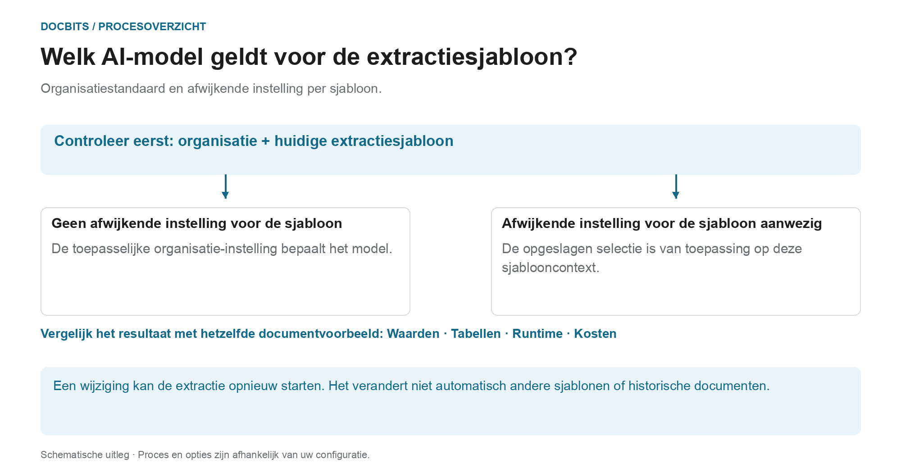

# Een leveranciersspecifiek AI-model kiezen voor veld- en tabelextractie

## Van organisatiestandaard naar werkelijk model

<figure><figcaption>
Organisatiestandaard en sjabloongerelateerde override. Het diagram is schematisch; de actieve instellingen van uw organisatie bepalen het werkelijke gedrag.
</figcaption></figure>

De ingang in het validatiescherm heet het leveranciersspecifieke AI-model. Bepalend is echter de **context van het huidige extractiesjabloon**: de override wordt per organisatie en sjabloon opgeslagen. Een leverancier kan meerdere sjablonen met verschillende instellingen hebben.

1. **Stel de context vast:** bekijk de organisatie, het document en het huidige extractiesjabloon voordat u een model wijzigt.
2. **Controleer de override:** is voor dit sjabloon een model opgeslagen, dan geldt die selectie binnen dat bereik. Ontbreekt een override, dan geldt de toepasselijke organisatie-instelling.
3. **Bevestig de wijziging bewust:** kies alleen een optie die in uw omgeving beschikbaar is. Een wijziging kan een bevestiging vereisen en de extractie opnieuw starten. Alleen het menu openen verandert de selectie niet.
4. **Vergelijk resultaten:** controleer veldwaarden, tabellen, looptijd en kosten met een vaste steekproef. Een ander modelniveau garandeert geen betere extractie, geen geslaagde validatie en geen PO-afstemming.

**Voorbeeld:** leverancier A gebruikt de sjablonen 'Binnenlandse factuur' en 'Buitenlandse factuur'. Een override voor 'Binnenlandse factuur' verandert niet alle facturen van die leverancier. Controleer bij een ander document opnieuw het sjabloon en de geldende instelling.

De afbeelding toont de selectiehiërarchie, geen aanbeveling voor een bepaald modelniveau. Informatie over de [organisatiestandaard en overrides](../../../administration-and-setup/settings/document-processing/classification-and-extraction/ai-model.md) en de diagnose [Welk extractiepad is gebruikt?](../../../overview-and-basics/faq/document-processing/which-extraction-path-was-used.md) helpen het werkelijke resultaat te plaatsen.

In het gereedschapsgedeelte van het **validatiescherm** kunt u het AI-model kiezen dat voor **Field Extraction** en **Table Extraction** wordt gebruikt.\
Deze ingang wijzigt de override voor de context van het huidige extractiesjabloon. De voorkeur wordt per organisatie en sjabloon (`tfidf_id`) opgeslagen; de leverancierskoppeling garandeert niet dat elk sjabloon of historisch document van die leverancier verandert. Zonder override geldt de toepasselijke organisatie-instelling.

Om het model te wijzigen opent u het optiemenu met de knop **More options** (drie puntjes) aan de rechterkant van het scherm en kiest u een van de beschikbare modellen: 

Het menu biedt momenteel **Full**, **Fast**, **Nexus**, **Nexus Flash**, **Auto** en **Auto Nexus**. Controleer de actuele informatie in de interface en uw abonnementsvoorwaarden voor beschikbaarheid en kosten. Ga er niet van uit dat één optie altijd het nauwkeurigst of snelst is, of dat elke organisatie standaard Fast gebruikt.

Een ander model kiezen kan een bevestiging vereisen en de extractie opnieuw starten. Controleer het document en het bereik voordat u bevestigt. Alleen het menu openen verandert de instelling niet; voor deze afbeeldingen is geen model geselecteerd of bevestigd.

<figure><figcaption>
Optiemenu voor de getoonde context van het extractiesjabloon, met een synthetische voorbeeldfactuur.
</figcaption></figure>

<figure><figcaption>
De dropdown AI Model met zes opties en een synthetische voorbeeldfactuur; er is geen modelwijziging te zien.
</figcaption></figure>

Zijn de extractieresultaten onbevredigend, vergelijk dan andere beschikbare modellen met goedgekeurde testdocumenten en controleer de geëxtraheerde waarden, de verwerkingstijd en de kosten. Een wissel kan een document opnieuw verwerken en garandeert geen verbetering.

Om de **organisatiestandaard** in te stellen of **sjabloonspecifieke overrides** te bekijken, raadpleegt u de bijbehorende documentatie [**hier**](../../../administration-and-setup/settings/document-processing/classification-and-extraction/ai-model.md).

## Instellingen en overrides

Structured Output heeft een eigen organisatie-/sjablooninstelling, los van het modelniveau. Wijzig die onder More options bij het document; bevestiging slaat de override op en start dat document opnieuw. De indicatoren in de instellingenlijst zijn alleen-lezen. Het verwijderen van een voorkeursitem kan meerdere overrides tegelijk weghalen. [Structured Output voor tabellen](../ai-table/structured-output.md).
