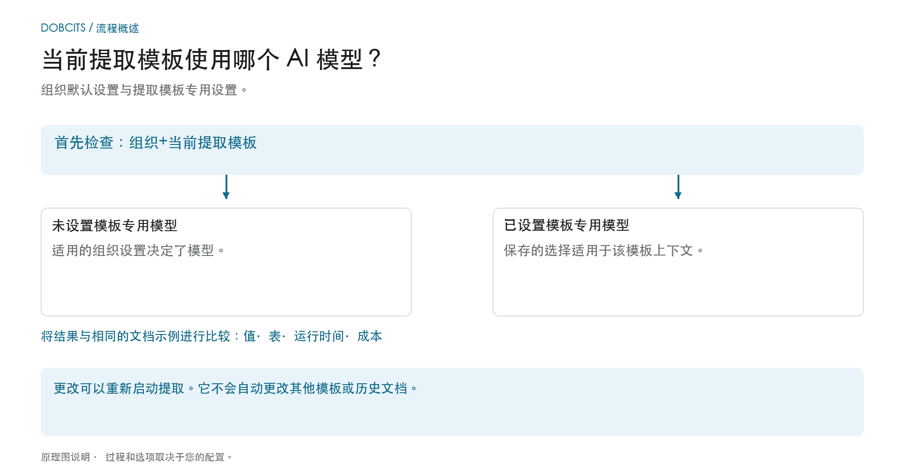

# 为字段和表格抽取选择供应商特定的 AI 模型

## 从组织标准到实际生效的模型

<figure><figcaption>
组织默认值和与模板相关的覆盖项。示意图仅为说明；实际行为由您组织的当前设置决定。
</figcaption></figure>

校验屏幕中的入口称为供应商特定的 AI 模型。但**当前抽取模板上下文**是决定性的：覆盖项按组织和模板保存。一个供应商可以有多个模板，且设置各不相同。

1. **确定上下文：** 修改模型前，先查看组织、文档和当前抽取模板。
2. **检查覆盖项：** 如果该模板存有模型，则该选择在其范围内生效。如果缺少覆盖项，则适用相应的组织设置。
3. **有意识地确认更改：** 只选择您所在环境中可用的选项。更改可能需要确认并重新触发抽取。仅打开菜单不会改变选择。
4. **比较结果：** 用固定样本检查字段值、表格、运行时间和费用。不同的模型层级并不保证更好的抽取、成功的校验或 PO 匹配。

**示例：** 供应商 A 使用「国内发票」和「国外发票」两个模板。为「国内发票」设置的覆盖项不会改变该供应商的所有发票。处理另一个文档时，请再次检查其模板和实际生效的设置。

该图展示的是选择层级，而不是对某个特定模型层级的推荐。关于[组织标准与覆盖项](../../../administration-and-setup/settings/document-processing/classification-and-extraction/ai-model.md)的信息以及[使用了哪条抽取路径？](../../../overview-and-basics/faq/document-processing/which-extraction-path-was-used.md)诊断有助于判断实际结果。

在 **Validation screen** 的工具部分，您可以选择用于 **Field Extraction** 和 **Table Extraction** 的 AI 模型。\
该入口会更改当前抽取模板上下文中的覆盖项。偏好按组织和模板（`tfidf_id`）保存；供应商关联并不保证该供应商的每个模板或历史文档都会随之改变。没有覆盖项时，适用相应的组织设置。

要更改模型，点击屏幕右侧的 **More options**（三个点）按钮打开选项菜单，然后选择可用的模型之一： 

菜单目前提供 **Full**、**Fast**、**Nexus**、**Nexus Flash**、**Auto** 和 **Auto Nexus**。请查看当前的界面信息和订阅条款以确认可用性和费用。不要假设某个选项总是最准确或最快的，也不要假设每个组织都默认使用 Fast。

选择其他模型可能需要确认并重新开始抽取。确认前请检查文档和范围。仅打开菜单不会改变设置；这些插图未选择或确认任何模型。

<figure><figcaption>
所示抽取模板上下文的选项菜单，使用合成示例发票。
</figcaption></figure>

<figure><figcaption>
AI Model 下拉菜单，包含六个选项和一张合成示例发票；未显示任何模型更改。
</figcaption></figure>

如果抽取结果不理想，请使用经批准的测试文档比较其他可用模型，并检查抽取的值、处理时间和费用。切换可能会重新处理文档，且不保证改善。

要配置**组织默认值**或查看**模板特定的覆盖项**，请参阅相应文档[**此处**](../../../administration-and-setup/settings/document-processing/classification-and-extraction/ai-model.md)。

## 设置与覆盖项

Structured Output 有独立的组织/模板设置，与模型层级分开。请在文档上的 More options 中更改；确认后会保存覆盖项并重新启动该文档。设置列表中的指示器为只读。删除偏好条目可能同时移除多个覆盖项。[表格的 Structured Output](../ai-table/structured-output.md)。
