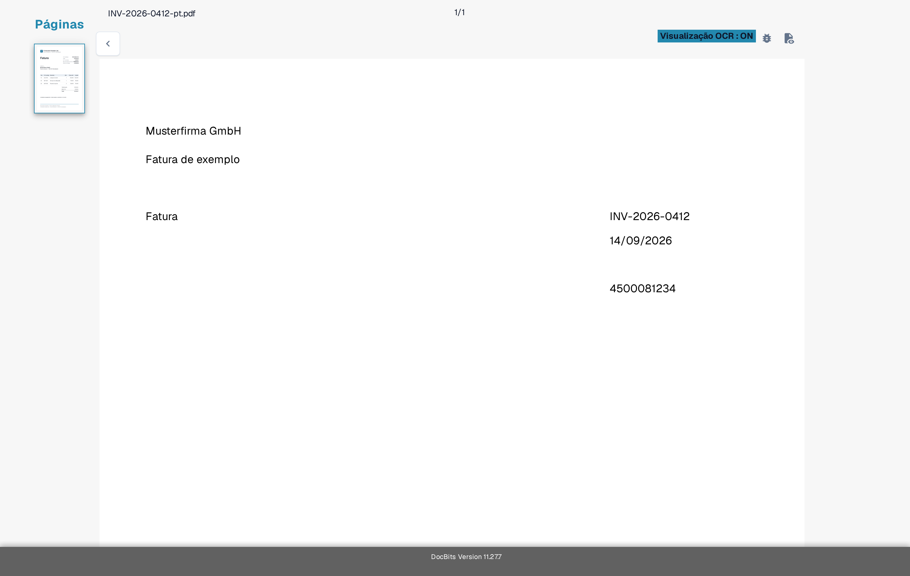
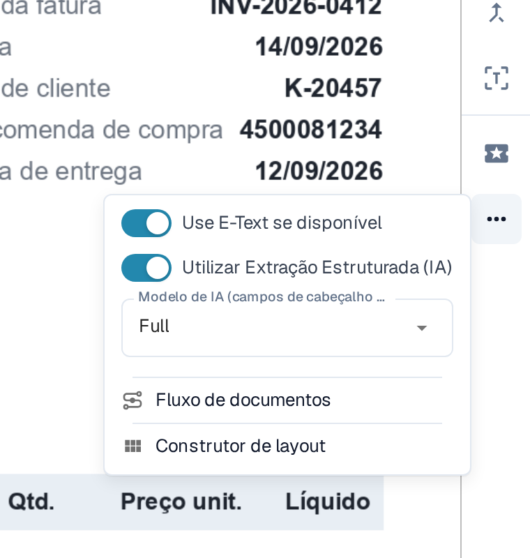
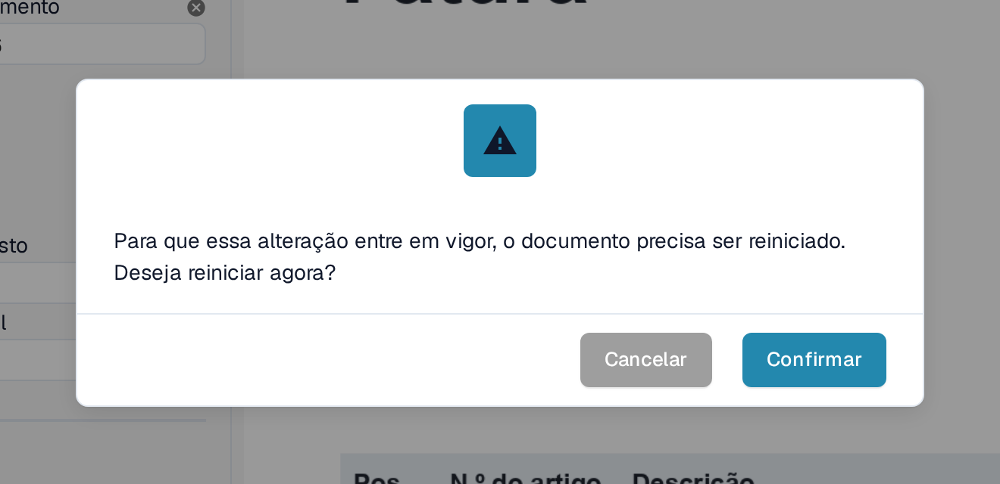
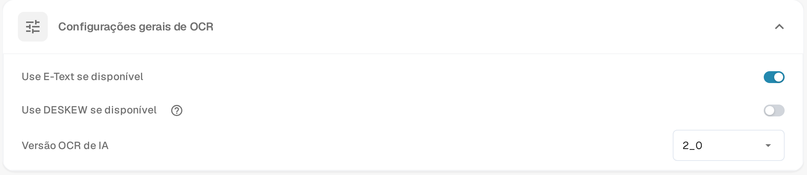

# Texto Ausente na Extração de OCR

Se o texto está visível num documento mas um campo não pode ser extraído, verifique primeiro se o DocBits reconheceu esse texto. Uma imagem digitalizada e o texto incorporado de um PDF podem dar resultados diferentes. Não altere uma regra de extração antes de saber que texto está disponível.

## Verificar a visualização OCR

1. Abra o documento em **Validação De Campo**.
2. Na barra de ferramentas à direita, selecione o ícone **Visualização OCR**. A visualização OCR abre num novo separador do navegador.
3. Procure a palavra ou o número em falta no texto reconhecido que aparece sobreposto à página. Se não aparecer, a extração de campos não o consegue obter dessa camada de texto. Se aparecer, verifique antes o mapeamento do campo.

<figure><figcaption>
Compare o texto do documento com as palavras mostradas na Visualização OCR: aqui foram reconhecidos o fornecedor Musterfirma GmbH, o título Fatura, o número da fatura INV-2026-0412, a data 14/09/2026 e o número 4500081234. Este exemplo mostra texto reconhecido, não uma extração falhada.
</figcaption></figure>

## Experimentar OCR em vez de E-Text incorporado para um fornecedor

Quando **Use E-Text se disponível** está ativo, o DocBits pode usar o texto já incorporado no PDF. O texto que existe apenas dentro de uma imagem pode faltar nessa camada. Para um fornecedor cujos documentos têm este problema:

1. Abra um documento desse fornecedor em **Validação De Campo**.
2. Selecione o botão de três pontos na barra de ferramentas à direita.
3. Desative **Use E-Text se disponível**.
4. Leia o aviso de reinício e selecione **Confirmar** para guardar a alteração e processar novamente o documento. Selecione **Cancelar** para manter a definição inalterada.
5. Abra novamente a **Visualização OCR** depois do processamento e verifique se o texto em falta aparece.

<figure><figcaption>
A opção E-Text do fornecedor está no menu de três pontos do ecrã de validação e ainda está ativa; no passo 3 desativa-a.
</figcaption></figure>

<figure><figcaption>
Confirmar reinicia o processamento do documento aberto, para que a definição E-Text do fornecedor passe a aplicar-se.
</figcaption></figure>

O menu de três pontos contém também entradas para outras tarefas: **Utilizar Extração Estruturada (IA)** e **Modelo de IA (campos de cabeçalho e tabela)** estão descritos em [Selecionar um modelo de IA específico do fornecedor para extração de campos e tabelas](../supplier-specific-ai-model-for-field-and-table-extraction.md). O que **Fluxo de documentos** mostra está explicado em [Fluxo do documento](../../dashboard/document-flow.md); **Construtor de layout** abre o [Construtor de Layouts](../../../../administration-and-setup/setup/document-types/layout-builder.md).

## Alterar a definição predefinida da organização

Um administrador pode abrir **Configurações → Processamento de documentos → Configurações de OCR → Configurações gerais de OCR** e desativar **Use E-Text se disponível** para a organização. Isto altera a predefinição para processamentos posteriores; verifique e processe novamente os documentos já afetados em separado. Consulte [Configurações OCR](../../../../administration-and-setup/settings/document-processing/ocr-settings.md) para os restantes controlos de OCR.

<figure><figcaption>
Utilize a definição da organização quando o problema afeta documentos de vários fornecedores.
</figcaption></figure>

Se o texto continuar ausente depois de processar novamente, verifique a qualidade da digitalização e contacte o administrador do DocBits ou o suporte, indicando o ID do documento e o número da página. Não envie um documento sensível num pedido de suporte público.
