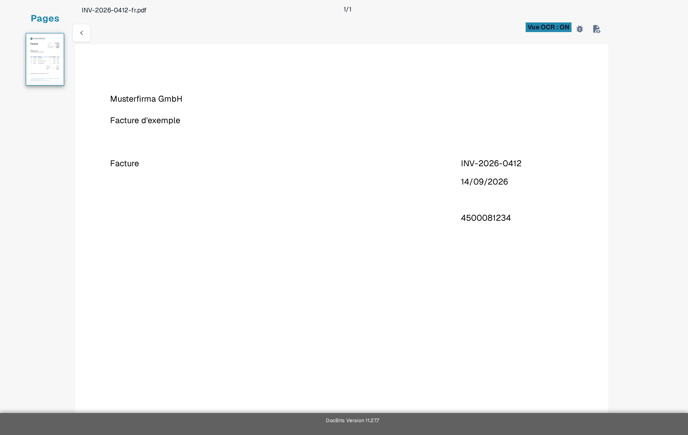
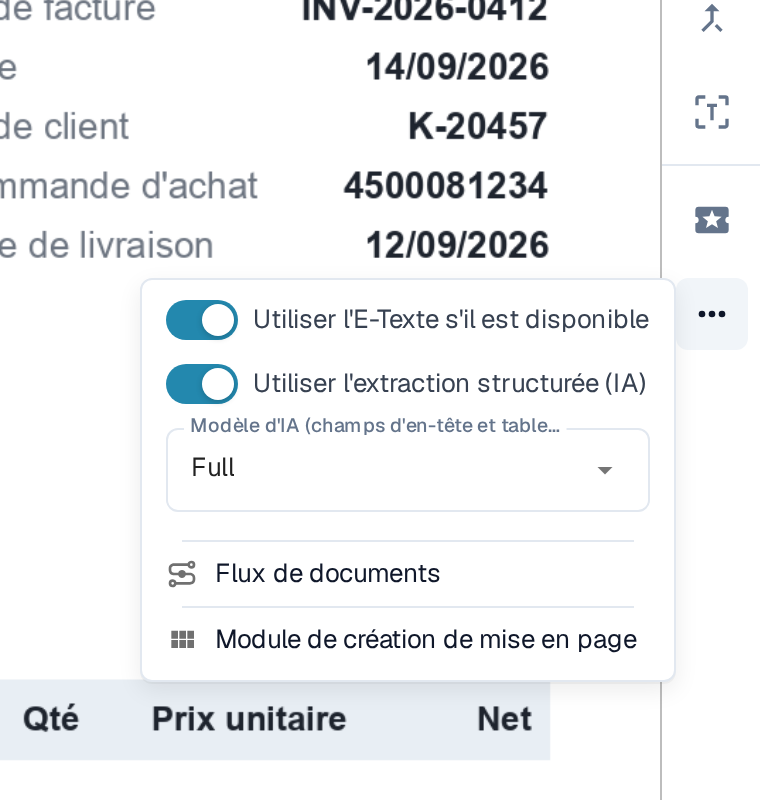
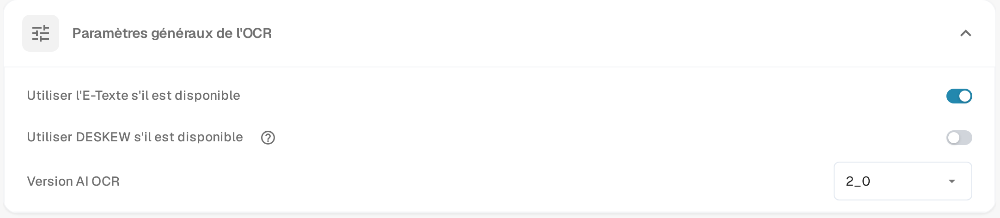

# Texte manquant dans l'extraction OCR

Si du texte est visible sur un document mais qu'un champ ne peut pas être extrait, vérifiez d'abord si DocBits a reconnu ce texte. Une image numérisée et le texte intégré à un PDF peuvent donner des résultats différents. Ne modifiez pas une règle d'extraction avant de savoir quel texte est disponible.

## Vérifier la vue OCR

1. Ouvrez le document dans **Validation des champs**.
2. Dans la barre d'outils de droite, sélectionnez l'icône **Vue OCR**. La vue OCR s'ouvre dans un nouvel onglet du navigateur.
3. Recherchez le mot ou le nombre manquant dans le texte reconnu affiché par-dessus la page. S'il est absent, l'extraction du champ ne peut pas le prendre dans cette couche de texte. S'il est présent, vérifiez plutôt le mappage du champ.

<figure><figcaption>
Comparez le texte du document avec les mots affichés dans la vue OCR : ici le fournisseur Musterfirma GmbH, le titre Facture, le numéro de facture INV-2026-0412 et la date 14/09/2026 sont reconnus comme texte. Cet exemple montre une facture fictive avec du texte reconnu, pas une extraction en échec.
</figcaption></figure>

## Essayer l'OCR au lieu de l'E-Texte intégré pour un fournisseur

Lorsque **Utiliser l'E-Texte s'il est disponible** est activé, DocBits peut utiliser le texte déjà intégré au PDF. Un texte qui n'existe que dans une image peut manquer dans cette couche. Pour un fournisseur dont les documents présentent ce problème :

1. Ouvrez un document de ce fournisseur dans **Validation des champs**.
2. Sélectionnez **Plus d'options** (trois points) dans la barre d'outils de droite.
3. Désactivez **Utiliser l'E-Texte s'il est disponible**.
4. Lisez l'invite de redémarrage et sélectionnez **Confirmer** pour enregistrer la modification et retraiter le document. Sélectionnez **Annuler** pour laisser le paramètre inchangé.
5. Rouvrez **Vue OCR** après le traitement et vérifiez si le texte manquant apparaît.

<figure><figcaption>
L'interrupteur E-Texte du fournisseur se trouve dans Plus d'options de la validation des champs et il est encore activé ici ; à l'étape 3, vous le désactivez.
</figcaption></figure>

<figure><figcaption>
Confirmer relance le traitement du document ouvert pour que le paramètre du fournisseur s'applique.
</figcaption></figure>

Le menu **Plus d'options** contient d'autres entrées qui concernent d'autres tâches : **Utiliser l'extraction structurée (IA)** et **Modèle d'IA (champs d'en-tête et tableau)** sont décrits dans [Modèle d'IA spécifique au fournisseur pour l'extraction des champs et des tableaux](../supplier-specific-ai-model-for-field-and-table-extraction.md). Ce que montre **Flux de documents** est expliqué dans [Flux du document](../../dashboard/document-flow.md) ; **Module de création de mise en page** ouvre l'[Éditeur de mise en page](../../../../administration-and-setup/setup/document-types/layout-builder.md).

## Modifier la valeur par défaut de l'organisation

Un administrateur peut ouvrir **Paramètres → Traitement des documents → Paramètres de l'OCR → Paramètres généraux de l'OCR** et désactiver **Utiliser l'E-Texte s'il est disponible** pour l'organisation. Cela modifie la valeur par défaut des traitements suivants ; vérifiez et retraitez séparément les documents déjà concernés. Les autres réglages OCR sont décrits dans [Paramètres OCR](../../../../administration-and-setup/settings/document-processing/ocr-settings.md).

<figure><figcaption>
Le paramètre de l'organisation aide lorsque le problème concerne les documents de plusieurs fournisseurs. La même carte affiche aussi l'option Utiliser DESKEW s'il est disponible et la Version AI OCR.
</figcaption></figure>

Si le texte est toujours absent après le retraitement, vérifiez la qualité du scan et contactez votre administrateur DocBits ou le support en indiquant l'ID du document et le numéro de page. N'envoyez pas de document sensible dans une demande de support publique.
