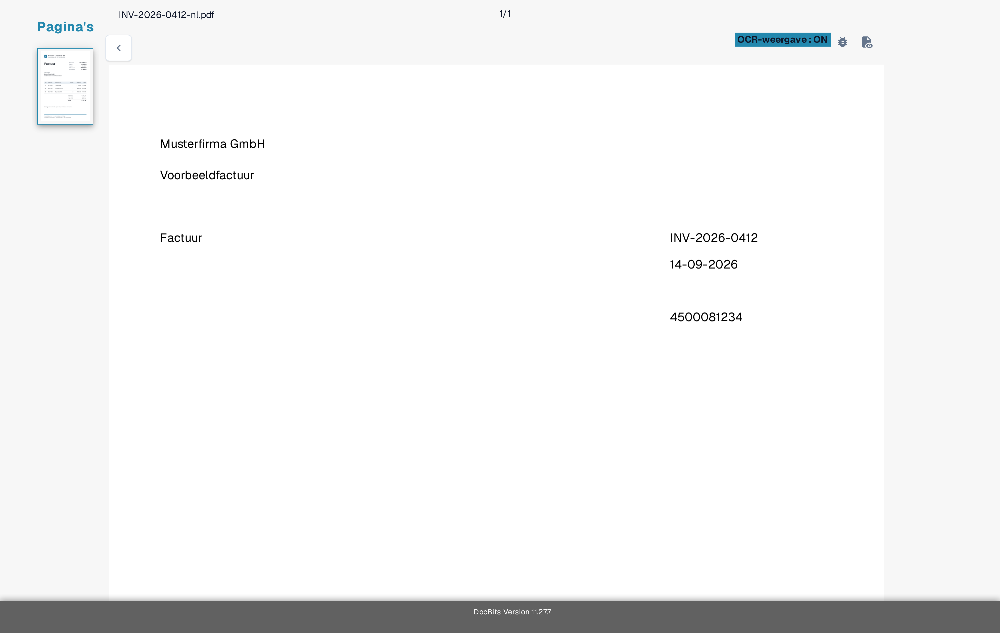
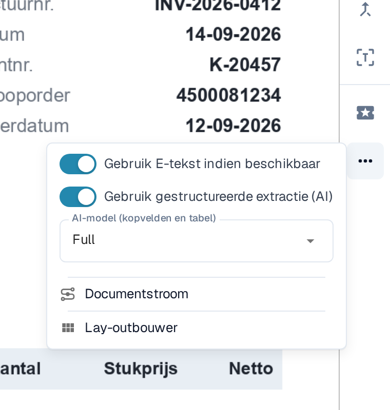

# Ontbrekende tekst in OCR-extractie

Als tekst zichtbaar is op een document maar een veld kan niet worden geëxtraheerd, controleer dan eerst of DocBits die tekst heeft herkend. Een gescande afbeelding en de ingebedde tekst van een PDF kunnen verschillende resultaten opleveren. Wijzig een extractieregel pas als u weet welke tekst beschikbaar is.

## De OCR-weergave controleren

1. Open het document in **Veldvalidatie**.
2. Selecteer in de werkbalk aan de rechterkant het pictogram **OCR-weergave**. De OCR-weergave opent in een nieuw browsertabblad.
3. Zoek het ontbrekende woord of getal in de herkende tekst die over de pagina heen wordt weergegeven. Ontbreekt het daar, dan kan de veldextractie het niet uit die tekstlaag halen. Staat het er wel, controleer dan in plaats daarvan de veldtoewijzing.

<figure><figcaption>
Vergelijk de tekst op het document met de woorden in de OCR-weergave: hier zijn de leverancier Musterfirma GmbH, de titel Factuur, het factuurnummer INV-2026-0412 en de datum 14-09-2026 als tekst herkend. Dit voorbeeld toont herkende tekst, geen mislukte extractie.
</figcaption></figure>

## OCR proberen in plaats van ingebedde E-tekst voor één leverancier

Als **Gebruik E-tekst indien beschikbaar** is ingeschakeld, kan DocBits de tekst gebruiken die al in de PDF is ingebed. Tekst die alleen in een afbeelding staat, kan in die laag ontbreken. Voor een leverancier bij wie dit probleem optreedt:

1. Open een document van die leverancier in **Veldvalidatie**.
2. Selecteer **Meer opties** (drie puntjes) in de werkbalk aan de rechterkant.
3. Schakel **Gebruik E-tekst indien beschikbaar** uit.
4. Lees de melding over opnieuw opstarten en selecteer **Bevestigen** om de wijziging op te slaan en het document opnieuw te verwerken. Selecteer **Annuleren** om de instelling ongewijzigd te laten.
5. Open **OCR-weergave** opnieuw nadat het document is verwerkt en controleer of de ontbrekende tekst verschijnt.

<figure><figcaption>
De E-tekstschakelaar van de leverancier staat in Meer opties van het validatiescherm en is hier nog ingeschakeld; in stap 3 schakelt u hem uit.
</figcaption></figure>

<figure><figcaption>
Bevestigen start de verwerking van het geopende document opnieuw, zodat de leveranciersinstelling van kracht wordt.
</figcaption></figure>

Het menu **Meer opties** bevat ook ingangen voor andere taken: **Gebruik gestructureerde extractie (AI)** en **AI-model (kopvelden en tabel)** worden beschreven in [Een leveranciersspecifiek AI-model kiezen voor veld- en tabelextractie](../supplier-specific-ai-model-for-field-and-table-extraction.md). Wat **Documentstroom** toont, staat uitgelegd in [Documentstroom](../../dashboard/document-flow.md); **Lay-outbouwer** opent de [Lay-outeditor](../../../../administration-and-setup/setup/document-types/layout-builder.md).

## De standaardinstelling van de organisatie wijzigen

Een beheerder kan **Instellingen → Documentverwerking → OCR-instellingen → Algemene OCR-instellingen** openen en **Gebruik E-tekst indien beschikbaar** voor de organisatie uitschakelen. Dit wijzigt de standaard voor latere verwerkingen; controleer en verwerk reeds getroffen documenten apart. Zie [OCR-instellingen](../../../../administration-and-setup/settings/document-processing/ocr-settings.md) voor de andere OCR-instellingen.

<figure><figcaption>
De organisatie-instelling helpt wanneer het probleem documenten van meerdere leveranciers treft. Dezelfde kaart toont ook de optie Gebruik DESKEW indien beschikbaar en de AI OCR-versie.
</figcaption></figure>

Als de tekst na opnieuw verwerken nog steeds ontbreekt, controleer dan de kwaliteit van de scan en neem contact op met uw DocBits-beheerder of de support met het document-ID en het paginanummer. Stuur geen vertrouwelijk document mee in een openbare supportaanvraag.
