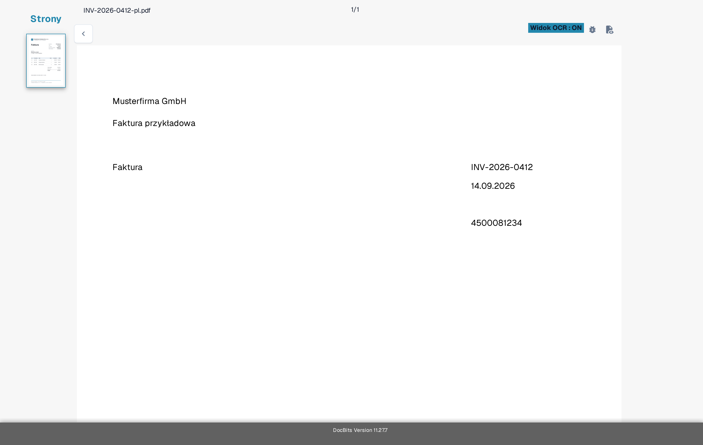
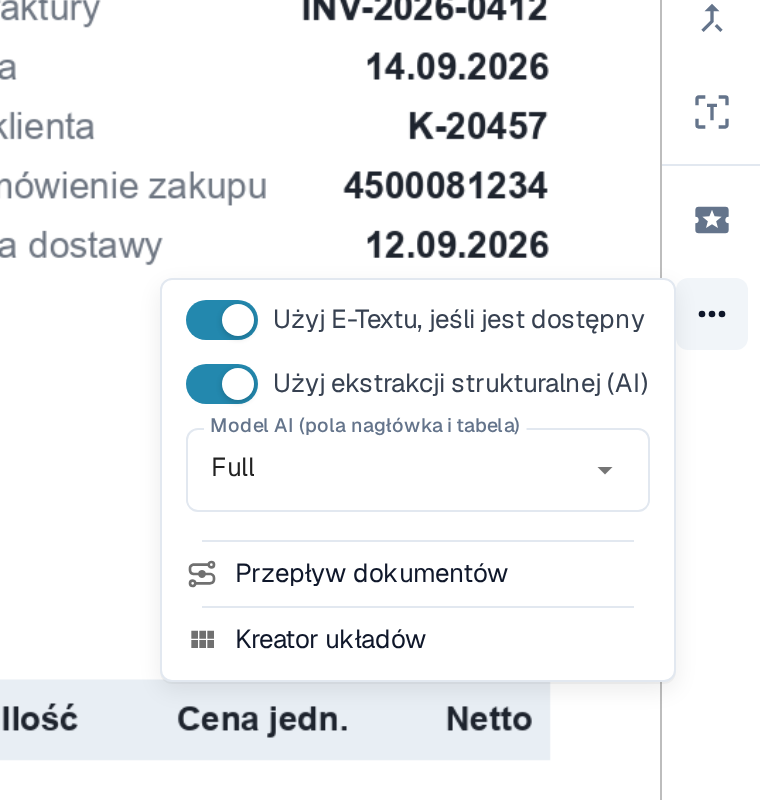
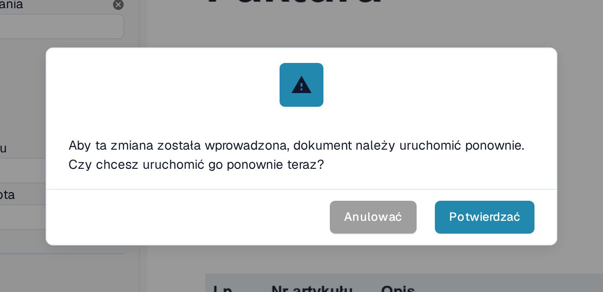
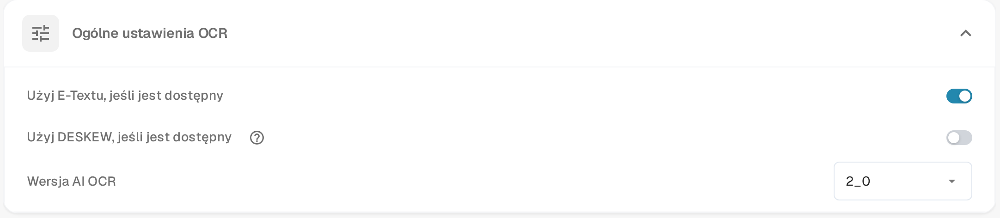

# Brakujący tekst w ekstrakcji OCR

Jeśli tekst jest widoczny na dokumencie, ale pola nie można wyodrębnić, najpierw sprawdź, czy DocBits rozpoznał ten tekst. Zeskanowany obraz i tekst osadzony w pliku PDF mogą dawać różne wyniki. Nie zmieniaj reguły ekstrakcji, dopóki nie wiesz, który tekst jest dostępny.

## Sprawdź widok OCR

1. Otwórz dokument w **Walidacji Pola**.
2. Na pasku narzędzi po prawej stronie wybierz ikonę **Widok OCR**. Widok OCR otwiera się w nowej karcie przeglądarki.
3. Poszukaj brakującego słowa lub liczby w nałożonej warstwie rozpoznanego tekstu. Jeśli go tam nie ma, ekstrakcja pola nie może pobrać tej wartości z warstwy tekstu. Jeśli jest obecne, sprawdź mapowanie pola.

<figure><figcaption>
Porównaj tekst na dokumencie ze słowami widocznymi w widoku OCR — tutaj tytuł Faktura, numer faktury INV-2026-0412, data 14.09.2026 i nazwa dostawcy Musterfirma GmbH są dostępne jako tekst. Przykład pokazuje rozpoznany tekst, a nie nieudaną ekstrakcję.
</figcaption></figure>

## Wypróbuj OCR zamiast osadzonego E-Textu dla jednego dostawcy

Gdy opcja **Użyj E-Textu, jeśli jest dostępny** jest włączona, DocBits może używać tekstu osadzonego w pliku PDF. Tekst, który znajduje się tylko na obrazie, może w tej warstwie nie występować. Dla dostawcy, którego dokumenty mają ten problem:

1. Otwórz jeden z dokumentów tego dostawcy w **Walidacji Pola**.
2. Na pasku narzędzi po prawej stronie wybierz **Więcej opcji** (trzy kropki).
3. Wyłącz **Użyj E-Textu, jeśli jest dostępny**.
4. Przeczytaj komunikat o ponownym uruchomieniu i wybierz **Potwierdzać**, aby zapisać zmianę i przetworzyć dokument ponownie. Wybierz **Anulować**, aby pozostawić ustawienie bez zmian.
5. Po przetworzeniu otwórz ponownie **Widok OCR** i sprawdź, czy brakujący tekst się pojawił.

<figure><figcaption>
Przełącznik E-Textu dostawcy znajduje się w menu Więcej opcji ekranu walidacji i jest tutaj jeszcze włączony; w kroku 3 go wyłączasz.
</figcaption></figure>

<figure><figcaption>
Potwierdzenie ponownie uruchamia przetwarzanie otwartego dokumentu, aby ustawienie dostawcy zaczęło działać.
</figcaption></figure>

Menu **Więcej opcji** zawiera dalsze pozycje dotyczące innych zadań: **Użyj ekstrakcji strukturalnej (AI)** oraz **Model AI (pola nagłówka i tabela)** opisuje strona [Wybór modelu AI specyficznego dla dostawcy do ekstrakcji pól i tabel](../supplier-specific-ai-model-for-field-and-table-extraction.md). Co pokazuje **Przepływ dokumentów**, opisano w sekcji [Przepływ dokumentu](../../dashboard/document-flow.md); **Kreator układów** otwiera [Edytor układu](../../../../administration-and-setup/setup/document-types/layout-builder.md).

## Zmień ustawienie domyślne organizacji

Administrator może otworzyć **Ustawienia → Przetwarzanie dokumentów → Ustawienia OCR → Ogólne ustawienia OCR** i wyłączyć **Użyj E-Textu, jeśli jest dostępny** dla całej organizacji. Zmienia to ustawienie domyślne dla późniejszego przetwarzania; już dotknięte dokumenty sprawdź i przetwórz ponownie osobno. Pozostałe ustawienia OCR opisuje strona [Ustawienia OCR](../../../../administration-and-setup/settings/document-processing/ocr-settings.md).

<figure><figcaption>
Ustawienie organizacji pomaga, gdy problem dotyczy dokumentów wielu dostawców. Ta sama karta pokazuje opcję Użyj DESKEW, jeśli jest dostępny oraz wersję AI OCR.
</figcaption></figure>

Jeśli tekst nadal nie występuje po ponownym przetworzeniu, sprawdź jakość skanu i skontaktuj się z administratorem DocBits lub pomocą techniczną, podając identyfikator dokumentu i numer strony. Nie wysyłaj poufnego dokumentu w publicznym zgłoszeniu do pomocy technicznej.
