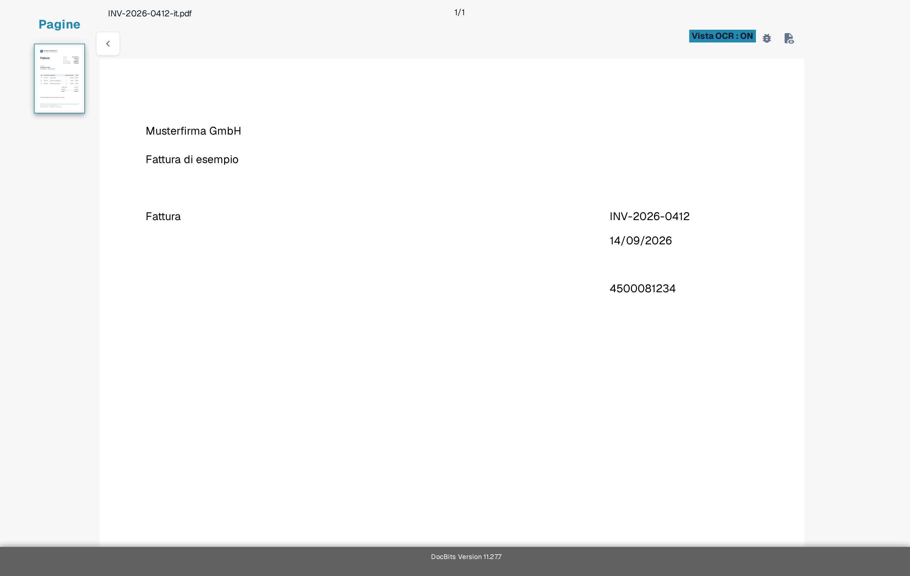
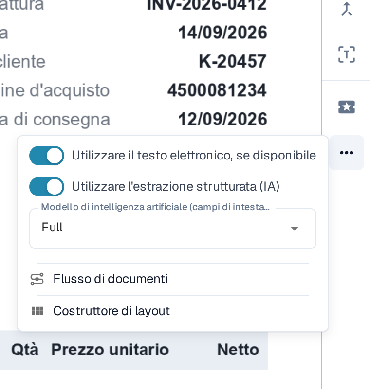
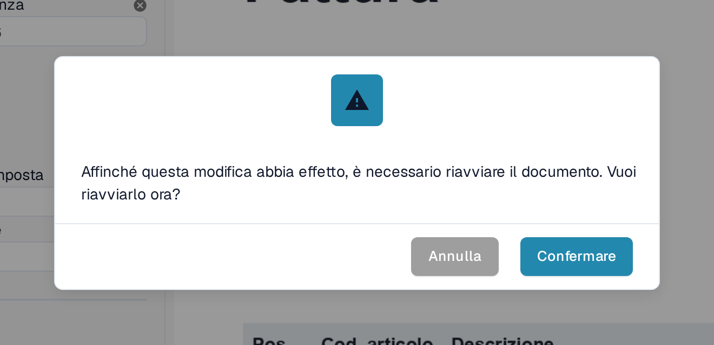
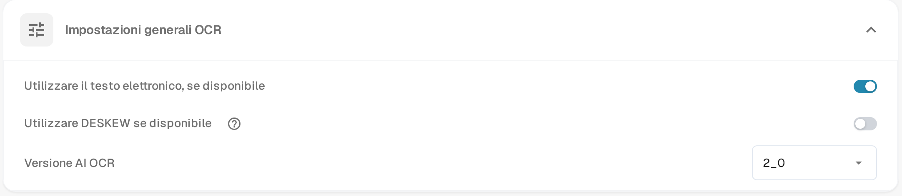

# Testo mancante nell'estrazione OCR

Se il testo è visibile su un documento ma un campo non può essere estratto, controlla prima se DocBits ha riconosciuto quel testo. Un'immagine scansionata e il testo incorporato in un PDF possono produrre risultati diversi. Non modificare una regola di estrazione prima di sapere quale testo è disponibile.

## Controllare la vista OCR

1. Apri il documento in **Convalida Del Campo**.
2. Nella barra degli strumenti a destra, seleziona l'icona **Vista OCR**. La vista OCR si apre in una scheda separata del browser.
3. Cerca la parola o il numero mancante nel livello di testo riconosciuto. Se non è presente, l'estrazione del campo non può prelevarlo da quel livello di testo. Se è presente, controlla invece la mappatura del campo.

<figure><figcaption>
Confronta il testo sul documento con le parole mostrate nella vista OCR: qui il titolo Fattura, il numero di fattura INV-2026-0412, la data 14/09/2026 e il nome del fornitore Musterfirma GmbH sono presenti come testo. L'esempio mostra testo riconosciuto, non un'estrazione non riuscita.
</figcaption></figure>

## Provare l'OCR invece dell'E-Text incorporato per un fornitore

Quando **Utilizzare il testo elettronico, se disponibile** è attivo, DocBits può usare il testo già incorporato nel PDF. Il testo che esiste solo dentro un'immagine può mancare in quel livello. Per un fornitore i cui documenti presentano questo problema:

1. Apri un documento di quel fornitore in **Convalida Del Campo**.
2. Seleziona **Altre opzioni** (tre punti) nella barra degli strumenti a destra.
3. Disattiva **Utilizzare il testo elettronico, se disponibile**.
4. Leggi l'avviso di riavvio e seleziona **Confermare** per salvare la modifica e rielaborare il documento. Seleziona **Annulla** per lasciare invariata l'impostazione.
5. Dopo l'elaborazione, apri di nuovo la **Vista OCR** e controlla se il testo mancante compare.

<figure><figcaption>
L'interruttore dell'E-Text del fornitore si trova in Altre opzioni nella schermata di convalida ed è qui ancora attivo; nel passaggio 3 lo disattivi.
</figcaption></figure>

<figure><figcaption>
Confermare riavvia l'elaborazione del documento aperto, così l'impostazione del fornitore ha effetto.
</figcaption></figure>

Il menu **Altre opzioni** contiene altre voci relative ad attività diverse: **Utilizzare l'estrazione strutturata (IA)** e **Modello di intelligenza artificiale (campi di intestazione e tabella)** sono descritti in [Modello di intelligenza artificiale specifico del fornitore per l'estrazione di campi e tabelle](../supplier-specific-ai-model-for-field-and-table-extraction.md). Che cosa mostra **Flusso di documenti** è descritto in [Flusso del documento](../../dashboard/document-flow.md); **Costruttore di layout** apre l'[editor di layout](../../../../administration-and-setup/setup/document-types/layout-builder.md).

## Modificare l'impostazione predefinita dell'organizzazione

Un amministratore può aprire **Impostazioni → ELABORAZIONE DOCUMENTI → Impostazioni OCR → Impostazioni generali OCR** e disattivare **Utilizzare il testo elettronico, se disponibile** per l'organizzazione. Questo cambia l'impostazione predefinita per le elaborazioni successive; i documenti già interessati vanno controllati e rielaborati separatamente. Le altre impostazioni OCR sono descritte in [Impostazioni OCR](../../../../administration-and-setup/settings/document-processing/ocr-settings.md).

<figure><figcaption>
L'impostazione dell'organizzazione è utile quando il problema riguarda documenti di più fornitori. La stessa scheda mostra anche l'opzione Utilizzare DESKEW se disponibile e la Versione AI OCR.
</figcaption></figure>

Se il testo manca ancora dopo la rielaborazione, controlla la qualità della scansione e rivolgiti all'amministratore DocBits o all'assistenza indicando l'ID del documento e il numero di pagina. Non inviare un documento riservato in una richiesta di assistenza pubblica.
