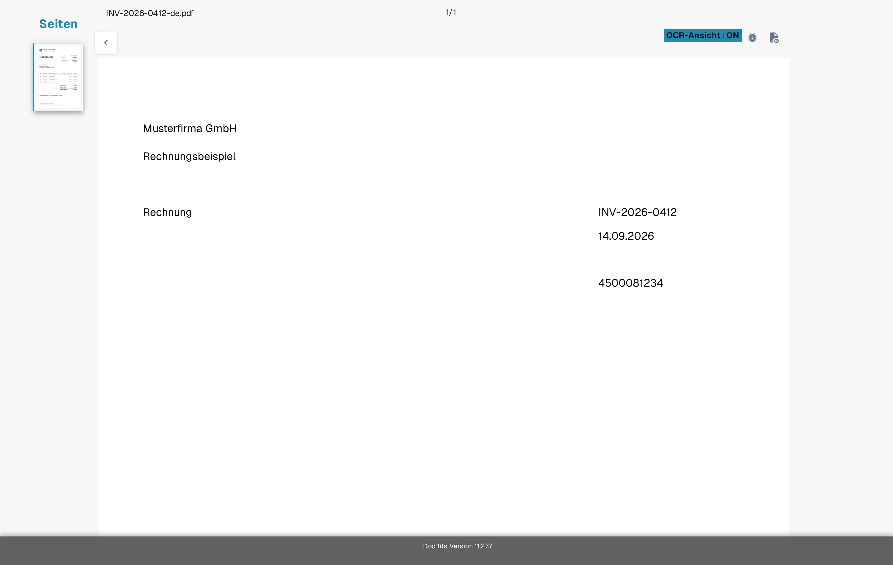
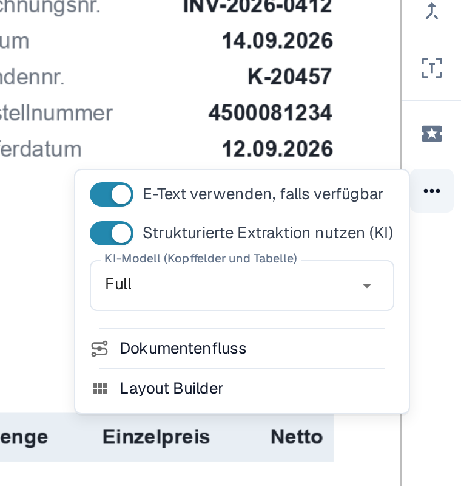
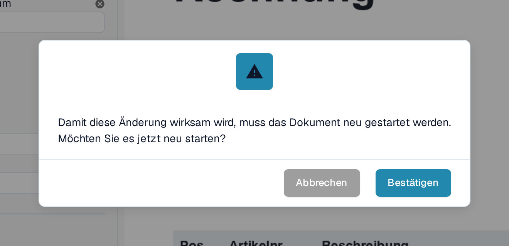

# Fehlender Text in der OCR-Extraktion

Ist auf einem Dokument Text sichtbar, ein Feld lässt sich aber nicht extrahieren, prüfen Sie zuerst, ob DocBits diesen Text erkannt hat. Ein gescanntes Bild und der eingebettete Text einer PDF-Datei können unterschiedliche Ergebnisse liefern. Ändern Sie keine Extraktionsregel, bevor Sie wissen, welcher Text verfügbar ist.

## OCR-Ansicht prüfen

1. Öffnen Sie das Dokument in der **Feldvalidierung**.
2. Wählen Sie in der Symbolleiste rechts das Symbol **OCR-Ansicht**. Die OCR-Ansicht öffnet sich in einem eigenen Browser-Tab.
3. Suchen Sie das fehlende Wort oder die fehlende Zahl in der eingeblendeten Textebene. Fehlt es dort, kann die Feldextraktion es nicht aus dieser Textebene übernehmen. Ist es vorhanden, prüfen Sie stattdessen die Feldzuordnung.

<figure><figcaption>
Vergleichen Sie den Text auf dem Dokument mit den Wörtern in der OCR-Ansicht — hier sind der Titel Rechnung, die Rechnungsnummer INV-2026-0412, das Datum 14.09.2026 und der Lieferantenname Musterfirma GmbH als Text vorhanden. Das Beispiel zeigt erkannten Text, keinen fehlgeschlagenen Fall.
</figcaption></figure>

## OCR statt eingebettetem E-Text für einen Lieferanten versuchen

Ist **E-Text verwenden, falls verfügbar** eingeschaltet, kann DocBits Text verwenden, der bereits in der PDF-Datei eingebettet ist. Text, der nur in einem Bild steht, kann in dieser Ebene fehlen. Gehen Sie für einen Lieferanten, dessen Dokumente dieses Problem haben, so vor:

1. Öffnen Sie ein Dokument dieses Lieferanten in der **Feldvalidierung**.
2. Wählen Sie in der Symbolleiste rechts **Mehr Optionen** (drei Punkte).
3. Schalten Sie **E-Text verwenden, falls verfügbar** aus.
4. Lesen Sie den Hinweis zum Neustart und wählen Sie **Bestätigen**, um die Änderung zu speichern und das Dokument neu zu verarbeiten. Mit **Abbrechen** bleibt die Einstellung unverändert.
5. Öffnen Sie nach der Verarbeitung erneut die **OCR-Ansicht** und prüfen Sie, ob der fehlende Text erscheint.

<figure><figcaption>
Der Schalter für den E-Text des Lieferanten liegt in den Mehr Optionen der Feldvalidierung und ist hier noch eingeschaltet; in Schritt 3 schalten Sie ihn aus.
</figcaption></figure>

<figure><figcaption>
Bestätigen startet die Verarbeitung des geöffneten Dokuments neu, damit die Lieferanteneinstellung wirkt.
</figcaption></figure>

Das Menü **Mehr Optionen** enthält weitere Einträge, die andere Aufgaben betreffen: **Strukturierte Extraktion nutzen (KI)** und **KI-Modell (Kopffelder und Tabelle)** beschreibt [Lieferantenspezifisches KI-Modell für Feld- und Tabellenextraktion](../supplier-specific-ai-model-for-field-and-table-extraction.md). Was **Dokumentenfluss** zeigt, steht unter [Dokumentenfluss](../../dashboard/document-flow.md); **Layout Builder** öffnet den [Layout-Editor](../../../../administration-and-setup/setup/document-types/layout-builder.md).

## Standard der Organisation ändern

Ein Administrator kann **Einstellungen → Dokumentenverarbeitung → OCR-Einstellungen → Allgemeine OCR-Einstellungen** öffnen und **E-Text verwenden, falls verfügbar** für die Organisation ausschalten. Das ändert den Standard für die spätere Verarbeitung; bereits betroffene Dokumente müssen Sie separat prüfen und neu verarbeiten. Die übrigen OCR-Steuerungen finden Sie unter [OCR-Einstellungen](../../../../administration-and-setup/settings/document-processing/ocr-settings.md).

<figure><figcaption>
Die Organisationseinstellung hilft, wenn das Problem Dokumente mehrerer Lieferanten betrifft. Dieselbe Karte zeigt die Option DESKEW verwenden, wenn verfügbar und die AI OCR Version.
</figcaption></figure>

Ist der Text nach der erneuten Verarbeitung weiterhin nicht vorhanden, prüfen Sie die Scanqualität und wenden Sie sich mit der Dokument-ID und der Seitenzahl an Ihren DocBits-Administrator oder den Support. Senden Sie kein vertrauliches Dokument in einer öffentlichen Supportanfrage.
