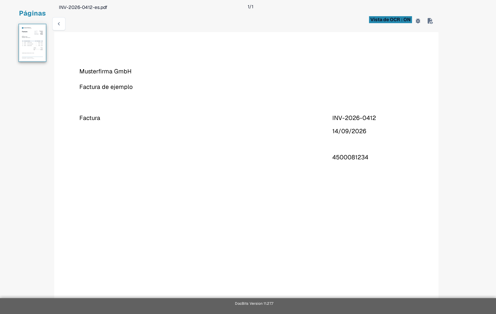
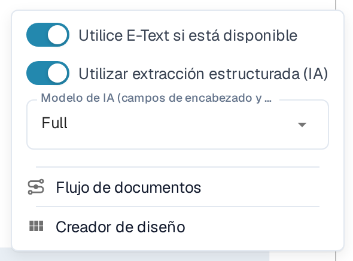
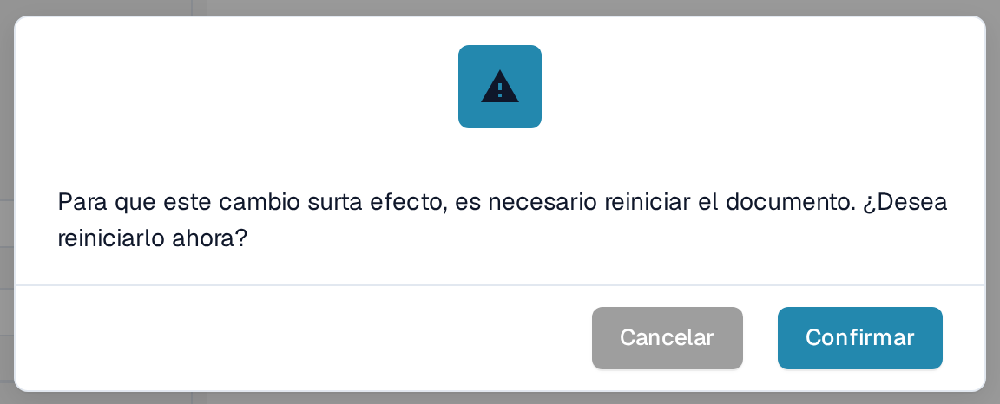
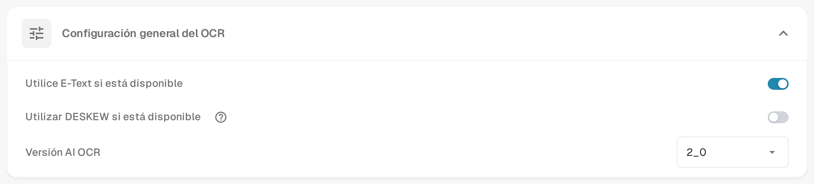

# Texto faltante en la extracción de OCR

Si el texto es visible en un documento pero un campo no se puede extraer, compruebe primero si DocBits ha reconocido ese texto. Una imagen escaneada y el texto incrustado en un PDF pueden dar resultados distintos. No cambie una regla de extracción hasta saber qué texto está disponible.

## Comprobar la vista de OCR

1. Abra el documento en **Validación De Campos**.
2. En la barra de herramientas de la derecha, seleccione el icono **Vista de OCR**. La vista de OCR se abre en una pestaña nueva del navegador.
3. Busque la palabra o el número que falta en el texto reconocido que se muestra sobre la página. Si no aparece, la extracción de campos no puede tomarlo de esa capa de texto. Si aparece, compruebe la asignación del campo.

<figure><figcaption>
Compare el texto del documento con las palabras que se muestran en la vista de OCR: en este ejemplo se reconocen el nombre del proveedor, el número de factura, las fechas y los importes. La imagen muestra una factura de ejemplo con datos inventados y texto reconocido, no una extracción fallida.
</figcaption></figure>

## Probar OCR en lugar del E-Text incrustado para un proveedor

Cuando **Utilice E-Text si está disponible** está activado, DocBits puede usar el texto que ya está incrustado en el PDF. El texto que solo existe dentro de una imagen puede faltar en esa capa. Para un proveedor cuyos documentos presentan este problema:

1. Abra un documento de ese proveedor en **Validación De Campos**.
2. Seleccione **Más opciones** (tres puntos) en la barra de herramientas de la derecha.
3. Desactive **Utilice E-Text si está disponible**.
4. Lea el aviso de reinicio y seleccione **Confirmar** para guardar el cambio y volver a procesar el documento. Seleccione **Cancelar** para dejar el ajuste sin cambios.
5. Vuelva a abrir la **Vista de OCR** después del procesamiento y compruebe si aparece el texto que faltaba.

<figure><figcaption>
El interruptor de E-Text del proveedor está en Más opciones, en la pantalla de validación.
</figcaption></figure>

<figure><figcaption>
Al confirmar el ajuste del proveedor se reinicia el procesamiento del documento abierto.
</figcaption></figure>

## Cambiar el valor predeterminado de la organización

Un administrador puede abrir **Ajustes → Procesamiento de documentos → OCR** y desactivar **Utilice E-Text si está disponible** para la organización. Esto cambia el valor predeterminado para los procesamientos posteriores; revise y vuelva a procesar por separado los documentos ya afectados. Consulte [Configuración de OCR](../../../../administration-and-setup/settings/document-processing/ocr-settings.md) para ver los demás controles de OCR.

<figure><figcaption>
Use el ajuste de la organización cuando el problema afecte a documentos de varios proveedores.
</figcaption></figure>

Si el texto sigue sin aparecer después de volver a procesar, revise la calidad del escaneo y contacte con su administrador de DocBits o con el soporte indicando el ID del documento y el número de página. No envíe un documento confidencial en una solicitud de soporte pública.
