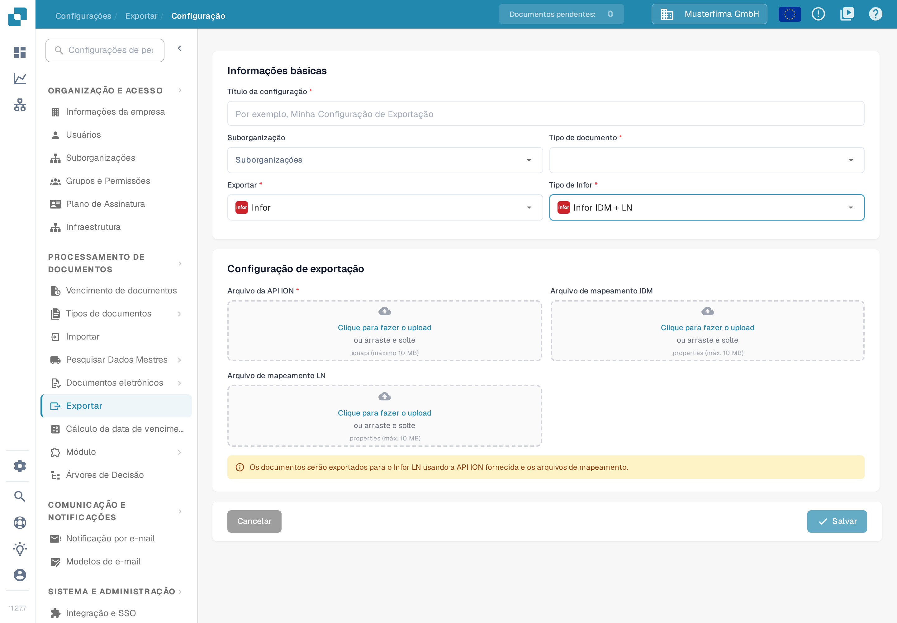

# Configuração do LN

Este guia combina exemplos históricos do Infor ION com o formulário de exportação LN atual do DocBits. As imagens do Infor ilustram os passos individuais; os nomes de empresas, os nomes de mapeamentos e a disposição nessas imagens são exemplos. Antes de ativar um fluxo, peça ao administrador do Infor que confirme os pontos de ligação, o pacote de mapeamentos e as permissões BOD para a sua empresa LN. Nesta atualização da documentação não foi testada nenhuma ligação a uma empresa Infor nem a exportação de uma fatura.

## Pré-requisitos

Já criou:

* Um endpoint da API ION
* Um ficheiro da API ION
* Um ficheiro de mapeamento BOD
* Um ficheiro de mapeamento IDM

## Importar ficheiros de mapeamento

Antes de configurar o fluxo de dados, importe os ficheiros de mapeamento no InforOS.

No ION Desk, abra **Connect → Mappings**.

<figure><figcaption>
Exemplo histórico: navegação do ION Desk com o grupo Connect expandido e as entradas Data Flows, API Flows, Connection Points, File Templates e Enterprise Locations. Confirme as definições correspondentes na sua empresa Infor.
</figcaption></figure>

Clique no ícone de importação.

<figure><figcaption>
Exemplo histórico: barra de ferramentas da página Mappings no ION Desk, com o ícone de importação assinalado. Confirme as definições correspondentes na sua empresa Infor.
</figcaption></figure>

* Selecione os ficheiros de mapeamento necessários: SyncCaptDoc\_SyncSuppInv, SyncSupplierInvoice\_LoadSupplierInvoice e LoadSupplierInvoice\_ProcessSupplierInvoice.
* Depois de importar todos os ficheiros de mapeamento, aprove cada um clicando no ícone de confirmação no respetivo bloco do painel de mapeamentos.

## Do DocBits para o LN

O passo seguinte é configurar o fluxo de dados no ION Desk. Abra a aplicação ION Desk e selecione **Data Flow → + ADD → Document Flow**, como no exemplo abaixo.

<figure><figcaption>
Exemplo histórico: página Data Flows no ION Desk com a navegação à esquerda, o fluxo DF_SLTStAPI na lista e as entradas de menu Document Flow e Data Lake Flow. Confirme as definições correspondentes na sua empresa Infor.
</figcaption></figure>

Nesta área de trabalho irá construir o fluxo de informação do DocBits para o LN.

<figure><figcaption>
Exemplo histórico: novo Document Flow com o painel de propriedades vazio e as mensagens Document flow name must be specified e The document flow has no activities. Confirme as definições correspondentes na sua empresa Infor.
</figcaption></figure>

O fluxo de dados LN será semelhante ao seguinte. Existem vários percursos porque cada um se destina a um tipo de documento específico; neste exemplo seguimos o fluxo de dados da fatura.

<figure><figcaption>
Exemplo histórico: área do fluxo de dados com vários percursos para diferentes tipos de documento, cada percurso composto por um ponto de ligação DocBits, um mapeamento e um ponto de ligação LN. Confirme as definições correspondentes na sua empresa Infor.
</figcaption></figure>

Todos os elementos da cadeia são arrastados a partir da secção superior.

Na cadeia, o DocBits e o LN são aplicações e, entre eles, os mapeamentos convertem os dados para um formato compreendido pela etapa seguinte e encaminham a informação para onde é necessária.

<figure><figcaption>
Exemplo histórico: paleta de atividades e fluxo do ION, em que as atividades de aplicação representam o DocBits e o LN, com atividades de mapeamento entre elas. Confirme as definições correspondentes na sua empresa Infor.
</figcaption></figure>

### Aplicação DocBits

Atribua-lhe um nome adequado, como «DocBits», selecione o sinal de adição e procure o ponto de ligação que criou anteriormente, como DocBits\_Export, e clique nele.

Para criar este ponto de ligação, abra **ION Desk → Connect → Connection Points**.

<figure><figcaption>
Exemplo histórico: navegação do ION Desk com o grupo Connect expandido e as entradas Data Flows, API Flows, Mappings e Connection Points. Confirme as definições correspondentes na sua empresa Infor.
</figcaption></figure>

Clique em **+ Add**.

<figure><figcaption>
Exemplo histórico: página Connection Points no ION Desk com o grupo Connect aberto na navegação. Confirme as definições correspondentes na sua empresa Infor.
</figcaption></figure>

Selecione **IMS via API Gateway** e preencha as informações seguintes.

<figure><figcaption>
Exemplo histórico: ponto de ligação IMS via API Gateway com um identificador lógico de exemplo e o campo ION API Client Id ocultado. Confirme as definições correspondentes na sua empresa Infor.
</figcaption></figure>

O Client ID da ION API é o valor `ci` do seu ficheiro `.ionapi`. Obtenha o ficheiro específico da sua empresa junto do administrador do Infor autorizado. O ficheiro contém credenciais; mantenha-o fora de capturas de ecrã, tickets e Git. Consulte a [explicação dos campos de credenciais da ION API na documentação do Infor](https://docs.infor.com/crm/9.4.x/en-us/webclient/upi1639111995644.html).

Mude para o separador de documentos e adicione o BOD **Sync.CaptureDocument** ao ponto de ligação DocBits, como abaixo.

<figure><figcaption>
Exemplo histórico: ponto de ligação DocBits-Sandbox-Export com o separador Documents aberto e o documento Sync.CaptureDocument associado. Confirme as definições correspondentes na sua empresa Infor.
</figcaption></figure>

Guarde o ponto de ligação com o ícone de disquete no canto superior esquerdo.

Volte à secção Dataflow do ION Desk para abrir o seu fluxo de dados. A aplicação DocBits deverá ficar semelhante à seguinte.

<figure><figcaption>
Exemplo histórico: Application Activity Properties com o nome da aplicação DocBits-Sandbox e o ponto de ligação DocBits-Sandbox-Export selecionado. Confirme as definições correspondentes na sua empresa Infor.
</figcaption></figure>

### Mapeamento 1

O primeiro nó de mapeamento deverá ficar como se segue:

<figure><figcaption>
Exemplo histórico: propriedades do primeiro mapeamento, Capture2sync, com o mapeamento de exemplo LN_CaptureDocumentToSupplierInvoice_1. Confirme as definições correspondentes na sua empresa Infor.
</figcaption></figure>

### Mapeamento 2

O segundo nó de mapeamento deverá ficar como se segue:

<figure><figcaption>
Exemplo histórico: propriedades do segundo mapeamento, Load2Process, com o mapeamento de exemplo LoadSupplierToProcessSupplierInvoice. Confirme as definições correspondentes na sua empresa Infor.
</figcaption></figure>

### Aplicação LN

Deve já existir no Infor um ponto de ligação chamado LN ou com um nome semelhante, criado para a empresa LN correta. Tal como na aplicação DocBits, selecione-o clicando no sinal «+» e o resultado deverá ficar como se segue:

<figure><figcaption>
Exemplo histórico: Application Activity Properties da aplicação LN com o nome de exemplo LN-200 e a ligação de aplicação In01_0200 selecionada. Confirme as definições correspondentes na sua empresa Infor.
</figcaption></figure>

### BODs

<figure><figcaption>
Exemplo histórico: área do fluxo de dados com os nós DocBits-DEV, MappingDeliver, Load Supplier, PurchaseOrder, SalesOrder e AdvancedShip acima da entrada End. Confirme as definições correspondentes na sua empresa Infor.
</figcaption></figure>

As configurações seguintes deverão ficar como se segue:

#### Primeiro

<figure><figcaption>
Exemplo histórico: lista de documentos do primeiro passo com Sync.CaptureDocument. Confirme as definições correspondentes na sua empresa Infor.
</figcaption></figure>

#### Segundo

<figure><figcaption>
Exemplo histórico: lista de documentos do segundo passo com Load.SupplierInvoice. Confirme as definições correspondentes na sua empresa Infor.
</figcaption></figure>

#### Terceiro

<figure><figcaption>
Exemplo histórico: lista de documentos do terceiro passo com Process.SupplierInvoice. Confirme as definições correspondentes na sua empresa Infor.
</figcaption></figure>

O último ícone deverá estar vazio, porque não transporta nenhum documento nem informação.

Depois de o administrador do Infor ter verificado todos os nós, mapeamentos e subscrições de documentos, utilize o controlo de ativação do fluxo pretendido. A imagem histórica abaixo assinala esse controlo; o nome antigo do fluxo nela visível contém M3 e não deve ser usado como nome nem como destino da sua configuração LN.

<figure><figcaption>
Exemplo histórico: barra de ferramentas do Document Flow com o controlo de ativação assinalado. O fluxo de exemplo antigo chama-se DocBits-Export-M3; escolha o fluxo LN correto na sua empresa. Confirme as definições correspondentes na sua empresa Infor.
</figcaption></figure>

## Configurar a exportação no DocBits

Na organização DocBits pretendida, abra **Configurações → Exportar**. A lista mostra as configurações de exportação existentes, com as colunas Tipo, Suborganizações, Título, Método De Exportação e Ações. Selecione **Novo** para preparar uma nova configuração.

<figure><figcaption>
Neste exemplo a lista está vazia e mostra a mensagem «Nenhuma configuração encontrada. Crie sua primeira configuração para começar.» O botão Novo abre o formulário de configuração; nenhuma configuração guardada foi aberta ou alterada. Todos os dados são um exemplo inventado da aplicação 11.27.7.
</figcaption></figure>

Em **Informações básicas**, introduza um **Título da configuração** e selecione o **Tipo de documento** (no exemplo, uma fatura). Preencha a **Suborganização** apenas se a sua configuração o exigir. Em **Exportar**, escolha **Infor** e, em **Tipo de Infor**, escolha **Infor IDM + LN**.

Em **Configuração de exportação**, forneça os três ficheiros necessários para uma nova configuração LN: **Arquivo da API ION** (`.ionapi`), **Arquivo de mapeamento IDM** (`.properties`) e **Arquivo de mapeamento LN** (`.properties`). Clique em **Clique para fazer o upload** ou arraste o ficheiro para o campo. Obtenha os ficheiros desta empresa e da empresa LN junto do administrador do Infor autorizado. A imagem abaixo deixa deliberadamente todos os campos de upload vazios e não contém dados de acesso.

<figure><figcaption>
O formulário LN atual separa os três campos de upload: Arquivo da API ION, Arquivo de mapeamento IDM e Arquivo de mapeamento LN. Neste exemplo não foi selecionado nenhum tipo de documento, não foi carregado nenhum ficheiro e não foi guardada nenhuma configuração. Todos os dados são um exemplo inventado da aplicação 11.27.7.
</figcaption></figure>

Depois de o administrador confirmar o fluxo ION e os ficheiros, guarde a configuração com **Salvar** e teste uma fatura autorizada fora do ambiente de produção. Verifique o resultado no DocBits, no Infor ION e no LN. Uma configuração guardada, por si só, não prova que o LN recebeu a fatura. Se estiver apenas a consultar os campos disponíveis, feche o formulário com **Cancelar**.

Para saber o papel dos pontos de ligação e dos fluxos de documentos, consulte a [explicação do Infor ION](https://docs.infor.com/ln/10.8/en-us/lnesolh/lnoshybridng/wxa1699288671147.html).
