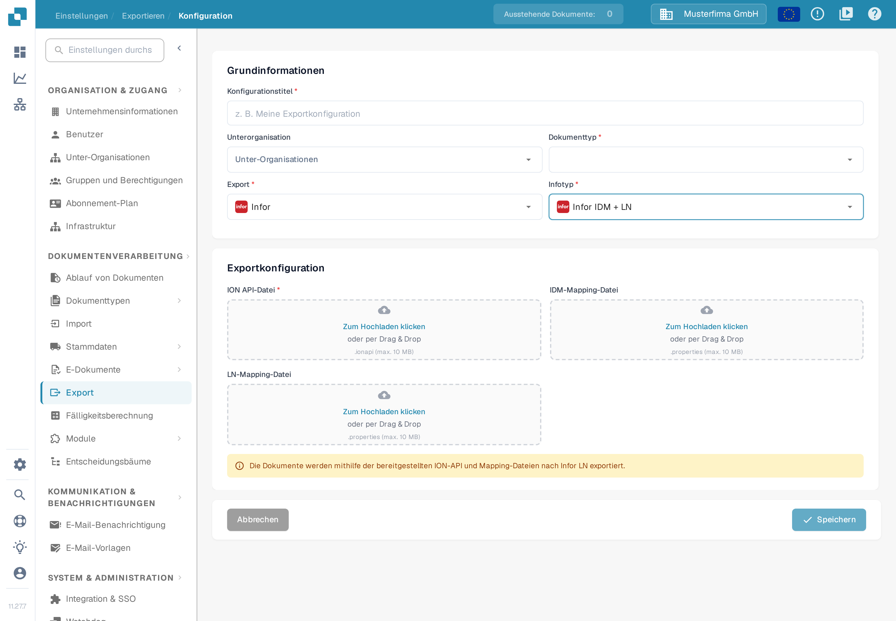

# LN-Konfiguration

Diese Anleitung verbindet historische Beispiele aus Infor ION mit dem aktuellen LN-Exportformular von DocBits. Die Infor-Bilder veranschaulichen die einzelnen Schritte; Mandanten-, Zuordnungs- und Aufbauangaben darin sind Beispiele. Lassen Sie Verbindungspunkte, Zuordnungspaket und BOD-Berechtigungen von Ihrer Infor-Administration für Ihre LN-Gesellschaft prüfen, bevor Sie einen Datenfluss aktivieren. Für diese Aktualisierung der Dokumentation wurden weder eine Infor-Mandantenverbindung noch ein Rechnungsexport getestet.

## Voraussetzungen

Sie haben Folgendes erstellt:

* einen ION-API-Endpunkt;
* eine ION-API-Datei;
* eine BOD-Zuordnungsdatei;
* eine IDM-Zuordnungsdatei.

## Zuordnungsdateien importieren

Importieren Sie die Zuordnungsdateien in Infor OS, bevor Sie den Datenfluss einrichten.

Öffnen Sie in **ION Desk → Connect** den Bereich **Mappings**.

<figure><figcaption>
Historisches Beispiel: Navigation in ION Desk mit aufgeklappter Gruppe Connect und den Einträgen Data Flows, API Flows, Connection Points, File Templates und Enterprise Locations. Prüfen Sie die entsprechenden Einstellungen in Ihrem Infor-Mandanten.
</figcaption></figure>

Klicken Sie auf das Importsymbol.

<figure><figcaption>
Historisches Beispiel: Symbolleiste der Seite Mappings in ION Desk mit dem markierten Import-Symbol. Prüfen Sie die entsprechenden Einstellungen in Ihrem Infor-Mandanten.
</figcaption></figure>

* Wählen Sie die benötigten Zuordnungsdateien aus: SyncCaptDoc\_SyncSuppInv, SyncSupplierInvoice\_LoadSupplierInvoice und LoadSupplierInvoice\_ProcessSupplierInvoice.
* Genehmigen Sie nach dem Import jede Zuordnung über das Häkchensymbol in ihrer Kachel im Zuordnungs-Dashboard.

## Von DocBits nach LN

Richten Sie anschließend den Datenfluss in ION Desk ein. Öffnen Sie die Anwendung und wählen Sie **Data Flow → + ADD → Document Flow**, wie unten gezeigt.

<figure><figcaption>
Historisches Beispiel: Seite Data Flows in ION Desk mit der Navigation links, dem Fluss DF_SLTStAPI in der Liste und den Menüeinträgen Document Flow und Data Lake Flow. Prüfen Sie die entsprechenden Einstellungen in Ihrem Infor-Mandanten.
</figcaption></figure>

Auf der folgenden Seite erstellen Sie den Informationsfluss von DocBits nach LN.

<figure><figcaption>
Historisches Beispiel: Neuer Document Flow mit leerem Eigenschaftenbereich und den Meldungen Document flow name must be specified und The document flow has no activities. Prüfen Sie die entsprechenden Einstellungen in Ihrem Infor-Mandanten.
</figcaption></figure>

Ein LN-Datenfluss sieht etwa wie unten gezeigt aus. Die verschiedenen Pfade dienen jeweils einem bestimmten Dokumenttyp. Diese Anleitung konzentriert sich auf den Rechnungsdatenfluss.

<figure><figcaption>
Historisches Beispiel: Datenfluss-Arbeitsfläche mit mehreren Pfaden für verschiedene Dokumenttypen, jeder Pfad aus einem DocBits-Verbindungspunkt, einer Zuordnung und einem LN-Verbindungspunkt. Prüfen Sie die entsprechenden Einstellungen in Ihrem Infor-Mandanten.
</figcaption></figure>

Ziehen Sie die Bestandteile der Verarbeitungskette aus dem oberen Bereich an die gewünschte Position.

In der Kette sind DocBits und LN als Anwendungen eingebunden. Die dazwischenliegenden Zuordnungen wandeln die Daten in das Format um, das der jeweils nächste Abschnitt erwartet, und ordnen die Informationen ihren Zielpositionen zu.

<figure><figcaption>
Historisches Beispiel: Aktivitätenpalette und Ablauf in ION, in denen Anwendungsaktivitäten DocBits und LN darstellen und Zuordnungsaktivitäten dazwischenliegen. Prüfen Sie die entsprechenden Einstellungen in Ihrem Infor-Mandanten.
</figcaption></figure>

### DocBits-Anwendung

Vergeben Sie einen passenden Namen, beispielsweise „DocBits“. Klicken Sie auf das Pluszeichen, suchen Sie den zuvor erstellten Verbindungspunkt, etwa DocBits\_Export, und wählen Sie ihn aus.

Um diesen Verbindungspunkt zu erstellen, öffnen Sie **ION Desk → Connect → Connection Points**.

<figure><figcaption>
Historisches Beispiel: Navigation in ION Desk mit aufgeklappter Gruppe Connect und den Einträgen Data Flows, API Flows, Mappings und Connection Points. Prüfen Sie die entsprechenden Einstellungen in Ihrem Infor-Mandanten.
</figcaption></figure>

Klicken Sie auf **+ Add**.

<figure><figcaption>
Historisches Beispiel: Seite Connection Points in ION Desk mit geöffneter Gruppe Connect in der Navigation. Prüfen Sie die entsprechenden Einstellungen in Ihrem Infor-Mandanten.
</figcaption></figure>

Wählen Sie **IMS via API Gateway** und tragen Sie die folgenden Informationen ein.

<figure><figcaption>
Historisches Beispiel: Verbindungspunkt IMS via API Gateway mit einer beispielhaften Logical ID und einem unkenntlich gemachten Feld ION API Client Id. Prüfen Sie die entsprechenden Einstellungen in Ihrem Infor-Mandanten.
</figcaption></figure>

Die ION-API-Client-ID ist der Wert `ci` in Ihrer `.ionapi`-Datei. Fordern Sie die mandantenspezifische Datei bei der zuständigen Infor-Administration an. Sie enthält Zugangsdaten; halten Sie sie aus Screenshots, Tickets und Git heraus. Siehe die [Erläuterung der ION-API-Zugangsfelder von Infor](https://docs.infor.com/crm/9.4.x/en-us/webclient/upi1639111995644.html).

Öffnen Sie die Registerkarte für Dokumente und fügen Sie dem DocBits-Verbindungspunkt das BOD **Sync.CaptureDocument** hinzu, wie unten gezeigt.

<figure><figcaption>
Historisches Beispiel: Verbindungspunkt DocBits-Sandbox-Export mit geöffnetem Tab Documents und dem zugeordneten Dokument Sync.CaptureDocument. Prüfen Sie die entsprechenden Einstellungen in Ihrem Infor-Mandanten.
</figcaption></figure>

Speichern Sie den Verbindungspunkt über das Diskettensymbol oben links.

Kehren Sie zum Bereich **Dataflow** in ION Desk zurück und öffnen Sie Ihren Datenfluss. Die DocBits-Anwendung sollte etwa wie unten gezeigt aussehen.

<figure><figcaption>
Historisches Beispiel: Application Activity Properties mit dem Anwendungsnamen DocBits-Sandbox und dem gewählten Verbindungspunkt DocBits-Sandbox-Export. Prüfen Sie die entsprechenden Einstellungen in Ihrem Infor-Mandanten.
</figcaption></figure>

### Zuordnung 1

Der erste Zuordnungsknoten sollte so aussehen:

<figure><figcaption>
Historisches Beispiel: Eigenschaften der ersten Zuordnung, Capture2sync, mit der Beispielzuordnung LN_CaptureDocumentToSupplierInvoice_1. Prüfen Sie die entsprechenden Einstellungen in Ihrem Infor-Mandanten.
</figcaption></figure>

### Zuordnung 2

Der zweite Zuordnungsknoten sollte so aussehen:

<figure><figcaption>
Historisches Beispiel: Eigenschaften der zweiten Zuordnung, Load2Process, mit der Beispielzuordnung LoadSupplierToProcessSupplierInvoice. Prüfen Sie die entsprechenden Einstellungen in Ihrem Infor-Mandanten.
</figcaption></figure>

### LN-Anwendung

In Infor sollte bereits ein Verbindungspunkt für die entsprechende LN-Gesellschaft vorhanden sein, beispielsweise mit dem Namen „LN“. Wählen Sie ihn wie bei der DocBits-Anwendung über das Pluszeichen aus. Das Ergebnis sollte so aussehen:

<figure><figcaption>
Historisches Beispiel: LN Application Activity Properties mit dem Beispielnamen LN-200 und der gewählten Anwendungsverbindung In01_0200. Prüfen Sie die entsprechenden Einstellungen in Ihrem Infor-Mandanten.
</figcaption></figure>

### BODs

<figure><figcaption>
Historisches Beispiel: Datenfluss-Arbeitsfläche mit den Knoten DocBits-DEV, MappingDeliver, Load Supplier, PurchaseOrder, SalesOrder und AdvancedShip über dem Eintrag End. Prüfen Sie die entsprechenden Einstellungen in Ihrem Infor-Mandanten.
</figcaption></figure>

Die folgenden Konfigurationen sollten so aussehen:

#### Erste Konfiguration

<figure><figcaption>
Historisches Beispiel: Dokumentliste des ersten Schritts mit Sync.CaptureDocument. Prüfen Sie die entsprechenden Einstellungen in Ihrem Infor-Mandanten.
</figcaption></figure>

#### Zweite Konfiguration

<figure><figcaption>
Historisches Beispiel: Dokumentliste des zweiten Schritts mit Load.SupplierInvoice. Prüfen Sie die entsprechenden Einstellungen in Ihrem Infor-Mandanten.
</figcaption></figure>

#### Dritte Konfiguration

<figure><figcaption>
Historisches Beispiel: Dokumentliste des dritten Schritts mit Process.SupplierInvoice. Prüfen Sie die entsprechenden Einstellungen in Ihrem Infor-Mandanten.
</figcaption></figure>

Das letzte Symbol sollte leer sein, da es weder ein Dokument noch Informationen überträgt.

Nachdem Ihre Infor-Administration alle Knoten, Zuordnungen und Dokumentabonnements geprüft hat, aktivieren Sie den vorgesehenen Datenfluss über das Bedienelement zum Aktivieren. Das historische Bild unten kennzeichnet dieses Bedienelement; sein alter Flussname enthält M3 und darf nicht als Name oder Ziel Ihrer LN-Einrichtung verwendet werden.

<figure><figcaption>
Historisches Beispiel: Symbolleiste des Document Flow mit dem markierten Bedienelement zum Aktivieren. Der alte Beispielname lautet DocBits-Export-M3; wählen Sie in Ihrem Mandanten den richtigen LN-Datenfluss. Prüfen Sie die entsprechenden Einstellungen in Ihrem Infor-Mandanten.
</figcaption></figure>

## Export in DocBits konfigurieren

Öffnen Sie in der vorgesehenen DocBits-Organisation **Einstellungen → Export**. Die Seite **Exportieren** listet die vorhandenen Exportkonfigurationen; die Spalten heißen Typ, Unter-Organisationen, Titel und Methode Exportieren. Wählen Sie **Neu**, um eine neue Konfiguration vorzubereiten.

<figure><figcaption>
Die Liste enthält in diesem erfundenen Beispielmandanten keine Exportkonfiguration und zeigt die Meldung, dass noch keine angelegt wurde. Neu öffnet das Konfigurationsformular; eine gespeicherte Konfiguration wurde nicht geöffnet oder geändert.
</figcaption></figure>

Tragen Sie unter **Grundinformationen** einen **Konfigurationstitel** ein, wählen Sie den **Dokumenttyp** (für die Rechnungsübertragung Rechnung) und nur dann eine **Unterorganisation**, wenn Ihre Einrichtung eine benötigt. Wählen Sie bei **Export** den Wert **Infor** und bei **Infotyp** den Wert **Infor IDM + LN**; die deutsche Oberfläche beschriftet dieses Feld mit „Infotyp“, gemeint ist der Infor-Typ.

Stellen Sie alle drei für eine neue LN-Konfiguration erforderlichen Dateien bereit: die **ION API-Datei** (.ionapi), die **IDM-Mapping-Datei** (.properties) und die **LN-Mapping-Datei** (.properties). Klicken Sie dazu auf **Zum Hochladen klicken** oder ziehen Sie die Datei in das Feld. Fordern Sie die Dateien für diesen Mandanten und diese LN-Gesellschaft bei der zuständigen Infor-Administration an. Das Bild lässt alle Upload-Felder bewusst leer und enthält keine Zugangsdaten.

<figure><figcaption>
Das aktuelle LN-Formular trennt die drei Upload-Felder. Unter Grundinformationen werden Zieltyp und Dokumenttyp festgelegt; in diesem Beispiel wurden keine Dateien hochgeladen und keine Konfiguration gespeichert.
</figcaption></figure>

Nachdem Ihre Administration den ION-Datenfluss und die Dateien bestätigt hat, speichern Sie die Konfiguration über **Speichern** und testen Sie eine freigegebene Rechnung außerhalb des Produktivbetriebs. Prüfen Sie das Ergebnis in DocBits, in Infor ION und in LN. Eine gespeicherte Konfiguration allein belegt nicht, dass LN eine Rechnung erhalten hat. Brechen Sie das Formular mit **Abbrechen** ab, wenn Sie nur die verfügbaren Felder ansehen möchten.

Zu den Aufgaben von Verbindungspunkten und Dokumentflüssen siehe die [Erläuterung von Infor ION](https://docs.infor.com/ln/10.8/en-us/lnesolvh/lnoshybridng/wxa1699288671147.html).
