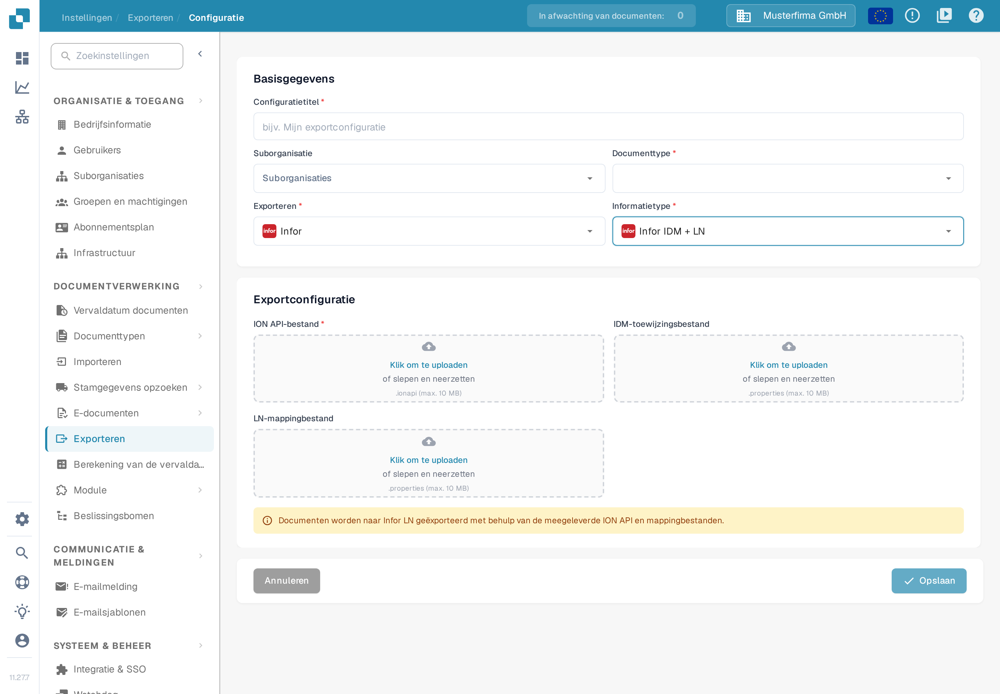

# LN-configuratie

Deze handleiding combineert historische voorbeelden uit Infor ION met het actuele LN-exportformulier van DocBits. De Infor-afbeeldingen laten de afzonderlijke stappen zien; de namen van tenants en toewijzingen en de opbouw daarvan zijn voorbeelden. Laat verbindingspunten, het toewijzingspakket en de BOD-rechten door uw Infor-beheerder controleren voor uw LN-bedrijf voordat u een gegevensstroom activeert. Voor deze actualisering van de documentatie zijn geen Infor-tenantverbinding en geen facturenexport getest.

## Vereisten

U hebt het volgende aangemaakt:

* een ION-API-eindpunt;
* een ION-API-bestand;
* een BOD-toewijzingsbestand;
* een IDM-toewijzingsbestand.

## Toewijzingsbestanden importeren

Voordat u de gegevensstroom inricht, importeert u de toewijzingsbestanden in Infor OS.

Open in ION Desk → Connect het onderdeel **Mappings**.

<figure><figcaption>
Historisch voorbeeld: navigatie in ION Desk met de groep Connect uitgeklapt en de onderdelen Data Flows, API Flows, Connection Points, File Templates en Enterprise Locations. Controleer de bijbehorende instellingen in uw Infor-tenant.
</figcaption></figure>

Klik op het pictogram Importeren.

<figure><figcaption>
Historisch voorbeeld: werkbalk Mappings in een oudere ION Desk met het importpictogram omcirkeld. Controleer de bijbehorende instellingen in uw Infor-tenant.
</figcaption></figure>

* Kies daar de toewijzingsbestanden die u nodig hebt: SyncCaptDoc\_SyncSuppInv, SyncSupplierInvoice\_LoadSupplierInvoice en LoadSupplierInvoice\_ProcessSupplierInvoice.
* Keur na het importeren elke toewijzing goed met het vinkjespictogram in de tegel op het toewijzingsdashboard.

## Van DocBits naar LN

Stel daarna de gegevensstroom in ION Desk in: open de toepassing en kies **Data Flow → + ADD → Document Flow**, zoals hieronder.

<figure><figcaption>
Historisch voorbeeld: pagina Data Flows in ION Desk met de navigatie links, de stroom DF_SLTStAPI in de lijst en de menuonderdelen Document Flow en Data Lake Flow. Controleer de bijbehorende instellingen in uw Infor-tenant.
</figcaption></figure>

Gebruik dit canvas om de informatiestroom van DocBits naar LN op te bouwen.

<figure><figcaption>
Historisch voorbeeld: nieuwe documentstroom met een leeg eigenschappenpaneel en de meldingen Document flow name must be specified en The document flow has no activities. Controleer de bijbehorende instellingen in uw Infor-tenant.
</figcaption></figure>

Een LN-gegevensstroom ziet er ongeveer uit zoals hieronder. Er zijn meerdere paden, omdat elk pad voor een bepaald documenttype bedoeld is; deze uitleg richt zich op de factuurgegevensstroom.

<figure><figcaption>
Historisch voorbeeld: canvas van een gegevensstroom met meerdere paden voor verschillende documenttypen, elk opgebouwd uit een verbindingspunt van DocBits, een toewijzing en een verbindingspunt van LN. Controleer de bijbehorende instellingen in uw Infor-tenant.
</figcaption></figure>

Alle onderdelen van de keten sleept u uit het bovenste gedeelte.

In de keten zijn DocBits en LN toepassingen; daartussen staan toewijzingen die de gegevens omzetten naar een vorm die het volgende deel van de gegevensstroom begrijpt, en die de informatie naar de juiste bestemming brengen.

<figure><figcaption>
Historisch voorbeeld: activiteitenpalet en stroom in ION, waarbij toepassingsactiviteiten DocBits en LN voorstellen en toewijzingsactiviteiten ertussen staan. Controleer de bijbehorende instellingen in uw Infor-tenant.
</figcaption></figure>

### DocBits-toepassing

Geef de toepassing een passende naam, bijvoorbeeld ‘DocBits', kies daarna het plusteken en zoek het verbindingspunt dat u eerder hebt gemaakt, bijvoorbeeld DocBits\_Export, en klik erop.

Om dit verbindingspunt te maken, opent u ION Desk → Connect → Connection Points.

<figure><figcaption>
Historisch voorbeeld: navigatie in ION Desk met de groep Connect uitgeklapt en de onderdelen Data Flows, API Flows, Mappings en Connection Points. Controleer de bijbehorende instellingen in uw Infor-tenant.
</figcaption></figure>

Klik op **+ Add**.

<figure><figcaption>
Historisch voorbeeld: pagina Connection Points in ION Desk met de groep Connect open in de navigatie. Controleer de bijbehorende instellingen in uw Infor-tenant.
</figcaption></figure>

Kies **IMS via API Gateway** en vul de volgende gegevens in.

<figure><figcaption>
Historisch voorbeeld: verbindingspunt IMS via API Gateway met een voorbeeld van een logische id en een afgeschermd veld ION API Client Id. Controleer de bijbehorende instellingen in uw Infor-tenant.
</figcaption></figure>

De ION API-client-id is de waarde `ci` in uw `.ionapi`-bestand. Vraag het tenantbestand aan bij de bevoegde Infor-beheerder. Het bevat inloggegevens; houd het buiten schermafbeeldingen, tickets en Git. Zie de [uitleg van Infor over de ION-API-inloggegevens](https://docs.infor.com/crm/9.4.x/en-us/webclient/upi1639111995644.html).

Schakel over naar het tabblad voor documenten en voeg het BOD Sync.CaptureDocument toe aan het verbindingspunt van DocBits, zoals hieronder.

<figure><figcaption>
Historisch voorbeeld: verbindingspunt DocBits-Sandbox-Export met het tabblad Documents open en het document Sync.CaptureDocument toegewezen. Controleer de bijbehorende instellingen in uw Infor-tenant.
</figcaption></figure>

Sla het verbindingspunt daarna op met het diskettepictogram linksboven.

Ga terug naar het onderdeel **Dataflow** in ION Desk om uw gegevensstroom te openen. Uw DocBits-toepassing ziet er ongeveer uit zoals hieronder.

<figure><figcaption>
Historisch voorbeeld: eigenschappen van een toepassingsactiviteit met de naam DocBits-Sandbox en het gekozen verbindingspunt DocBits-Sandbox-Export. Controleer de bijbehorende instellingen in uw Infor-tenant.
</figcaption></figure>

### Toewijzing 1

De eerste toewijzingsknoop ziet er als volgt uit.

<figure><figcaption>
Historisch voorbeeld: eigenschappen van de eerste toewijzing Capture2sync met de voorbeeldtoewijzing LN_CaptureDocumentToSupplierInvoice_1. Controleer de bijbehorende instellingen in uw Infor-tenant.
</figcaption></figure>

### Toewijzing 2

De tweede toewijzingsknoop ziet er als volgt uit.

<figure><figcaption>
Historisch voorbeeld: eigenschappen van de tweede toewijzing Load2Process met de voorbeeldtoewijzing LoadSupplierToProcessSupplierInvoice. Controleer de bijbehorende instellingen in uw Infor-tenant.
</figcaption></figure>

### LN-toepassing

In Infor bestaat er al een verbindingspunt voor het juiste LN-bedrijf, bijvoorbeeld met de naam ‘LN'. Net als bij de DocBits-toepassing selecteert u het met het plusteken; het resultaat ziet er als volgt uit.

<figure><figcaption>
Historisch voorbeeld: eigenschappen van de LN-toepassingsactiviteit met de voorbeeldnaam LN-200 en de gekozen toepassingsverbinding In01_0200. Controleer de bijbehorende instellingen in uw Infor-tenant.
</figcaption></figure>

### BOD's

<figure><figcaption>
Historisch voorbeeld: canvas van een gegevensstroom met de knopen DocBits-DEV, MappingDeliver, Load Supplier, PurchaseOrder, SalesOrder en AdvancedShip boven de ingang End. Controleer de bijbehorende instellingen in uw Infor-tenant.
</figcaption></figure>

De volgende configuraties zien er als volgt uit:

#### Eerste configuratie

<figure><figcaption>
Historisch voorbeeld: documentenlijst van de eerste stap met Sync.CaptureDocument. Controleer de bijbehorende instellingen in uw Infor-tenant.
</figcaption></figure>

#### Tweede configuratie

<figure><figcaption>
Historisch voorbeeld: documentenlijst van de tweede stap met Load.SupplierInvoice. Controleer de bijbehorende instellingen in uw Infor-tenant.
</figcaption></figure>

#### Derde configuratie

<figure><figcaption>
Historisch voorbeeld: documentenlijst van de derde stap met Process.SupplierInvoice. Controleer de bijbehorende instellingen in uw Infor-tenant.
</figcaption></figure>

Het laatste pictogram hoort leeg te zijn, omdat het geen document en geen informatie doorgeeft.

Nadat uw Infor-beheerder alle knopen, toewijzingen en documentabonnementen heeft gecontroleerd, activeert u de bedoelde gegevensstroom met het bedieningselement voor activeren. De historische afbeelding hieronder markeert dat bedieningselement; de oude naam van de stroom bevat M3 en mag niet worden gebruikt als naam of bestemming voor uw LN-inrichting.

<figure><figcaption>
Historisch voorbeeld: werkbalk van een historische documentstroom met het activeringsbedieningselement omcirkeld. Het oude voorbeeld heet DocBits-Export-M3; kies de juiste LN-stroom in uw tenant. Controleer de bijbehorende instellingen in uw Infor-tenant.
</figcaption></figure>

## Export configureren in DocBits

Open in de bedoelde DocBits-organisatie **Instellingen → Exporteren**. De pagina toont de bestaande exportconfiguraties; kies **Nieuw** om een nieuwe configuratie voor te bereiden.

<figure><figcaption>
De lijst bevat in deze verzonnen voorbeeldorganisatie geen exportconfiguratie en toont de melding dat er nog geen is aangemaakt. Nieuw opent het configuratieformulier; een opgeslagen configuratie is niet geopend of gewijzigd.
</figcaption></figure>

Vul onder **Basisgegevens** een **Configuratietitel** in, kies het **Documenttype** (voor de factuuroverdracht Factuur) en kies alleen een **Suborganisatie** als uw inrichting die nodig heeft. Kies bij **Exporteren** de waarde **Infor** en daarna bij **Informatietype** de waarde **Infor IDM + LN**.

Lever alle drie bestanden aan die een nieuwe LN-configuratie vereist: het **ION API-bestand** (`.ionapi`), het **IDM-toewijzingsbestand** (`.properties`) en het **LN-mappingbestand** (`.properties`). Vraag de bestanden voor deze tenant en dit LN-bedrijf aan bij de bevoegde Infor-beheerder. Klik daarvoor op **Klik om te uploaden** of sleep het bestand naar het veld. De afbeelding laat alle uploadvelden bewust leeg en bevat geen inloggegevens.

<figure><figcaption>
Het actuele LN-formulier scheidt de drie uploadvelden. Onder Basisgegevens worden het doeltype en het documenttype vastgelegd; in dit voorbeeld is geen bestand geüpload en is geen configuratie opgeslagen.
</figcaption></figure>

Nadat uw beheerder de ION-stroom en de bestanden heeft bevestigd, slaat u de configuratie op met **Opslaan** en test u één toegestane factuur buiten de productieomgeving. Controleer het resultaat in DocBits, Infor ION en LN. Een opgeslagen configuratie bewijst op zichzelf niet dat LN een factuur heeft ontvangen. Met **Annuleren** verlaat u het formulier als u alleen de beschikbare velden wilt bekijken.

Voor de rol van verbindingspunten en documentstromen zie de [uitleg van Infor ION](https://docs.infor.com/ln/10.8/en-us/lnesolvh/lnoshybridng/wxa1699288671147.html).
