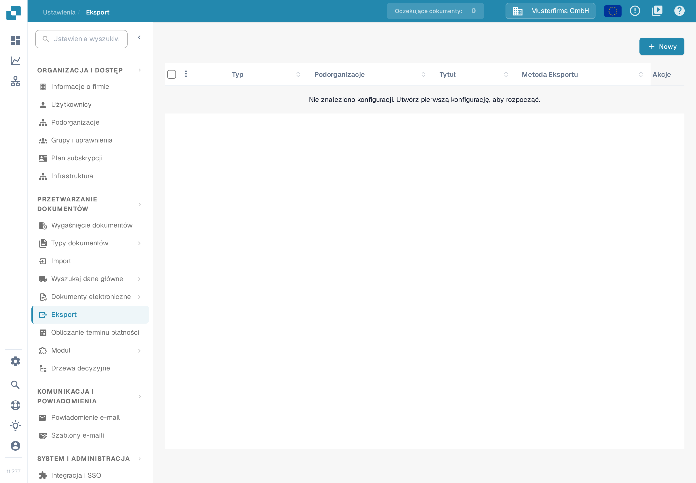
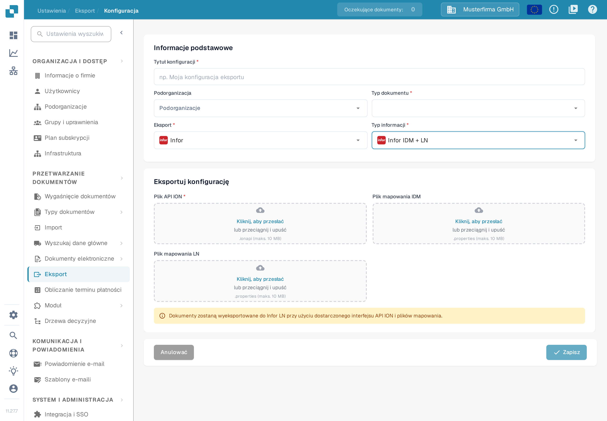

# Konfiguracja LN

Ten przewodnik łączy historyczne przykłady z Infor ION z aktualnym formularzem eksportu LN w DocBits. Obrazy z Infor pokazują poszczególne kroki; nazwy firm, nazwy mapowań i układ na tych obrazach są przykładami. Przed aktywowaniem przepływu poproś administratora Infor o sprawdzenie punktów połączenia, pakietu mapowań i uprawnień BOD dla Twojej firmy LN. Na potrzeby tej aktualizacji dokumentacji nie testowano połączenia z firmą Infor ani eksportu faktury.

## Wymagania wstępne

Przygotuj:

* punkt końcowy API ION
* plik API ION
* plik mapowania BOD
* plik mapowania IDM

## Importowanie plików mapowania

Zanim skonfigurujesz przepływ danych, zaimportuj pliki mapowania do InforOS.

W ION Desk otwórz **Connect → Mappings**.

<figure><figcaption>
Historyczny przykład: nawigacja ION Desk z rozwiniętą grupą Connect i pozycjami Data Flows, API Flows, Connection Points, File Templates oraz Enterprise Locations. Sprawdź odpowiednie ustawienia w swojej firmie Infor.
</figcaption></figure>

Kliknij ikonę importu.

<figure><figcaption>
Historyczny przykład: pasek narzędzi Mappings w ION Desk z zaznaczoną ikoną importu. Sprawdź odpowiednie ustawienia w swojej firmie Infor.
</figcaption></figure>

* Wybierz potrzebne pliki mapowania: SyncCaptDoc\_SyncSuppInv, SyncSupplierInvoice\_LoadSupplierInvoice oraz LoadSupplierInvoice\_ProcessSupplierInvoice.
* Po zaimportowaniu wszystkich plików mapowania zatwierdź każdy z nich, klikając ikonę znacznika w jego kafelku na pulpicie mapowań.

## Z DocBits do LN

Następnie skonfiguruj przepływ danych w ION Desk: otwórz aplikację ION Desk i wybierz **Data Flow → + ADD → Document Flow**, jak pokazano poniżej.

<figure><figcaption>
Historyczny przykład: strona Data Flows w ION Desk z nawigacją po lewej, przepływem DF_SLTStAPI na liście oraz pozycjami menu Document Flow i Data Lake Flow. Sprawdź odpowiednie ustawienia w swojej firmie Infor.
</figcaption></figure>

Na tym obszarze roboczym zbudujesz przepływ informacji z DocBits do LN.

<figure><figcaption>
Historyczny przykład: nowy Document Flow z pustym panelem właściwości oraz komunikatami Document flow name must be specified i The document flow has no activities. Sprawdź odpowiednie ustawienia w swojej firmie Infor.
</figcaption></figure>

Przepływ danych LN wygląda podobnie do poniższego. Widocznych jest kilka ścieżek, ponieważ każda z nich jest przeznaczona dla innego typu dokumentu; w tym opisie skupiamy się na przepływie danych faktury.

<figure><figcaption>
Historyczny przykład: obszar roboczy Data Flow z kilkoma ścieżkami dla różnych typów dokumentów; każda ścieżka składa się z punktu połączenia DocBits, mapowania i punktu połączenia LN. Sprawdź odpowiednie ustawienia w swojej firmie Infor.
</figcaption></figure>

Wszystkie elementy łańcucha przeciągasz z górnej sekcji.

W łańcuchu DocBits i LN są aplikacjami, a pomiędzy nimi znajdują się mapowania. Przekształcają one dane do postaci zrozumiałej dla następnego elementu przepływu i przypisują informacje do właściwych miejsc.

<figure><figcaption>
Historyczny przykład: paleta działań i przepływ w ION, w których działania aplikacji reprezentują DocBits i LN, a pomiędzy nimi znajdują się działania mapowania. Sprawdź odpowiednie ustawienia w swojej firmie Infor.
</figcaption></figure>

### Aplikacja DocBits

Nadaj jej odpowiednią nazwę, na przykład „DocBits”, następnie wybierz znak plus, wyszukaj utworzony wcześniej punkt połączenia — na przykład DocBits\_Export — i kliknij go.

Aby utworzyć ten punkt połączenia, przejdź do **ION Desk → Connect → Connection Points**.

<figure><figcaption>
Historyczny przykład: nawigacja ION Desk z rozwiniętą grupą Connect i pozycjami Data Flows, API Flows, Mappings oraz Connection Points. Sprawdź odpowiednie ustawienia w swojej firmie Infor.
</figcaption></figure>

Kliknij **+ Add**.

<figure><figcaption>
Historyczny przykład: strona Connection Points w ION Desk z otwartą grupą Connect w nawigacji. Sprawdź odpowiednie ustawienia w swojej firmie Infor.
</figcaption></figure>

Wybierz **IMS via API Gateway** i wypełnij poniższe informacje.

<figure><figcaption>
Historyczny przykład: punkt połączenia IMS via API Gateway z przykładowym identyfikatorem logicznym i zamazanym polem ION API Client Id. Sprawdź odpowiednie ustawienia w swojej firmie Infor.
</figcaption></figure>

Identyfikator klienta ION API to wartość `ci` w pliku `.ionapi`. Plik dla Twojej firmy otrzymasz od upoważnionego administratora Infor. Zawiera dane dostępowe, dlatego nie umieszczaj go na zrzutach ekranu, w zgłoszeniach ani w Git. Zobacz [objaśnienie pól danych dostępowych ION API w dokumentacji Infor](https://docs.infor.com/crm/9.4.x/en-us/webclient/upi1639111995644.html).

Przejdź do karty dokumentów i dodaj BOD **Sync.CaptureDocument** do punktu połączenia DocBits, jak pokazano poniżej.

<figure><figcaption>
Historyczny przykład: punkt połączenia DocBits-Sandbox-Export z otwartą kartą Documents i przypisanym dokumentem Sync.CaptureDocument. Sprawdź odpowiednie ustawienia w swojej firmie Infor.
</figcaption></figure>

Następnie zapisz punkt połączenia, klikając ikonę dysku w lewym górnym rogu.

Wróć do sekcji Dataflow w ION Desk, aby otworzyć swój przepływ danych. Aplikacja DocBits powinna wyglądać podobnie do poniższej.

<figure><figcaption>
Historyczny przykład: okno Application Activity Properties z nazwą aplikacji DocBits-Sandbox i wybranym punktem połączenia DocBits-Sandbox-Export. Sprawdź odpowiednie ustawienia w swojej firmie Infor.
</figcaption></figure>

### Mapowanie 1

Pierwszy węzeł mapowania powinien wyglądać następująco:

<figure><figcaption>
Historyczny przykład: właściwości pierwszego mapowania, Capture2sync, z przykładowym mapowaniem LN_CaptureDocumentToSupplierInvoice_1. Sprawdź odpowiednie ustawienia w swojej firmie Infor.
</figcaption></figure>

### Mapowanie 2

Drugi węzeł mapowania powinien wyglądać następująco:

<figure><figcaption>
Historyczny przykład: właściwości drugiego mapowania, Load2Process, z przykładowym mapowaniem LoadSupplierToProcessSupplierInvoice. Sprawdź odpowiednie ustawienia w swojej firmie Infor.
</figcaption></figure>

### Aplikacja LN

W Infor powinien już istnieć punkt połączenia o nazwie LN lub podobnej, utworzony dla właściwej firmy LN. Wybierz go tak samo jak aplikację DocBits, klikając znak „+”. Wynik powinien wyglądać następująco:

<figure><figcaption>
Historyczny przykład: okno Application Activity Properties aplikacji LN z przykładową nazwą LN-200 i wybranym połączeniem aplikacji In01_0200. Sprawdź odpowiednie ustawienia w swojej firmie Infor.
</figcaption></figure>

### BODs

<figure><figcaption>
Historyczny przykład: obszar roboczy Data Flow z węzłami DocBits-DEV, MappingDeliver, Load Supplier, PurchaseOrder, SalesOrder i AdvancedShip powyżej pozycji End. Sprawdź odpowiednie ustawienia w swojej firmie Infor.
</figcaption></figure>

Poniższe konfiguracje powinny wyglądać następująco:

#### Pierwszy

<figure><figcaption>
Historyczny przykład: lista dokumentów pierwszego kroku z pozycją Sync.CaptureDocument. Sprawdź odpowiednie ustawienia w swojej firmie Infor.
</figcaption></figure>

#### Drugi

<figure><figcaption>
Historyczny przykład: lista dokumentów drugiego kroku z pozycją Load.SupplierInvoice. Sprawdź odpowiednie ustawienia w swojej firmie Infor.
</figcaption></figure>

#### Trzeci

<figure><figcaption>
Historyczny przykład: lista dokumentów trzeciego kroku z pozycją Process.SupplierInvoice. Sprawdź odpowiednie ustawienia w swojej firmie Infor.
</figcaption></figure>

Ostatnia ikona powinna być pusta, ponieważ nie przenosi żadnego dokumentu ani informacji.

Gdy administrator Infor sprawdzi wszystkie węzły, mapowania i subskrypcje dokumentów, aktywuj przeznaczony przepływ przyciskiem aktywacji. Poniższy historyczny obrazek wskazuje ten przycisk; jego stara nazwa przepływu zawiera M3 i nie może być użyta jako nazwa ani cel konfiguracji LN.

<figure><figcaption>
Historyczny przykład: pasek narzędzi Document Flow z zaznaczonym przyciskiem aktywacji. Stary przykładowy przepływ nazywa się DocBits-Export-M3; w swojej firmie wybierz właściwy przepływ LN. Sprawdź odpowiednie ustawienia w swojej firmie Infor.
</figcaption></figure>

## Konfiguracja eksportu w DocBits

W wybranej organizacji DocBits otwórz **Ustawienia → Eksport**. Lista pokazuje istniejące konfiguracje eksportu wraz z kolumnami Typ, Podorganizacje, Tytuł, Metoda Eksportu i Akcje. Wybierz **Nowy**, aby przygotować nową konfigurację.

<figure><figcaption>
W tym przykładzie lista jest pusta i pokazuje komunikat „Nie znaleziono konfiguracji. Utwórz pierwszą konfigurację, aby rozpocząć.” Przycisk Nowy otwiera formularz konfiguracji; żadna zapisana konfiguracja nie została otwarta ani zmieniona. Wszystkie dane to wymyślony przykład z aplikacji 11.27.7.
</figcaption></figure>

W sekcji **Informacje podstawowe** wpisz **Tytuł konfiguracji** i wybierz **Typ dokumentu** (w przykładzie fakturę). Pole **Podorganizacja** wypełnij tylko wtedy, gdy wymaga tego Twoja konfiguracja. W polu **Eksport** wybierz **Infor**, a w polu **Typ informacji** — **Infor IDM + LN**; polska wersja interfejsu określa to pole jako „Typ informacji”, chodzi o typ eksportu Infor.

W sekcji **Eksportuj konfigurację** przygotuj wszystkie trzy pliki wymagane dla nowej konfiguracji LN: **Plik API ION** (`.ionapi`), **Plik mapowania IDM** (`.properties`) i **Plik mapowania LN** (`.properties`). Kliknij **Kliknij, aby przesłać** albo przeciągnij plik do pola. Pliki dla tej firmy i firmy LN otrzymasz od upoważnionego administratora Infor. Zrzut ekranu celowo pozostawia wszystkie pola przesyłania puste i nie zawiera danych dostępowych.

<figure><figcaption>
Aktualny formularz LN rozdziela trzy pola przesyłania: Plik API ION, Plik mapowania IDM i Plik mapowania LN. W tym przykładzie nie wybrano typu dokumentu, nie przesłano żadnego pliku i nie zapisano konfiguracji. Wszystkie dane to wymyślony przykład z aplikacji 11.27.7.
</figcaption></figure>

Gdy administrator potwierdzi przepływ ION i pliki, zapisz konfigurację przyciskiem **Zapisz** i przetestuj jedną autoryzowaną fakturę poza środowiskiem produkcyjnym. Sprawdź wynik w DocBits, Infor ION i LN. Zapisana konfiguracja sama nie dowodzi, że LN otrzymał fakturę. Jeśli tylko przeglądasz dostępne pola, zamknij formularz przyciskiem **Anulować**.

Informacje o roli punktów połączenia i przepływów dokumentów znajdziesz w [objaśnieniu Infor ION](https://docs.infor.com/ln/10.8/en-us/lnesolh/lnoshybridng/wxa1699288671147.html).
