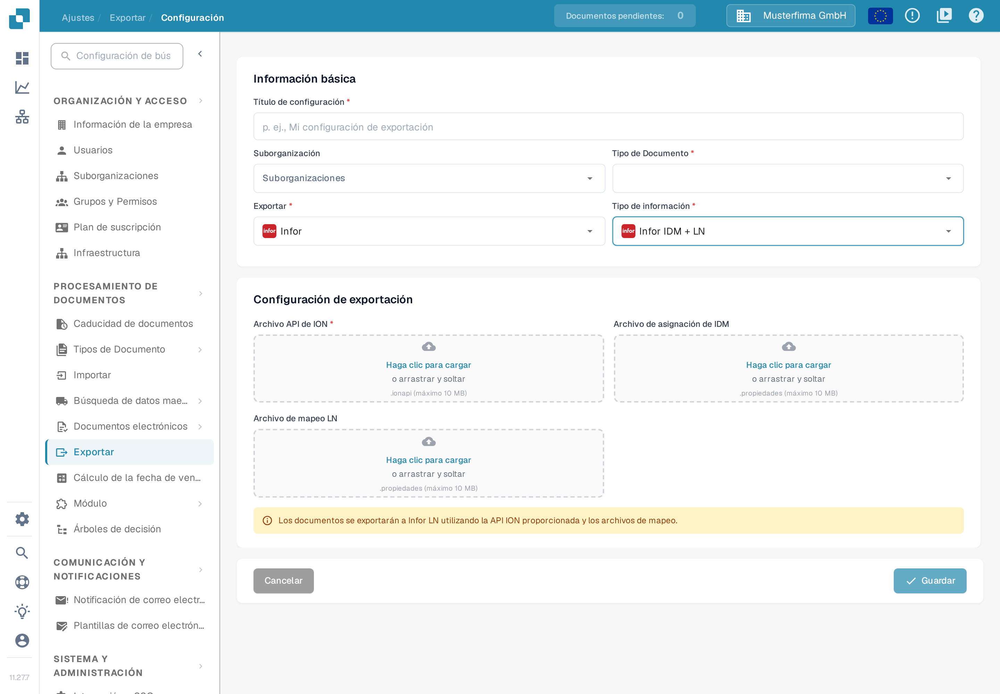

# Configuración de LN

Esta guía combina ejemplos históricos de Infor ION con el formulario actual de exportación a LN de DocBits. Las imágenes de Infor ilustran los pasos individuales; los nombres de sus entornos, de sus mapeos y su disposición son ejemplos. Antes de activar un flujo, verifica los puntos de conexión, el paquete de mapeo y los permisos de BOD con tu administrador de Infor para tu empresa LN. Para esta actualización de la documentación no se probó ninguna conexión a un entorno de Infor ni ninguna exportación de facturas.

## Requisitos previos

Has creado:

* Un punto de conexión de ION API
* Un archivo de ION API
* Un archivo de mapeo BOD
* Un archivo de mapeo IDM

## Importar archivos de mapeo

Antes de configurar el flujo de datos, importa los archivos de mapeo en InforOS

En ION Desk → Connect, abre Mappings

<figure><figcaption>
Ejemplo histórico: navegación de ION Desk con el grupo Connect desplegado y las entradas Data Flows, API Flows, Connection Points, File Templates y Enterprise Locations. Confirma la configuración correspondiente en tu entorno de Infor.
</figcaption></figure>

Haz clic en el icono de importación

<figure><figcaption>
Ejemplo histórico: barra de herramientas de la página Mappings en ION Desk con el control de importación marcado. Confirma la configuración correspondiente en tu entorno de Infor.
</figcaption></figure>

* Aquí debes seleccionar los distintos archivos de mapeo que necesitas, entre ellos: SyncCaptDoc\_SyncSuppInv, SyncSupplierInvoice\_LoadSupplierInvoice y LoadSupplierInvoice\_ProcessSupplierInvoice.
* Cuando hayas importado todos los archivos de mapeo, aprueba cada uno de ellos haciendo clic en el icono de marca dentro de su cuadro en el panel de mapeos.

## De DocBits a LN

El siguiente paso es configurar el flujo de datos en ION Desk. Abre la aplicación ION Desk y selecciona Data Flow → + ADD → Document Flow, como se muestra a continuación

<figure><figcaption>
Ejemplo histórico: página Data Flows de ION Desk con la navegación a la izquierda, el flujo DF_SLTStAPI en la lista y las entradas de menú Document Flow y Data Lake Flow. Confirma la configuración correspondiente en tu entorno de Infor.
</figcaption></figure>

Usa este lienzo para construir el flujo de información de DocBits a LN.

<figure><figcaption>
Ejemplo histórico: Document Flow nuevo con el panel de propiedades vacío y los mensajes Document flow name must be specified y The document flow has no activities. Confirma la configuración correspondiente en tu entorno de Infor.
</figcaption></figure>

Un flujo de datos de LN se parecerá a lo que se muestra a continuación (hay varias rutas porque cada ruta individual está pensada para un tipo de documento concreto; en esta explicación nos centramos en el flujo de datos de la factura).

<figure><figcaption>
Ejemplo histórico: lienzo de flujo de datos con varias rutas para distintos tipos de documento; cada ruta se compone de un punto de conexión DocBits, un mapeo y un punto de conexión LN. Confirma la configuración correspondiente en tu entorno de Infor.
</figcaption></figure>

Todas las partes de la cadena se arrastran y sueltan desde la sección superior

En la cadena, DocBits y LN son aplicaciones, mientras que entre ellas hay mapeos que convierten los datos a un formato que la siguiente sección del flujo de datos puede entender y “asignan” la información para que llegue adonde se necesita.

<figure><figcaption>
Ejemplo histórico de la paleta de actividades de ION y del flujo: las actividades de aplicación representan DocBits y LN, con actividades de mapeo entre ellas. Confirma la configuración correspondiente en tu entorno de Infor.
</figcaption></figure>

### Aplicación DocBits

Dale un nombre apropiado, como “DocBits”; después selecciona el signo más, busca el punto de conexión que creaste antes (por ejemplo, DocBits\_Export o similar) y haz clic en él.

Para crear este punto de conexión, ve a ION Desk → Connect → Connection Points

<figure><figcaption>
Ejemplo histórico: navegación de ION Desk con el grupo Connect desplegado y las entradas Data Flows, API Flows, Mappings y Connection Points. Confirma la configuración correspondiente en tu entorno de Infor.
</figcaption></figure>

Haz clic en “+ Add”

<figure><figcaption>
Ejemplo histórico: página Connection Points de ION Desk con el grupo Connect abierto en la navegación. Confirma la configuración correspondiente en tu entorno de Infor.
</figcaption></figure>

Selecciona “IMS via API Gateway” y completa la siguiente información

<figure><figcaption>
Punto de conexión histórico IMS via API Gateway con el nombre DocBits-Sandbox-Export, el tipo de ID lógico ims y el campo ION API Client Id oculto. Confirma la configuración correspondiente en tu entorno de Infor.
</figcaption></figure>

El ID de cliente de ION API es el valor `ci` de tu archivo `.ionapi`. Solicita el archivo específico de tu entorno a tu administrador autorizado de Infor. Contiene credenciales: mantenlo fuera de capturas de pantalla, tickets y Git. Consulta la [explicación de Infor sobre los campos de credenciales de ION API](https://docs.infor.com/crm/9.4.x/en-us/webclient/upi1639111995644.html).

Cambia a la pestaña de documentos y añade el BOD Sync.CaptureDocument al punto de conexión DocBits, como se muestra a continuación.

<figure><figcaption>
Ejemplo histórico: punto de conexión DocBits-Sandbox-Export con la pestaña Documents abierta y el documento Sync.CaptureDocument asignado. Confirma la configuración correspondiente en tu entorno de Infor.
</figcaption></figure>

Después guarda el punto de conexión pulsando el icono de disco de la esquina superior izquierda.

Vuelve a la sección Dataflow de ION Desk para acceder a tu flujo de datos. Tu aplicación DocBits debería parecerse a lo que se muestra a continuación.

<figure><figcaption>
Propiedades históricas de la actividad de aplicación con el nombre DocBits-Sandbox y su punto de conexión seleccionado DocBits-Sandbox-Export. Confirma la configuración correspondiente en tu entorno de Infor.
</figcaption></figure>

### Mapeo 1

El primer nodo de mapeo debería verse así

<figure><figcaption>
Propiedades históricas del primer mapeo: Capture2sync con el mapeo de ejemplo LN_CaptureDocumentToSupplierInvoice_1. Confirma la configuración correspondiente en tu entorno de Infor.
</figcaption></figure>

### Mapeo 2

El segundo nodo de mapeo debería verse así

<figure><figcaption>
Propiedades históricas del segundo mapeo: Load2Process con el mapeo de ejemplo LoadSupplierToProcessSupplierInvoice. Confirma la configuración correspondiente en tu entorno de Infor.
</figcaption></figure>

### Aplicación LN

Ya debería existir un punto de conexión LN o con un nombre similar (para la empresa LN adecuada) creado en INFOR; al igual que con la aplicación DocBits, lo seleccionas haciendo clic en el signo “+” y debería verse así

<figure><figcaption>
Propiedades históricas de la actividad de aplicación LN con el nombre de ejemplo LN-200 y la conexión de aplicación seleccionada IMI_0200. Confirma la configuración correspondiente en tu entorno de Infor.
</figcaption></figure>

### BOD

<figure><figcaption>
Ejemplo histórico: lienzo de flujo de datos con los nodos DocBits-DEV, MappingDeliver, Load Supplier, PurchaseOrder, SalesOrder y AdvancedShip sobre la entrada End. Confirma la configuración correspondiente en tu entorno de Infor.
</figcaption></figure>

Las siguientes configuraciones deberían verse así:

#### Primero

<figure><figcaption>
Lista histórica de Documents del primer paso con la entrada Sync.CaptureDocument. Confirma la configuración correspondiente en tu entorno de Infor.
</figcaption></figure>

#### Segundo

<figure><figcaption>
Lista histórica de Documents del segundo paso con la entrada Load.SupplierInvoice. Confirma la configuración correspondiente en tu entorno de Infor.
</figcaption></figure>

#### Tercero

<figure><figcaption>
Lista histórica de Documents del tercer paso con la entrada Process.SupplierInvoice. Confirma la configuración correspondiente en tu entorno de Infor.
</figcaption></figure>

El último icono debe estar vacío, ya que no contiene ningún documento ni información.

Cuando tu administrador de Infor haya verificado todos los nodos, mapeos y suscripciones de documentos, usa el control de activación del flujo previsto. La captura histórica siguiente marca ese control; su antiguo nombre de flujo contiene M3 y no debe usarse como nombre ni como destino de tu configuración de LN.

<figure><figcaption>
Barra de herramientas histórica del Document Flow con el control de activación marcado en verde. El ejemplo antiguo se llama DocBits-Export-M3; elige el flujo LN correcto en tu entorno. Confirma la configuración correspondiente en tu entorno de Infor.
</figcaption></figure>

## Configurar la exportación en DocBits

Abre **Ajustes → Exportar** en la organización de DocBits prevista. La lista muestra las configuraciones de exportación existentes; mientras no haya ninguna, aparece el aviso **Sin configuraciones**. Selecciona **Nuevo** para preparar una nueva configuración.

<figure><figcaption>
Nuevo abre un formulario de configuración. En esta organización de ejemplo todavía no hay ninguna configuración guardada y no se abrió ni se modificó ninguna.
</figcaption></figure>

En **Información básica**, introduce un **Título de configuración**, selecciona el **Tipo de Documento** (una factura en el ejemplo) y elige una **Suborganización** solo si tu configuración la requiere. En **Exportar**, elige **Infor** y, en **Tipo de información**, elige **Infor IDM + LN**.

Aporta los tres archivos necesarios para una nueva configuración de LN: el **Archivo API de ION** (`.ionapi`), el **Archivo de asignación de IDM** (`.properties`) y el **Archivo de mapeo LN** (`.properties`). Solicita los archivos de este entorno y de esta empresa LN al administrador autorizado de Infor. La captura deja deliberadamente todas las cargas vacías y no contiene credenciales.

<figure><figcaption>
El formulario actual separa los tres campos de carga. Información básica identifica el destino y el tipo de documento; en este ejemplo no se eligieron tipo de documento ni archivos, y el formulario no se guardó. La captura se tomó en una organización de ejemplo con datos inventados.
</figcaption></figure>

Cuando tu administrador haya confirmado el flujo de ION y los archivos, selecciona **Guardar** y prueba una factura autorizada que no sea de producción. Comprueba el resultado en DocBits, en Infor ION y en LN. Una configuración guardada por sí sola no demuestra que LN haya recibido una factura. Si solo estás revisando los campos disponibles, **Cancelar** cierra el formulario sin guardar nada.

Para conocer la función de los puntos de conexión y de los flujos de documentos, consulta la [explicación de Infor ION](https://docs.infor.com/ln/10.8/en-us/lnesolh/lnoshybridng/wxa1699288671147.html).
