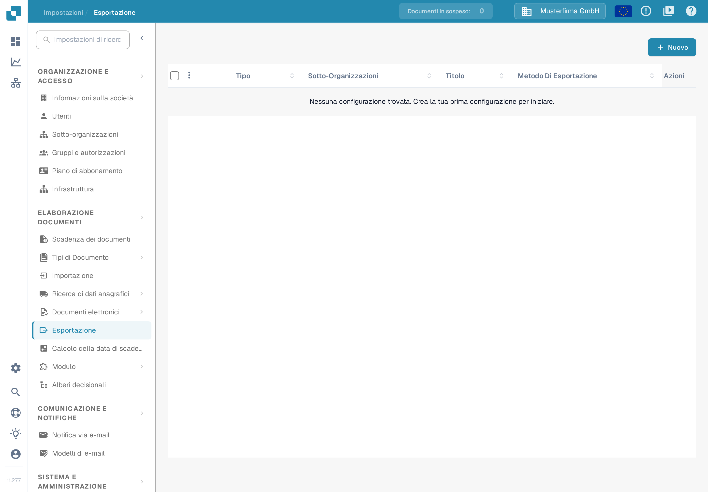
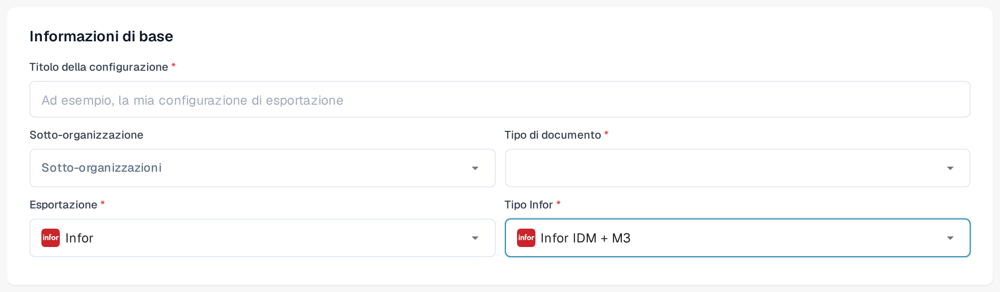
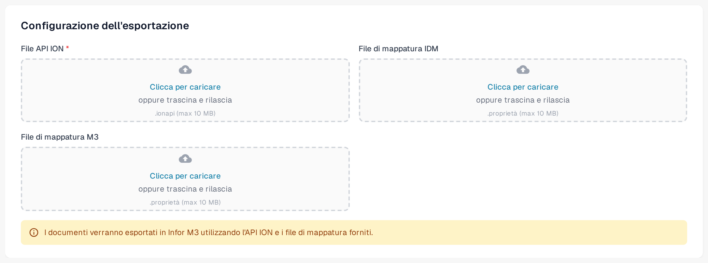

# Esportazione in Infor M3

Questa pagina descrive il flusso Infor ION e la configurazione dell'esportazione in DocBits. Le schermate Infor riportate sotto sono esempi storici; i loro menu e le impostazioni del flusso di dati vanno verificati nel proprio tenant prima dell'attivazione. La sezione DocBits usa tre schermate italiane dell'ambiente Sandbox, acquisite il 12 novembre 2026 con dati di esempio inventati; la versione 11.27.7 è visibile nell'immagine della pagina Esportazione. Per questo aggiornamento non sono stati provati né una connessione Infor né un'esportazione di fatture.

## Passo 1: Creare un punto di connessione in Infor ION

1. Andare in **OS > ION > Connect > Connection Points**.
2. Fare clic su **Add** e selezionare **IMS via API Gateway** come tipo di connessione.
3. Configurare le impostazioni seguenti:
   * **Name**: impostare `DocBits_Export`.
   * **Description**: impostare `DocBits_Export`.
   * **Uncheck**: _Application has IMS End Point_.
   * **ION API Client ID**:
     * Aprire il file ION API.
     * Cercare `"ci"` all'interno del file.
     * Copiare il valore dell'ID client `ci`. Tenere privato l'intero file `.ionapi`, perché contiene anche le credenziali. Infor spiega i [campi del file](https://docs.infor.com/crm/9.4.x/en-us/webclient/upi1639111995644.html).

<figure><figcaption>
Esempio storico di punto di connessione. La scheda Connection è selezionata; usare l'ID client del proprio file ION API privato.
</figcaption></figure>

4. In **Documents**, aggiungere `Sync.CaptureDocument`.

<figure><figcaption>
Esempio storico della scheda Documents: Sync.CaptureDocument è attivo per Send from Application.
</figcaption></figure>

5. Fare clic su **Save** per completare la configurazione.

## Passo 2: Caricare le mappature



1. Scaricare l'XML di mappatura M3 di esempio riportato sopra. Far verificare la mappatura dal proprio amministratore dell'integrazione per il tenant prima di importarla.
2. Andare in **Infor** > **OS** > **ION** > **Connect** > **Mappings**.
3. Fare clic su **Import** e selezionare il file di mappatura adatto per **M3**.

<figure><figcaption>
Esempio storico dell'azione di importazione della mappatura. La freccia azzurra indica l'icona Import.
</figcaption></figure>

4. Controllare la mappatura importata e i relativi BOD di origine e di destinazione, quindi usare **Approve** secondo il processo di modifica del proprio tenant.

<figure><figcaption>
Esempio storico di mappatura: confermare i BOD di origine e di destinazione prima di usare Approve.
</figcaption></figure>

## Passo 3: Creare il flusso di dati

1. Andare in **OS** -> **ION** -> **Connect** -> **Data Flows**.
2. Fare clic su **Add** e selezionare **Document Flow**.
3. Compilare i dettagli:
   * **Name**: `DocBits_Export_to_M3`
4. Aggiungere i nodi al flusso:

#### Nodo applicazione

1. Aggiungere un **Application Node** al flusso.
   * **Name**: `DocBits` oppure `DocBits-Export`.
2. Fare clic su **Add** e selezionare il **Connection Point** creato nel Passo 1.

<figure><figcaption>
Esempio storico del nodo applicazione DocBits. Selezionare il punto di connessione creato per il proprio tenant; il nome dimostrativo è solo un esempio.
</figcaption></figure>

3. Fare clic sull'**Document Icon** accanto al nodo applicazione.
   * Fare clic su **Add** e selezionare `Sync.CaptureDocument`.

<figure><figcaption>
Esempio storico del pannello Documents del nodo DocBits: Sync.CaptureDocument.
</figcaption></figure>

#### Nodo di mappatura

1. Aggiungere un **Mapping Node** a destra del nodo applicazione.
   * **Name**: `Capt2process`.
   * **Mapping**: selezionare la mappatura importata da `Sync.CaptureDocument` a `Process.SupplierInvoice`. Il nome visualizzato può differire dal nome del file XML scaricato; l'esempio storico sotto usa `SyncCaptDoc_SyncSuppInv`.

<figure><figcaption>
Esempio storico del nodo di mappatura. In questo esempio la mappatura si chiama SyncCaptDoc_SyncSuppInv; la mappatura importata può avere un altro nome.
</figcaption></figure>

#### Nodo applicazione

1. Aggiungere un **Application Node** a destra del nodo di mappatura precedente.
   * **Name**: `M3`.
2. Fare clic su **Add** e selezionare l'**M3 Application** del cliente.

<figure><figcaption>
Esempio storico del nodo applicazione M3. Selezionare il punto di connessione M3 fornito per il proprio tenant.
</figcaption></figure>

3. Fare clic sull'**Document Icon** accanto al nodo applicazione.
   * Fare clic su **Add** e selezionare `Acknowledge.SupplierInvoice`.

<figure><figcaption>
Esempio storico del pannello Documents del nodo M3: Acknowledge.SupplierInvoice.
</figcaption></figure>

#### Nodo API

1. Aggiungere un **API Node** a destra del nodo applicazione.
   * **Name**: `DocBits-Error`.
   * **ION API Connector**: `DocBits_Import`.
   * Se il connettore di importazione non esiste, consultare la [guida all'importazione M3 e alla connessione API](../../importing-customer-master-data/m3/import-from-infor-m3-to-docbits-via-api.md) e farla verificare dal proprio amministratore Infor prima dell'attivazione.

<figure><figcaption>
Esempio storico del nodo API per la gestione degli errori. Il connettore dimostrativo selezionato è un esempio; usare il proprio connettore di importazione.
</figcaption></figure>

#### Salvare e attivare il flusso

* Dopo aver aggiunto e configurato tutti i nodi, fare clic su **Save**.
* Attivare il flusso per completare la configurazione.

<figure><figcaption>
Esempio storico della barra strumenti di attivazione. La freccia azzurra indica l'azione di attivazione; questo ritaglio non mostra il flusso completo.
</figcaption></figure>

## Passo 4: Configurare l'esportazione in DocBits

Nell'organizzazione DocBits corretta, aprire **Impostazioni → Esportazione** e scegliere **Nuovo**. Si apre una configurazione di esportazione non ancora salvata.

<figure><figcaption>
Scegliere Nuovo nella pagina Esportazione per aprire una bozza di configurazione. La versione 11.27.7 è visibile in basso a sinistra.
</figcaption></figure>

In **Informazioni di base** inserire un **Titolo della configurazione** significativo, scegliere il **Tipo di documento** (per questo flusso di fatture, la fattura) e selezionare una **Sotto-organizzazione** solo se necessario. Impostare **Esportazione** su **Infor**. Compare quindi il campo **Tipo Infor**. Le scelte osservate nell'ambiente Sandbox il 12 novembre 2026 includono **Infor IDM + ION BOD**, **Infor IDM + M3** e **Infor IDM + M3 (TOML)**. Scegliere il tipo che corrisponde ai file di connessione e di mappatura forniti dal proprio amministratore dell'integrazione; la vecchia denominazione "Infor IDM + M3 (API)" non è più mostrata in questa schermata.

Per **Infor IDM + M3** il modulo richiede un **File API ION** (`.ionapi`, obbligatorio), un **File di mappatura IDM** (`.properties`) e un **File di mappatura M3** (`.properties`). Le varianti TOML e ION BOD hanno campi diversi; non sostituire un file con l'altro. Richiedere i file specifici del tenant all'amministratore Infor autorizzato. Il file `.ionapi` contiene credenziali e non deve comparire in schermate, ticket o nel repository Git. Il testo di aiuto del campo di caricamento mostra «.proprietà (max 10 MB)»; l'estensione reale del file è `.properties`.

<figure><figcaption>
Esempio italiano non salvato con Infor IDM + M3 selezionato. La sotto-organizzazione è vuota e il tipo di documento non è ancora scelto.
</figcaption></figure>

<figure><figcaption>
Campi dei file per Infor IDM + M3 nell'ambiente Sandbox. Non è stato caricato alcun file e la configurazione non è stata salvata.
</figcaption></figure>

Controllare tipo di documento, organizzazione e nomi dei file prima di **Salva**. Dopo l'attivazione del flusso Infor, provare con una singola fattura non di produzione e confermarne lo stato in DocBits, in Infor ION e in M3. Una configurazione salvata non è la prova che una fattura sia arrivata a M3.

### Verifica Infor necessaria

Le undici schermate Infor dei passi 1–3 sono mantenute come esempi annotati. Non sono state aggiornate perché non era disponibile un tenant Infor autorizzato. Chiedere all'amministratore Infor di confrontare punti di connessione, flusso di dati, nomi delle mappature e autorizzazioni con l'interfaccia attuale del tenant. La [spiegazione di Infor su punti di connessione e flussi di dati](https://docs.infor.com/ln/10.8/en-us/lnesolh/lnoshybridng/wxa1699288671147.html) descrive come queste parti si collegano.
