# Eksport do Infor M3

Ta strona opisuje przepływ Infor ION oraz konfigurację eksportu w DocBits. Zrzuty ekranu z Infor poniżej są przykładami historycznymi; ich menu i ustawienia przepływu danych trzeba sprawdzić we własnej instancji przed aktywacją. Sekcja DocBits zawiera polskie zrzuty ekranu z Sandbox w wersji 11.27.7, wykonane 12 listopada 2026 z wymyślonymi danymi przykładowymi. W ramach tej aktualizacji nie testowano połączenia z Infor ani eksportu faktury.

## Krok 1: Utwórz punkt połączenia w Infor ION

1. Otwórz **OS > ION > Connect > Connection Points**
2. Kliknij **Add** i wybierz **IMS via API Gateway** jako typ połączenia.
3. Skonfiguruj następujące ustawienia:
   * **Name**: ustaw `DocBits_Export`.
   * **Description**: ustaw `DocBits_Export`.
   * **Odznacz**: _Application has IMS End Point_.
   * **ION API Client ID**:
     * Otwórz plik ION API.
     * Wyszukaj w pliku wartość `"ci"`.
     * Skopiuj wartość identyfikatora klienta z `"ci"`. Cały plik `.ionapi` przechowuj poufnie, ponieważ zawiera także dane uwierzytelniające. Infor wyjaśnia [znaczenie pól pliku](https://docs.infor.com/crm/9.4.x/en-us/webclient/upi1639111995644.html).

<figure>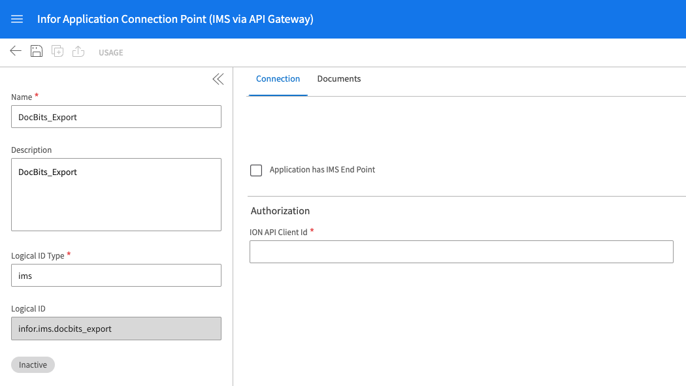<figcaption>
Historyczny przykład punktu połączenia. Wybrana jest karta Connection; użyj identyfikatora klienta z własnego, prywatnego pliku ION API.
</figcaption></figure>

4. W sekcji **Documents** dodaj `Sync.CaptureDocument`.

<figure>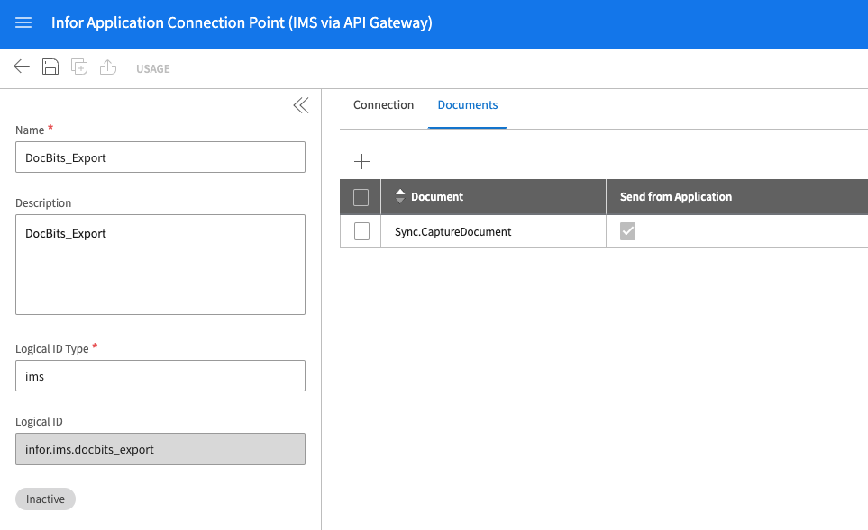<figcaption>
Historyczna karta Documents: Sync.CaptureDocument jest ustawiony jako Send from Application.
</figcaption></figure>

5. Kliknij **Save**, aby zakończyć konfigurację.

## Krok 2: Prześlij mapowania



1. Pobierz przykładowe mapowanie M3 w pliku XML powyżej. Przed importem zleć administratorowi integracji sprawdzenie go pod kątem Twojej instancji.
2. Otwórz **Infor** > **OS** > **ION** > **Connect** > **Mappings**.
3. Kliknij **Import** i wybierz odpowiedni plik mapowania dla **M3**.

<figure>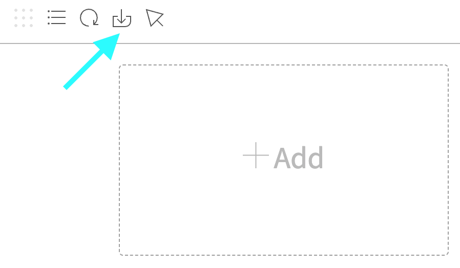<figcaption>
Historyczna czynność importu mapowania. Turkusowa strzałka wskazuje ikonę Import.
</figcaption></figure>

4. Przejrzyj zaimportowane mapowanie oraz jego źródłowe i docelowe BOD, a następnie zatwierdź je przyciskiem **Approve** zgodnie z procesem zmian w Twojej instancji.

<figure>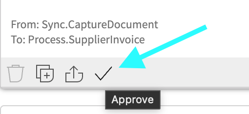<figcaption>
Historyczny przykład mapowania. Przed użyciem Approve potwierdź źródłowe i docelowe BOD.
</figcaption></figure>

## Krok 3: Utwórz przepływ dokumentów

1. Otwórz **OS** > **ION** > **Connect** > **Data Flows**.
2. Kliknij **Add** i wybierz **Document Flow**.
3. Wypełnij szczegóły:
   * **Name**: ustaw `DocBits_Export_to_M3`
4. Dodaj węzły do przepływu:

#### Węzeł aplikacji

1. Dodaj **Application Node** do przepływu.
   * **Name**: `DocBits` lub `DocBits-Export`.
2. Kliknij **Add** i wybierz **Connection Point** utworzony w kroku 1.

<figure>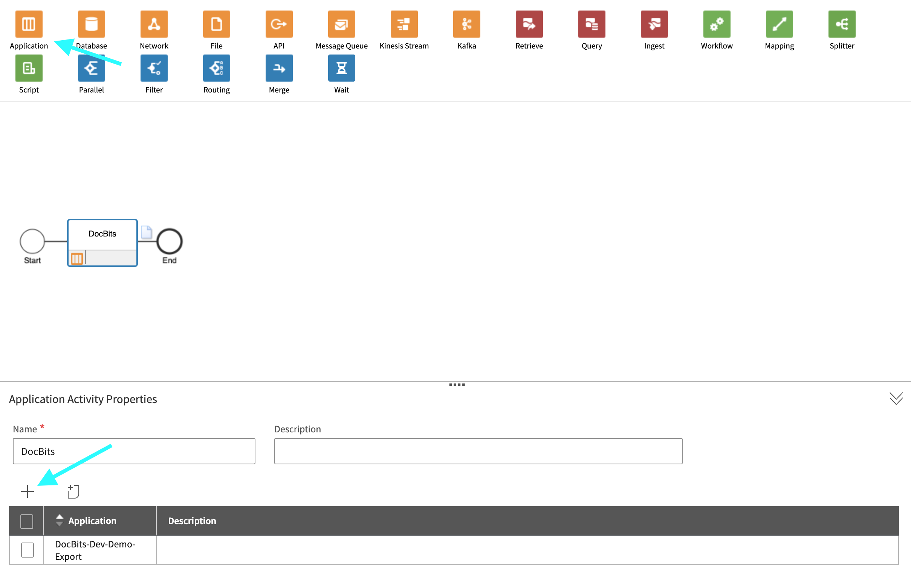<figcaption>
Historyczny węzeł aplikacji DocBits. Wybierz punkt połączenia utworzony dla własnej instancji; nazwa demonstracyjna jest tylko przykładem.
</figcaption></figure>

3. Kliknij **Document Icon** obok **Application Node**.
   * Kliknij **Add** i wybierz `Sync.CaptureDocument`.

<figure>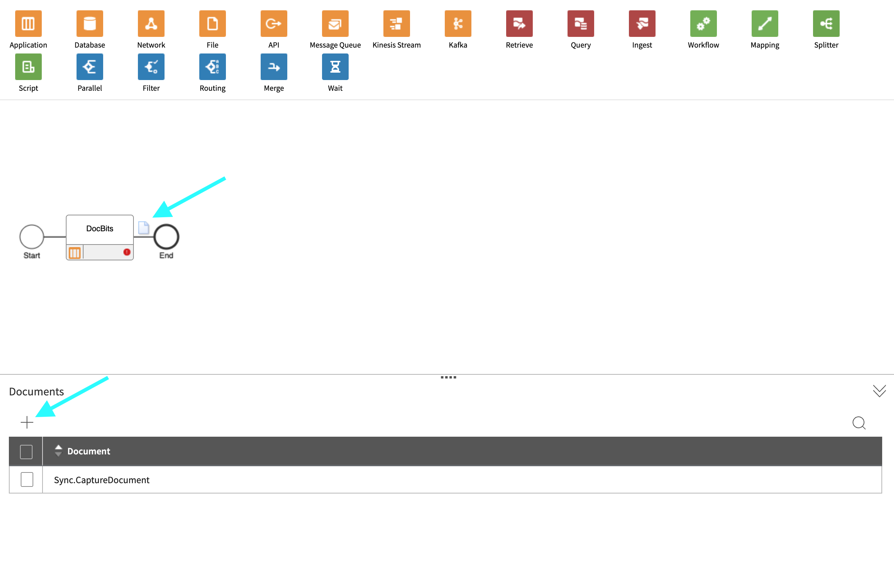<figcaption>
Historyczny panel Documents węzła DocBits: Sync.CaptureDocument.
</figcaption></figure>

#### Węzeł mapowania

1. Dodaj **Mapping Node** po prawej stronie **Application Node**.
   * **Name**: `Capt2process`.
   * **Mapping**: wybierz zaimportowane mapowanie z `Sync.CaptureDocument` do `Process.SupplierInvoice`. Wyświetlana nazwa może różnić się od nazwy pobranego pliku XML; w historycznym przykładzie poniżej użyto `SyncCaptDoc_SyncSuppInv`.

<figure>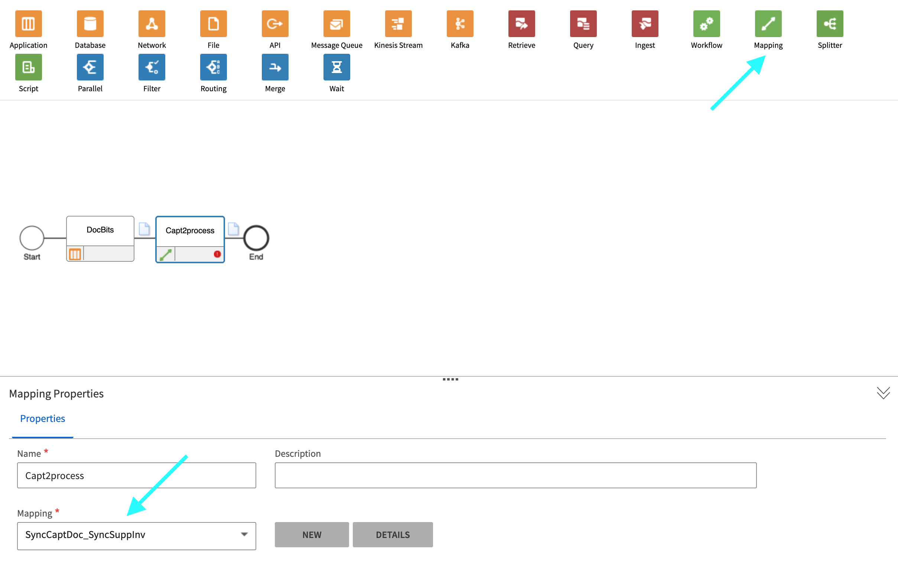<figcaption>
Historyczny węzeł mapowania. W tym przykładzie mapowanie nazywa się SyncCaptDoc_SyncSuppInv; zaimportowane mapowanie może mieć inną nazwę.
</figcaption></figure>

#### Węzeł aplikacji

1. Dodaj **Application Node** po prawej stronie poprzedniego **Mapping Node**.
   * **Name**: `M3`.
2. Kliknij **Add** i wybierz **M3 Application** udostępnioną przez klienta.

<figure>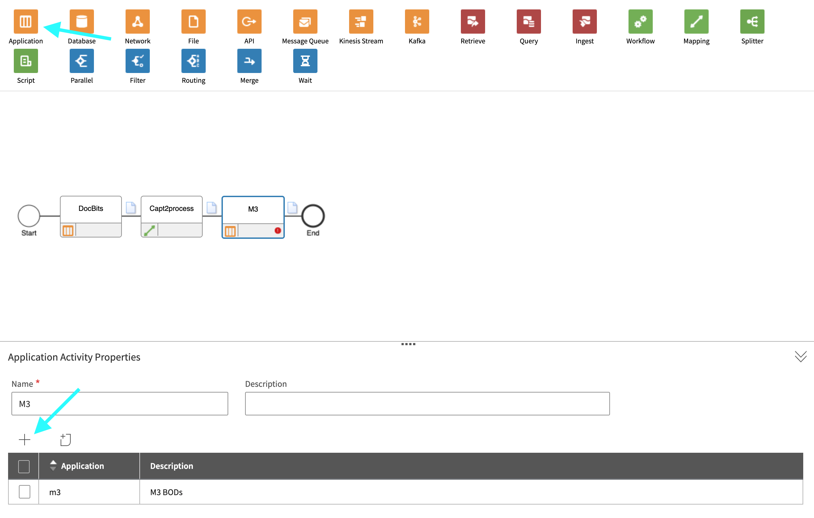<figcaption>
Historyczny węzeł aplikacji M3. Wybierz punkt połączenia M3 udostępniony dla własnej instancji.
</figcaption></figure>

3. Kliknij **Document Icon** obok **Application Node**.
   * Kliknij **Add** i wybierz `Acknowledge.SupplierInvoice`.

<figure>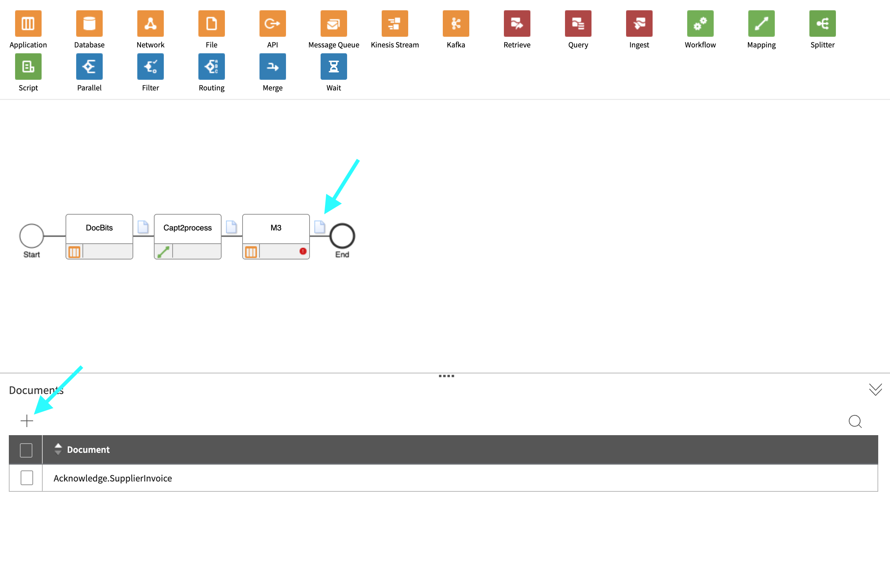<figcaption>
Historyczny panel Documents węzła M3: Acknowledge.SupplierInvoice.
</figcaption></figure>

#### Węzeł API

1. Dodaj **API Node** po prawej stronie **Application Node**.
   * **Name**: `DocBits-Error`.
   * **ION API Connector**: `DocBits_Import`.
   * Jeśli `DocBits_Import` nie istnieje, zapoznaj się z [przewodnikiem po imporcie z M3 i połączeniu przez API](../../importing-customer-master-data/m3/import-from-infor-m3-to-docbits-via-api.md) i zleć administratorowi Infor utworzenie punktu połączenia przed aktywacją.

<figure>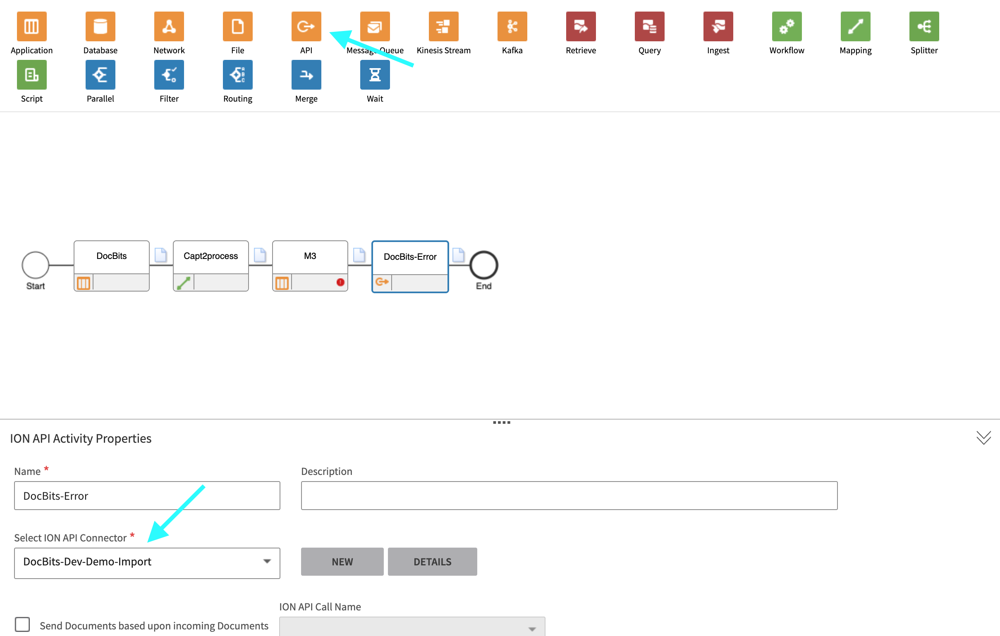<figcaption>
Historyczny węzeł API do obsługi błędów. Wybrany łącznik demonstracyjny jest przykładem; użyj własnego łącznika importu.
</figcaption></figure>

#### Zapisz i aktywuj przepływ

* Po dodaniu i skonfigurowaniu wszystkich węzłów kliknij **Save**.
* Aktywuj przepływ, aby zakończyć konfigurację.

<figure>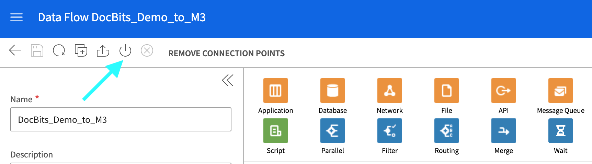<figcaption>
Historyczny przykład aktywacji. Ten wycinek nie pokazuje całego przepływu.
</figcaption></figure>

## Krok 4: Skonfiguruj eksport w DocBits

W odpowiedniej organizacji DocBits otwórz **Ustawienia → Eksport** i wybierz **Nowy**. Otworzy się niezapisana konfiguracja eksportu.

<figure>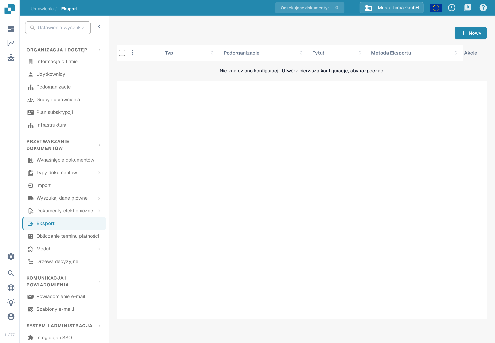<figcaption>
Wybierz Nowy na stronie Eksport, aby otworzyć szkic konfiguracji. Przykład z wymyślonymi danymi; w lewym dolnym rogu widoczna jest wersja 11.27.7.
</figcaption></figure>

W sekcji **Informacje podstawowe** wpisz opisowy **Tytuł konfiguracji**, wybierz **Typ dokumentu** (dla tego przepływu faktur — faktura) i wskaż **Podorganizację** tylko wtedy, gdy jest potrzebna. Ustaw **Eksport** na **Infor**. Wtedy pojawia się pole **Typ informacji**. Opcje widoczne w Sandbox 11.27.7 to między innymi **Infor IDM + ION BOD**, **Infor IDM + M3** oraz **Infor IDM + M3 (TOML)**. Wybierz typ zgodny z połączeniem i plikami mapowań udostępnionymi przez administratora integracji; starsza etykieta „Infor IDM + M3 (API)” nie jest już wyświetlana na tym ekranie.

Dla opcji **Infor IDM + M3** formularz wymaga **Pliku API ION** (`.ionapi`, obowiązkowy), **Pliku mapowania IDM** (`.properties`) oraz **Pliku mapowania M3** (`.properties`). Warianty TOML i ION BOD mają inne pola; nie zastępuj jednego pliku drugim. Pliki właściwe dla instancji otrzymasz od upoważnionego administratora Infor. Plik `.ionapi` zawiera dane uwierzytelniające i nie może pojawić się na zrzutach ekranu, w zgłoszeniach ani w repozytorium Git.

<figure>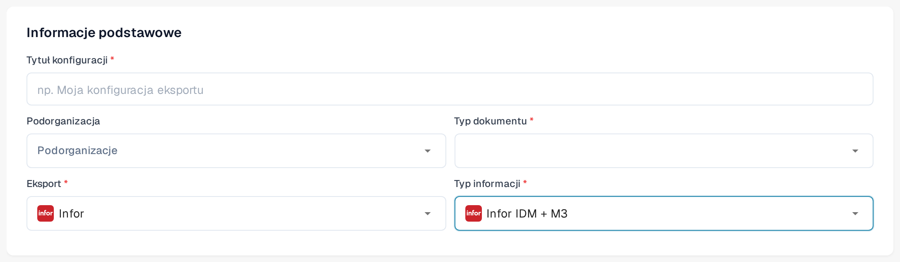<figcaption>
Niezapisany przykład z Sandbox z wybraną opcją Infor IDM + M3. Podorganizacja i typ dokumentu nie są wybrane, a podpowiedź w polu tytułu brzmi „np. Moja konfiguracja eksportu”. Wycinek nie pokazuje przycisków Zapisz i Anulować.
</figcaption></figure>

<figure>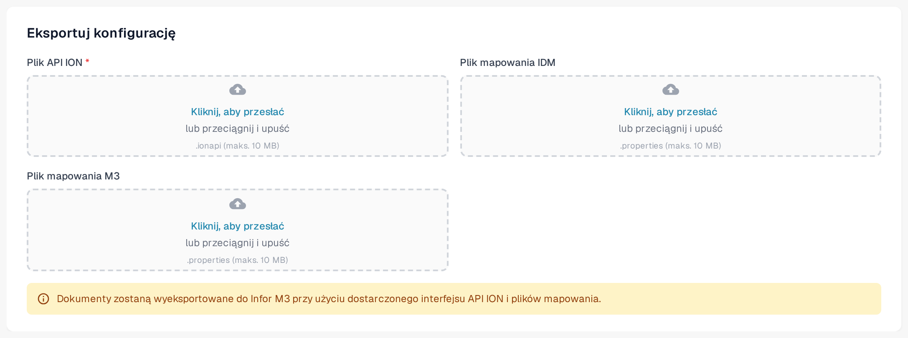<figcaption>
Pola plików dla opcji Infor IDM + M3 w Sandbox. Nie przesłano żadnego pliku i konfiguracji nie zapisano.
</figcaption></figure>

Przycisk **Anulować** zamyka formularz bez zapisywania. Przejrzyj typ dokumentu, organizację i nazwy plików przed kliknięciem **Zapisz**. Gdy przepływ Infor będzie aktywny, przetestuj go na jednej fakturze poza środowiskiem produkcyjnym i potwierdź jej status w DocBits, Infor ION i M3. Zapisana konfiguracja nie jest dowodem, że faktura dotarła do M3.

### Wymagana weryfikacja Infor

Jedenaście zrzutów ekranu Infor w krokach 1–3 zachowano jako opatrzone opisem przykłady. Nie zostały odświeżone, ponieważ nie było dostępnej upoważnionej instancji Infor. Poproś administratora Infor o porównanie punktów połączeń, przepływu dokumentów, nazw mapowań i uprawnień z bieżącym interfejsem instancji. [Objaśnienie punktów połączeń i przepływów dokumentów](https://docs.infor.com/ln/10.8/en-us/lnesolh/lnoshybridng/wxa1699288671147.html) w dokumentacji Infor opisuje, jak te elementy się łączą.
