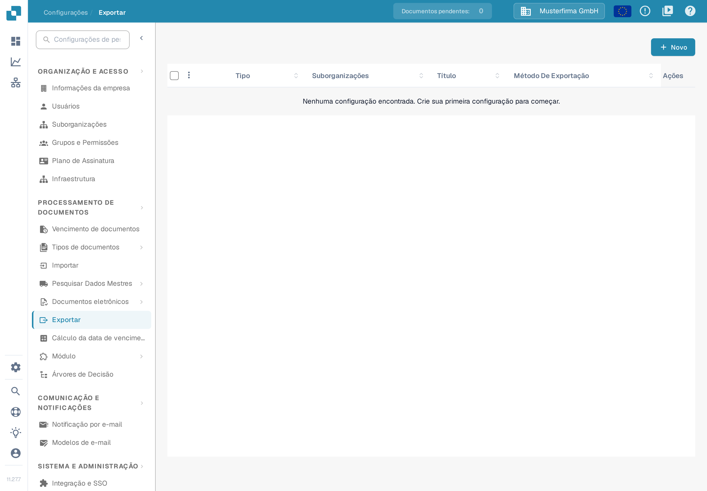
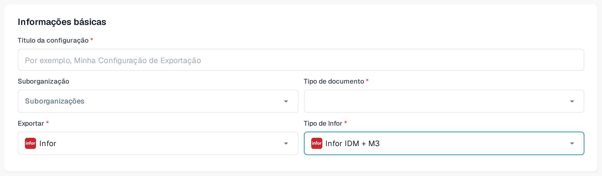

# Exportar para o Infor M3

Esta página descreve o fluxo Infor ION e a configuração de exportação no DocBits. As capturas do Infor abaixo são exemplos históricos; os menus e as definições do fluxo de dados têm de ser confirmados no seu próprio ambiente antes da ativação. A secção do DocBits usa capturas da interface portuguesa da Sandbox (versão 11.27.7, 12 de novembro de 2026), produzidas com dados de exemplo inventados: nenhum ficheiro real foi carregado, nenhuma configuração foi guardada e nesta atualização não foi testada qualquer ligação ao Infor nem qualquer exportação de faturas.

## Passo 1: Criar um ponto de ligação no Infor ION

1. Navegue para **OS > ION > Connect > Connection Points**.
2. Clique em **Add** e selecione **IMS via API Gateway** como tipo de ligação.
3. Configure as seguintes definições:
   * **Name**: defina como `DocBits_Export`.
   * **Description**: defina como `DocBits_Export`.
   * **Desmarque**: _Application has IMS End Point_.
   * **ION API Client ID**:
     * Abra o ficheiro ION API.
     * Procure `"ci"` dentro do ficheiro.
     * Copie o valor do client ID `ci`. Mantenha o ficheiro `.ionapi` completo em local privado, porque também contém credenciais. A Infor explica os [campos do ficheiro](https://docs.infor.com/crm/9.4.x/en-us/webclient/upi1639111995644.html).

<figure><figcaption>
Exemplo histórico de um ponto de ligação. O separador Connection está selecionado; use o client ID do seu próprio ficheiro ION API privado.
</figcaption></figure>

4. Em **Documents**, adicione `Sync.CaptureDocument`.

<figure><figcaption>
Exemplo histórico do separador Documents: Sync.CaptureDocument está ativo em Send from Application.
</figcaption></figure>

5. Clique em **Save** para concluir a configuração.

## Passo 2: Importar mapeamentos



1. Descarregue o ficheiro XML de mapeamento M3 acima. Peça ao seu administrador de integração para o rever para o seu ambiente antes de o importar.
2. Navegue para **Infor** > **OS** > **ION** > **Connect** > **Mappings**.
3. Clique em **Import** e selecione o ficheiro de mapeamento adequado para o **M3**.

<figure><figcaption>
Exemplo histórico da ação de importação de mapeamentos. A seta ciano marca o ícone Import.
</figcaption></figure>

4. Reveja o mapeamento importado e os BOD de origem e destino e, em seguida, use **Approve** de acordo com o processo de alterações do seu ambiente.

<figure><figcaption>
Exemplo histórico de mapeamento: confirme os BOD de origem e destino antes de usar Approve.
</figcaption></figure>

## Passo 3: Criar o fluxo de dados

1. Navegue para **OS** -> **ION** -> **Connect** -> **Data Flows**.
2. Clique em **Add** e selecione **Document Flow**.
3. Preencha os detalhes:
   * **Name**: `DocBits_Export_to_M3`
4. Adicione nós ao fluxo:

#### Nó de aplicação

1. Adicione um **Application Node** ao fluxo.
   * **Name**: `DocBits` ou `DocBits-Export`.
2. Clique em **Add** e selecione o **Connection Point** criado no Passo 1.

<figure><figcaption>
Exemplo histórico do nó de aplicação DocBits. Selecione o ponto de ligação criado para o seu próprio ambiente; o nome de demonstração é apenas um exemplo.
</figcaption></figure>

3. Clique no **Document Icon** junto ao nó de aplicação.
   * Clique em **Add** e selecione `Sync.CaptureDocument`.

<figure><figcaption>
Exemplo histórico do painel Documents do nó DocBits: Sync.CaptureDocument.
</figcaption></figure>

#### Nó de mapeamento

1. Adicione um **Mapping Node** à direita do nó de aplicação.
   * **Name**: `Capt2process`.
   * **Mapping**: selecione o mapeamento importado de `Sync.CaptureDocument` para `Process.SupplierInvoice`. O nome apresentado pode ser diferente do nome do ficheiro XML descarregado; o exemplo histórico abaixo usa `SyncCaptDoc_SyncSuppInv`.

<figure><figcaption>
Exemplo histórico de um nó de mapeamento. SyncCaptDoc_SyncSuppInv é o nome do mapeamento neste exemplo; o mapeamento que importar pode ter outro nome.
</figcaption></figure>

#### Nó de aplicação

1. Adicione um **Application Node** à direita do nó de mapeamento anterior.
   * **Name**: `M3`.
2. Clique em **Add** e selecione a **M3 Application** do cliente.

<figure><figcaption>
Exemplo histórico do nó de aplicação M3. Selecione o ponto de ligação M3 fornecido para o seu ambiente.
</figcaption></figure>

3. Clique no **Document Icon** junto ao nó de aplicação.
   * Clique em **Add** e selecione `Acknowledge.SupplierInvoice`.

<figure><figcaption>
Exemplo histórico do painel Documents do nó M3: Acknowledge.SupplierInvoice.
</figcaption></figure>

#### Nó de API

1. Adicione um **API Node** à direita do nó de aplicação.
   * **Name**: `DocBits-Error`.
   * **ION API Connector**: `DocBits_Import`.
   * Se o seu conector de importação não existir, consulte o [guia de importação M3 e ligação à API](../../importing-customer-master-data/m3/import-from-infor-m3-to-docbits-via-api.md) e peça ao seu administrador do Infor para o verificar antes da ativação.

<figure><figcaption>
Exemplo histórico do nó de API para tratamento de erros. O conector de demonstração selecionado é um exemplo; use o seu próprio conector de importação.
</figcaption></figure>

#### Guardar e ativar o fluxo

* Quando todos os nós estiverem adicionados e configurados, clique em **Save**.
* Ative o fluxo para concluir a configuração.

<figure><figcaption>
Exemplo histórico da barra de ativação. A seta ciano marca a ação de ativação; este recorte não mostra o fluxo completo.
</figcaption></figure>

## Passo 4: Configurar a exportação no DocBits

Na organização correta do DocBits, abra **Configurações → Exportar** e escolha **Novo**. É aberta uma configuração de exportação ainda não guardada.

<figure><figcaption>
A lista de exportações está vazia nesta captura de exemplo; escolha Novo para abrir um rascunho de configuração. Organização de exemplo inventada: Musterfirma GmbH.
</figcaption></figure>

Em **Informações básicas**, introduza um **Título da configuração** significativo, escolha o **Tipo de documento** (para este fluxo de faturas, uma fatura) e selecione uma **Suborganização** apenas se for necessário. Defina **Exportar** como **Infor**. O campo **Tipo de Infor** aparece então. As opções observadas na Sandbox a 12 de novembro de 2026 incluem **Infor IDM + ION BOD**, **Infor IDM + M3** e **Infor IDM + M3 (TOML)**. Escolha o tipo que corresponde à ligação e aos ficheiros de mapeamento fornecidos pelo seu administrador de integração; a designação antiga "Infor IDM + M3 (API)" já não é apresentada neste ecrã.

Para **Infor IDM + M3**, o formulário pede um **Arquivo da API ION** (`.ionapi`, obrigatório), um **Arquivo de mapeamento IDM** (`.properties`) e um **Arquivo de mapeamento M3** (`.properties`). As variantes TOML e ION BOD têm campos diferentes; não substitua um ficheiro por outro. Obtenha os ficheiros específicos do seu ambiente junto do administrador do Infor autorizado. O ficheiro `.ionapi` contém credenciais e não pode aparecer em capturas de ecrã, tickets ou no repositório Git.

<figure><figcaption>
Exemplo não guardado com Infor IDM + M3 selecionado. O título e o tipo de documento estão vazios; todos os dados visíveis são de exemplo e inventados.
</figcaption></figure>

<figure><figcaption>
Exemplo de Infor IDM + M3 na Sandbox com os campos de ficheiro vazios. Não foi carregado nenhum ficheiro e a configuração não foi guardada; todos os dados visíveis são inventados.
</figcaption></figure>

Reveja o tipo de documento, a organização e os nomes dos ficheiros antes de **Salvar**. Depois de o fluxo Infor estar ativo, teste com uma única fatura que não seja de produção e confirme o estado no DocBits, no Infor ION e no M3. Não considere uma configuração guardada como prova de que uma fatura chegou ao M3.

### Revisão pela Infor necessária

As onze capturas do Infor nos passos 1 a 3 são mantidas como exemplos anotados. Não foram atualizadas porque não estava disponível nenhum ambiente Infor autorizado. Peça ao administrador do Infor para comparar pontos de ligação, fluxo de dados, nomes de mapeamento e permissões com a interface atual do ambiente. A [explicação da Infor sobre pontos de ligação e fluxos de dados](https://docs.infor.com/ln/10.8/en-us/lnesolh/lnoshybridng/wxa1699288671147.html) descreve como estas peças se relacionam.
