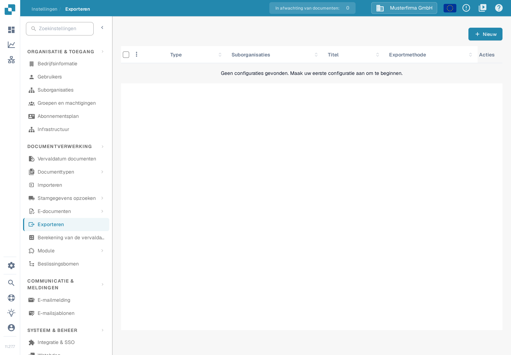
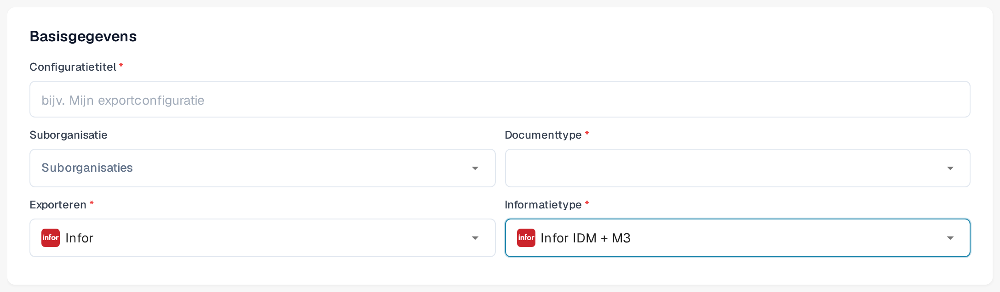
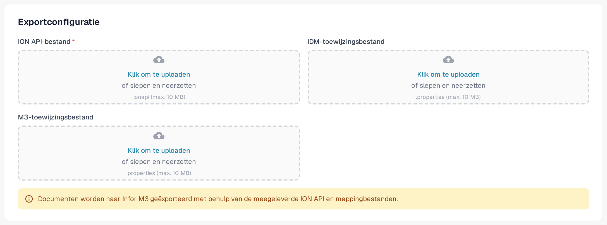

# Exporteren naar Infor M3

Deze pagina behandelt de stroom in Infor ION en de exportconfiguratie in DocBits. De Infor-schermafbeeldingen hieronder zijn historische voorbeelden; de menu's en de instellingen van de gegevensstroom moet u in uw eigen tenant controleren voordat u de configuratie activeert. Het DocBits-gedeelte gebruikt Nederlandse schermafbeeldingen uit de Sandbox van 12 november 2026. Voor deze bijwerking zijn geen Infor-verbinding en geen export van een factuur getest.

## Stap 1: Een verbindingspunt aanmaken in Infor ION

1. Navigeer naar **OS > ION > Connect > Connection Points**.
2. Klik op **Add** en selecteer **IMS via API Gateway** als verbindingstype.
3. Configureer de volgende instellingen:
   * **Name**: stel in op `DocBits_Export`.
   * **Description**: stel in op `DocBits_Export`.
   * **Uitschakelen**: _Application has IMS End Point_.
   * **ION API Client ID**:
     * Open het ION API-bestand.
     * Zoek in het bestand naar `"ci"`.
     * Kopieer de waarde van de client-id `ci`. Houd het volledige `.ionapi`-bestand privé, want het bevat ook inloggegevens. Infor legt de [velden van het bestand](https://docs.infor.com/crm/9.4.x/en-us/webclient/upi1639111995644.html) uit.

<figure><figcaption>
Historisch voorbeeld van een verbindingspunt. Het tabblad Connection is geselecteerd; gebruik de client-id uit uw eigen privé-ION API-bestand.
</figcaption></figure>

4. Voeg onder **Documents** `Sync.CaptureDocument` toe.

<figure><figcaption>
Historisch tabblad Documents: Sync.CaptureDocument is ingeschakeld voor Send from Application.
</figcaption></figure>

5. Klik op **Save** om de configuratie te voltooien.

## Stap 2: Toewijzingen uploaden



1. Download het voorbeeld van de M3-toewijzing in XML hierboven. Laat uw integratiebeheerder het bestand voor uw tenant beoordelen voordat u het importeert.
2. Navigeer naar **Infor** > **OS** > **ION** > **Connect** > **Mappings**.
3. Klik op **Import** en selecteer het toewijzingsbestand dat bij **M3** hoort.

<figure><figcaption>
Historische importactie voor toewijzingen. De blauwgroene pijl markeert het pictogram Import.
</figcaption></figure>

4. Controleer de geïmporteerde toewijzing en de bijbehorende bron- en doel-BOD's en gebruik daarna **Approve** volgens het wijzigingsproces van uw tenant.

<figure><figcaption>
Historisch toewijzingsvoorbeeld: controleer de bron- en doel-BOD's voordat u Approve gebruikt.
</figcaption></figure>

## Stap 3: De gegevensstroom aanmaken

1. Navigeer naar **OS** -> **ION** -> **Connect** -> **Data Flows**.
2. Klik op **Add** en selecteer **Document Flow**.
3. Vul de gegevens in:
   * **Name**: `DocBits_Export_to_M3`
4. Voeg knooppunten aan de stroom toe:

#### Applicatieknooppunt

1. Voeg een **Application Node** aan de stroom toe.
   * **Name**: `DocBits` of `DocBits-Export`.
2. Klik op **Add** en selecteer het **Connection Point** uit Stap 1.

<figure><figcaption>
Historisch applicatieknooppunt voor DocBits. Selecteer het verbindingspunt dat u voor uw eigen tenant hebt aangemaakt; de demo-naam is een voorbeeld.
</figcaption></figure>

3. Klik op het **Document Icon** naast het applicatieknooppunt.
   * Klik op **Add** en selecteer `Sync.CaptureDocument`.

<figure><figcaption>
Historisch paneel Documents voor het knooppunt DocBits: Sync.CaptureDocument.
</figcaption></figure>

#### Toewijzingsknooppunt

1. Voeg een **Mapping Node** rechts van het applicatieknooppunt toe.
   * **Name**: `Capt2process`.
   * **Mapping**: selecteer de geïmporteerde toewijzing van `Sync.CaptureDocument` naar `Process.SupplierInvoice`. De weergegeven naam kan afwijken van de bestandsnaam van het gedownloade XML-bestand; het historische voorbeeld hieronder gebruikt `SyncCaptDoc_SyncSuppInv`.

<figure><figcaption>
Historisch toewijzingsknooppunt. SyncCaptDoc_SyncSuppInv is de naam van de toewijzing in dit voorbeeld; uw geïmporteerde toewijzing kan anders heten.
</figcaption></figure>

#### Applicatieknooppunt

1. Voeg een **Application Node** rechts van het vorige toewijzingsknooppunt toe.
   * **Name**: `M3`.
2. Klik op **Add** en selecteer de **M3 Application** van de klant.

<figure><figcaption>
Historisch applicatieknooppunt voor M3. Selecteer het M3-verbindingspunt dat voor uw tenant is geleverd.
</figcaption></figure>

3. Klik op het **Document Icon** naast het applicatieknooppunt.
   * Klik op **Add** en selecteer `Acknowledge.SupplierInvoice`.

<figure><figcaption>
Historisch paneel Documents voor het knooppunt M3: Acknowledge.SupplierInvoice.
</figcaption></figure>

#### API-knooppunt

1. Voeg een **API Node** rechts van het applicatieknooppunt toe.
   * **Name**: `DocBits-Error`.
   * **ION API Connector**: `DocBits_Import`.
   * Als uw importconnector niet bestaat, lees dan de gids [Importeer hoofdgegevens van Infor M3 via ION API](../../importing-customer-master-data/m3/import-from-infor-m3-to-docbits-via-api.md) en laat uw Infor-beheerder de connector controleren voordat u de stroom activeert.

<figure><figcaption>
Historisch API-knooppunt voor foutafhandeling. De geselecteerde demo-connector is een voorbeeld; gebruik uw eigen importconnector.
</figcaption></figure>

#### De stroom opslaan en activeren

* Klik op **Save** zodra alle knooppunten zijn toegevoegd en geconfigureerd.
* Activeer de stroom om de installatie te voltooien.

<figure><figcaption>
Historische werkbalk voor activering. De blauwgroene pijl markeert de activeringsactie; deze uitsnede toont niet de volledige stroom.
</figcaption></figure>

## Stap 4: De export in DocBits configureren

Open in de juiste DocBits-organisatie **Instellingen → Exporteren** en kies **Nieuw**. Er opent een exportconfiguratie die nog niet is opgeslagen.

<figure><figcaption>
Kies Nieuw op de pagina Exporteren om een conceptconfiguratie te openen. Rechtsonder in het scherm staat versie 11.27.7.
</figcaption></figure>

Vul in **Basisgegevens** een herkenbare **Configuratietitel** in, kies het **Documenttype** (voor deze factuurstromen: Factuur) en selecteer alleen indien nodig een **Suborganisatie**. Zet **Exporteren** op **Infor**. Het veld **Informatietype** verschijnt dan. De keuzes die op 12 november 2026 in de Sandbox zichtbaar waren, zijn onder meer **Infor IDM + ION BOD**, **Infor IDM + M3** en **Infor IDM + M3 (TOML)**. Kies het type dat hoort bij de verbinding en de toewijzingsbestanden die uw integratiebeheerder aanlevert; de oude aanduiding "Infor IDM + M3 (API)" wordt op dit scherm niet meer getoond.

Voor **Infor IDM + M3** vraagt het formulier om een **ION API-bestand** (`.ionapi`, verplicht), een **IDM-toewijzingsbestand** (`.properties`) en een **M3-toewijzingsbestand** (`.properties`). De varianten TOML en ION BOD hebben andere velden; vervang het ene bestand niet door het andere. Vraag de bestanden voor uw tenant op bij de bevoegde Infor-beheerder. Het `.ionapi`-bestand bevat inloggegevens en mag niet in schermafbeeldingen, tickets of de Git-repository terechtkomen.

<figure><figcaption>
Niet-opgeslagen Nederlands voorbeeld met Infor IDM + M3 geselecteerd. De configuratietitel toont alleen de plaatsaanduiding, de suborganisatie en het documenttype zijn nog niet gekozen.
</figcaption></figure>

<figure><figcaption>
Bestandsvelden voor Infor IDM + M3 in de Sandbox. Er is geen bestand geüpload en de configuratie is niet opgeslagen.
</figcaption></figure>

Controleer het documenttype, de organisatie en de bestandsnamen voordat u op **Opslaan** klikt. Test de configuratie zodra de Infor-stroom actief is met één niet-productiefactuur en controleer de status daarvan in DocBits, Infor ION en M3. Een opgeslagen configuratie is geen bewijs dat een factuur M3 heeft bereikt.

### Infor-controle vereist

De elf Infor-schermafbeeldingen in stap 1 tot en met 3 blijven bewaard als voorbeelden met toelichting. Ze zijn niet vernieuwd, omdat geen bevoegde Infor-tenant beschikbaar was. Vraag de Infor-beheerder om verbindingspunten, gegevensstroom, toewijzingsnamen en machtigingen te vergelijken met de actuele interface van de tenant. De [uitleg van Infor over verbindingspunten en gegevensstromen](https://docs.infor.com/ln/10.8/en-us/lnesolh/lnoshybridng/wxa1699288671147.html) beschrijft hoe deze onderdelen samenhangen.
