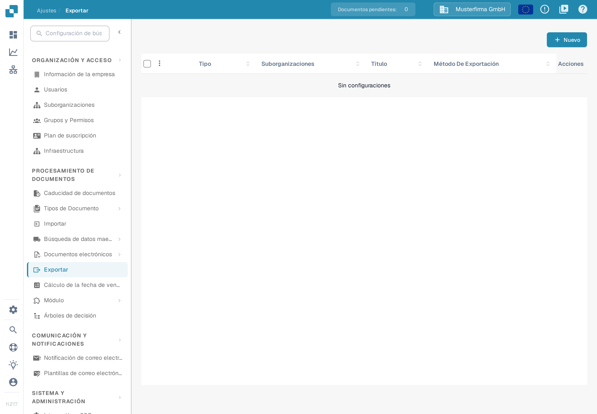
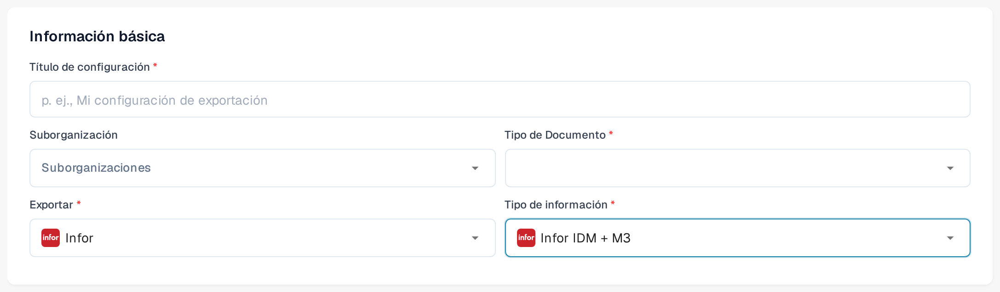
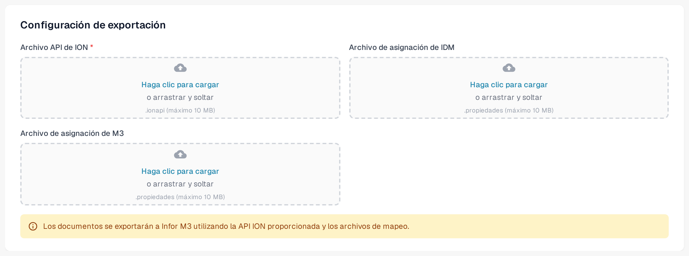

# Exportar a Infor M3

Esta página describe el flujo de Infor ION y la configuración de exportación en DocBits. Las imágenes de Infor que aparecen más abajo son ejemplos históricos; sus menús y ajustes del flujo de datos deben comprobarse en su propio tenant antes de la activación. La sección de DocBits muestra capturas de la interfaz de la Sandbox en español (versión 11.27.7) con datos de ejemplo inventados, tomadas el 12 de noviembre de 2026. Para esta revisión no se probaron ni una conexión de Infor ni una exportación de facturas.

## Paso 1: Crear un punto de conexión en Infor ION

1. Vaya a **OS > ION > Connect > Connection Points**.
2. Haga clic en **Add** y seleccione **IMS via API Gateway** como tipo de conexión.
3. Configure los siguientes ajustes:
   * **Name**: establezca `DocBits_Export`.
   * **Description**: establezca `DocBits_Export`.
   * **Uncheck**: _Application has IMS End Point_.
   * **ION API Client ID**:
     * Abra el archivo de ION API.
     * Busque `"ci"` dentro del archivo.
     * Copie el valor del ID de cliente `ci`. Mantenga privado el archivo `.ionapi` completo porque también contiene credenciales. Infor explica los [campos del archivo](https://docs.infor.com/crm/9.4.x/en-us/webclient/upi1639111995644.html).

<figure><figcaption>
Ejemplo histórico de punto de conexión. La pestaña Connection está seleccionada; utilice el ID de cliente de su propio archivo privado de ION API.
</figcaption></figure>

4. En **Documents**, añada `Sync.CaptureDocument`.

<figure><figcaption>
Pestaña Documents histórica: Sync.CaptureDocument está habilitado para Send from Application.
</figcaption></figure>

5. Haga clic en **Save** para finalizar la configuración.

## Paso 2: Cargar las asignaciones



1. Descargue el XML de asignación de M3 de ejemplo que aparece arriba. Pida a su administrador de integración que lo revise para su tenant antes de importarlo.
2. Vaya a **Infor** > **OS** > **ION** > **Connect** > **Mappings**.
3. Haga clic en **Import** y seleccione el archivo de asignación adecuado para **M3**.

<figure><figcaption>
Acción histórica de importación de asignaciones. La flecha cian marca el icono Import.
</figcaption></figure>

4. Revise la asignación importada y sus BOD de origen y destino y, después, utilice **Approve** según el proceso de cambios de su tenant.

<figure><figcaption>
Ejemplo histórico de asignación: confirme los BOD de origen y destino antes de usar Approve.
</figcaption></figure>

## Paso 3: Crear el flujo de datos

1. Vaya a **OS** -> **ION** -> **Connect** -> **Data Flows**.
2. Haga clic en **Add** y seleccione **Document Flow**.
3. Complete los datos:
   * **Name**: `DocBits_Export_to_M3`
4. Añada nodos al flujo:

#### Nodo de aplicación

1. Añada un **Application Node** al flujo.
   * **Name**: `DocBits` o `DocBits-Export`.
2. Haga clic en **Add** y seleccione el **Connection Point** creado en el paso 1.

<figure><figcaption>
Nodo de aplicación DocBits histórico. Seleccione el punto de conexión creado para su propio tenant; el nombre de demostración es un ejemplo.
</figcaption></figure>

3. Haga clic en el **Document Icon** situado junto al nodo de aplicación.
   * Haga clic en **Add** y seleccione `Sync.CaptureDocument`.

<figure><figcaption>
Panel Documents histórico del nodo DocBits: Sync.CaptureDocument.
</figcaption></figure>

#### Nodo de asignación

1. Añada un **Mapping Node** a la derecha del nodo de aplicación.
   * **Name**: `Capt2process`.
   * **Mapping**: seleccione la asignación importada de `Sync.CaptureDocument` a `Process.SupplierInvoice`. Su nombre mostrado puede diferir del nombre del archivo XML descargado; el ejemplo histórico de abajo utiliza `SyncCaptDoc_SyncSuppInv`.

<figure><figcaption>
Nodo de asignación histórico. SyncCaptDoc_SyncSuppInv es el nombre de la asignación en este ejemplo; su asignación importada puede tener otro nombre.
</figcaption></figure>

#### Nodo de aplicación

1. Añada un **Application Node** a la derecha del nodo de asignación anterior.
   * **Name**: `M3`.
2. Haga clic en **Add** y seleccione la **M3 Application** del cliente.

<figure><figcaption>
Nodo de aplicación M3 histórico. Seleccione el punto de conexión de M3 proporcionado para su tenant.
</figcaption></figure>

3. Haga clic en el **Document Icon** situado junto al nodo de aplicación.
   * Haga clic en **Add** y seleccione `Acknowledge.SupplierInvoice`.

<figure><figcaption>
Panel Documents histórico del nodo M3: Acknowledge.SupplierInvoice.
</figcaption></figure>

#### Nodo de API

1. Añada un **API Node** a la derecha del nodo de aplicación.
   * **Name**: `DocBits-Error`.
   * **ION API Connector**: `DocBits_Import`.
   * Si su conector de importación no existe, revise la [guía de importación y conexión de API para M3](../../importing-customer-master-data/m3/import-from-infor-m3-to-docbits-via-api.md) y pida a su administrador de Infor que lo verifique antes de la activación.

<figure><figcaption>
Nodo de API histórico para el tratamiento de errores. El conector de demostración seleccionado es un ejemplo; utilice su propio conector de importación.
</figcaption></figure>

#### Guardar y activar el flujo

* Cuando haya añadido y configurado todos los nodos, haga clic en **Save**.
* Active el flujo para completar la configuración.

<figure><figcaption>
Barra de activación histórica. La flecha cian marca la acción de activación; este recorte no muestra el flujo completo.
</figcaption></figure>

## Paso 4: Configurar la exportación en DocBits

En la organización correcta de DocBits, abra **Ajustes → Exportar** y elija **Nuevo**. Se abre una configuración de exportación aún sin guardar.

<figure><figcaption>
Captura de la Sandbox en español con datos de ejemplo inventados: la página Exportar está vacía. Elija Nuevo para crear una configuración.
</figcaption></figure>

En **Información básica**, introduzca un **Título de configuración** significativo, elija el **Tipo de Documento** (para este flujo de facturas, el tipo de factura) y seleccione una **Suborganización** solo si es necesario. Establezca **Exportar** en **Infor**. Entonces aparece el campo **Tipo de información**. En la interfaz en español de la versión 11.27.7 aparecen, entre otras, las opciones **Infor IDM + ION BOD**, **Infor IDM + M3** e **Infor IDM + M3 (TOML)**, además de entradas como **Cargos de Infor M3 OC** y **Unidad de embalaje Infor M3**. Elija el tipo que coincida con los archivos de conexión y de asignación que le haya facilitado su administrador de integración; la antigua etiqueta «Infor IDM + M3 (API)» ya no se muestra en esta pantalla.

Para **Infor IDM + M3**, el formulario pide un **Archivo API de ION** (`.ionapi`, obligatorio), un **Archivo de asignación de IDM** (`.properties`) y un **Archivo de asignación de M3** (`.properties`). Las variantes TOML e ION BOD tienen otros campos; no sustituya un archivo por otro. Solicite los archivos específicos de su tenant al administrador de Infor autorizado. El archivo `.ionapi` contiene credenciales y no debe aparecer en capturas, tickets ni en el repositorio de Git. El aviso del campo de carga muestra «.propiedades (máximo 10 MB)»; el archivo real tiene la extensión `.properties`.

<figure><figcaption>
Configuración de ejemplo sin guardar en español con Tipo de información Infor IDM + M3. La Suborganización y el Tipo de Documento no están elegidos; todos los datos son inventados y no se guardó nada.
</figcaption></figure>

<figure><figcaption>
Ejemplo en español con datos inventados: los tres campos de archivo para Infor IDM + M3. No se cargó ningún archivo; los archivos contienen credenciales y no deben aparecer en capturas ni en tickets.
</figcaption></figure>

Revise el tipo de documento, la organización y los nombres de archivo antes de **Guardar**. Una vez activo el flujo de Infor, pruebe con una sola factura que no sea de producción y confirme su estado en DocBits, Infor ION y M3. Una configuración guardada no demuestra que una factura haya llegado a M3.

### Revisión de Infor necesaria

Las once imágenes de Infor de los pasos 1 a 3 se conservan como ejemplos anotados. No se actualizaron porque no había un tenant de Infor autorizado disponible. Pida al administrador de Infor que compare los puntos de conexión, el flujo de documentos, los nombres de asignación y los permisos con la interfaz actual del tenant. La [explicación de Infor sobre puntos de conexión y flujos de documentos](https://docs.infor.com/ln/10.8/en-us/lnesolh/lnoshybridng/wxa1699288671147.html) describe cómo se relacionan estas piezas.
