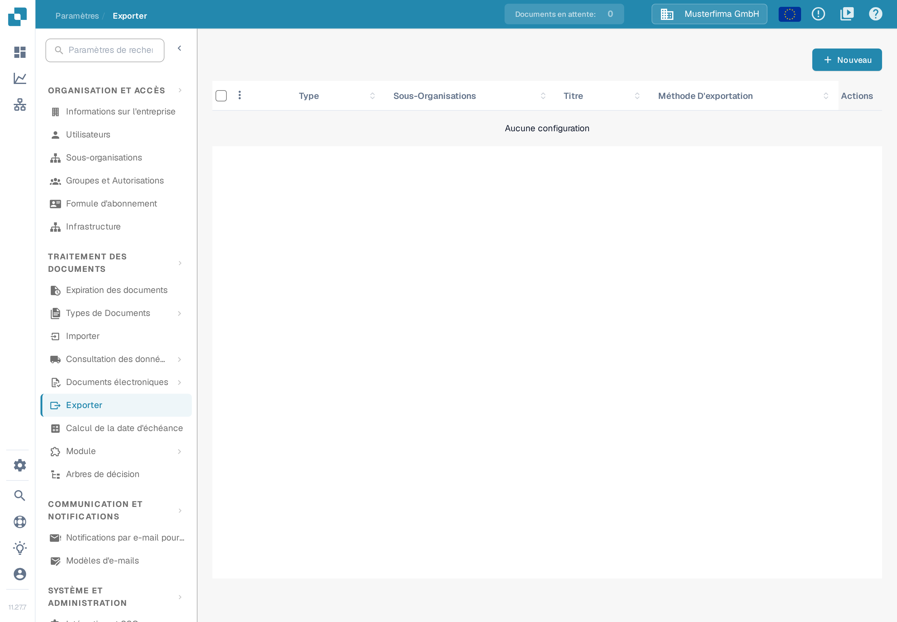
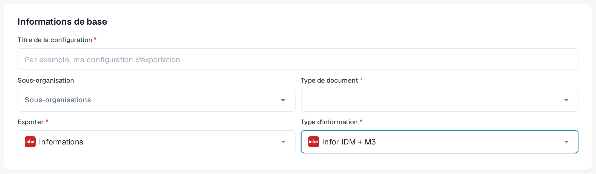
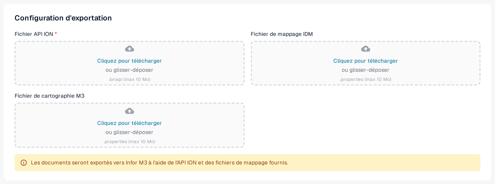

# Exportation vers Infor M3

Cette page décrit le flux Infor ION et la configuration d’exportation dans DocBits. Les images Infor ci-dessous sont des exemples historiques ; leurs menus et leurs réglages de flux de données doivent être vérifiés dans votre propre tenant avant l’activation. La section DocBits utilise des captures françaises de l’interface de la sandbox (version 11.27.7) avec des données d’exemple inventées, réalisées le 12 novembre 2026. Pour cette mise à jour, ni une connexion Infor ni une exportation de facture n’ont été testées.

## Étape 1 : Créer un Connection Point dans Infor ION

1. Accédez à **OS > ION > Connect > Connection Points**.
2. Cliquez sur **Add** et sélectionnez **IMS via API Gateway** comme type de connexion.
3. Configurez les paramètres suivants :
   * **Name** : saisissez `DocBits_Export`.
   * **Description** : saisissez `DocBits_Export`.
   * **Décochez** : _Application has IMS End Point_.
   * **ION API Client ID** :
     * Ouvrez le fichier ION API.
     * Recherchez `"ci"` dans le fichier.
     * Copiez la valeur de l’identifiant client `ci`. Gardez le fichier `.ionapi` complet confidentiel, car il contient aussi des identifiants d’accès. Infor décrit les [champs du fichier](https://docs.infor.com/crm/9.4.x/en-us/webclient/upi1639111995644.html).

<figure><figcaption>
Exemple historique d’un Connection Point. L’onglet Connection est sélectionné ; utilisez l’identifiant client de votre propre fichier ION API, conservé confidentiellement.
</figcaption></figure>

4. Sous **Documents**, ajoutez `Sync.CaptureDocument`.

<figure><figcaption>
Onglet Documents historique : Sync.CaptureDocument est activé pour Send from Application.
</figcaption></figure>

5. Cliquez sur **Save** pour finaliser la configuration.

## Étape 2 : Télécharger les mappages



1. Téléchargez l’exemple de mappage M3 (XML) ci-dessus. Faites-le vérifier par votre administrateur d’intégration pour votre tenant avant de l’importer.
2. Accédez à **Infor** > **OS** > **ION** > **Connect** > **Mappings**.
3. Cliquez sur **Import** et sélectionnez le fichier de mappage correspondant à **M3**.

<figure><figcaption>
Action d’importation historique dans la zone des mappages. La flèche cyan marque l’icône Import.
</figcaption></figure>

4. Vérifiez le mappage importé ainsi que ses BOD source et cible, puis utilisez **Approve** conformément au processus de modification de votre tenant.

<figure><figcaption>
Exemple de mappage historique : vérifiez les BOD source et cible avant d’utiliser Approve.
</figcaption></figure>

## Étape 3 : Créer le Data Flow

1. Accédez à **OS** -> **ION** -> **Connect** -> **Data Flows**.
2. Cliquez sur **Add** et sélectionnez **Document Flow**.
3. Saisissez les détails :
   * **Name** : `DocBits_Export_to_M3`
4. Ajoutez des nœuds au flux :

#### Nœud d’application

1. Ajoutez un **Application Node** au flux.
   * **Name** : `DocBits` ou `DocBits-Export`.
2. Cliquez sur **Add** et sélectionnez le **Connection Point** créé à l’étape 1.

<figure><figcaption>
Nœud d’application DocBits historique. Sélectionnez le Connection Point créé pour votre propre tenant ; le nom de démonstration est un exemple.
</figcaption></figure>

3. Cliquez sur l’**icône de document** à côté du nœud d’application.
   * Cliquez sur **Add** et sélectionnez `Sync.CaptureDocument`.

<figure><figcaption>
Zone Documents historique du nœud DocBits : Sync.CaptureDocument.
</figcaption></figure>

#### Nœud de mappage

1. Ajoutez un **Mapping Node** à droite du nœud d’application.
   * **Name** : `Capt2process`.
   * **Mapping** : sélectionnez le mappage importé de `Sync.CaptureDocument` vers `Process.SupplierInvoice`. Son nom affiché peut différer du nom du fichier XML téléchargé ; l’exemple historique ci-dessous utilise `SyncCaptDoc_SyncSuppInv`.

<figure><figcaption>
Nœud de mappage historique. SyncCaptDoc_SyncSuppInv est le nom du mappage dans cet exemple ; le vôtre peut porter un autre nom.
</figcaption></figure>

#### Nœud d’application

1. Ajoutez un **Application Node** à droite du nœud de mappage précédent.
   * **Name** : `M3`.
2. Cliquez sur **Add** et sélectionnez l’**Application M3** du client.

<figure><figcaption>
Nœud d’application M3 historique. Sélectionnez le Connection Point M3 fourni pour votre tenant.
</figcaption></figure>

3. Cliquez sur l’**icône de document** à côté du nœud d’application.
   * Cliquez sur **Add** et sélectionnez `Acknowledge.SupplierInvoice`.

<figure><figcaption>
Zone Documents historique du nœud M3 : Acknowledge.SupplierInvoice.
</figcaption></figure>

#### Nœud API

1. Ajoutez un **API Node** à droite du nœud d’application.
   * **Name** : `DocBits-Error`.
   * **ION API Connector** : `DocBits_Import`.
   * Si votre connecteur d’importation n’existe pas, consultez le guide [Importer les données de base Infor M3 via l’API ION](../../importing-customer-master-data/m3/import-from-infor-m3-to-docbits-via-api.md) et faites-le vérifier par votre administrateur Infor avant l’activation.

<figure><figcaption>
Nœud API historique pour le traitement des erreurs. Le connecteur de démonstration sélectionné est un exemple ; utilisez votre propre connecteur d’importation.
</figcaption></figure>

#### Enregistrer et activer le flux

* Une fois tous les nœuds ajoutés et configurés, cliquez sur **Save**.
* Activez le flux pour terminer la configuration.

<figure><figcaption>
Barre d’activation historique. La flèche cyan marque l’activation ; cet extrait ne montre pas le flux complet.
</figcaption></figure>

## Étape 4 : Configurer l’exportation dans DocBits

Dans la bonne organisation DocBits, ouvrez **Paramètres → Exporter** et choisissez **Nouveau**. La page porte le titre **Exporter** ; une configuration d’exportation encore non enregistrée s’ouvre.

<figure><figcaption>
Capture française de la sandbox avec des données d’exemple inventées : la page Exporter est encore vide. Choisissez Nouveau pour créer une configuration.
</figcaption></figure>

Sous **Informations de base**, saisissez un **Titre de la configuration** explicite, choisissez le **Type de document** (pour ce flux de factures : la facture) et une **Sous-organisation** seulement si nécessaire. Réglez **Exporter** sur **Informations** : c’est le libellé que l’interface française de la version 11.27.7 affiche pour la méthode d’exportation Infor. Le champ **Type d’information** apparaît alors. Dans l’interface française de la version 11.27.7, ce champ propose entre autres **Infor IDM + ION BOD**, **Infor IDM + M3** et **Infor IDM + M3 (TOML)**, ainsi que d’autres entrées comme **Charges Infor M3 OC** et **Unité d’emballage Infor M3**. Choisissez le type qui correspond aux fichiers de connexion et de mappage fournis par votre administrateur d’intégration ; l’ancien libellé « Infor IDM + M3 (API) » n’est plus proposé dans cet écran.

Pour **Infor IDM + M3**, le formulaire demande un **Fichier API ION** (`.ionapi`, obligatoire), un **Fichier de mappage IDM** (`.properties`) et un **Fichier de cartographie M3** (`.properties`). Les variantes TOML et ION BOD ont d’autres champs ; ne remplacez pas un fichier par un autre. Demandez les fichiers propres à votre tenant à l’administrateur Infor autorisé. Le fichier `.ionapi` contient des identifiants d’accès et ne doit apparaître ni dans les captures d’écran, ni dans les tickets, ni dans le dépôt Git.

<figure><figcaption>
Configuration d’exemple française non enregistrée avec le type d’information Infor IDM + M3. La Sous-organisation et le Type de document ne sont pas choisis ; toutes les données sont inventées et rien n’a été enregistré.
</figcaption></figure>

<figure><figcaption>
Exemple français avec des données inventées : les trois champs de fichiers pour Infor IDM + M3. Aucun fichier n’a été téléchargé ; ces fichiers contiennent des identifiants et ne doivent pas figurer dans des captures d’écran ou des tickets.
</figcaption></figure>

Vérifiez le type de document, l’organisation et les noms de fichiers avant **Enregistrer**. Une fois le flux Infor actif, testez avec une seule facture hors production et contrôlez son statut dans DocBits, Infor ION et M3. Une configuration enregistrée ne prouve pas qu’une facture a atteint M3.

### Vérification par Infor requise

Les onze images Infor des étapes 1 à 3 sont conservées comme exemples commentés. Elles n’ont pas été actualisées, faute de tenant Infor autorisé. Demandez à l’administrateur Infor de comparer les Connection Points, le flux de documents, les noms de mappage et les autorisations avec l’interface actuelle du tenant. L’[explication des Connection Points et des flux de documents](https://docs.infor.com/ln/10.8/en-us/lnesolh/lnoshybridng/wxa1699288671147.html) d’Infor décrit le lien entre ces éléments.
