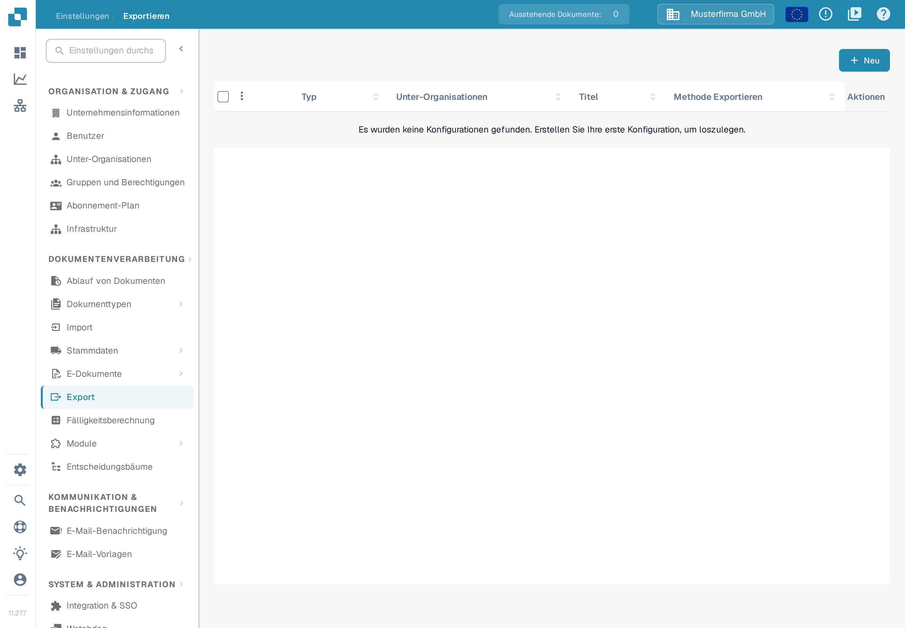
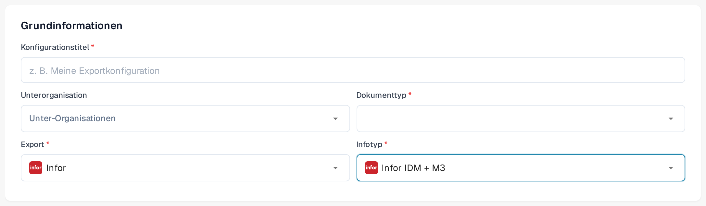
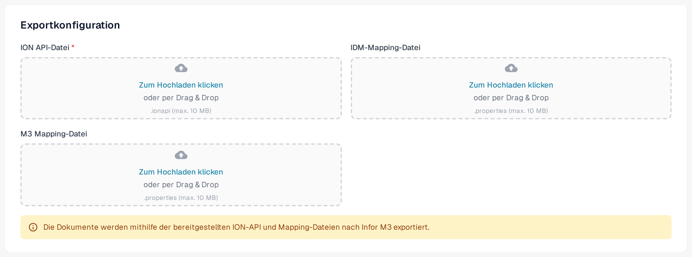

# Export nach Infor M3

Diese Seite beschreibt den Infor-ION-Ablauf und die Exportkonfiguration in DocBits. Die Infor-Bilder unten sind historische Beispiele; ihre Menüs und Einstellungen im Datenfluss müssen Sie vor der Aktivierung im eigenen Tenant prüfen. Der DocBits-Abschnitt zeigt deutsche Aufnahmen der Sandbox-Oberfläche (Version 11.27.7) mit erfundenen Beispieldaten vom 12. November 2026. Für diese Überarbeitung wurden weder eine Infor-Verbindung noch ein Rechnungsexport getestet.

## Schritt 1: Connection Point in Infor ION anlegen

1. Navigieren Sie zu **OS > ION > Connect > Connection Points**.
2. Klicken Sie auf **Add** und wählen Sie **IMS via API Gateway** als Connection Type.
3. Konfigurieren Sie die folgenden Einstellungen:
   * **Name**: Auf `DocBits_Export` setzen.
   * **Description**: Auf `DocBits_Export` setzen.
   * **Uncheck**: _Application has IMS End Point_.
   * **ION API Client ID**:
     * Öffnen Sie die ION-API-Datei.
     * Suchen Sie in der Datei nach `"ci"`.
     * Kopieren Sie den Wert der Client-ID `ci`. Halten Sie die vollständige `.ionapi`-Datei geheim, weil sie auch Zugangsdaten enthält. Infor beschreibt die [Felder der Datei](https://docs.infor.com/crm/9.4.x/en-us/webclient/upi1639111995644.html).

<figure><figcaption>
Historisches Beispiel eines Connection Point. Der Reiter Connection ist ausgewählt; verwenden Sie die Client-ID aus Ihrer eigenen, geheim gehaltenen ION-API-Datei.
</figcaption></figure>

4. Fügen Sie unter **Documents** `Sync.CaptureDocument` hinzu.

<figure><figcaption>
Historischer Reiter Documents: Sync.CaptureDocument ist für Send from Application aktiviert.
</figcaption></figure>

5. Klicken Sie auf **Save**, um die Konfiguration abzuschließen.

## Schritt 2: Mappings hochladen



1. Laden Sie das M3-Mapping-Beispiel (XML) oben herunter. Lassen Sie es von Ihrem Integrationsadministrator für Ihren Tenant prüfen, bevor Sie es importieren.
2. Navigieren Sie zu **Infor** > **OS** > **ION** > **Connect** > **Mappings**.
3. Klicken Sie auf **Import** und wählen Sie die passende Mapping-Datei für **M3**.

<figure><figcaption>
Historische Import-Aktion im Mapping-Bereich. Der cyanfarbene Pfeil markiert das Symbol Import.
</figcaption></figure>

4. Prüfen Sie das importierte Mapping samt Quell- und Ziel-BOD und verwenden Sie **Approve** so, wie es der Änderungsprozess Ihres Tenants vorsieht.

<figure><figcaption>
Historisches Mapping-Beispiel: Prüfen Sie Quell- und Ziel-BOD, bevor Sie Approve verwenden.
</figcaption></figure>

## Schritt 3: Den Data Flow erstellen

1. Navigieren Sie zu **OS** -> **ION** -> **Connect** -> **Data Flows**.
2. Klicken Sie auf **Add** und wählen Sie **Document Flow**.
3. Geben Sie die Details ein:
   * **Name**: `DocBits_Export_to_M3`
4. Fügen Sie Nodes zum Flow hinzu:

#### Application Node

1. Fügen Sie einen **Application Node** zum Flow hinzu.
   * **Name**: `DocBits` oder `DocBits-Export`.
2. Klicken Sie auf **Add** und wählen Sie den **Connection Point**, der in Schritt 1 erstellt wurde.

<figure><figcaption>
Historischer DocBits-Application-Node. Wählen Sie den für Ihren Tenant angelegten Connection Point; der Demo-Name ist ein Beispiel.
</figcaption></figure>

3. Klicken Sie auf das **Document Icon** neben dem Application Node.
   * Klicken Sie auf **Add** und wählen Sie `Sync.CaptureDocument`.

<figure><figcaption>
Historischer Bereich Documents für den DocBits-Node: Sync.CaptureDocument.
</figcaption></figure>

#### Mapping Node

1. Fügen Sie einen **Mapping Node** rechts vom Application Node hinzu.
   * **Name**: `Capt2process`.
   * **Mapping**: Wählen Sie das importierte Mapping von `Sync.CaptureDocument` auf `Process.SupplierInvoice`. Der angezeigte Name kann vom Dateinamen der heruntergeladenen XML-Datei abweichen; das historische Beispiel unten verwendet `SyncCaptDoc_SyncSuppInv`.

<figure><figcaption>
Historischer Mapping-Node. SyncCaptDoc_SyncSuppInv ist der Mapping-Name in diesem Beispiel; Ihr importiertes Mapping kann anders heißen.
</figcaption></figure>

#### Application Node

1. Fügen Sie einen **Application Node** rechts vom vorherigen Mapping Node hinzu.
   * **Name**: `M3`.
2. Klicken Sie auf **Add** und wählen Sie die **M3 Application** des Kunden.

<figure><figcaption>
Historischer M3-Application-Node. Wählen Sie den für Ihren Tenant bereitgestellten M3-Connection-Point.
</figcaption></figure>

3. Klicken Sie auf das **Document Icon** neben dem Application Node.
   * Klicken Sie auf **Add** und wählen Sie `Acknowledge.SupplierInvoice`.

<figure><figcaption>
Historischer Bereich Documents für den M3-Node: Acknowledge.SupplierInvoice.
</figcaption></figure>

#### API Node

1. Fügen Sie einen **API Node** rechts vom Application Node hinzu.
   * **Name**: `DocBits-Error`.
   * **ION API Connector**: `DocBits_Import`.
   * Wenn Ihr Import-Connector nicht existiert, lesen Sie die Anleitung [Stammdaten aus Infor M3 über die ION-API importieren](../../importing-customer-master-data/m3/import-from-infor-m3-to-docbits-via-api.md) und lassen Sie ihn von Ihrem Infor-Administrator prüfen, bevor Sie aktivieren.

<figure><figcaption>
Historischer API-Node für die Fehlerbehandlung. Der ausgewählte Demo-Connector ist ein Beispiel; verwenden Sie Ihren eigenen Import-Connector.
</figcaption></figure>

#### Flow speichern und aktivieren

* Sobald alle Nodes hinzugefügt und konfiguriert sind, klicken Sie auf **Save**.
* Aktivieren Sie den Flow, um die Einrichtung abzuschließen.

<figure><figcaption>
Historische Aktivierungsleiste. Der cyanfarbene Pfeil markiert die Aktivierung; dieser Ausschnitt zeigt nicht den vollständigen Flow.
</figcaption></figure>

## Schritt 4: Export in DocBits konfigurieren

Öffnen Sie in der richtigen DocBits-Organisation **Einstellungen → Export** und wählen Sie **Neu**. Die Seite trägt die Überschrift **Exportieren**. Es öffnet sich eine noch nicht gespeicherte Exportkonfiguration.

<figure><figcaption>
Deutsche Sandbox-Aufnahme mit erfundenen Beispieldaten: Die Seite Exportieren ist noch leer. Wählen Sie Neu, um eine Konfiguration anzulegen.
</figcaption></figure>

Tragen Sie unter **Grundinformationen** einen aussagekräftigen **Konfigurationstitel** ein, wählen Sie den **Dokumenttyp** (für diesen Rechnungsablauf Rechnung) und nur bei Bedarf eine **Unterorganisation**. Stellen Sie **Export** auf **Infor**. Daraufhin erscheint das Feld **Infotyp**. In der deutschen Oberfläche der Version 11.27.7 stehen dort unter anderem **Infor IDM + ION BOD**, **Infor IDM + M3** und **Infor IDM + M3 (TOML)** zur Auswahl, daneben weitere Einträge wie **Infor M3 OC-Zusatzkosten** und **Infor M3 Verpackungseinheit**. Wählen Sie den Typ, der zu den Verbindungs- und Mapping-Dateien Ihres Integrationsadministrators passt. Die frühere Bezeichnung „Infor IDM + M3 (API)“ wird in diesem Dialog nicht mehr angeboten.

Für **Infor IDM + M3** verlangt das Formular eine **ION API-Datei** (`.ionapi`, Pflichtfeld), eine **IDM-Mapping-Datei** (`.properties`) und eine **M3 Mapping-Datei** (`.properties`). Die Varianten TOML und ION BOD haben andere Felder; ersetzen Sie eine Datei nicht durch eine andere. Fordern Sie die tenant-spezifischen Dateien beim zuständigen Infor-Administrator an. Die `.ionapi`-Datei enthält Zugangsdaten und darf weder in Screenshots noch in Tickets oder im Git-Repository erscheinen.

<figure><figcaption>
Ungespeicherte deutsche Beispielkonfiguration mit Infotyp Infor IDM + M3. Unterorganisation und Dokumenttyp sind nicht gewählt; alle Angaben sind erfunden und nichts wurde gespeichert.
</figcaption></figure>

<figure><figcaption>
Deutsche Beispielaufnahme mit erfundenen Daten: die drei Dateifelder für Infor IDM + M3. Es wurde keine Datei hochgeladen; die Dateien enthalten Zugangsdaten und gehören nicht in Screenshots oder Tickets.
</figcaption></figure>

Prüfen Sie Dokumenttyp, Organisation und Dateinamen vor **Speichern**. Testen Sie nach der Aktivierung des Infor-Flows mit einer einzelnen Nicht-Produktions-Rechnung und prüfen Sie den Status in DocBits, Infor ION und M3. Eine gespeicherte Konfiguration ist kein Beleg dafür, dass eine Rechnung M3 erreicht hat.

### Prüfung durch Infor erforderlich

Die elf Infor-Bilder in den Schritten 1–3 bleiben als kommentierte Beispiele erhalten. Sie wurden nicht erneuert, weil kein autorisierter Infor-Tenant zur Verfügung stand. Bitten Sie den Infor-Administrator, Connection Points, Dokumentenfluss, Mapping-Namen und Berechtigungen mit der aktuellen Oberfläche des Tenants zu vergleichen. Die [Erklärung zu Connection Points und Dokumentenflüssen](https://docs.infor.com/ln/10.8/en-us/lnesolh/lnoshybridng/wxa1699288671147.html) von Infor beschreibt, wie diese Bausteine zusammenhängen.
