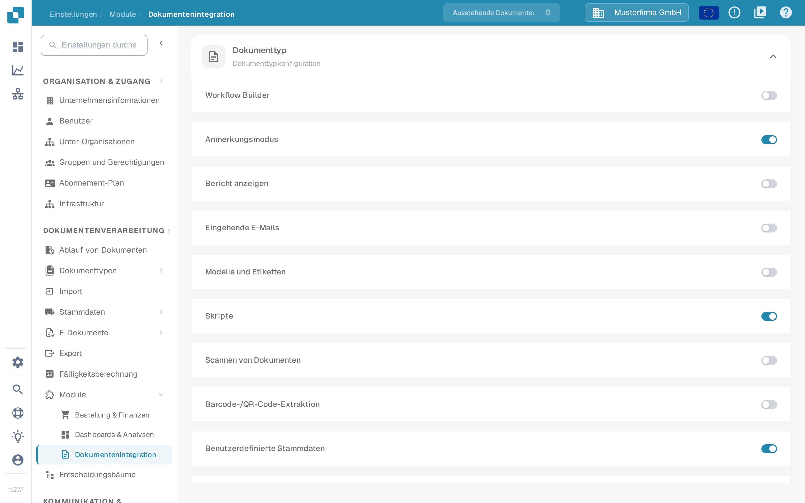
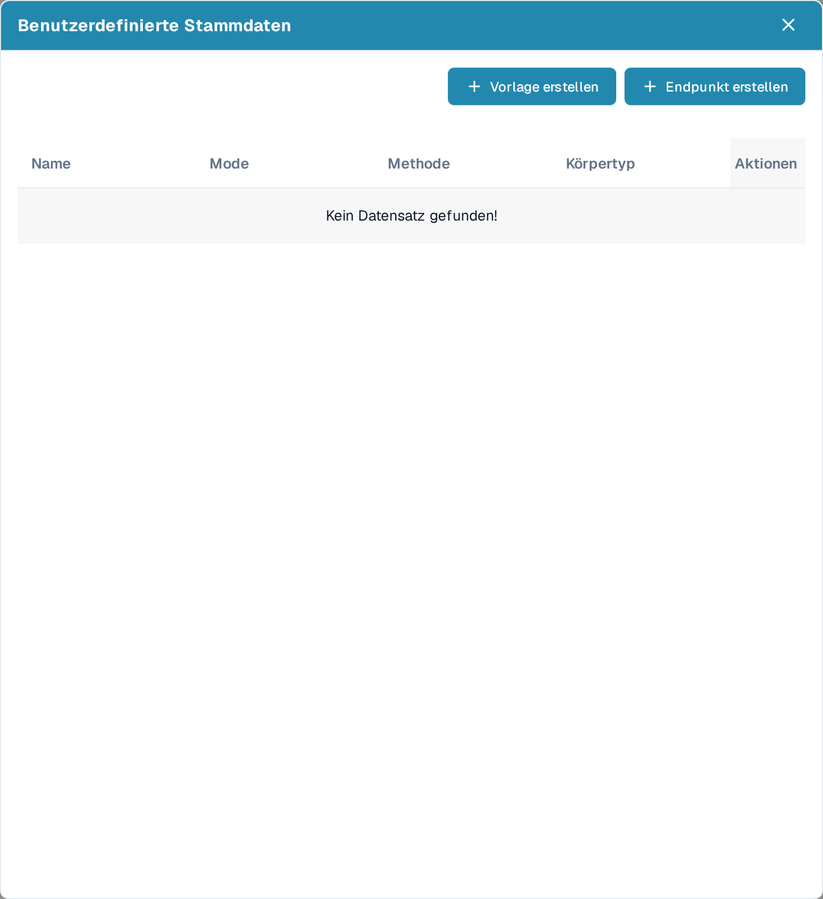
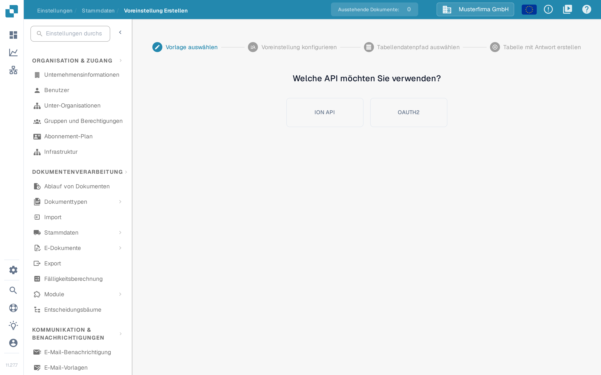
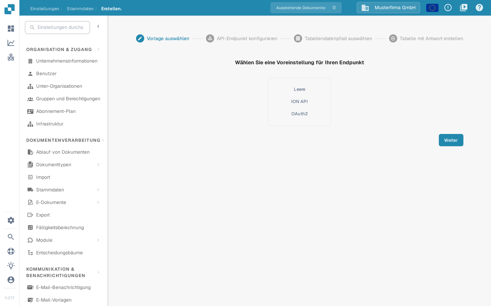
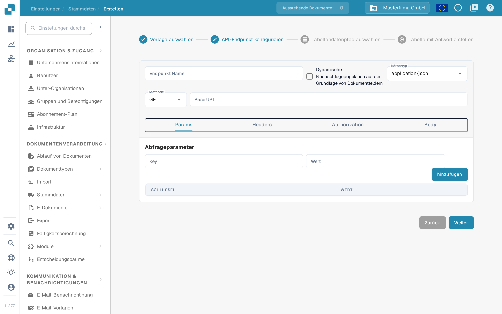

# Benutzerdefinierte Stammdaten

Mit benutzerdefinierten Stammdaten verbinden Sie DocBits mit einem eigenen API-Endpunkt und nutzen die zurückgegebenen Daten als Stammdaten – zum Beispiel Ihre eigene Lieferanten- oder Artikeltabelle – neben den Daten, die DocBits für Sie verwaltet. Halten Sie vor dem Start die API-Adresse, die Zugangsdaten und eine Beispielantwort gemeinsam mit Ihrer Integrationsadministration bereit.

## Benutzerdefinierte Stammdaten aktivieren

Benutzerdefinierte Stammdaten sind ein Modul. Gehen Sie zu **Einstellungen → DOKUMENTENVERARBEITUNG → Module → Dokumentenintegration** und aktivieren Sie im Abschnitt **Dokumenttyp** den Schalter **Benutzerdefinierte Stammdaten**.

<figure><figcaption>
Der Schalter Benutzerdefinierte Stammdaten im Abschnitt Dokumenttyp der Dokumentenintegration
</figcaption></figure>

Mehr zu Modulen finden Sie unter [Modul](../../administration-and-setup/settings/document-processing/module/README.md).

## Dialog Benutzerdefinierte Stammdaten öffnen

Sobald das Modul aktiv ist, gehen Sie zu **Einstellungen → DOKUMENTENVERARBEITUNG → Stammdaten**. Klicken Sie in der Liste der Stammdatengruppen links auf das Zahnradsymbol neben **ERP-API-Daten**, um den Dialog **Benutzerdefinierte Stammdaten** zu öffnen. Das Pluszeichen neben **Importiert** ist für CSV-Uploads gedacht, nicht für API-Endpunkte.

<figure><figcaption>
Stammdaten – das Zahnradsymbol neben ERP-API-Daten öffnet den Dialog Benutzerdefinierte Stammdaten
</figcaption></figure>

Der Dialog listet Ihre Tabellen für benutzerdefinierte Stammdaten mit **Name**, **Mode**, **Methode** und **Körpertyp** und bietet zwei Wege, eine neue Tabelle anzulegen:

- **Vorlage erstellen** – eine wiederverwendbare Voreinstellung definieren, die Sie beim Anlegen von Endpunkten auswählen können.
- **Endpunkt erstellen** – eine Stammdatentabelle verbinden, die DocBits aus Ihrer API füllt.

<figure><figcaption>
Der Dialog Benutzerdefinierte Stammdaten mit Vorlage erstellen und Endpunkt erstellen
</figcaption></figure>

Über die Schaltfläche **Aktionen** in einer Zeile erreichen Sie vier Aktionen:

* **Bearbeiten** öffnet die Endpunktkonfiguration.
* **Endpunkt auslösen** führt den API-Aufruf sofort aus, statt auf die nächste automatische Suche zu warten.
* **Clear data** (in der deutschen Oberfläche englisch beschriftet) löscht alle Datensätze dieser Stammdatentabelle, einschließlich Datensätzen aus anderen Quellen wie einem CSV-Upload. Die Endpunktkonfiguration bleibt erhalten, sodass Sie den Endpunkt erneut auslösen können; bis dahin liefern Suchen mit diesem Datensatz keine Ergebnisse.
* **Löschen** entfernt die Verbindung aus DocBits. Ihre Datenquelle bleibt unverändert.

## Vorlage erstellen

Klicken Sie auf **Vorlage erstellen**, um eine Voreinstellung zu definieren, die Sie für mehrere Endpunkte wiederverwenden können. Vorlagen werden auf der Seite **Voreinstellung Erstellen** verwaltet (**Einstellungen → Stammdaten → Voreinstellung Erstellen**).

Der erste Schritt heißt **Vorlage auswählen**: Wählen Sie, ob die Voreinstellung die **ION API**-Datei Ihrer Organisation oder **OAUTH2** verwendet. Bei ION API laden Sie im nächsten Schritt die ION-API-JSON-Datei der Organisation hoch; bei OAUTH2 geben Sie die Zugangsdaten beim Konfigurieren der Voreinstellung ein.

<figure><figcaption>
Voreinstellung Erstellen – Vorlage auswählen: ION API oder OAUTH2
</figcaption></figure>

Im Schritt **Voreinstellung konfigurieren** geben Sie der Voreinstellung einen Namen ohne Leerzeichen, wählen Körpertyp und Methode und tragen die Basis-URL und die Adresse des API-Aufrufs ein. Die übrigen Reiter beschreiben den Aufruf selbst:

- **Params** – Abfrageparameter als Schlüssel-Wert-Paare.
- **Headers** – HTTP-Header-Felder als Schlüssel-Wert-Paare.
- **Authorization** – die Authentifizierungsart und ihre JSON-Daten, einschließlich des Uploads einer Authentifizierungs-JSON-Datei.
- **Body** – der Anfragetext, der bei Methoden mit Anfragetext gesendet wird.

Fahren Sie mit **Tabellendatenpfad auswählen** und **Tabelle mit Antwort erstellen** fort, wie unten für einen Endpunkt beschrieben, und schließen Sie mit **Fertig** ab. Die gespeicherte Voreinstellung erscheint danach im Schritt **Vorlage auswählen** des Endpunkt-Assistenten.

## Endpunkt erstellen

Klicken Sie auf **Endpunkt erstellen**, um eine Stammdatentabelle zu verbinden. Der Assistent hat vier Schritte.

### Schritt 1 – Vorlage auswählen

Die Seite fragt **Wählen Sie eine Voreinstellung für Ihren Endpunkt**. Wählen Sie **Leere**, um alles selbst zu konfigurieren, **ION API**, um die Authentifizierung aus der ION-API-Datei Ihrer Organisation vorzubelegen, **OAuth2**, um die OAuth2-Authentifizierung vorzubelegen, oder eine Ihrer gespeicherten Vorlagen.

<figure><figcaption>
Endpunkt erstellen – Vorlage auswählen: Leere, ION API, OAuth2 oder eine gespeicherte Vorlage
</figcaption></figure>

### Schritt 2 – API-Endpunkt konfigurieren

Geben Sie einen **Endpunkt Name** ohne Leerzeichen ein; dieser Name wird der Name Ihrer Stammdatentabelle.

Aktivieren Sie **Dynamische Nachschlagepopulation auf der Grundlage von Dokumentfeldern**, wenn die Suche vom verarbeiteten Dokument abhängen soll. DocBits füllt dann Platzhalter im API-Aufruf – in der Adresse, den Abfrageparametern oder den Headern – mit Werten aus dem aktuellen Dokument, sodass der Aufruf Daten liefern kann, die zu diesem Dokument passen.

Wählen Sie **Körpertyp** und **Methode** des Aufrufs und tragen Sie die **Base URL** ein. Die Reiter darunter beschreiben den Aufruf:

- **Params** – Abfrageparameter als Schlüssel-Wert-Paare; bei dynamischer Nachschlagepopulation können die Werte aus Dokumentfeldern stammen.
- **Headers** – HTTP-Header-Felder als Schlüssel-Wert-Paare, hinzugefügt über **hinzufügen**.
- **Authorization** – wählen Sie unter **Authentifizierungstyp** die Authentifizierungsart und tragen Sie die JSON-Daten ein; eine Datei laden Sie über **Authentifizierung JSON hochladen** hoch. Die verfügbaren Typen hängen von der gewählten Vorlage ab.
- **Body** – der Anfragetext für Methoden, die einen senden. **Beautify** formatiert das JSON für bessere Lesbarkeit.

<figure><figcaption>
Endpunkt erstellen – API-Endpunkt konfigurieren
</figcaption></figure>

Mit **Weiter** gelangen Sie zum nächsten Schritt; **Zurück** führt zum vorherigen Schritt, ohne Ihre Eingaben zu verlieren.

### Schritt 3 – Tabellendatenpfad auswählen

Tragen Sie im Feld **$. Basispfad** den Pfad des Feldes in der API-Antwort ein, das die Tabellendaten enthält, und zwar in Punktnotation. Die Seite zeigt dazu den Hinweis, zum Beispiel „results.0“ statt „results[0]“ zu verwenden, und stellt die API-Antwort neben den ausgelesenen Daten dar, sodass Sie prüfen können, ob der Pfad die richtigen Einträge auswählt. Mehr zur Punktnotation finden Sie unter [Writing JSONPath expressions](https://docs.hevodata.com/sources/engg-analytics/streaming/rest-api/writing-jsonpath-expressions/).

### Schritt 4 – Tabelle mit Antwort erstellen

Ordnen Sie die Werte der Antwort den Spalten zu, die Sie anlegen möchten: Geben Sie unter **Spalte Name** einen Spaltennamen und unter **Spaltenwert Name** den passenden Wert aus der Antwort ein und klicken Sie auf **hinzufügen**. Mit **Test-Extraktion** prüfen Sie vor dem Speichern, ob DocBits die erwarteten Werte liest.

Klicken Sie abschließend auf **Fertig**, damit Ihre neue Stammdatentabelle angelegt und befüllt wird.

Hilfe zum Finden und Verwenden von Stammdaten nach dem Einrichten finden Sie unter [Stammdaten-Lookup](../../administration-and-setup/settings/document-processing/master-data-lookup.md).
