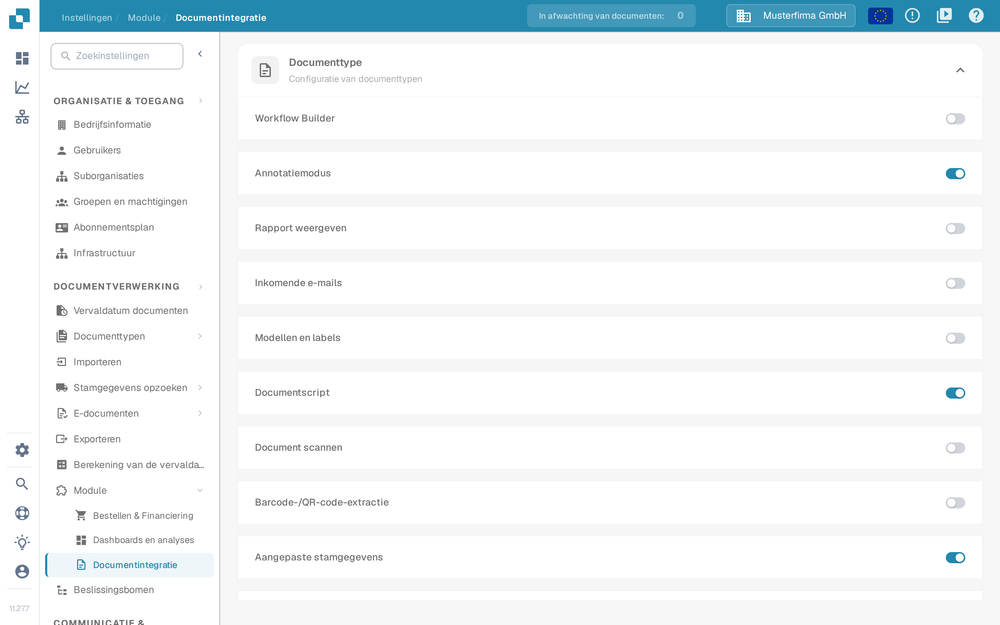
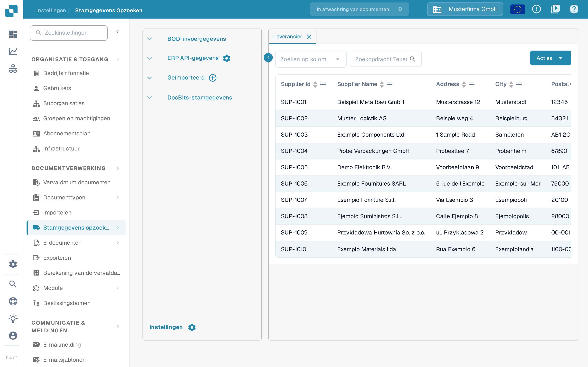
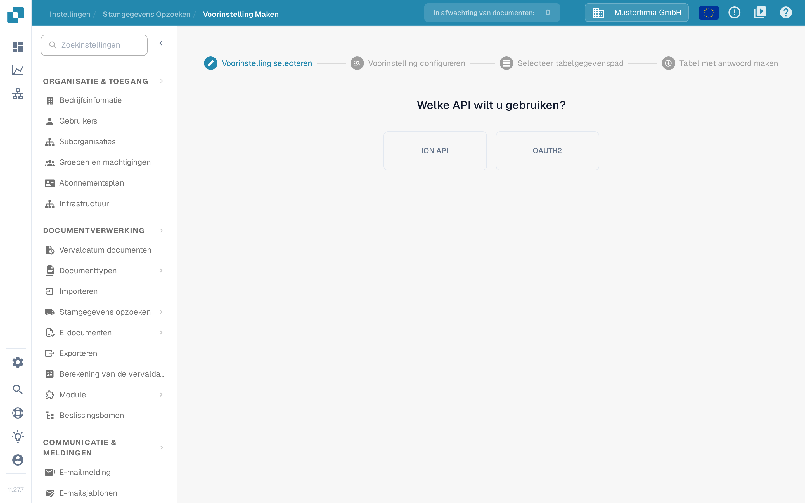
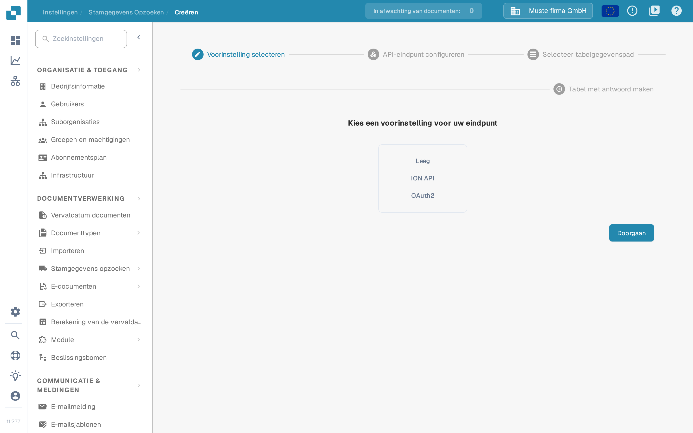
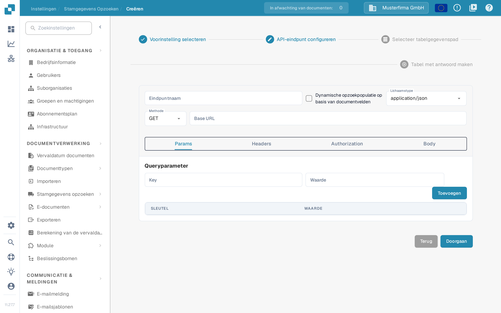

# Aangepaste stamgegevens

Met aangepaste stamgegevens verbindt u DocBits met een eigen API-eindpunt en gebruikt u de teruggegeven gegevens als stamgegevens — bijvoorbeeld uw eigen leveranciers- of artikelentabel — naast de gegevens die DocBits voor u beheert. Houd het API-adres, de inloggegevens en een voorbeeldantwoord vóór de start samen met uw integratiebeheerder bij de hand.

## Aangepaste stamgegevens activeren

Aangepaste stamgegevens zijn een module. Ga naar **Instellingen → DOCUMENTVERWERKING → Module → Documentintegratie** en activeer in de sectie **Configuratie van documenttypen** de schakelaar **Aangepaste stamgegevens**.

<figure><figcaption>
De schakelaar Aangepaste stamgegevens in de sectie Configuratie van documenttypen van Documentintegratie
</figcaption></figure>

Meer over modules vindt u onder [Module](../../administration-and-setup/settings/document-processing/module/README.md).

## Het dialoogvenster Aangepaste stamgegevens openen

Zodra de module actief is, gaat u naar **Instellingen → DOCUMENTVERWERKING → Stamgegevens opzoeken**. Klik in de lijst met stamgegevensgroepen links op het instellingenpictogram naast **ERP API-gegevens** om het dialoogvenster **Aangepaste stamgegevens** te openen. Het pluspictogram naast **Geïmporteerd** is bedoeld voor CSV-uploads, niet voor API-eindpunten.

<figure><figcaption>
Stamgegevens Opzoeken – het instellingenpictogram naast ERP API-gegevens opent het dialoogvenster Aangepaste stamgegevens
</figcaption></figure>

Het dialoogvenster toont uw tabellen met aangepaste stamgegevens met de kolommen **Naam**, **Mode**, **Methode**, **Lichaamstype** en **Acties** en biedt twee manieren om een nieuwe tabel aan te maken:

- **Sjabloon maken** – een herbruikbare voorinstelling definiëren die u bij het aanmaken van eindpunten kunt kiezen.
- **Eindpunt maken** – een stamgegevenstabel koppelen die DocBits vanuit uw API vult.

<figure><figcaption>
Het dialoogvenster Aangepaste stamgegevens met Sjabloon maken en Eindpunt maken
</figcaption></figure>

Met de knop **Acties** in een rij bereikt u vier acties:

* **Bewerking** opent de eindpuntconfiguratie.
* **Trigger-eindpunt** voert de API-aanroep onmiddellijk uit in plaats van te wachten op de volgende automatische zoekopdracht.
* **Clear data** (in de Nederlandse interface in het Engels gelabeld) verwijdert alle records van deze stamgegevenstabel, inclusief records uit andere bronnen zoals een CSV-upload. De eindpuntconfiguratie blijft behouden, zodat u het eindpunt opnieuw kunt activeren; tot die tijd leveren zoekopdrachten met deze gegevensset geen resultaten.
* **Verwijderen** verwijdert de verbinding uit DocBits. Uw gegevensbron blijft ongewijzigd.

## Een sjabloon maken

Klik op **Sjabloon maken** om een voorinstelling te definiëren die u voor meerdere eindpunten kunt hergebruiken. Sjablonen beheert u op de pagina **Voorinstelling Maken** (**Instellingen → Stamgegevens opzoeken → Voorinstelling Maken**).

De eerste stap heet **Voorinstelling selecteren**: kies of de voorinstelling het **ION API**-bestand van uw organisatie of **OAUTH2** gebruikt. Bij ION API uploadt u in het volgende scherm het ION API-JSON-bestand van de organisatie; bij OAUTH2 voert u de inloggegevens in bij het configureren van de voorinstelling.

<figure><figcaption>
Voorinstelling Maken – Voorinstelling selecteren: ION API of OAUTH2
</figcaption></figure>

In de stap **Voorinstelling configureren** geeft u de voorinstelling een naam zonder spaties, kiest u het lichaamstype en de methode en vult u de basis-URL en het adres van de API-aanroep in. De overige tabbladen beschrijven de aanroep zelf:

- **Params** – queryparameters als sleutel-waardeparen.
- **Headers** – HTTP-headervelden als sleutel-waardeparen.
- **Authorization** – het authenticatietype en de bijbehorende JSON-gegevens, inclusief het uploaden van een authenticatie-JSON-bestand.
- **Body** – de aanvraagbody, die wordt verzonden bij methoden die er een gebruiken.

Ga verder met **Selecteer tabelgegevenspad** en **Tabel met antwoord maken**, zoals hieronder voor een eindpunt beschreven, en sluit af met **Klaar**. De opgeslagen voorinstelling verschijnt daarna in de stap **Voorinstelling selecteren** van de eindpuntwizard.

## Een eindpunt maken

Klik op **Eindpunt maken** om een stamgegevenstabel te koppelen. De wizard heeft vier stappen.

### Stap 1 – Voorinstelling selecteren

De pagina vraagt **Kies een voorinstelling voor uw eindpunt**. Kies **Leeg** om alles zelf te configureren, **ION API** om de authenticatie uit het ION API-bestand van uw organisatie vooraf in te vullen, **OAuth2** om de OAuth2-authenticatie vooraf in te vullen, of een van uw opgeslagen sjablonen.

<figure><figcaption>
Eindpunt maken – Voorinstelling selecteren: Leeg, ION API, OAuth2 of een opgeslagen sjabloon
</figcaption></figure>

### Stap 2 – API-eindpunt configureren

Voer een **Eindpuntnaam** zonder spaties in; deze naam wordt de naam van uw stamgegevenstabel.

Activeer **Dynamische opzoekpopulatie op basis van documentvelden** als de zoekopdracht van het verwerkte document moet afhangen. DocBits vult dan plaatsaanduidingen in de API-aanroep – in de URL, de queryparameters of de headers – met waarden uit het huidige document, zodat de aanroep gegevens kan retourneren die bij dat document passen.

Kies het **Lichaamstype** en de **Methode** van de aanroep en voer de **Base URL** in. De tabbladen eronder beschrijven de aanroep:

- **Params** – queryparameters als sleutel-waardeparen; bij dynamische opzoekpopulatie kunnen de waarden uit documentvelden komen.
- **Headers** – HTTP-headervelden als sleutel-waardeparen, toegevoegd met **Toevoegen**.
- **Authorization** – kies onder **Authenticatietype** het authenticatietype en voer de JSON-gegevens in; een bestand uploadt u via **Upload authenticatie JSON**. De beschikbare typen hangen af van de gekozen voorinstelling.
- **Body** – de aanvraagbody voor methoden die er een verzenden. **Beautify** formatteert de JSON voor betere leesbaarheid.

<figure><figcaption>
Eindpunt maken – API-eindpunt configureren
</figcaption></figure>

Met **Doorgaan** gaat u naar de volgende stap; **Terug** keert terug naar de vorige stap zonder uw invoer te verliezen.

### Stap 3 – Selecteer tabelgegevenspad

De stap vraagt **Waar bevinden zich uw tabelgegevens?**. Voer in het veld **Basispad** (in de interface voorafgegaan door **$.**) het pad in van het veld in de API-respons dat de tabelgegevens bevat, in puntnotatie. De pagina geeft daarbij de hint **Gebruik bijvoorbeeld "results.0" en niet "results[0]"** en zet de API-respons naast de uitgelezen gegevens, zodat u kunt controleren of het pad de juiste regels selecteert. Meer over puntnotatie vindt u onder [Writing JSONPath expressions](https://docs.hevodata.com/sources/engg-analytics/streaming/rest-api/writing-jsonpath-expressions/).

### Stap 4 – Tabel met antwoord maken

De stap vraagt **Selecteer tabelkolommen**; de tabelwaarden moeten uit het JSON-antwoord worden geëxtraheerd. Wijs de antwoordwaarden toe aan de kolommen die u wilt aanmaken: voer onder **Kolomnaam** een kolomnaam en onder **Spaltenwert-naam** (in de Nederlandse interface in het Duits gelabeld) de bijbehorende waarde uit het antwoord in en klik op **Toevoegen**. Meerdere waarden scheidt u met een komma. Met **Test Extractie** controleert u vóór het opslaan of DocBits de verwachte waarden leest. Bij **Selecteer suborganisatie** staat standaard **All** geselecteerd.

Klik ten slotte op **Klaar** om uw nieuwe stamgegevenstabel aan te maken en te vullen.

Voor hulp bij het vinden en gebruiken van stamgegevens na het instellen, zie [Stamgegevens opzoeken](../../administration-and-setup/settings/document-processing/master-data-lookup.md).
