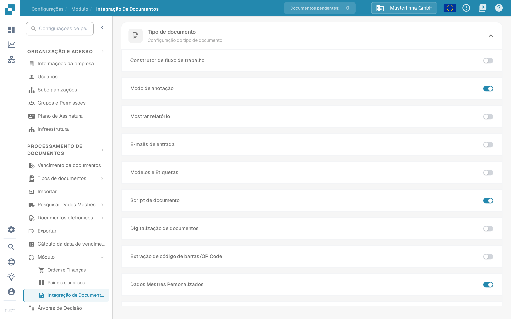
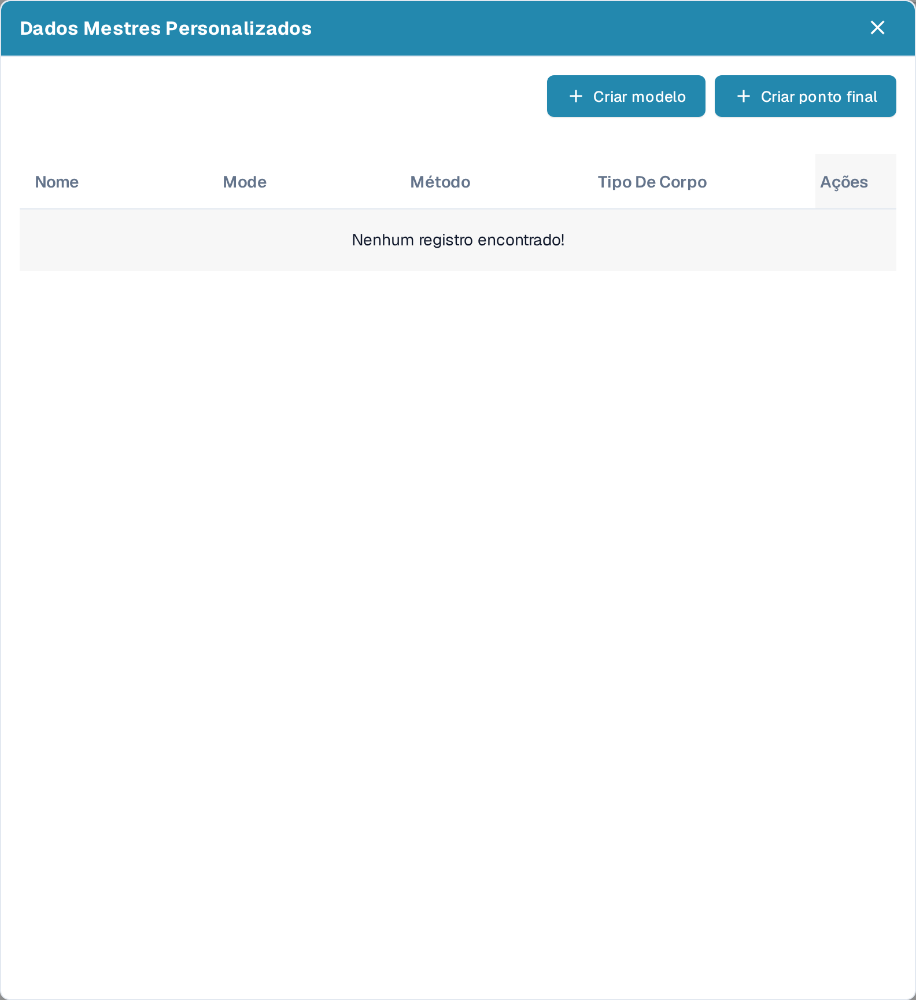
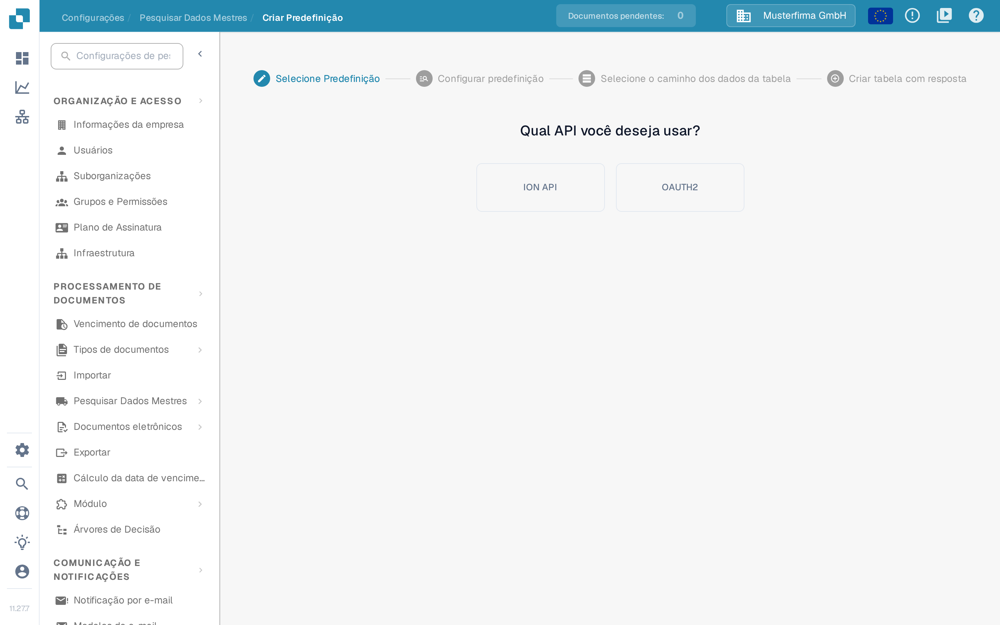
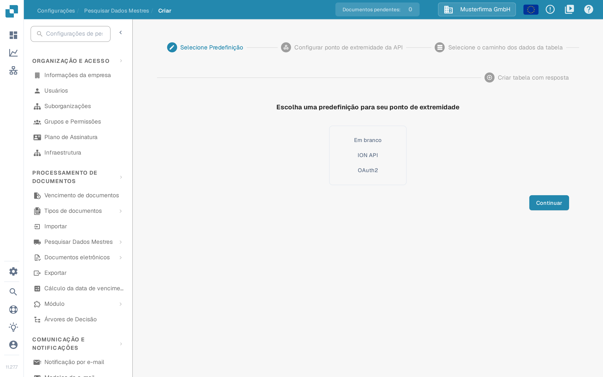
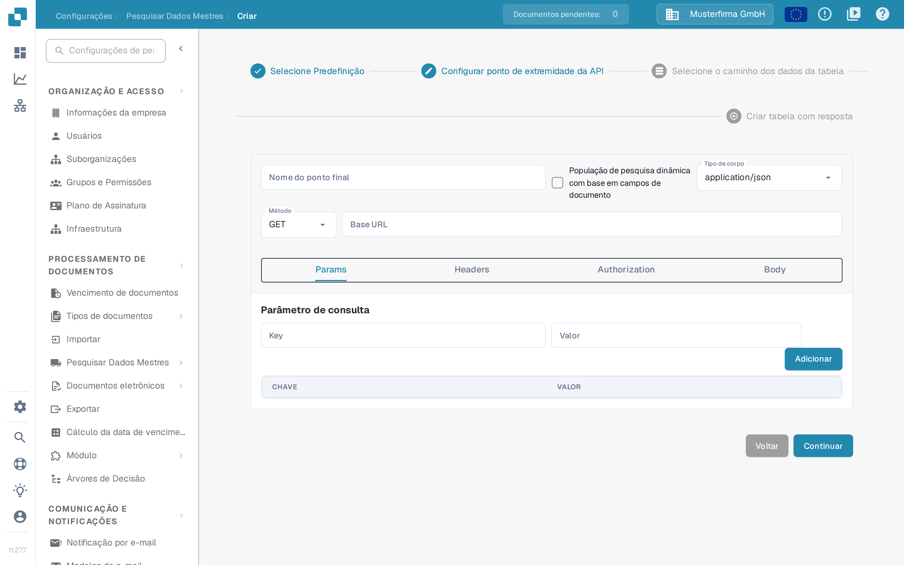

# Dados Mestres Personalizados

Os Dados Mestres Personalizados permitem conectar o DocBits a um dos seus próprios pontos finais de API e usar os dados que ele retorna como dados mestres — por exemplo, a sua própria tabela de fornecedores ou de artigos — em conjunto com os dados que o DocBits mantém para você. Prepare a URL da API, os dados de autenticação e uma resposta de exemplo com o administrador da sua integração antes de começar.

## Ativar os Dados Mestres Personalizados

Os Dados Mestres Personalizados são um módulo. Para ativá-lo, acesse **Configurações → PROCESSAMENTO DE DOCUMENTOS → Módulo → Integração De Documentos** e ative a opção **Dados Mestres Personalizados** na seção **Configuração do tipo de documento**.

<figure><figcaption>
A opção Dados Mestres Personalizados ativada no cartão Tipo de documento, em Integração De Documentos
</figcaption></figure>

Para mais informações sobre módulos, consulte [Módulo](../../administration-and-setup/settings/document-processing/module/README.md).

## Abrir a janela Dados Mestres Personalizados

Com o módulo ativo, acesse **Configurações → PROCESSAMENTO DE DOCUMENTOS → Pesquisar Dados Mestres**. Na lista de grupos de dados mestres à esquerda, clique no ícone **settings** ao lado de **Dados da API do ERP** para abrir a janela **Dados Mestres Personalizados**. O ícone de mais ao lado de **Importado** serve para importações CSV e não para pontos finais de API.

<figure><figcaption>
Pesquisar Dados Mestres — o ícone de configurações ao lado de Dados da API do ERP abre a janela Dados Mestres Personalizados
</figcaption></figure>

A janela lista as suas tabelas de dados mestres com **Nome**, **Mode**, **Método**, **Tipo De Corpo** e **Ações** e oferece duas formas de adicionar uma nova. A coluna **Mode** aparece em inglês na interface em português. Enquanto não houver pontos finais, a lista mostra **Nenhum registro encontrado!**.

* **Criar modelo** — define uma predefinição reutilizável que você pode escolher ao criar pontos finais.
* **Criar ponto final** — conecta uma tabela de dados mestres que o DocBits preenche a partir da sua API.

<figure><figcaption>
A janela Dados Mestres Personalizados com Criar modelo e Criar ponto final; a lista ainda não tem pontos finais
</figcaption></figure>

Cada conexão existente tem quatro ações de linha:

* **Editar** abre a configuração do ponto final.
* **Ponto final do gatilho** executa a chamada da API imediatamente, em vez de esperar pela próxima pesquisa automática.
* **Clear data** apaga todos os registos do conjunto de dados, incluindo registos de outras origens, como uma importação CSV. O rótulo desta ação aparece em inglês na interface em português. A configuração do ponto final é mantida, portanto você pode executá-lo novamente; até lá, as pesquisas que usam o conjunto de dados não retornam resultados.
* **Excluir** remove a conexão do DocBits. A fonte de dados do seu lado não é alterada.

## Criar um modelo

Clique em **Criar modelo** para definir uma predefinição que você pode reutilizar em vários pontos finais. Os modelos são gerenciados na página **Criar Predefinição** (**Configurações → Pesquisar Dados Mestres → Criar Predefinição**).

O primeiro passo é **Selecione Predefinição**: escolha se a predefinição deve usar o arquivo **ION API** da sua organização ou **OAUTH2**. Com ION API você carrega o arquivo JSON do ION API da organização na tela seguinte; com OAUTH2 você informa as credenciais ao configurar a predefinição.

<figure><figcaption>
Criar Predefinição — Selecione Predefinição: ION API ou OAUTH2
</figcaption></figure>

No passo **Configurar predefinição**, dê à predefinição um nome sem espaços, escolha o tipo de corpo e o método da requisição e informe a URL base e a URL da chamada da API. As abas restantes descrevem a chamada:

- **Params** — parâmetros de consulta como pares chave/valor.
- **Headers** — campos de cabeçalho HTTP como pares chave/valor.
- **Authorization** — o tipo de autenticação e os seus dados JSON; o campo de upload aceita um arquivo JSON de autenticação.
- **Body** — o corpo da requisição, enviado nos métodos que o utilizam.

Continue com **Selecione o caminho dos dados da tabela** e **Criar tabela com resposta** como descrito para um ponto final abaixo e conclua com **Feito**. A predefinição salva aparece então no passo **Selecione Predefinição** do assistente de ponto final.

## Criar um ponto final

Clique em **Criar ponto final** para conectar uma tabela de dados mestres. O assistente tem quatro passos.

### Passo 1 — Selecione Predefinição

Escolha o ponto de partida: **Em branco** para configurar tudo você mesmo, **ION API** para preencher a autenticação a partir do arquivo ION API da sua organização, **OAuth2** para preencher a autenticação OAuth2 ou um dos seus modelos salvos.

<figure><figcaption>
Criar ponto final — Selecione Predefinição: Em branco, ION API, OAuth2 ou um modelo salvo
</figcaption></figure>

### Passo 2 — Configurar ponto de extremidade da API

Informe um **Nome do ponto final** sem espaços; esse nome passa a ser o nome da sua tabela de dados mestres.

Ative **População de pesquisa dinâmica com base em campos de documento** se a pesquisa deve depender do documento que está sendo processado. O DocBits preenche então os espaços reservados na chamada da API — na URL, nos parâmetros de consulta ou nos cabeçalhos — com valores do documento atual, para que a chamada possa retornar dados correspondentes a esse documento.

Selecione o **Tipo de corpo** e o **Método** da chamada e informe a **Base URL**. As abas abaixo descrevem a chamada:

- **Params** — parâmetros de consulta como pares chave/valor; com a população de pesquisa dinâmica, os valores podem vir de campos do documento.
- **Headers** — campos de cabeçalho HTTP como pares chave/valor, adicionados com **Adicionar**.
- **Authorization** — o tipo de autenticação e os seus dados JSON. Os tipos disponíveis dependem da predefinição selecionada.
- **Body** — o corpo da requisição para os métodos que enviam um. **Beautify** formata o JSON para facilitar a leitura.

<figure><figcaption>
Criar ponto final — Configurar ponto de extremidade da API
</figcaption></figure>

Use **Continuar** para avançar; **Voltar** retorna ao passo anterior sem perder os dados informados.

### Passo 3 — Selecione o caminho dos dados da tabela

Informe o **Caminho Base**, em notação de pontos, do campo da resposta da API que contém os dados da tabela. A página mostra a resposta da API ao lado dos dados extraídos para que você verifique se o caminho seleciona as entradas corretas. Para mais informações sobre notação de pontos, consulte [Writing JSONPath expressions](https://docs.hevodata.com/sources/engg-analytics/streaming/rest-api/writing-jsonpath-expressions/).

### Passo 4 — Criar tabela com resposta

Mapeie os valores da resposta para as colunas que deseja criar: informe um nome para a coluna em **Nome da coluna** e o valor correspondente da resposta em **Nome Spaltenwert** e clique em **Adicionar**. O rótulo **Nome Spaltenwert** contém uma palavra em alemão na interface em português. Use **Extração de teste** para verificar se o DocBits lê os valores esperados antes de salvar.

Por fim, clique em **Feito** para que a sua nova tabela de dados mestres seja criada e preenchida.

Para ajuda a encontrar e usar dados mestres depois da configuração, consulte [Pesquisar Dados Mestres](../../administration-and-setup/settings/document-processing/master-data-lookup.md).
