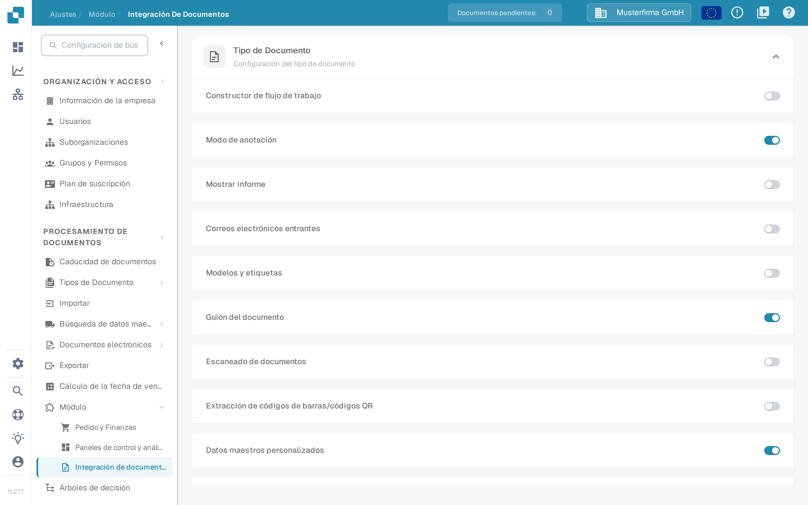
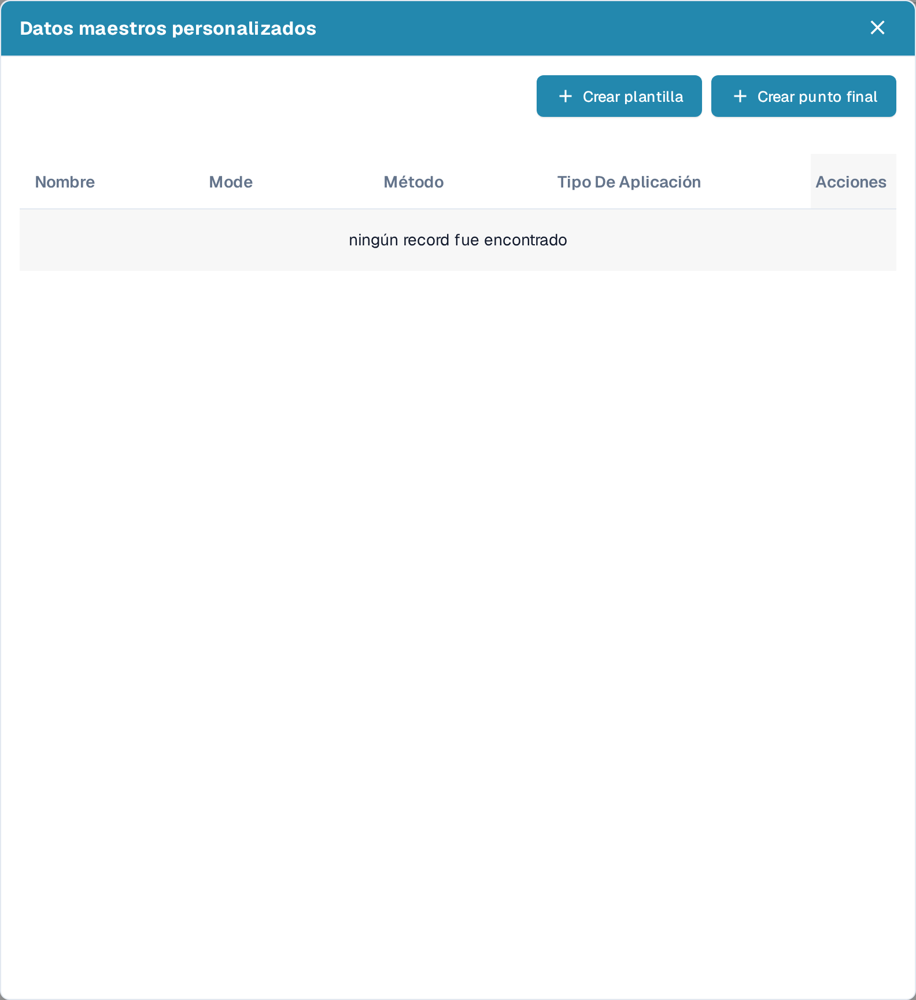
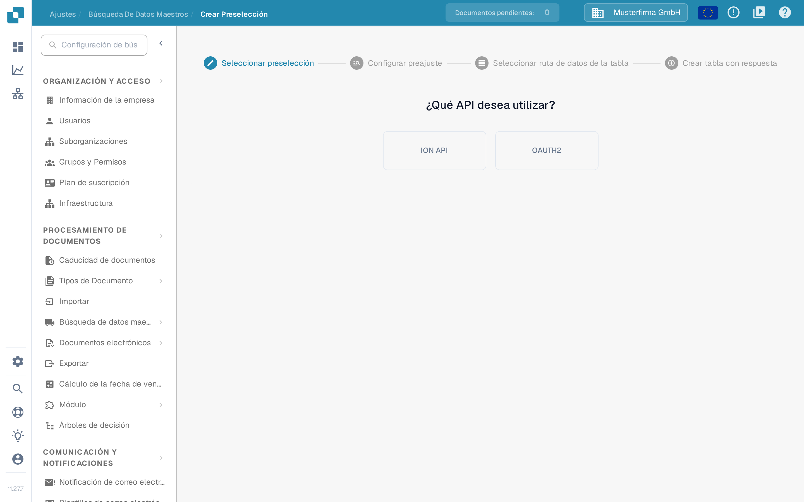
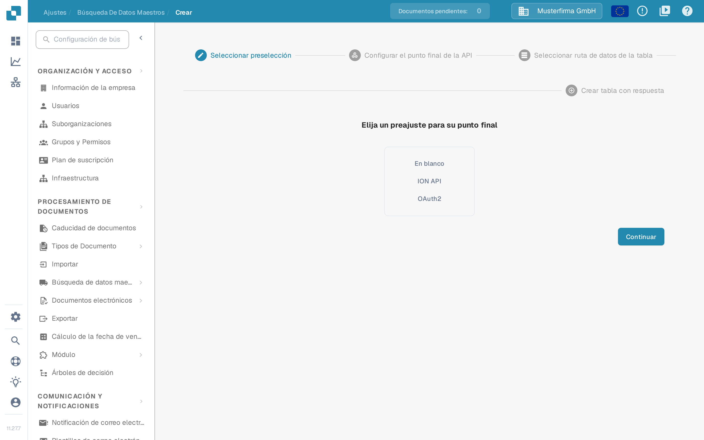
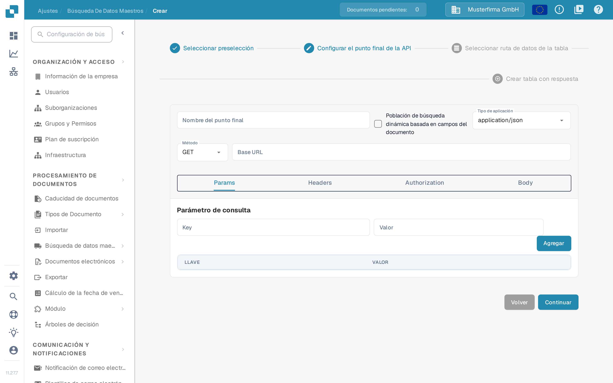

# Datos maestros personalizados

Los datos maestros personalizados le permiten conectar DocBits con uno de sus propios puntos finales de API y utilizar los datos que devuelve como datos maestros —por ejemplo, su propia tabla de proveedores o de artículos— junto con los datos que DocBits mantiene para usted. Prepare la URL de la API, los datos de autenticación y una respuesta de ejemplo con su administrador de integraciones antes de empezar.

## Activar los datos maestros personalizados

Los datos maestros personalizados son un módulo. Para activarlo, vaya a **Ajustes** → **PROCESAMIENTO DE DOCUMENTOS** → **Módulo** → **Integración de documentos** y active el interruptor **Datos maestros personalizados** en la sección **Configuración del tipo de documento**.

<figure><figcaption>
El interruptor Datos maestros personalizados en la sección Configuración del tipo de documento de Integración de documentos; en este ejemplo está activado.
</figcaption></figure>

Para obtener más información sobre los módulos, consulte [Módulo](../../administration-and-setup/settings/document-processing/module/README.md).

## Abrir el diálogo Datos maestros personalizados

Con el módulo activo, vaya a **Ajustes** → **PROCESAMIENTO DE DOCUMENTOS** → **Búsqueda de datos maestros**. En la lista de grupos de datos maestros de la izquierda, haga clic en el icono de ajustes junto a **Datos de la API ERP** para abrir el diálogo **Datos maestros personalizados**. El icono de suma junto a **Importado** sirve para cargar archivos CSV, no para puntos finales de API.

<figure><figcaption>
Búsqueda de datos maestros: el icono de ajustes junto a Datos de la API ERP abre el diálogo Datos maestros personalizados.
</figcaption></figure>

El diálogo enumera sus tablas de datos maestros personalizados con el nombre, el método y el tipo de cuerpo de la llamada, y ofrece dos formas de añadir una nueva:

- **Crear plantilla** — defina una preselección reutilizable que pueda elegir al crear puntos finales.
- **Crear punto final** — conecte una tabla de datos maestros que DocBits rellena desde su API.

<figure><figcaption>
El diálogo Datos maestros personalizados con Crear plantilla y Crear punto final. En este ejemplo no hay conexiones guardadas, por eso la lista muestra el aviso «ningún record fue encontrado».
</figcaption></figure>

Cada conexión existente tiene cuatro acciones de fila:

* **Editar** abre la configuración del punto final.
* **Punto final de activación** ejecuta la llamada a la API de inmediato en lugar de esperar a la próxima búsqueda automática.
* **Clear data** elimina todos los registros del conjunto de datos, incluidos los registros de otras fuentes, como una carga CSV. La configuración del punto final se conserva, así que puede activarlo de nuevo; hasta entonces, las búsquedas que usan el conjunto de datos no devuelven resultados. La interfaz muestra esta acción en inglés.
* **Borrar** elimina la conexión de DocBits. La fuente de datos de su lado no cambia.

## Crear una plantilla

Haga clic en **Crear plantilla** para definir una preselección que pueda reutilizar en varios puntos finales. Las plantillas se gestionan en la página **Crear Preselección** (**Ajustes** → **Búsqueda de datos maestros** → **Crear Preselección**).

El primer paso es **Seleccionar preselección**: elija si la preselección debe usar el archivo **ION API** de su organización o **OAUTH2**. Con ION API cargará el archivo JSON de ION API de la organización en la pantalla siguiente; con OAUTH2 introducirá las credenciales al configurar la preselección.

<figure><figcaption>
Crear Preselección: en el paso Seleccionar preselección se elige entre ION API y OAUTH2.
</figcaption></figure>

En el paso **Configurar preajuste**, asigne a la preselección un nombre sin espacios, elija el tipo de cuerpo y el método de la petición e introduzca la URL base y la URL de la llamada a la API. Las pestañas restantes describen la llamada:

- **Params** — parámetros de consulta como pares clave/valor.
- **Headers** — campos de cabecera HTTP como pares clave/valor.
- **Authorization** — el tipo de autenticación y sus datos JSON; el campo de carga acepta un archivo JSON de autenticación.
- **Body** — el cuerpo de la petición, que se envía en los métodos que lo usan.

Continúe con **Seleccionar ruta de datos de la tabla** y **Crear tabla con respuesta** como se describe para un punto final más abajo, y finalice el asistente. La preselección guardada aparece después en el paso **Seleccionar preselección** del asistente de puntos finales.

## Crear un punto final

Haga clic en **Crear punto final** para conectar una tabla de datos maestros. El asistente tiene cuatro pasos.

### Paso 1: Seleccionar preselección

Elija el punto de partida: **En blanco** para configurarlo todo usted mismo, **ION API** para rellenar previamente la autenticación desde el archivo ION API de su organización, **OAuth2** para rellenar previamente la autenticación OAuth2, o una de sus plantillas guardadas.

<figure><figcaption>
Crear punto final, paso Seleccionar preselección: En blanco, ION API u OAuth2. En este ejemplo no hay preselecciones guardadas.
</figcaption></figure>

### Paso 2: Configurar el punto final de la API

Introduzca un **Nombre del punto final** sin espacios; este nombre pasa a ser el nombre de su tabla de datos maestros.

Active **Población de búsqueda dinámica basada en campos del documento** si la búsqueda debe depender del documento que se está procesando. DocBits rellena entonces los marcadores de posición de la llamada a la API —en la URL, los parámetros de consulta o las cabeceras— con valores tomados del documento actual, de modo que la llamada puede devolver datos que correspondan a ese documento.

Seleccione el **Tipo de aplicación** y el **Método** de la llamada e introduzca la **Base URL**. Las pestañas siguientes describen la llamada:

- **Params** — parámetros de consulta como pares clave/valor; con la población dinámica de la búsqueda los valores pueden venir de campos del documento.
- **Headers** — campos de cabecera HTTP como pares clave/valor, que se añaden con **Agregar**.
- **Authorization** — el tipo de autenticación y sus datos JSON. Los tipos disponibles dependen de la preselección elegida.
- **Body** — el cuerpo de la petición para los métodos que lo envían. El editor permite dar formato al JSON para leerlo mejor.

<figure><figcaption>
Crear punto final, paso Configurar el punto final de la API; la pestaña Params muestra Parámetro de consulta, Key, Valor y el botón Agregar. No se ha introducido ningún valor en este ejemplo.
</figcaption></figure>

Use **Continuar** para avanzar; **Volver** regresa al paso anterior sin perder lo introducido.

### Paso 3: Seleccionar ruta de datos de la tabla

Introduzca la ruta JSON, en notación de puntos, del campo de la respuesta de la API que contiene los datos de la tabla. La página muestra la respuesta de la API junto a los datos extraídos para que pueda comprobar si la ruta selecciona las entradas correctas. Para obtener más información sobre la notación de puntos, consulte [Writing JSONPath expressions](https://docs.hevodata.com/sources/engg-analytics/streaming/rest-api/writing-jsonpath-expressions/).

### Paso 4: Crear tabla con respuesta

Asigne los valores de la respuesta a las columnas que desea crear: introduzca un nombre para la columna y el valor correspondiente de la respuesta, y haga clic en **Agregar**. Antes de guardar, compruebe con la prueba de extracción que DocBits lee los valores esperados.

Por último, finalice el asistente para crear y rellenar su nueva tabla de datos maestros.

Para obtener ayuda sobre cómo encontrar y utilizar los datos maestros después de la configuración, consulte [Búsqueda de datos maestros](../../administration-and-setup/settings/document-processing/master-data-lookup.md).
