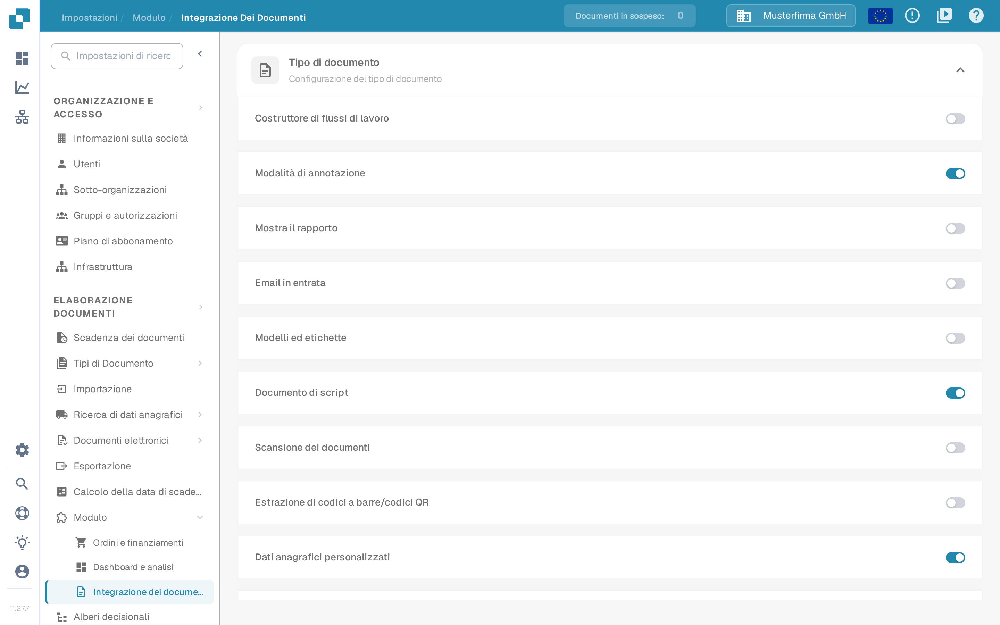
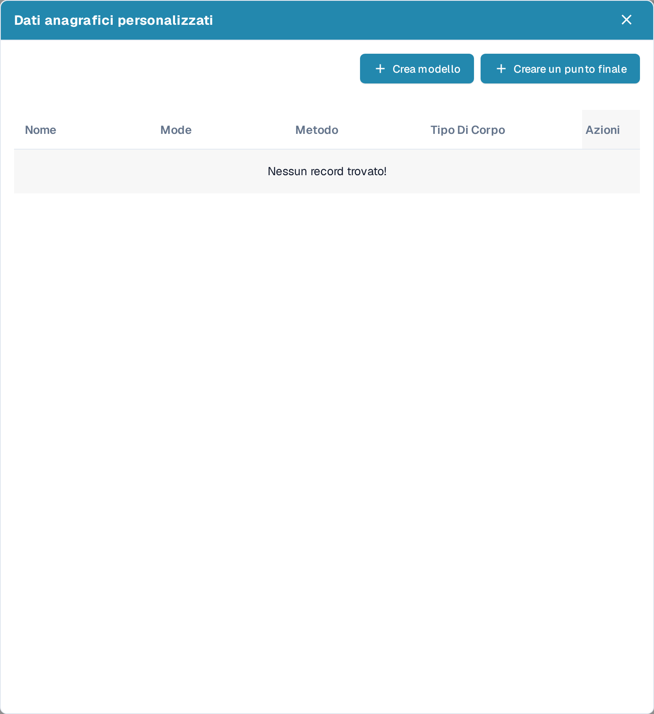
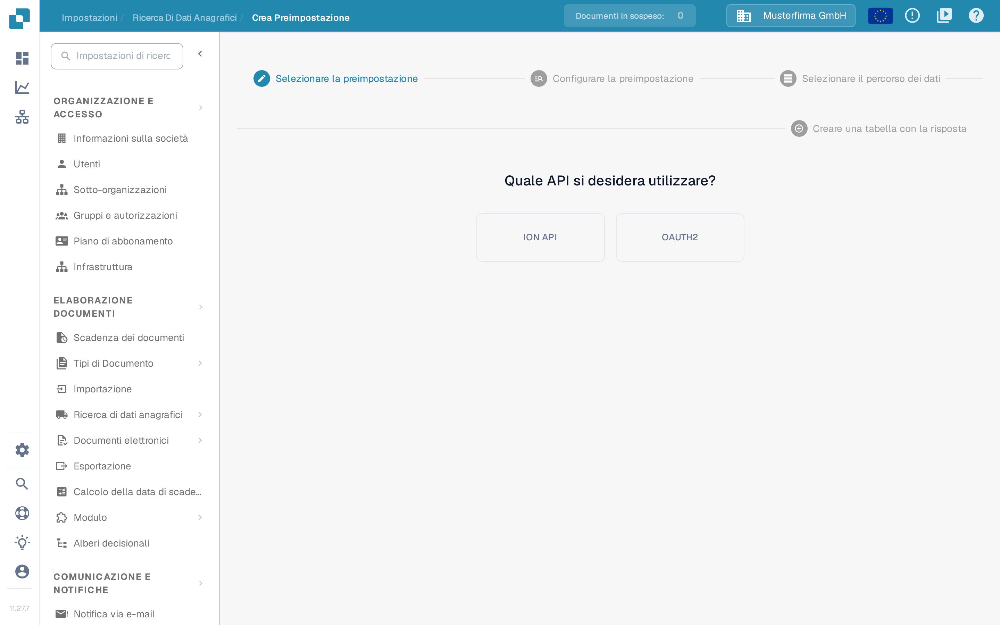
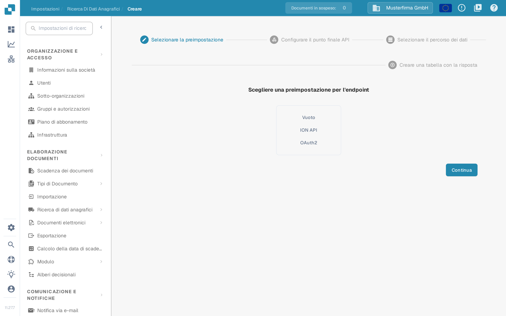
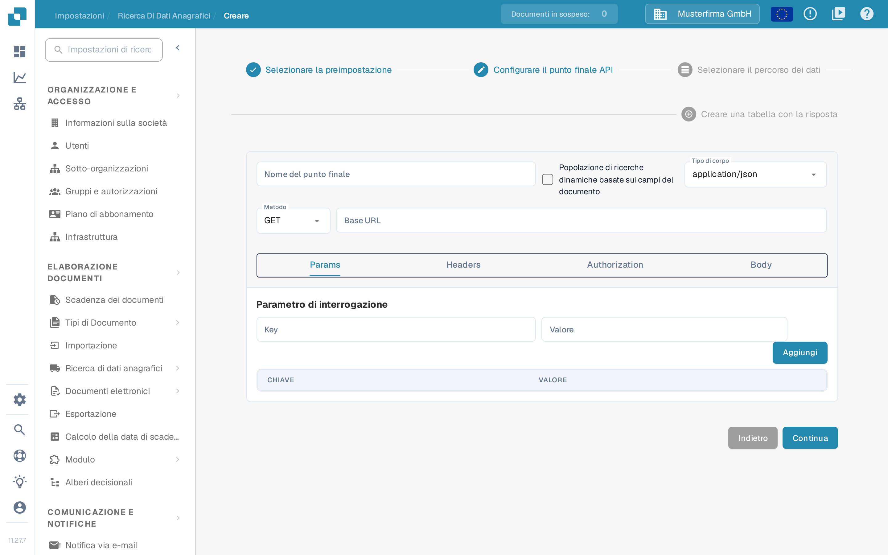

# Dati anagrafici personalizzati

I dati anagrafici personalizzati consentono di collegare DocBits a uno dei propri endpoint API e di utilizzare i dati restituiti come dati anagrafici, per esempio una propria tabella dei fornitori o degli articoli, accanto ai dati gestiti da DocBits. Prima di iniziare, preparare con l'amministratore dell'integrazione l'URL dell'API, i dati di autenticazione e una risposta di esempio.

## Attivare i dati anagrafici personalizzati

I dati anagrafici personalizzati sono un modulo. Per attivarli, andare in **Impostazioni** → **ELABORAZIONE DOCUMENTI** → **Modulo** → **Integrazione dei documenti** e attivare l'interruttore **Dati anagrafici personalizzati** nella sezione **Configurazione del tipo di documento**.

<figure><figcaption>
L'interruttore Dati anagrafici personalizzati nella sezione Configurazione del tipo di documento di Integrazione dei documenti; in questo esempio è attivato.
</figcaption></figure>

Per ulteriori informazioni sui moduli, vedere [Modulo](../../administration-and-setup/settings/document-processing/module/README.md).

## Aprire la finestra Dati anagrafici personalizzati

Con il modulo attivo, andare in **Impostazioni** → **ELABORAZIONE DOCUMENTI** → **Ricerca di dati anagrafici**. Nell'elenco dei gruppi di dati anagrafici a sinistra, fare clic sull'icona **impostazioni** accanto a **Dati API ERP** per aprire la finestra **Dati anagrafici personalizzati**. L'icona con il segno più accanto a **Importato** serve per caricare file CSV, non per gli endpoint API.

<figure><figcaption>
Ricerca di dati anagrafici: l'icona impostazioni accanto a Dati API ERP apre la finestra Dati anagrafici personalizzati.
</figcaption></figure>

La finestra elenca le tabelle di dati anagrafici personalizzati con **Nome**, **Mode** (mostrato in inglese), **Metodo** e **Tipo Di Corpo** e offre due modi per aggiungerne una nuova:

- **Crea modello** — definire una preimpostazione riutilizzabile da scegliere durante la creazione degli endpoint.
- **Creare un punto finale** — collegare una tabella di dati anagrafici che DocBits popola dalla propria API.

<figure><figcaption>
La finestra Dati anagrafici personalizzati con Crea modello e Creare un punto finale. In questo esempio non ci sono connessioni salvate, per questo l'elenco mostra il messaggio «Nessun record trovato».
</figcaption></figure>

Ogni connessione esistente dispone di quattro azioni di riga:

* **Modifica** apre la configurazione del punto finale.
* **Punto finale di attivazione** esegue subito la chiamata API invece di attendere la prossima ricerca automatica.
* **Clear data** elimina tutti i record del set di dati, compresi i record provenienti da altre fonti come un caricamento CSV. La configurazione del punto finale viene mantenuta, quindi è possibile attivarla di nuovo; fino a quel momento le ricerche che utilizzano il set di dati non restituiscono risultati. L'interfaccia mostra questa azione in inglese.
* **Cancellare** rimuove la connessione da DocBits. L'origine dati resta invariata.

## Creare un modello

Fare clic su **Crea modello** per definire una preimpostazione riutilizzabile in più endpoint. I modelli si gestiscono nella pagina **Crea Preimpostazione** (**Impostazioni** → **Ricerca di dati anagrafici** → **Crea Preimpostazione**).

Il primo passo è **Selezionare la preimpostazione**: scegliere se la preimpostazione deve usare il file **ION API** dell'organizzazione oppure **OAUTH2**. Con ION API si carica il file JSON ION API dell'organizzazione nella schermata successiva; con OAUTH2 si inseriscono le credenziali durante la configurazione della preimpostazione.

<figure><figcaption>
Crea Preimpostazione: nel passo Selezionare la preimpostazione si sceglie tra ION API e OAUTH2.
</figcaption></figure>

Nel passo **Configurare la preimpostazione** assegnare alla preimpostazione un nome senza spazi, scegliere il tipo di corpo e il metodo della richiesta e inserire la **Base URL** e l'URL della chiamata API. Le altre schede descrivono la chiamata:

- **Params** — parametri di interrogazione come coppie chiave/valore.
- **Headers** — campi di intestazione HTTP come coppie chiave/valore.
- **Authorization** — il tipo di autenticazione e i relativi dati JSON; il campo di caricamento accetta un file JSON di autenticazione.
- **Body** — il corpo della richiesta, inviato per i metodi che lo utilizzano.

Proseguire con **Selezionare il percorso dei dati** e **Creare una tabella con la risposta** come descritto più avanti per un endpoint e completare la procedura. La preimpostazione salvata compare poi nel passo **Selezionare la preimpostazione** della procedura guidata degli endpoint.

## Creare un punto finale

Fare clic su **Creare un punto finale** per collegare una tabella di dati anagrafici. La procedura guidata comprende quattro passi.

### Passo 1: Selezionare la preimpostazione

Scegliere il punto di partenza: **Vuoto** per configurare tutto manualmente, **ION API** per precompilare l'autenticazione dal file ION API dell'organizzazione, **OAuth2** per precompilare l'autenticazione OAuth2, oppure una delle preimpostazioni salvate.

<figure><figcaption>
Creare un punto finale, passo Selezionare la preimpostazione: Vuoto, ION API o OAuth2. In questo esempio non ci sono preimpostazioni salvate.
</figcaption></figure>

### Passo 2: Configurare il punto finale API

Inserire il **Nome del punto finale** senza spazi; questo nome diventa il nome della tabella di dati anagrafici.

Attivare **Popolazione di ricerche dinamiche basate sui campi del documento** se la ricerca deve dipendere dal documento in elaborazione. DocBits riempie quindi i segnaposto della chiamata API — nell'URL, nei parametri di interrogazione o nelle intestazioni — con valori presi dal documento corrente, così la chiamata può restituire dati corrispondenti a quel documento.

Selezionare il **Tipo di corpo** e il **Metodo** della chiamata e inserire la **Base URL**. Le schede sottostanti descrivono la chiamata:

- **Params** — parametri di interrogazione come coppie chiave/valore; con la popolazione dinamica della ricerca i valori possono provenire dai campi del documento.
- **Headers** — campi di intestazione HTTP come coppie chiave/valore, aggiunti con **Aggiungi**.
- **Authorization** — il tipo di autenticazione e i relativi dati JSON. I tipi disponibili dipendono dalla preimpostazione scelta.
- **Body** — il corpo della richiesta per i metodi che lo inviano. Lo strumento di formattazione dispone il JSON in modo più leggibile.

<figure><figcaption>
Creare un punto finale, passo Configurare il punto finale API; la scheda Params mostra Parametro di interrogazione, Key, Valore e il pulsante Aggiungi. In questo esempio non è stato inserito alcun valore.
</figcaption></figure>

Usare **Continua** per proseguire; **Indietro** torna al passo precedente senza perdere i dati inseriti.

### Passo 3: Selezionare il percorso dei dati

Inserire il percorso JSON, in notazione puntata, del campo della risposta API che contiene i dati della tabella. La pagina mostra la risposta API accanto ai dati estratti, così è possibile verificare se il percorso seleziona le voci corrette. Per ulteriori informazioni sulla notazione puntata, vedere [Writing JSONPath expressions](https://docs.hevodata.com/sources/engg-analytics/streaming/rest-api/writing-jsonpath-expressions/).

### Passo 4: Creare una tabella con la risposta

Mappare i valori della risposta alle colonne che si desidera creare: inserire un nome per la colonna e il valore corrispondente della risposta, quindi fare clic su **Aggiungi**. Con la funzione di test dell'estrazione verificare che DocBits legga i valori attesi prima di salvare.

Infine completare la procedura per creare e popolare la nuova tabella di dati anagrafici.

Per assistenza su come trovare e utilizzare i dati anagrafici dopo la configurazione, vedere [Ricerca dei dati anagrafici](../../administration-and-setup/settings/document-processing/master-data-lookup.md).
