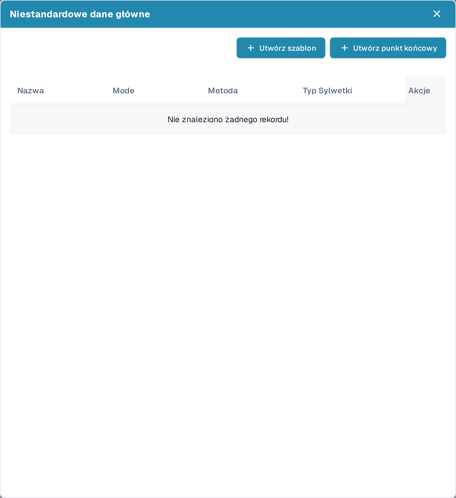
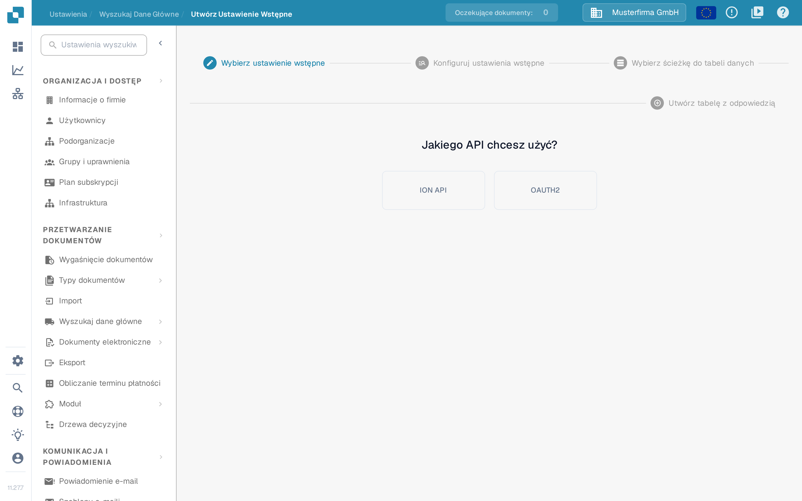
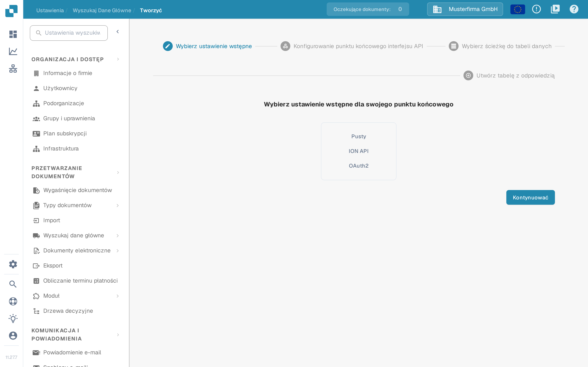
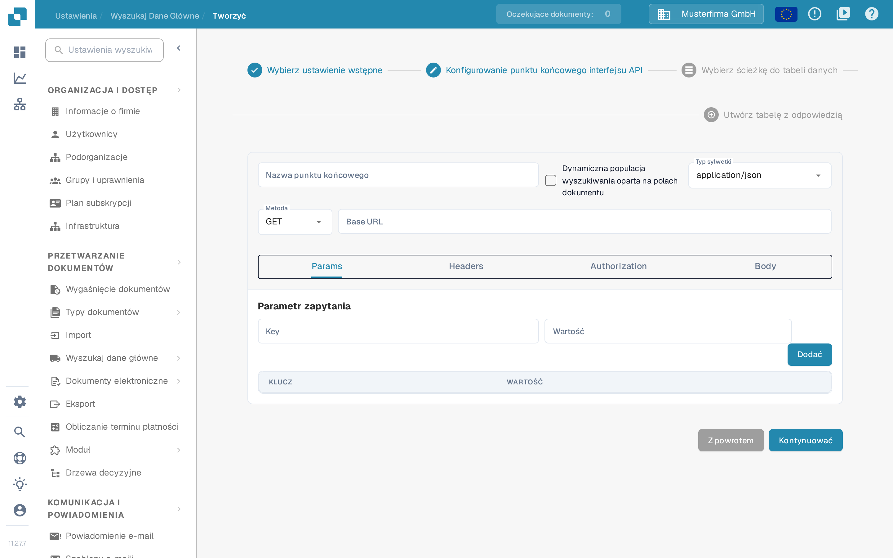

# Własne dane podstawowe

Własne dane podstawowe (w interfejsie: **Niestandardowe dane główne**) pozwalają połączyć DocBits z własnym punktem końcowym API i używać zwracanych danych jako danych podstawowych — na przykład własnej tabeli dostawców lub artykułów — obok danych prowadzonych przez DocBits. Przed rozpoczęciem przygotuj z administratorem integracji adres URL interfejsu API, dane uwierzytelniające i przykładową odpowiedź.

## Włączanie własnych danych podstawowych

Własne dane podstawowe są modułem. Aby go włączyć, przejdź do **Ustawienia** → **PRZETWARZANIE DOKUMENTÓW** → **Moduł** → **Integracja dokumentów** i włącz przełącznik **Niestandardowe dane główne** w sekcji **Typ dokumentu** (podtytuł **Konfiguracja typu dokumentu**).

<figure><figcaption>
Przełącznik Niestandardowe dane główne w sekcji Konfiguracja typu dokumentu modułu Integracja dokumentów; w tym przykładzie jest włączony.
</figcaption></figure>

Więcej o modułach znajdziesz w artykule [Moduł](../../administration-and-setup/settings/document-processing/module/README.md).

## Otwieranie okna Niestandardowe dane główne

Gdy moduł jest aktywny, przejdź do **Ustawienia** → **PRZETWARZANIE DOKUMENTÓW** → **Wyszukaj dane główne**. Na liście grup danych podstawowych po lewej stronie kliknij ikonę **Ustawienia** obok **Dane API ERP**, aby otworzyć okno **Niestandardowe dane główne**. Ikona plus obok **Importowany** służy do wgrywania plików CSV, a nie do punktów końcowych API.

<figure><figcaption>
Wyszukaj dane główne: ikona Ustawienia obok Dane API ERP otwiera okno Niestandardowe dane główne.
</figcaption></figure>

Okno zawiera listę tabel własnych danych podstawowych z kolumnami **Nazwa**, **Mode** (wyświetlana po angielsku), **Metoda** i **Typ Sylwetki** (typ treści żądania) oraz dwa sposoby dodania nowej tabeli:

- **Utwórz szablon** — zdefiniuj ustawienie wstępne wielokrotnego użytku, które wybierzesz podczas tworzenia punktów końcowych.
- **Utwórz punkt końcowy** — połącz tabelę danych podstawowych, którą DocBits wypełnia z Twojego interfejsu API.

<figure><figcaption>
Okno Niestandardowe dane główne z przyciskami Utwórz szablon i Utwórz punkt końcowy. W tym przykładzie nie ma zapisanych połączeń, dlatego lista pokazuje komunikat „Nie znaleziono żadnego rekordu!”.
</figcaption></figure>

Każde istniejące połączenie ma cztery akcje wiersza:

* **Redagować** otwiera konfigurację punktu końcowego.
* **Punkt końcowy wyzwalacza** od razu wykonuje wywołanie API, zamiast czekać na następne automatyczne wyszukiwanie.
* **Clear data** usuwa wszystkie rekordy zbioru danych, w tym rekordy z innych źródeł, takich jak wgranie pliku CSV. Konfiguracja punktu końcowego pozostaje zapisana, więc możesz go uruchomić ponownie; do tego czasu wyszukiwania korzystające ze zbioru danych nie zwracają wyników. Interfejs pokazuje tę akcję po angielsku.
* **Usuwać** usuwa połączenie z DocBits. Twoje źródło danych pozostaje niezmienione.

## Tworzenie szablonu

Kliknij **Utwórz szablon**, aby zdefiniować ustawienie wstępne wielokrotnego użytku w kilku punktach końcowych. Szablonami zarządzasz na stronie **Utwórz Ustawienie Wstępne** (**Ustawienia** → **Wyszukaj dane główne** → **Utwórz Ustawienie Wstępne**).

Pierwszy krok to **Wybierz ustawienie wstępne**: wybierz, czy ustawienie ma korzystać z pliku **ION API** Twojej organizacji, czy z **OAUTH2**. W przypadku ION API w następnym ekranie wgrywasz plik JSON ION API organizacji; w przypadku OAUTH2 dane uwierzytelniające podajesz podczas konfigurowania ustawienia.

<figure><figcaption>
Utwórz Ustawienie Wstępne: w kroku Wybierz ustawienie wstępne wybierasz ION API albo OAUTH2.
</figcaption></figure>

W kroku **Konfiguruj ustawienia wstępne** nadaj ustawieniu nazwę bez spacji, wybierz typ treści żądania i metodę oraz podaj **Base URL** i adres URL wywołania API. Pozostałe karty opisują samo wywołanie:

- **Params** — parametry zapytania jako pary klucz/wartość.
- **Headers** — pola nagłówka HTTP jako pary klucz/wartość.
- **Authorization** — typ uwierzytelniania i powiązane dane JSON; pole wgrywania przyjmuje plik JSON z danymi uwierzytelniania.
- **Body** — treść żądania, wysyłana dla metod, które jej używają.

Kontynuuj krokami **Wybierz ścieżkę do tabeli danych** i **Utwórz tabelę z odpowiedzią** — opis znajdziesz poniżej przy punkcie końcowym — a następnie zakończ kreator. Zapisane ustawienie pojawi się potem w kroku **Wybierz ustawienie wstępne** kreatora punktów końcowych.

## Tworzenie punktu końcowego

Kliknij **Utwórz punkt końcowy**, aby połączyć tabelę danych podstawowych. Kreator obejmuje cztery kroki.

### Krok 1: Wybierz ustawienie wstępne

Wybierz punkt wyjścia: **Pusty**, aby skonfigurować wszystko samodzielnie, **ION API**, aby wstępnie wypełnić uwierzytelnianie z pliku ION API Twojej organizacji, **OAuth2**, aby wstępnie wypełnić uwierzytelnianie OAuth2, albo jedno z zapisanych ustawień.

<figure><figcaption>
Utwórz punkt końcowy, krok Wybierz ustawienie wstępne: Pusty, ION API albo OAuth2. W tym przykładzie nie ma zapisanych ustawień wstępnych.
</figcaption></figure>

### Krok 2: Konfigurowanie punktu końcowego interfejsu API

Wpisz **Nazwa punktu końcowego** bez spacji; ta nazwa staje się nazwą tabeli danych podstawowych.

Włącz **Dynamiczna populacja wyszukiwania oparta na polach dokumentu**, jeśli wyszukiwanie ma zależeć od przetwarzanego dokumentu. DocBits wypełnia wtedy symbole zastępcze w wywołaniu API — w adresie URL, parametrach zapytania lub nagłówkach — wartościami z bieżącego dokumentu, dzięki czemu wywołanie może zwrócić dane pasujące do tego dokumentu.

Wybierz **Typ sylwetki** i **Metoda** wywołania oraz podaj **Base URL**. Karty poniżej opisują wywołanie:

- **Params** — parametry zapytania jako pary klucz/wartość; przy dynamicznej populacji wyszukiwania wartości mogą pochodzić z pól dokumentu.
- **Headers** — pola nagłówka HTTP jako pary klucz/wartość, dodawane przyciskiem **Dodać**.
- **Authorization** — typ uwierzytelniania i powiązane dane JSON. Dostępne typy zależą od wybranego ustawienia wstępnego.
- **Body** — treść żądania dla metod, które ją wysyłają. Narzędzie formatowania porządkuje JSON, aby ułatwić czytanie.

<figure><figcaption>
Utwórz punkt końcowy, krok Konfigurowanie punktu końcowego interfejsu API; karta Params pokazuje Parametr zapytania, Key, Wartość i przycisk Dodać. W tym przykładzie nie wpisano żadnej wartości.
</figcaption></figure>

Użyj **Kontynuować**, aby przejść dalej; **Z powrotem** wraca do poprzedniego kroku bez utraty wpisanych danych.

### Krok 3: Wybierz ścieżkę do tabeli danych

Wpisz ścieżkę JSON w notacji kropkowej do pola w odpowiedzi API, które zawiera dane tabeli. Strona pokazuje odpowiedź API obok wyodrębnionych danych, dzięki czemu możesz sprawdzić, czy ścieżka wybiera właściwe pozycje. Więcej o notacji kropkowej znajdziesz w artykule [Writing JSONPath expressions](https://docs.hevodata.com/sources/engg-analytics/streaming/rest-api/writing-jsonpath-expressions/) (po angielsku).

### Krok 4: Utwórz tabelę z odpowiedzią

Przypisz wartości z odpowiedzi do kolumn, które chcesz utworzyć: wpisz nazwę kolumny i odpowiadającą jej wartość z odpowiedzi, a następnie kliknij **Dodać**. Funkcją testowania ekstrakcji sprawdź, czy DocBits odczytuje oczekiwane wartości, zanim zapiszesz.

Na koniec zakończ kreator, aby utworzyć i wypełnić nową tabelę danych podstawowych.

Pomoc w wyszukiwaniu i używaniu danych podstawowych po konfiguracji znajdziesz w artykule [Wyszukiwanie danych podstawowych](../../administration-and-setup/settings/document-processing/master-data-lookup.md).
