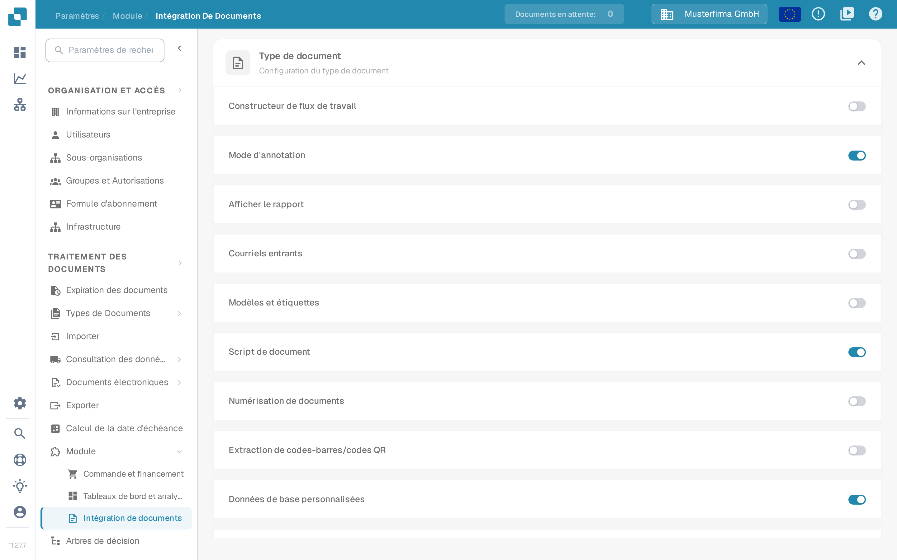
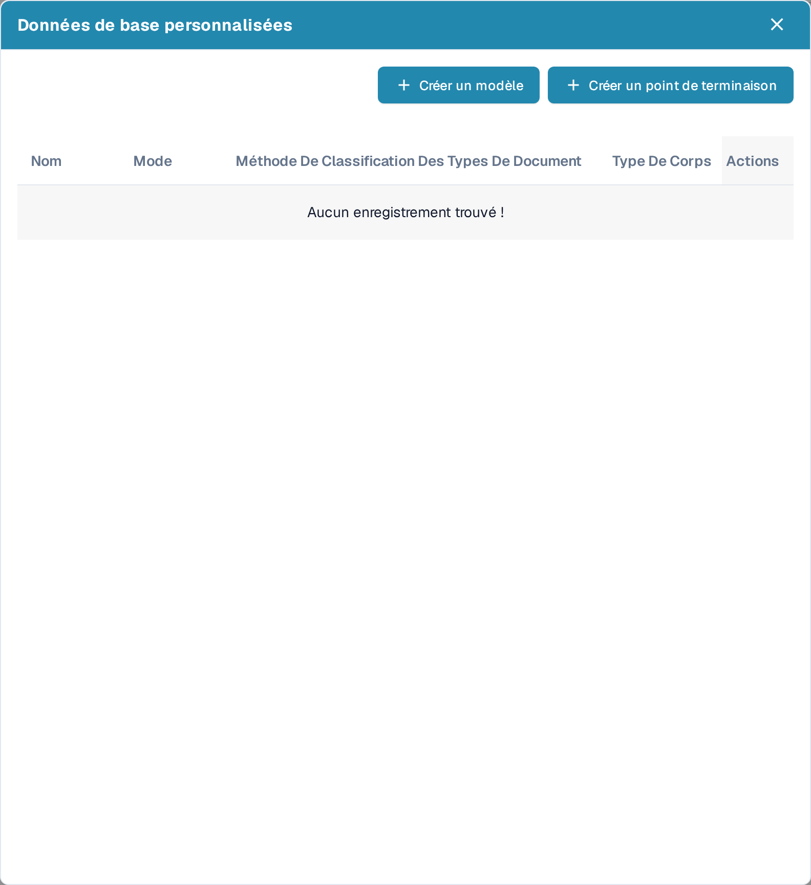
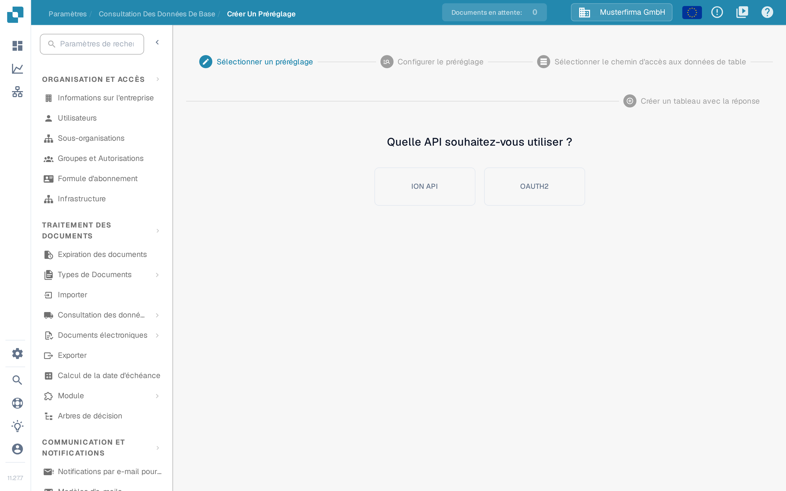
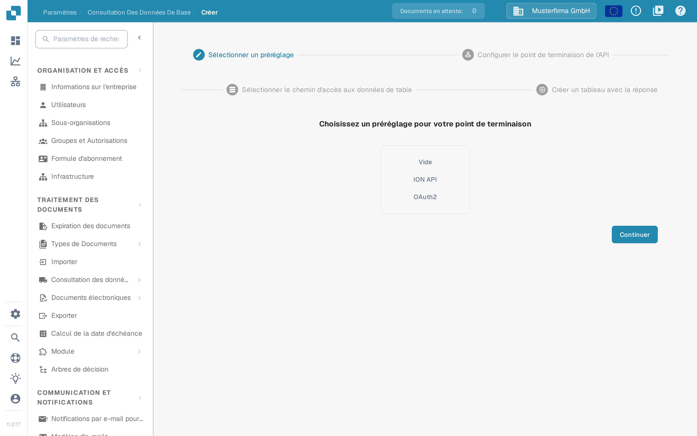
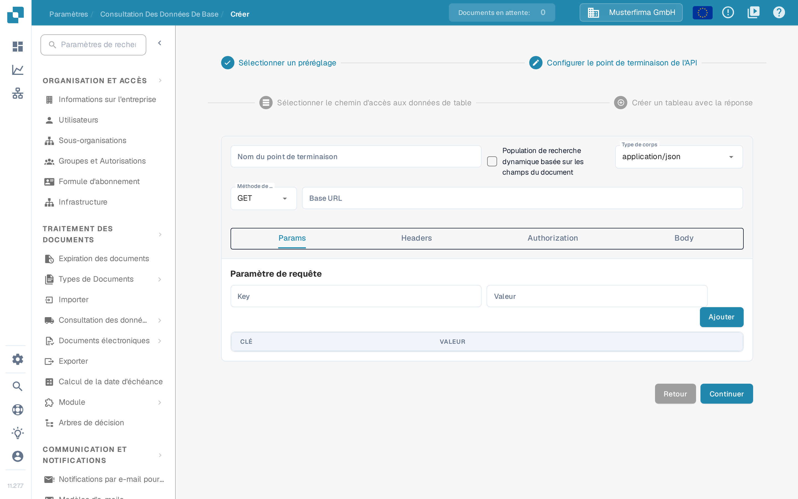

# Données de base personnalisées

Les données de base personnalisées vous permettent de connecter DocBits à l'un de vos propres points de terminaison d'API et d'utiliser les données renvoyées comme données de base — par exemple votre propre table de fournisseurs ou d'articles — en complément des données que DocBits gère pour vous. Préparez l'URL de l'API, les informations d'authentification et une réponse d'exemple avec votre administrateur d'intégration avant de commencer.

## Activer les données de base personnalisées

Les données de base personnalisées sont un module. Pour l'activer, allez dans **Paramètres** → **TRAITEMENT DES DOCUMENTS** → **Module** → **Intégration de documents** et activez l'interrupteur **Données de base personnalisées** dans la section **Configuration du type de document**.

<figure><figcaption>
L'interrupteur Données de base personnalisées dans la section Configuration du type de document de la page Intégration de documents ; dans cet exemple, il est activé.
</figcaption></figure>

Pour en savoir plus sur les modules, consultez [Module](../../administration-and-setup/settings/document-processing/module/README.md).

## Ouvrir la boîte de dialogue Données de base personnalisées

Une fois le module actif, allez dans **Paramètres** → **TRAITEMENT DES DOCUMENTS** → **Consultation des données de base**. Dans la liste des groupes de données de base à gauche, cliquez sur l'icône **settings** à côté de **Données de l'API ERP** pour ouvrir la boîte de dialogue **Données de base personnalisées**. L'icône plus à côté de **Importé** sert à importer des fichiers CSV, et non à créer des points de terminaison d'API.

<figure><figcaption>
Consultation des données de base : l'icône settings à côté de Données de l'API ERP ouvre la boîte de dialogue Données de base personnalisées. Le tableau de droite contient des données d'exemple inventées.
</figcaption></figure>

La boîte de dialogue liste vos tables de données de base personnalisées avec leur **Nom**, leur **Mode**, leur **Méthode De Classification Des Types De Document** et leur **Type De Corps**, et propose deux façons d'en ajouter une nouvelle :

- **Créer un modèle** — définissez un préréglage réutilisable que vous pourrez choisir lors de la création de points de terminaison.
- **Créer un point de terminaison** — connectez une table de données de base que DocBits remplit depuis votre API.

<figure><figcaption>
La boîte de dialogue Données de base personnalisées avec Créer un modèle et Créer un point de terminaison. Dans cet exemple, aucune connexion n'est enregistrée : la liste affiche donc le message « Aucun enregistrement trouvé ! ».
</figcaption></figure>

Chaque connexion existante propose quatre actions de ligne :

* **Éditer** ouvre la configuration du point de terminaison.
* **Point de terminaison de déclenchement** exécute l'appel d'API immédiatement au lieu d'attendre la prochaine consultation automatique.
* **Clear data** supprime tous les enregistrements du jeu de données, y compris ceux provenant d'autres sources comme un import CSV. La configuration du point de terminaison est conservée : vous pouvez donc le déclencher à nouveau ; d'ici là, les consultations qui utilisent ce jeu de données ne renvoient aucun résultat. L'interface affiche cette action en anglais.
* **Supprimer** retire la connexion de DocBits. La source de données de votre côté reste inchangée.

## Créer un modèle

Cliquez sur **Créer un modèle** pour définir un préréglage que vous pouvez réutiliser sur plusieurs points de terminaison. Les modèles se gèrent sur la page **Créer Un Préréglage**, accessible depuis la consultation des données de base.

La première étape, **Sélectionner un préréglage**, pose la question **Quelle API souhaitez-vous utiliser ?** : choisissez **ION API** pour utiliser le fichier ION API de votre organisation ou **OAUTH2**. Avec ION API, vous importez le fichier JSON ION API de l'organisation dans l'écran suivant ; avec OAUTH2, vous saisissez les identifiants lors de la configuration du préréglage.

<figure><figcaption>
Créer Un Préréglage, étape Sélectionner un préréglage : le choix se fait entre ION API et OAUTH2.
</figcaption></figure>

À l'étape **Configurer le préréglage**, donnez au préréglage un nom sans espaces, choisissez le type de corps et la méthode de la requête, puis saisissez le champ **Base URL** et l'URL de l'appel d'API. Les onglets restants décrivent l'appel lui-même :

- **Params** — paramètres de requête sous forme de paires clé/valeur.
- **Headers** — champs d'en-tête HTTP sous forme de paires clé/valeur.
- **Authorization** — le type d'authentification et ses données JSON ; le champ d'import accepte un fichier JSON d'authentification.
- **Body** — le corps de la requête, envoyé pour les méthodes qui en utilisent un.

Poursuivez avec **Sélectionner le chemin d'accès aux données de table** et **Créer un tableau avec la réponse**, comme décrit ci-dessous pour un point de terminaison, puis terminez l'assistant. Le préréglage enregistré apparaît ensuite à l'étape **Sélectionner un préréglage** de l'assistant de point de terminaison.

## Créer un point de terminaison

Cliquez sur **Créer un point de terminaison** pour connecter une table de données de base. L'assistant comporte quatre étapes.

### Étape 1 — Sélectionner un préréglage

Choisissez le point de départ : **Vide** pour tout configurer vous-même, **ION API** pour préremplir l'authentification à partir du fichier ION API de votre organisation, **OAUTH2** pour préremplir l'authentification OAuth2, ou l'un de vos modèles enregistrés.

<figure><figcaption>
Créer un point de terminaison, étape Sélectionner un préréglage : Vide, ION API ou OAuth2. Dans cet exemple, aucun préréglage enregistré n'est proposé.
</figcaption></figure>

### Étape 2 — Configurer le point de terminaison de l'API

Saisissez un **Nom du point de terminaison** sans espaces ; ce nom devient celui de votre table de données de base.

Activez **Population de recherche dynamique basée sur les champs du document** si la consultation doit dépendre du document en cours de traitement. DocBits remplit alors les espaces réservés de l'appel d'API — dans l'URL, les paramètres de requête ou les en-têtes — avec des valeurs issues du document courant, afin que l'appel puisse renvoyer des données correspondant à ce document.

Sélectionnez le **Type de corps** et la méthode de l'appel, puis saisissez le champ **Base URL**. Les onglets ci-dessous décrivent l'appel :

- **Params** — paramètres de requête sous forme de paires clé/valeur ; avec la population dynamique de la recherche, les valeurs peuvent venir des champs du document.
- **Headers** — champs d'en-tête HTTP sous forme de paires clé/valeur, ajoutés avec **Ajouter**.
- **Authorization** — le type d'authentification et ses données JSON. Les types disponibles dépendent du préréglage choisi.
- **Body** — le corps de la requête pour les méthodes qui en envoient un. La vue du corps permet de mettre en forme le JSON pour le lire plus facilement.

<figure><figcaption>
Créer un point de terminaison, étape Configurer le point de terminaison de l'API ; l'onglet Params affiche Paramètre de requête, Key, Valeur et le bouton Ajouter. Aucune valeur n'a été saisie dans cet exemple.
</figcaption></figure>

Utilisez **Continuer** pour avancer ; **Retour** revient à l'étape précédente sans perdre vos saisies.

### Étape 3 — Sélectionner le chemin d'accès aux données de table

Saisissez le chemin JSON, en notation pointée, du champ de la réponse d'API qui contient les données du tableau. La page affiche la réponse de l'API à côté des données extraites pour que vous puissiez vérifier si le chemin sélectionne les bonnes entrées. Pour en savoir plus sur la notation pointée, consultez [Writing JSONPath expressions](https://docs.hevodata.com/sources/engg-analytics/streaming/rest-api/writing-jsonpath-expressions/).

### Étape 4 — Créer un tableau avec la réponse

Associez les valeurs de la réponse aux colonnes que vous souhaitez créer : saisissez un nom pour la colonne et la valeur correspondante de la réponse, puis cliquez sur **Ajouter**. Avant d'enregistrer, utilisez la fonction de test de l'extraction pour vérifier que DocBits lit bien les valeurs attendues.

Enfin, terminez l'assistant pour créer et remplir votre nouvelle table de données de base.

Pour savoir comment retrouver et utiliser les données de base après la configuration, consultez [Consultation des données de base](../../administration-and-setup/settings/document-processing/master-data-lookup.md).
