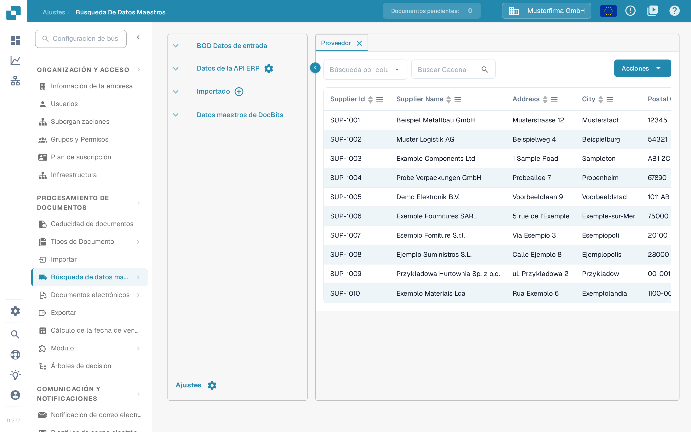
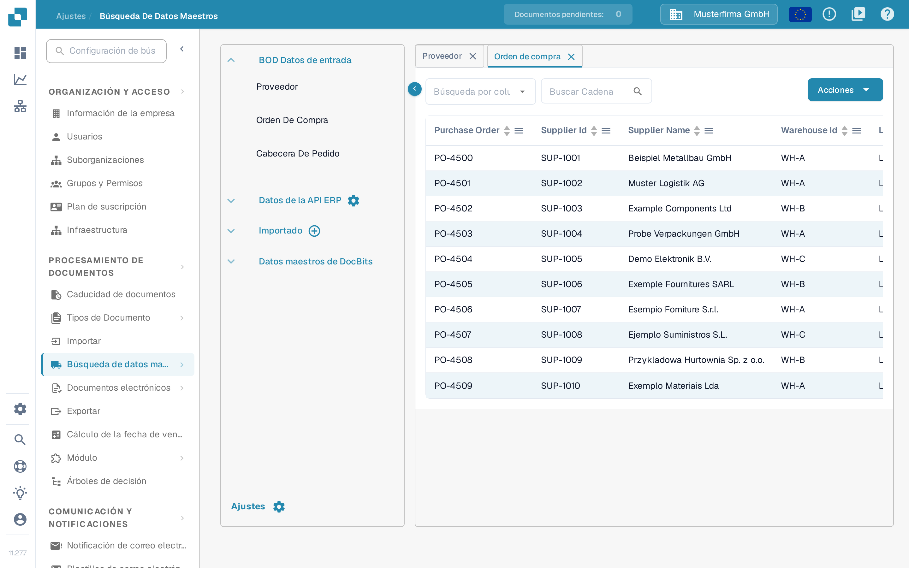

# Proveedores y órdenes de compra de Infor LN

Este ejemplo describe la ruta de Infor ION para los BOD de proveedores y de órdenes de compra y dónde verificarlos en DocBits. Las catorce capturas de Infor que aparecen a continuación son ejemplos históricos de un inquilino. Confirme con su administrador de integración los puntos de conexión, los nombres de las llamadas a la API y las opciones de publicación de LN; no se verificaron en un inquilino de Infor para esta actualización. Durante esta actualización no se publicó ni se importó ningún BOD.

Infor documenta el [publicador de datos maestros logísticos de LN](https://docs.infor.com/ln/latest/en-us/lnolh/tcolh/help/tc/bod/tcbod0200m000.html) y el [publicador transaccional de gestión de pedidos](https://docs.infor.com/ln/2025.x/en-us/lnolh/tdolh/help/td/bod/tdbod0200m000.html). Sus modos tienen efectos distintos: **Count** informa del total de registros sin publicar; **Simulate** genera un resultado de prueba sin confirmar la publicación; **Publish** envía los datos seleccionados. La publicación puede llegar a todos los suscriptores, así que compruebe el rango de empresas y los suscriptores antes de ejecutarla.

## **Punto de conexión**

Deberá crear el punto de conexión de la API de DocBits para poder crear después el flujo de datos.

En primer lugar, en InforOS, navegue a ION Desk → Connect → Connection Points

<figure><figcaption>
Ejemplo de navegación histórico: ION Desk → Connect → Connection Points.
</figcaption></figure>

Una vez allí, deberá crear un nuevo punto de conexión.

<figure><figcaption>
Elija Add para crear un punto de conexión; la anotación verde marca la acción en esta interfaz histórica.
</figcaption></figure>

**Seleccione API**

Asigne al punto de conexión un nombre y una descripción que indiquen su naturaleza y su entorno. En la pestaña Connection, importe la cuenta de servicio que haya creado para el entorno con el que trabaja.

<figure><figcaption>
Pestaña Connection histórica. Los nombres de cuenta de servicio y de conexión mostrados pertenecen al entorno de ejemplo.
</figcaption></figure>

A continuación, cambie a la pestaña Documents. Deberá añadir los siguientes BOD al punto de conexión.

<figure><figcaption>
Pestaña Dokumente (Documents) histórica. Este recorte muestra tres rutas; no muestra la configuración completa de proveedores.
</figcaption></figure>

* Ack-SupplierInvoice

Este BOD sirve para indicar en DocBits que se ha producido un error en Infor. La ruta Acknowledge.SupplierInvoice que se muestra a continuación es un ejemplo de acuse de facturas. Confirme el nombre de su llamada a la API y si esta ruta es necesaria para su flujo de proveedores y órdenes de compra.

<figure><figcaption>
Ruta de acuse histórica. Ack-SupplierInvoice es un nombre de llamada a la API de ejemplo; Acknowledge.SupplierInvoice es el BOD recibido.
</figcaption></figure>

* Sync.PurchaseOrder

El ejemplo histórico siguiente muestra una operación de recepción; confirme la operación actual y el formato de la solicitud para su entorno.

<figure><figcaption>
Ruta de órdenes de compra histórica. Revise la operación de recepción de su entorno de DocBits en lugar de copiar la antigua ruta del proxy.
</figcaption></figure>

* Sync.ReceiveDelivery

El ejemplo histórico siguiente muestra una operación de recepción; confirme la operación actual y el formato de la solicitud para su entorno.

<figure><figcaption>
Ruta histórica de datos de recepción. Confirme si ReceiveDelivery es necesario para su integración y qué operación lo recibe.
</figcaption></figure>

Una vez configurados estos BOD, puede guardar el punto de conexión pulsando el icono situado a la derecha del botón de retroceso.

## **Flujo de datos**

El flujo de datos tendrá un aspecto similar al siguiente

<figure><figcaption>
Flujo histórico con cuatro entornos. La división y la unión son visibles; el número y el destino de los nodos dependen del diseño de su integración.
</figcaption></figure>

Los múltiples nodos de API de DocBits de este ejemplo histórico representan entornos separados. Su diseño de producción puede usar un número distinto de nodos; nunca dirija datos de prueba a una organización de producción.

La siguiente ilustración utiliza cuatro entornos únicamente como ejemplo.

### **LN**

El inicio del flujo de datos lo forman sus aplicaciones de LN

### **DocBits API**

Aquí añadirá una aplicación y seleccionará las API de DocBits que creó anteriormente

### **Documentos**

Revise la lista de documentos asignada al flujo. Los mensajes de proveedor que se muestran aquí también necesitan sus correspondientes rutas de recepción en el punto de conexión de la API. Su configuración de llamadas a la API no aparece en el recorte anterior de tres rutas; confirme las operaciones necesarias con su administrador de integración.

<figure><figcaption>
Lista de documentos histórica del flujo. Aquí aparecen tanto los mensajes de proveedor como los de órdenes de compra y de recepción.
</figcaption></figure>

## **Activación de BOD en LN**

Una vez que el administrador de integración haya comprobado el punto de conexión, las rutas de documentos y el flujo de datos activo, utilice la sesión de publicación de LN adecuada. Siga cada identificador de prueba por LN, ION y DocBits; activar un BOD por sí solo no demuestra que un registro haya llegado.

<figure><figcaption>
Página inicial histórica de LN. Utilice la navegación descrita a continuación para encontrar la sesión de publicación adecuada.
</figcaption></figure>

### **PurchaseOrder**

En el menú anterior, en la pestaña del menú izquierdo, seleccione Common → BOD-Messaging → Publish BODs → Publish Order Management Transactional Data

Seleccione la pestaña PurchaseOrder y marque la casilla.

<figure><figcaption>
Selección histórica de PurchaseOrder. Revise el rango de pedidos y los estados antes de publicar.
</figcaption></figure>

### **Proveedores**

Desde la página de inicio de LN, en la pestaña del menú izquierdo, navegue a Common → BOD-Messaging → Publish BODs → Publish Logistics Master Data

Seleccione la pestaña PartyMaster y marque la casilla Supplier → Buy-from o SupplierPartyMaster.

<figure><figcaption>
Selección histórica de proveedores en PartyMaster. Elija los roles de socio que necesite su integración y compruebe el rango de la selección.
</figcaption></figure>

### **Activación de BOD**

Una vez marcados todos los BOD correctos para su publicación, seleccione la pestaña Options.

Revise las opciones de su inquilino. El ejemplo histórico resalta Publish y Use Process/Sync Verb; no son ajustes universales para todas las integraciones.

<figure><figcaption>
Ejemplo histórico de Options. Aquí están seleccionados Publish y Use Process/Sync Verb; verifique el modo, el rango de empresas y los suscriptores para su propia ejecución.
</figcaption></figure>

Antes de **Process**, utilice **Count** o **Simulate** y revise el número de registros y el rango de empresas en los casos en que su versión de LN ofrezca esos modos. Publique solo con la aprobación del administrador de integración. Una confirmación de que se activaron los BOD no demuestra la entrega a DocBits.

<figure><figcaption>
Acción Process histórica antes de la ejecución. Esta captura no contiene ningún resultado de publicación ni confirmación de que DocBits recibiera datos.
</figcaption></figure>

## Verificar en DocBits

Compruebe en Infor ION que la entrega a la organización de DocBits prevista se ha realizado correctamente. Después abra **Ajustes → Procesamiento de Documentos → Búsqueda de datos maestros**. En **BOD Datos de entrada**, abra **Proveedor**. Elija el campo identificador en **Búsqueda por columna**, introduzca un número o un nombre de proveedor conocido en **Buscar Cadena** y utilice la lupa para buscar. Abra **Orden de compra** y busque un número de pedido conocido. Compruebe también **Cabecera de pedido** si su mapeo separa cabecera y líneas. Compare los identificadores y la empresa con LN; no deduzca que todos los registros han llegado solo porque el mensaje de publicación se haya enviado correctamente.

<figure><figcaption>
Vista de verificación de proveedores en la versión 11.27.7 del sandbox con filas de ejemplo inventadas. Busque un identificador de prueba conocido y compárelo con LN e ION.
</figcaption></figure>

<figure><figcaption>
Vista de verificación de órdenes de compra en la versión 11.27.7 del sandbox con filas de ejemplo inventadas. Las filas no demuestran ninguna importación desde LN.
</figcaption></figure>

Las vistas en inglés de Dev se revisaron el 29 de octubre de 2026 sin publicar ningún BOD, importar ningún archivo ni modificar datos maestros; en esas imágenes se excluyeron las filas de registros. Las dos capturas en español proceden de la versión 11.27.7 del sandbox y muestran filas de ejemplo inventadas en lugar de datos maestros reales; ilustran dónde comprobar, no una transferencia desde LN completada. Si falta un registro esperado, revise los registros de publicación de LN, el enrutamiento en ION, la organización y el mapeo de BOD antes de volver a ejecutar.
