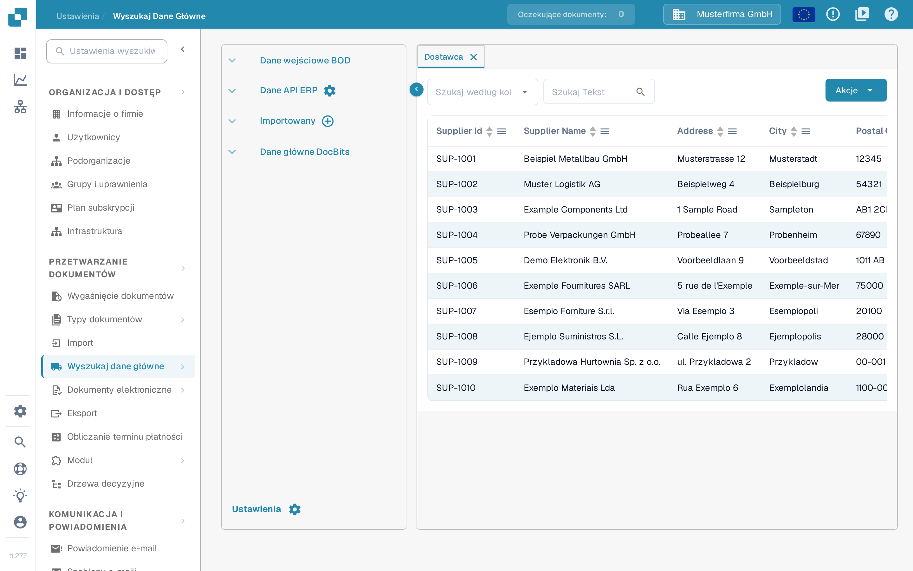
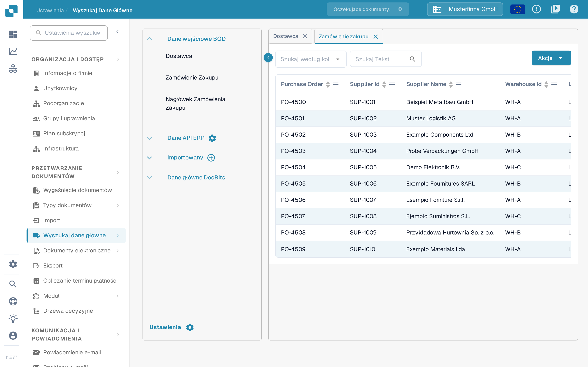

# Dostawcy i zamówienia zakupu z Infor LN

Ten przykład opisuje trasę Infor ION dla BOD-ów dostawców i zamówień zakupu oraz miejsca, w których można je sprawdzić w DocBits. Czternaście zrzutów ekranu Infor poniżej to historyczne przykłady z dzierżawy. Punkty połączenia, nazwy wywołań API i opcje publikowania w LN potwierdź z administratorem integracji; nie zostały sprawdzone w dzierżawie Infor na potrzeby tej aktualizacji. Podczas tej aktualizacji nie opublikowano ani nie zaimportowano żadnego BOD-a.

Infor opisuje [wydawcę danych głównych logistyki LN](https://docs.infor.com/ln/latest/en-us/lnolh/tcolh/help/tc/bod/tcbod0200m000.html) oraz [wydawcę transakcyjnego Order Management](https://docs.infor.com/ln/2025.x/en-us/lnolh/tdolh/help/td/bod/tdbod0200m000.html). Ich tryby działają inaczej: **Count** raportuje liczby rekordów bez publikowania; **Simulate** tworzy wynik próbny bez zatwierdzania publikacji; **Publish** wysyła wybrane dane. Publikacja może dotrzeć do wszystkich subskrybentów, więc przed jej uruchomieniem sprawdź zakres firm i subskrybentów.

## **Punkt połączenia**

Aby później utworzyć przepływ danych, musisz utworzyć punkt połączenia DocBits API.

Najpierw w InforOS przejdź do ION Desk → Connect → Connection Points

<figure><figcaption>
Historyczny przykład nawigacji: ION Desk → Connect → Connection Points.
</figcaption></figure>

Następnie utwórz nowy punkt połączenia.

<figure><figcaption>
Wybierz Add, aby utworzyć punkt połączenia; zielona adnotacja oznacza tę czynność w historycznym interfejsie.
</figcaption></figure>

**Wybierz API**

Nadaj punktowi połączenia nazwę i opis, które określają jego charakter i środowisko. Na karcie Connection zaimportuj konto usługi utworzone dla środowiska, w którym pracujesz.

<figure><figcaption>
Historyczna karta Connection. Widoczne nazwy konta usługi i połączenia należą do środowiska przykładowego.
</figcaption></figure>

Następnie przełącz się na kartę Documents. Do punktu połączenia musisz dodać następujące BOD-y.

<figure><figcaption>
Historyczna karta Dokumente (Documents). Ten wycinek pokazuje trzy trasy; nie pokazuje pełnej konfiguracji dostawców.
</figcaption></figure>

* Ack-SupplierInvoice

Ten BOD służy do sygnalizowania w DocBits, że w Infor wystąpił błąd. Trasa Acknowledge.SupplierInvoice pokazana poniżej jest przykładem potwierdzania faktur. Potwierdź nazwę wywołania API oraz to, czy ta trasa jest potrzebna w Twoim przepływie dostawców i zamówień zakupu.

<figure><figcaption>
Historyczna trasa potwierdzania. Ack-SupplierInvoice to przykładowa nazwa wywołania API; Acknowledge.SupplierInvoice to odebrany BOD.
</figcaption></figure>

* Sync.PurchaseOrder

Historyczny przykład poniżej pokazuje jedną operację odbioru; potwierdź aktualną operację i format żądania dla swojego środowiska.

<figure><figcaption>
Historyczna trasa zamówień zakupu. Sprawdź operację odbioru dla swojego środowiska DocBits, zamiast kopiować starą ścieżkę proxy.
</figcaption></figure>

* Sync.ReceiveDelivery

Historyczny przykład poniżej pokazuje jedną operację odbioru; potwierdź aktualną operację i format żądania dla swojego środowiska.

<figure><figcaption>
Historyczna trasa danych odbioru. Sprawdź, czy ReceiveDelivery jest potrzebne w Twojej integracji i która operacja je odbiera.
</figcaption></figure>

Po skonfigurowaniu tych BOD-ów możesz zapisać punkt połączenia, wybierając ikonę po prawej stronie przycisku wstecz.

## **Przepływ danych**

Przepływ danych będzie wyglądał podobnie do poniższego

<figure><figcaption>
Historyczny przepływ z czterema środowiskami. Podział i połączenie są widoczne; liczba i cele węzłów zależą od Twojego projektu integracji.
</figcaption></figure>

Wiele węzłów DocBits API w tym historycznym przykładzie reprezentuje osobne środowiska. Twój projekt produkcyjny może używać innej liczby węzłów; nigdy nie kieruj danych testowych do organizacji produkcyjnej.

Poniższa ilustracja używa czterech środowisk wyłącznie jako przykład.

### **LN**

Początek przepływu danych stanowi Twoja aplikacja LN

### **DocBits API**

Tutaj dodajesz aplikację i wybierasz utworzone wcześniej DocBits API

### **Dokumenty**

Sprawdź listę dokumentów przypisanych do przepływu. Komunikaty dostawców pokazane tutaj również wymagają odpowiednich tras odbioru w punkcie połączenia API. Ich konfiguracja wywołań API nie jest widoczna na wcześniejszym wycinku z trzema trasami; potwierdź wymagane operacje z administratorem integracji.

<figure><figcaption>
Historyczna lista dokumentów przepływu. Komunikaty dostawców występują tutaj obok komunikatów zamówień zakupu i odbiorów.
</figcaption></figure>

## **Wyzwalanie BOD-ów w LN**

Gdy administrator integracji sprawdzi punkt połączenia, trasy dokumentów i aktywny przepływ danych, użyj odpowiedniej sesji publikowania w LN. Śledź każdy identyfikator testowy przez LN, ION i DocBits; samo wyzwolenie BOD-a nie dowodzi, że rekord dotarł.

<figure><figcaption>
Historyczna strona startowa LN. Skorzystaj z nawigacji opisanej poniżej, aby znaleźć odpowiednią sesję publikowania.
</figcaption></figure>

### **PurchaseOrder**

W powyższym menu, w lewej karcie menu, wybierz Common → BOD-Messaging → Publish BODs → Publish Order Management Transactional Data

Wybierz kartę PurchaseOrder i zaznacz pole wyboru.

<figure><figcaption>
Historyczne zaznaczenie PurchaseOrder. Przed publikacją sprawdź zakres zamówień i statusy.
</figcaption></figure>

### **Dostawcy**

Na stronie głównej LN, w lewej karcie menu, przejdź do Common → BOD-Messaging → Publish BODs → Publish Logistics Master Data

Wybierz kartę PartyMaster i zaznacz pole Supplier → Buy-from lub SupplierPartyMaster.

<figure><figcaption>
Historyczne zaznaczenie dostawców na karcie PartyMaster. Wybierz role partnerów potrzebne w Twojej integracji i sprawdź zakres zaznaczenia.
</figcaption></figure>

### **Wyzwalanie BOD-ów**

Gdy wszystkie właściwe BOD-y są zaznaczone do publikacji, wybierz kartę Options.

Sprawdź opcje dla swojej dzierżawy. Historyczny przykład wyróżnia Publish i Use Process/Sync Verb; nie są to uniwersalne ustawienia każdej integracji.

<figure><figcaption>
Historyczny przykład karty Options. Tutaj wybrano Publish i Use Process/Sync Verb; sprawdź tryb, zakres firm i subskrybentów dla własnego uruchomienia.
</figcaption></figure>

Przed **Process** użyj **Count** lub **Simulate** i sprawdź liczbę rekordów oraz zakres firm, jeśli Twoja wersja LN oferuje te tryby. Publikuj wyłącznie za zgodą administratora integracji. Potwierdzenie, że BOD-y zostały wyzwolone, nie dowodzi dostarczenia ich do DocBits.

<figure><figcaption>
Historyczna czynność Process przed wykonaniem. Ten zrzut ekranu nie zawiera wyniku publikacji ani potwierdzenia, że DocBits otrzymał dane.
</figcaption></figure>

## Sprawdź w DocBits

Sprawdź w Infor ION, czy dane dotarły do właściwej organizacji DocBits. Następnie otwórz **Ustawienia → Przetwarzanie dokumentów → Wyszukaj dane główne**. W sekcji **Dane wejściowe BOD** otwórz **Dostawca**. W polu **Szukaj według kolumny** wybierz pole identyfikatora, w polu **Szukaj Tekst** wpisz znany numer lub nazwę dostawcy i użyj lupy, aby wyszukać. Otwórz **Zamówienie Zakupu** i wyszukaj znany numer zamówienia. Sprawdź także **Nagłówek Zamówienia Zakupu**, jeśli Twoje mapowanie rozdziela nagłówek i pozycje. Porównaj identyfikatory i firmę z LN; nie zakładaj, że wszystkie rekordy dotarły, tylko dlatego że komunikat o publikacji zakończył się powodzeniem. W polskim interfejsie nagłówki kolumn tabeli pozostają w języku angielskim, na przykład Supplier Id i Supplier Name.

<figure><figcaption>
Widok weryfikacji dostawców w wersji sandbox 11.27.7 z wymyślonymi przykładowymi wierszami. Wyszukaj znany identyfikator testowy i porównaj go z LN i ION.
</figcaption></figure>

<figure><figcaption>
Widok weryfikacji zamówień zakupu w wersji sandbox 11.27.7 z wymyślonymi przykładowymi wierszami. Wiersze nie dowodzą importu z LN.
</figcaption></figure>

Angielskie widoki w Dev sprawdzono 29 października 2026 bez publikowania BOD-a, importowania pliku i zmiany danych głównych; w tamtych obrazach wiersze rekordów zostały pominięte. Oba polskie zrzuty ekranu pochodzą z wersji sandbox 11.27.7 i pokazują wymyślone przykładowe wiersze zamiast rzeczywistych danych głównych; pokazują, gdzie sprawdzić dane, a nie zakończony transfer z LN. Jeśli oczekiwany rekord nie występuje, sprawdź logi publikowania w LN, routing ION, organizację i mapowanie BOD-ów przed ponownym uruchomieniem.
