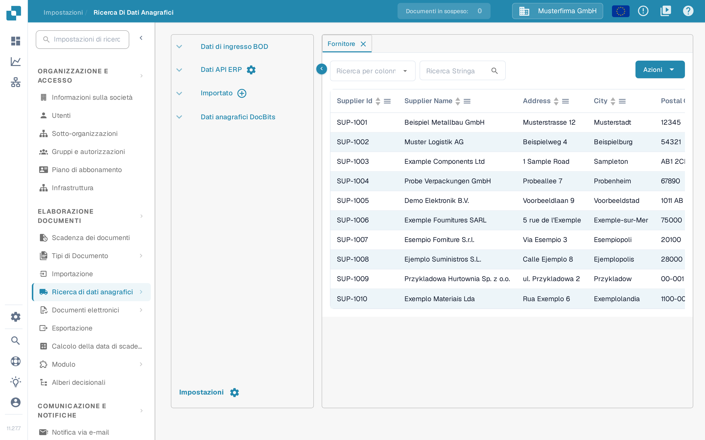

# Fornitori e ordini di acquisto da Infor LN

Questo esempio descrive la rotta Infor ION per i BOD di fornitori e ordini di acquisto e dove verificarli in DocBits. Le quattordici schermate Infor riportate sotto sono esempi storici di un tenant. Verifica punti di connessione, nomi delle chiamate API e opzioni di pubblicazione LN con l'amministratore dell'integrazione; non sono state controllate in un tenant Infor per questo aggiornamento. Durante questo aggiornamento non è stato pubblicato né importato alcun BOD.

Infor descrive il [publisher dei dati anagrafici logistici LN](https://docs.infor.com/ln/latest/en-us/lnolh/tcolh/help/tc/bod/tcbod0200m000.html) e il [publisher transazionale di Order Management](https://docs.infor.com/ln/2025.x/en-us/lnolh/tdolh/help/td/bod/tdbod0200m000.html). Le loro modalità hanno effetti diversi: **Count** riporta i totali dei record senza pubblicare; **Simulate** genera un risultato di prova senza confermare la pubblicazione; **Publish** invia i dati selezionati. La pubblicazione può raggiungere tutti i sottoscrittori, quindi controlla l'intervallo di società e i sottoscrittori prima di eseguirla.

## **Punto di connessione**

Dovrai creare il connection point DocBits API per poter creare successivamente il data flow.

Per prima cosa, in InforOS, vai su ION Desk → Connect → Connection Points

<figure><figcaption>
Esempio di navigazione storico: ION Desk → Connect → Connection Points.
</figcaption></figure>

Una volta qui, dovrai creare un nuovo connection point.

<figure><figcaption>
Scegli Add per creare un connection point; l'annotazione verde segnala l'azione in questa interfaccia storica.
</figcaption></figure>

**Seleziona API**

Assegna al connection point un nome e una descrizione che ne indichino la natura e l'ambiente. Nella scheda Connection, importa il service account che hai creato per l'ambiente con cui stai lavorando.

<figure><figcaption>
Scheda Connection storica. I nomi del service account e della connessione mostrati appartengono all'ambiente di esempio.
</figcaption></figure>

Quindi passa alla scheda Documents. Dovrai aggiungere al connection point i seguenti BOD.

<figure><figcaption>
Scheda Dokumente (Documents) storica. Questo ritaglio mostra tre rotte; non mostra la configurazione completa dei fornitori.
</figcaption></figure>

* Ack-SupplierInvoice

Questo BOD serve a segnalare a DocBits che in Infor si è verificato un errore. La rotta Acknowledge.SupplierInvoice mostrata sotto è un esempio di conferma delle fatture. Verifica il nome della chiamata API e se questa rotta è necessaria per il tuo flusso fornitori e ordini di acquisto.

<figure><figcaption>
Rotta di conferma storica. Ack-SupplierInvoice è un nome di chiamata API di esempio; Acknowledge.SupplierInvoice è il BOD ricevuto.
</figcaption></figure>

* Sync.PurchaseOrder

L'esempio storico sotto mostra un'operazione di ricezione; verifica l'operazione e il formato della richiesta attuali per il tuo ambiente.

<figure><figcaption>
Rotta storica degli ordini di acquisto. Verifica l'operazione di ricezione del tuo ambiente DocBits invece di copiare il vecchio percorso del proxy.
</figcaption></figure>

* Sync.ReceiveDelivery

L'esempio storico sotto mostra un'operazione di ricezione; verifica l'operazione e il formato della richiesta attuali per il tuo ambiente.

<figure><figcaption>
Rotta storica dei dati di ricezione. Verifica se ReceiveDelivery è necessario per la tua integrazione e quale operazione lo riceve.
</figcaption></figure>

Una volta configurati questi BOD, puoi salvare il connection point premendo l'icona situata a destra del pulsante Indietro.

## **Flusso di dati**

Il data flow avrà un aspetto simile al seguente

<figure><figcaption>
Flusso storico con quattro ambienti. La divisione e la giunzione sono visibili; il numero e le destinazioni dei nodi dipendono dal tuo progetto di integrazione.
</figcaption></figure>

I diversi nodi DocBits API di questo esempio storico rappresentano ambienti separati. Il tuo progetto di produzione può usare un numero diverso di nodi; non instradare mai dati di test in un'organizzazione di produzione.

L'illustrazione seguente usa quattro ambienti solo come esempio.

### **LN**

L'inizio del data flow è costituito dalla tua applicazione LN

### **DocBits API**

Qui aggiungerai un'applicazione e selezionerai le DocBits API create in precedenza

### **Documenti**

Controlla l'elenco dei documenti assegnati al flusso. Anche i messaggi dei fornitori mostrati qui richiedono rotte di ricezione corrispondenti nel connection point API. La configurazione delle loro chiamate API non è visibile nel ritaglio delle tre rotte precedente; verifica con l'amministratore dell'integrazione quali operazioni sono necessarie.

<figure><figcaption>
Elenco documenti storico del flusso. I messaggi dei fornitori compaiono qui insieme ai messaggi degli ordini di acquisto e delle ricezioni.
</figcaption></figure>

## **Attivazione dei BOD in LN**

Dopo che l'amministratore dell'integrazione ha controllato il connection point, le rotte dei documenti e il data flow attivo, usa la sessione di pubblicazione LN adatta. Segui ogni identificatore di test attraverso LN, ION e DocBits; attivare un BOD da solo non dimostra che un record sia arrivato.

<figure><figcaption>
Pagina iniziale LN storica. Usa la navigazione descritta sotto per trovare la sessione di pubblicazione adatta.
</figcaption></figure>

### **PurchaseOrder**

Dal menu precedente, nella scheda del menu a sinistra, seleziona Common → BOD-Messaging → Publish BODs → Publish Order Management Transactional Data

Seleziona la scheda PurchaseOrder e spunta la casella.

<figure><figcaption>
Selezione PurchaseOrder storica. Controlla l'intervallo ordini e gli stati prima di pubblicare.
</figcaption></figure>

### **Fornitori**

Dalla home page di LN, nella scheda del menu a sinistra, vai su Common → BOD-Messaging → Publish BODs → Publish Logistics Master Data

Seleziona la scheda PartyMaster e spunta la casella Supplier → Buy-from oppure SupplierPartyMaster.

<figure><figcaption>
Selezione dei fornitori storica in PartyMaster. Scegli i ruoli partner richiesti dalla tua integrazione e controlla l'intervallo di selezione.
</figcaption></figure>

### **Attivazione dei BOD**

Dopo aver spuntato per la pubblicazione tutti i BOD corretti, seleziona la scheda Options.

Controlla le opzioni del tuo tenant. L'esempio storico evidenzia Publish e Use Process/Sync Verb; non sono impostazioni valide per ogni integrazione.

<figure><figcaption>
Esempio storico della scheda Options. Qui sono selezionati Publish e Use Process/Sync Verb; verifica modalità, intervallo di società e sottoscrittori per la tua esecuzione.
</figcaption></figure>

Prima di **Process**, usa **Count** o **Simulate** e controlla il numero di record e l'intervallo di società, se la tua versione di LN offre queste modalità. Pubblica solo con l'approvazione dell'amministratore dell'integrazione. Una conferma che i BOD sono stati attivati non dimostra la consegna a DocBits.

<figure><figcaption>
Azione Process storica prima dell'esecuzione. Questa schermata non contiene alcun risultato di pubblicazione né la conferma che DocBits abbia ricevuto i dati.
</figcaption></figure>

## Verifica in DocBits

Controlla in Infor ION che la consegna all'organizzazione DocBits prevista sia riuscita. Apri quindi **Impostazioni → Elaborazione documenti → Ricerca di dati anagrafici**. In **Dati di ingresso BOD** apri **Fornitore**. Scegli il campo identificativo in **Ricerca per colonna**, inserisci in **Ricerca Stringa** un numero o un nome di fornitore noto e usa la lente per cercare. Apri **Ordine di acquisto** e cerca un numero d'ordine noto. Controlla anche **Intestazione dell'ordine di acquisto** se la tua mappatura separa intestazione e righe. Confronta gli identificatori e la società con LN; non dedurre che tutti i record siano arrivati solo perché il messaggio di pubblicazione è andato a buon fine. Nell'interfaccia italiana le intestazioni di colonna della tabella restano in inglese, ad esempio Supplier Id e Supplier Name.

<figure><figcaption>
Vista di verifica dei fornitori nella versione 11.27.7 del sandbox con righe di esempio inventate. Cerca un identificatore di test noto e confrontalo con LN e ION.
</figcaption></figure>

<figure><figcaption>
Vista di verifica degli ordini di acquisto nella versione 11.27.7 del sandbox con righe di esempio inventate. Le righe non dimostrano alcuna importazione da LN.
</figcaption></figure>

Le viste inglesi in Dev sono state controllate il 29 ottobre 2026 senza pubblicare BOD, importare file o modificare dati anagrafici; in quelle immagini le righe dei record erano escluse. Le due schermate in italiano provengono dalla versione 11.27.7 del sandbox e mostrano righe di esempio inventate al posto di dati anagrafici reali; illustrano dove verificare, non un trasferimento da LN completato. Se il record atteso manca, controlla i log di pubblicazione LN, l'instradamento ION, l'organizzazione e la mappatura dei BOD prima di riprovare.
