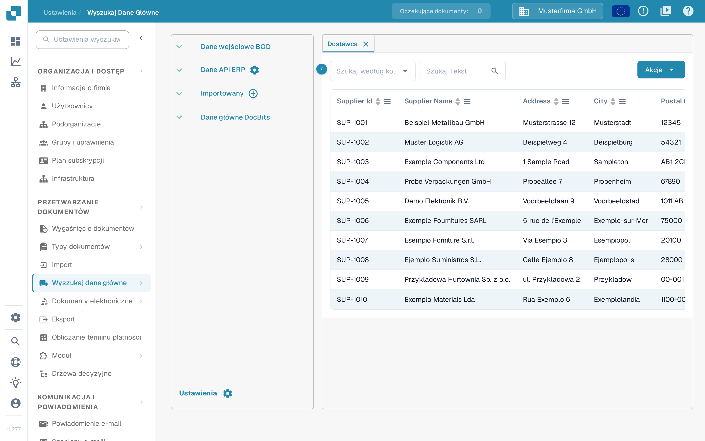
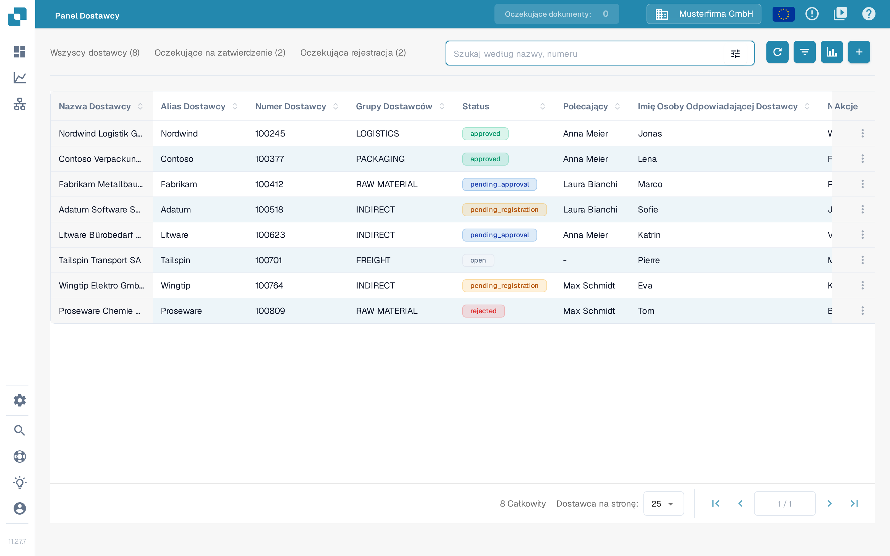

# Rozpocznij import początkowy dostawców z Infor M3

Używaj tej procedury dopiero po tym, jak Twój administrator Infor potwierdzi firmę, oddział, BOD `SupplierPartyMaster` i trasę ION w DocBits. Nieograniczony import początkowy może wysłać wszystkich kwalifikujących się dostawców, dlatego najpierw uzgodnij mały wybór. Jedenaście poniższych zrzutów ekranu Infor M3 to przykłady historyczne; porównaj je z własnym środowiskiem, zanim uruchomisz zadanie. Ta aktualizacja strony nie uruchomiła zadania M3 ani nie zaimportowała dostawców do DocBits.

Infor opisuje [procedurę importu początkowego w EVS006](https://docs.infor.com/m3core/latest/en-us/useradminlib_cloud/m3cecoreag_cloud/hmo1553266924239.html) oraz [opcje wyboru i uruchomienia w EVS007](https://docs.infor.com/m3udi/16.x/en-us/m3beud/appfoundhs/spl1567531742751.html). Jeśli etykiety się różnią, postępuj zgodnie z zatwierdzoną procedurą własnego środowiska.

* [ ] Otwórz Infor OS i aplikację M3 na koncie uprawnionym do importów początkowych. Przed kontynuowaniem potwierdź zamierzoną firmę i oddział.

<figure><figcaption>
Historyczny ekran startowy Infor M3 z pozycjami EVS006 Initial Load i BOD Processor Administration na liście Recent.
</figcaption></figure>

* [ ] Otwórz **Initial Load. Open (EVS006)** za pomocą wyszukiwania programów w swoim środowisku.

<figure><figcaption>
Historyczne okno Search and Start Infor M3 z polem wprowadzania i przyciskiem OK.
</figcaption></figure>

* [ ] W EVS006 utwórz definicję importu początkowego dla **SupplierPartyMaster**. Historyczny przykład używa tabeli **CIDMAS**. Poproś administratora M3 o potwierdzenie, że ta kombinacja BOD i tabeli jest prawidłowa w Twojej wersji i integracji.

<figure><figcaption>
Historyczny przykład Search and Start z wpisanym EVS006 w polu wprowadzania.
</figcaption></figure>

<figure><figcaption>
Historyczna lista Initial Load w EVS006 z SupplierPartyMaster jako BOD noun i CIDMAS jako tabelą.
</figcaption></figure>

* [ ] Wybierz **Create** i sprawdź definicję przed kontynuowaniem.

<figure><figcaption>
Historyczna lista EVS006 z wyróżnionym przyciskiem Create na pasku narzędzi.
</figcaption></figure>

<figure><figcaption>
Historyczny panel tworzenia w EVS006 dla CIDMAS z pustym polem BOD description.
</figcaption></figure>

* [ ] Wpisz czytelny **BOD Description**, na przykład **SupplierPartyMaster initial load for DocBits**.

<figure><figcaption>
Historyczny panel tworzenia w EVS006 z wpisanym SupplierPartyMaster jako BOD description.
</figcaption></figure>

* [ ] Wybierz **Next** i zdefiniuj uzgodniony wybór, jeśli jest dostępny. Infor zaleca kryteria wyboru, aby nie wywołać zbyt wielu zdarzeń.

<figure><figcaption>
Historyczny panel tworzenia w EVS006 z wyróżnionym przyciskiem Next.
</figcaption></figure>

* [ ] Przejdź do ustawień uruchomienia. Sprawdź ponownie firmę, oddział i wybór.

<figure><figcaption>
Historyczne okno Text w EVS006 z polami bloków tekstu i przyciskiem Next.
</figcaption></figure>

* [ ] W definicji SupplierPartyMaster wybierz **Related → Run**. Otworzy się **Initial Load Job. Open (EVS007)**; to jeszcze nie dowód, że DocBits otrzymał dane.

<figure><figcaption>
Historyczna lista EVS006 z otwartym menu Related → Run na wierszu SupplierPartyMaster.
</figcaption></figure>

* [ ] Wybierz **Sync** tylko wtedy, gdy odbierający przepływ ION oczekuje Sync.SupplierPartyMaster. Przed wysłaniem EVS007 potwierdź filtry i cel. Pełny import początkowy może wygenerować wiele zdarzeń.

<figure><figcaption>
Historyczne zadanie Initial Load Job w EVS007 z CIDMAS, SupplierPartyMaster, Sync i statusem 1-Pending. Identyfikator zadania jest zamazany; status Pending nie dowodzi zakończonego importu.
</figcaption></figure>

## Sprawdź wynik

Po autoryzowanym uruchomieniu sprawdź w EVS006 w **Related → History** liczbę przetworzonych rekordów i ewentualne błędy. Następnie sprawdź komunikat SupplierPartyMaster w Infor ION i potwierdź, że dotarł do skonfigurowanej organizacji DocBits. Dopiero potem poszukaj w DocBits jednego oczekiwanego dostawcy w **Ustawienia → Wyszukaj dane główne**, na karcie **Dostawca**. Użyj pola wyszukiwania z numerem lub nazwą dostawcy; nie zakładaj, że wszyscy dostawcy M3 dotarli tylko dlatego, że zadanie zostało wysłane.

<figure><figcaption>
DocBits Sandbox 11.27.7: <strong>Ustawienia → Wyszukaj Dane Główne</strong>, karta <strong>Dostawca</strong>, z filtrem <strong>Szukaj według kolumny</strong> i polem <strong>Szukaj Tekst</strong>. Wiersze SUP-1001 do SUP-1010 to wymyślone dane przykładowe i nie dowodzą importu z M3; nagłówki kolumn tego widoku pozostają w tej wersji interfejsu po angielsku.
</figcaption></figure>

Zrzut pokazuje wymyślone dane Sandbox, które już znajdowały się w organizacji testowej. Podczas tej aktualizacji dokumentacji nie było podłączonego środowiska M3. Jeśli oczekiwany dostawca nie występuje, porównaj historię EVS006, routing ION i organizację DocBits, zanim ponownie uruchomisz import. Co robią filtr **Szukaj według kolumny**, pole **Szukaj Tekst**, przycisk **Akcje** i stronicowanie w tym widoku, opisuje instrukcja [Wyszukiwanie danych podstawowych](../../../administration-and-setup/settings/document-processing/master-data-lookup.md), sekcja Tabela danych.

### Alternatywa: Panel Dostawcy

Jeśli portal dostawców jest używany i w DocBits dostępny jest widok **Panel Dostawcy**, zaimportowani dostawcy pojawiają się również tam, ponieważ oba widoki czytają te same dane podstawowe dostawców. Szukaj po nazwie lub numerze dostawcy polem **Szukaj według nazwy, numeru**. Liczniki **Wszyscy dostawcy**, **Oczekujące na zatwierdzenie** i **Oczekująca rejestracja**, przycisk filtra w polu wyszukiwania oraz **Dostawca na stronę:** opisuje instrukcja [portalu dostawców](../../../administration-and-setup/setup/supplier-portal/README.md), sekcja Administrator: wyszukiwanie i filtrowanie dostawców.

<figure><figcaption>
DocBits Sandbox 11.27.7: <strong>Panel Dostawcy</strong> z polem <strong>Szukaj według nazwy, numeru</strong> oraz licznikami <strong>Wszyscy dostawcy</strong>, <strong>Oczekujące na zatwierdzenie</strong> i <strong>Oczekująca rejestracja</strong>. Osiem wierszy to wymyślone dane przykładowe i nie dowodzą importu z M3.
</figcaption></figure>
