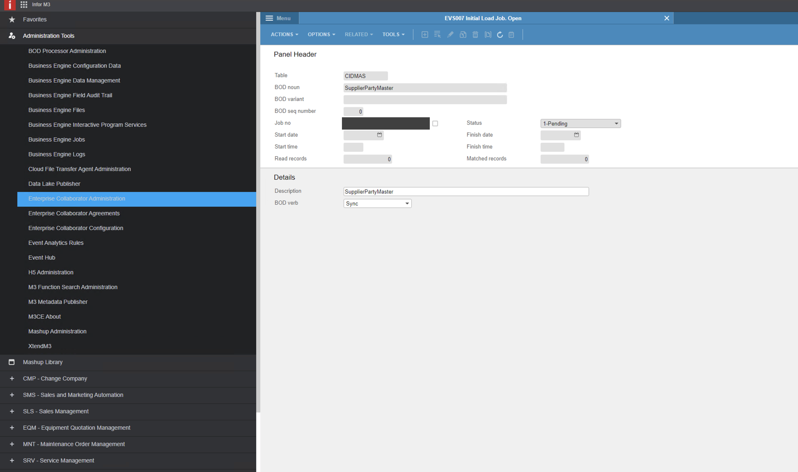
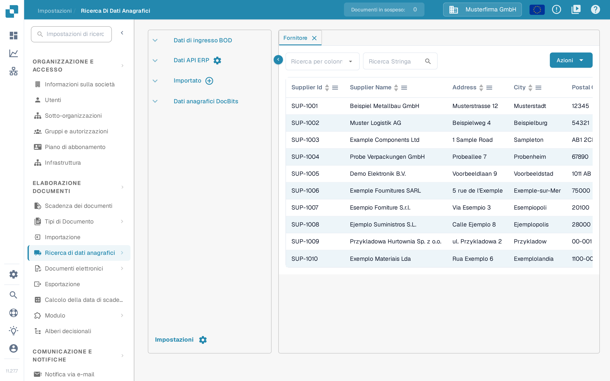
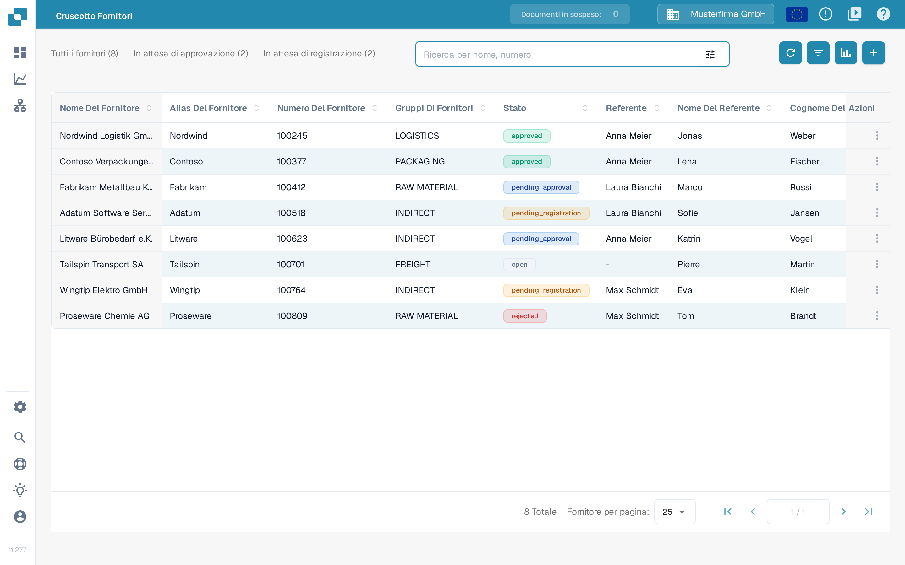

# Avviare un caricamento iniziale dei fornitori da Infor M3

Usa questa procedura solo dopo che l'amministratore Infor ha confermato l'azienda, la divisione, il BOD `SupplierPartyMaster` e la rotta ION di DocBits. Un caricamento iniziale senza restrizioni può inviare tutti i fornitori idonei, quindi concordate prima una selezione ristretta. Le undici schermate di Infor M3 riportate qui sotto sono esempi storici: confrontale con il tuo tenant prima di eseguire un job. Questo aggiornamento della pagina non ha eseguito alcun job M3 né importato fornitori in DocBits.

Infor documenta la [procedura di caricamento iniziale EVS006](https://docs.infor.com/m3core/latest/en-us/useradminlib_cloud/m3cecoreag_cloud/hmo1553266924239.html) e le [opzioni di selezione ed esecuzione EVS007](https://docs.infor.com/m3udi/16.x/en-us/m3beud/appfoundhs/spl1567531742751.html). Se le etichette sono diverse, segui la procedura approvata del tuo tenant.

* [ ] Apri Infor OS e l'applicazione M3 con un account autorizzato ai caricamenti iniziali. Prima di continuare, verifica l'azienda e la divisione previste.

<figure><figcaption>
Schermata iniziale storica di Infor M3 con EVS006 Initial Load e BOD Processor Administration nell'elenco Recent.
</figcaption></figure>

* [ ] Apri **Initial Load. Open (EVS006)** con la ricerca programmi del tuo tenant.

<figure><figcaption>
Finestra di ricerca e avvio storica di Infor M3 con il campo di input e il pulsante OK.
</figcaption></figure>

* [ ] In EVS006 crea una definizione di caricamento iniziale per **SupplierPartyMaster**. L'esempio storico usa **CIDMAS** come tabella. Chiedi all'amministratore M3 di confermare che questa combinazione BOD/tabella sia valida nella tua versione e integrazione.

<figure><figcaption>
Esempio storico della finestra di ricerca e avvio con EVS006 nel campo di input.
</figcaption></figure>

<figure><figcaption>
Elenco storico EVS006 Initial Load con SupplierPartyMaster come BOD noun e CIDMAS come tabella.
</figcaption></figure>

* [ ] Seleziona **Create** e controlla la definizione prima di procedere.

<figure><figcaption>
Elenco storico EVS006 con il pulsante Create evidenziato.
</figcaption></figure>

<figure><figcaption>
Pannello di creazione storico EVS006 per CIDMAS con il campo BOD description ancora vuoto.
</figcaption></figure>

* [ ] Inserisci una **BOD Description** chiara, per esempio **Caricamento iniziale SupplierPartyMaster per DocBits**.

<figure><figcaption>
Pannello di creazione storico EVS006 con SupplierPartyMaster inserito come BOD description.
</figcaption></figure>

* [ ] Seleziona **Next** e, dove disponibile, definisci una selezione concordata. Infor consiglia criteri di selezione per evitare di generare troppi eventi.

<figure><figcaption>
Pannello di creazione storico EVS006 con il pulsante Next evidenziato.
</figcaption></figure>

* [ ] Prosegui con le impostazioni di esecuzione. Controlla di nuovo azienda, divisione e selezione.

<figure><figcaption>
Finestra di testo storica EVS006 con i campi di testo e il pulsante Next.
</figcaption></figure>

* [ ] Nella definizione SupplierPartyMaster scegli **Related → Run**. Si apre **Initial Load Job. Open (EVS007)**; non è ancora la prova che DocBits abbia ricevuto i dati.

<figure> Run"><figcaption>
Elenco storico EVS006 con il menu Related → Run aperto sulla riga SupplierPartyMaster.
</figcaption></figure>

* [ ] Scegli **Sync** solo se il flusso ION di destinazione prevede Sync.SupplierPartyMaster. Conferma filtri e destinazione prima di inviare EVS007. Un caricamento iniziale completo può generare molti eventi.

<figure><figcaption>
Initial Load Job storico EVS007 con CIDMAS, SupplierPartyMaster, Sync e stato 1-Pending. L'identificativo del job è mascherato; lo stato Pending non prova un'importazione completata.
</figcaption></figure>

## Verifica del risultato

Dopo un'esecuzione autorizzata, controlla **Related → History** in EVS006 per il numero di record elaborati e per eventuali errori. Verifica poi il messaggio SupplierPartyMaster in Infor ION e conferma che sia arrivato all'organizzazione DocBits configurata. Solo allora cerca un fornitore atteso in DocBits sotto **Impostazioni → Ricerca di dati anagrafici → Fornitore**. Usa il controllo di ricerca con il numero o il nome del fornitore; non dare per scontato che tutti i fornitori M3 siano arrivati solo perché il job è stato inviato.

<figure><figcaption>
Dati inventati nella Sandbox DocBits 11.27.7: scheda Fornitore con il selettore Ricerca per colonna e il campo Ricerca Stringa. Queste righe dimostrative non provano un'importazione da M3.
</figcaption></figure>

La schermata mostra dati sintetici già presenti nella Sandbox Test A. Durante questo aggiornamento della documentazione non è stato collegato alcun tenant M3. Se il fornitore atteso manca, confronta la cronologia EVS006, il routing ION e l'organizzazione DocBits prima di rieseguire il caricamento.

### Alternativa: Cruscotto fornitori

Se nella tua organizzazione è attivo il Portale fornitori, i fornitori importati compaiono anche nella pagina **Cruscotto Fornitori**, perché entrambe le viste leggono gli stessi dati anagrafici dei fornitori. Cerca per nome o numero del fornitore con **Ricerca per nome, numero**.

<figure><figcaption>
Dati inventati nella Sandbox DocBits 11.27.7: campo di ricerca Ricerca per nome, numero nel Cruscotto Fornitori.
</figcaption></figure>
