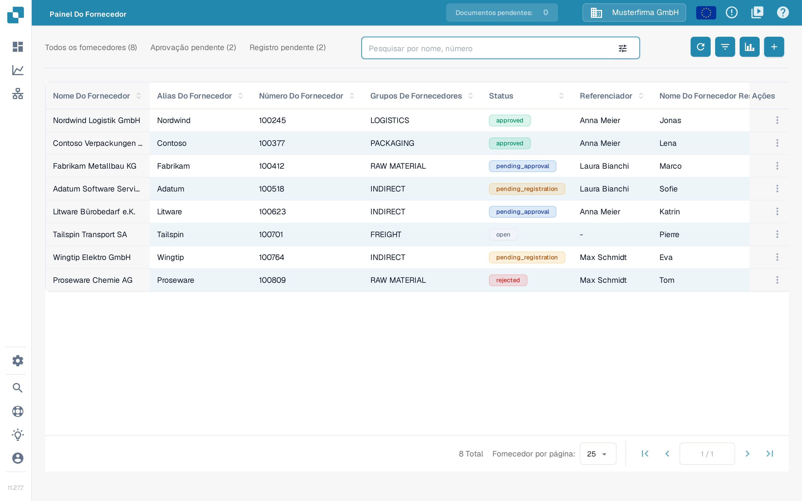

# Iniciar uma carga inicial de fornecedores a partir do Infor M3

Utilize este procedimento apenas depois de o administrador do Infor ter confirmado a empresa, a divisão, o BOD `SupplierPartyMaster` e a rota ION do DocBits. Uma carga inicial sem restrições pode enviar todos os fornecedores elegíveis, por isso acorde primeiro uma seleção pequena. As onze capturas do Infor M3 abaixo são exemplos históricos; compare-as com o seu ambiente antes de iniciar uma tarefa. Esta atualização da página não executou qualquer tarefa no M3 nem importou fornecedores para o DocBits.

A Infor documenta o [procedimento de carga inicial no EVS006](https://docs.infor.com/m3core/latest/en-us/useradminlib_cloud/m3cecoreag_cloud/hmo1553266924239.html) e as [opções de seleção e execução do EVS007](https://docs.infor.com/m3udi/16.x/en-us/m3beud/appfoundhs/spl1567531742751.html). Siga o procedimento aprovado do seu ambiente se as etiquetas forem diferentes.

* [ ] Abra o Infor OS e a aplicação M3 com uma conta autorizada para cargas iniciais. Confirme a empresa e a divisão pretendidas antes de continuar.

<figure><figcaption>
Ecrã de arranque histórico do Infor M3 com EVS006 Initial Load e BOD Processor Administration na lista Recent.
</figcaption></figure>

* [ ] Abra **Initial Load. Open (EVS006)** com a pesquisa de programas do seu ambiente.

<figure><figcaption>
Janela Search and Start histórica do Infor M3 com o campo de entrada e o botão OK.
</figcaption></figure>

* [ ] No EVS006, crie uma definição de carga inicial para **SupplierPartyMaster**. O exemplo histórico utiliza **CIDMAS** como tabela. Peça ao administrador do M3 que confirme se esta combinação de BOD e tabela é válida na sua versão e integração.

<figure><figcaption>
Exemplo histórico de Search and Start com EVS006 introduzido no campo de entrada.
</figcaption></figure>

<figure><figcaption>
Lista histórica EVS006 Initial Load com SupplierPartyMaster como substantivo do BOD (BOD noun) e CIDMAS como tabela.
</figcaption></figure>

* [ ] Selecione **Create** e reveja a definição antes de continuar.

<figure><figcaption>
Lista histórica do EVS006 com o botão Create da barra de ferramentas realçado.
</figcaption></figure>

<figure><figcaption>
Painel de criação histórico do EVS006 para CIDMAS com o campo BOD description ainda vazio.
</figcaption></figure>

* [ ] Introduza um **BOD Description** claro, por exemplo **SupplierPartyMaster initial load for DocBits**.

<figure><figcaption>
Painel de criação histórico do EVS006 com SupplierPartyMaster introduzido como BOD description.
</figcaption></figure>

* [ ] Selecione **Next** e defina uma seleção acordada quando estiver disponível. A Infor recomenda critérios de seleção para evitar demasiados eventos.

<figure><figcaption>
Painel de criação histórico do EVS006 com o botão Next realçado.
</figcaption></figure>

* [ ] Continue para as definições de execução. Reveja novamente a empresa, a divisão e a seleção.

<figure><figcaption>
Janela Text histórica do EVS006 com campos de bloco de texto e um botão Next.
</figcaption></figure>

* [ ] Na definição SupplierPartyMaster, escolha **Related → Run**. Abre-se o **Initial Load Job. Open (EVS007)**; isso ainda não prova que o DocBits recebeu os dados.

<figure><figcaption>
Lista histórica do EVS006 com o menu Related → Run aberto na linha SupplierPartyMaster.
</figcaption></figure>

* [ ] Escolha **Sync** apenas se o fluxo ION de receção esperar Sync.SupplierPartyMaster. Confirme os filtros e o destino antes de submeter o EVS007. Uma carga inicial completa pode gerar muitos eventos.

<figure><figcaption>
Initial Load Job histórico do EVS007 com CIDMAS, SupplierPartyMaster, Sync e o estado 1-Pending. O identificador da tarefa está ocultado; o estado Pending não prova uma importação concluída.
</figcaption></figure>

## Verificar o resultado

Depois de uma execução autorizada, verifique em **Related → History** do EVS006 a quantidade processada e eventuais erros. Confirme depois a mensagem SupplierPartyMaster no Infor ION e se chegou à organização DocBits configurada. Só então procure um fornecedor previsto no DocBits em **Configurações → Pesquisar Dados Mestres**, separador **Fornecedor**. Utilize o campo de pesquisa com o número ou o nome do fornecedor; não parta do princípio de que todos os fornecedores do M3 chegaram apenas porque a tarefa foi submetida.

<figure><figcaption>
DocBits Sandbox 11.27.7: <strong>Configurações → Pesquisar Dados Mestres</strong>, separador <strong>Fornecedor</strong>, com o filtro <strong>Pesquisar por coluna</strong> e o campo <strong>Procurar Texto</strong>. As linhas SUP-1001 a SUP-1010 são dados de exemplo inventados e não provam uma importação do M3; os cabeçalhos das colunas desta vista continuam em inglês nesta versão da interface.
</figcaption></figure>

A captura mostra dados inventados do Sandbox que já existiam na organização de teste. Não estava ligado qualquer ambiente M3 durante esta atualização da documentação. Se o fornecedor esperado não aparecer, compare o histórico do EVS006, o encaminhamento ION e a organização DocBits antes de reiniciar a carga. O que fazem o filtro **Pesquisar por coluna**, o campo **Procurar Texto**, o botão **Ações** e a paginação desta vista está explicado no manual [Pesquisa de dados mestre](../../../administration-and-setup/settings/document-processing/master-data-lookup.md), secção Tabela de dados. O campo **Configurações de pesquisa** pertence à barra lateral de configurações e é independente da pesquisa da tabela.

### Alternativa: Painel Do Fornecedor

Se o portal de fornecedores estiver em uso e a entrada **Painel Do Fornecedor** aparecer no menu principal, os fornecedores importados também aparecem aí, porque ambas as vistas leem os mesmos dados mestre de fornecedores. Pesquise pelo nome ou pelo número do fornecedor com **Pesquisar por nome, número**. Os totais **Todos os fornecedores**, **Aprovação pendente** e **Registro pendente**, o botão de filtro do campo de pesquisa, **Fornecedor por página**, o botão **+** para adicionar um fornecedor e o menu **Ações** no fim de cada linha estão explicados no manual do [portal de fornecedores](../../../administration-and-setup/setup/supplier-portal/README.md), nas secções Admin: pesquisar e filtrar fornecedores, Admin: convidar fornecedores e Admin: abrir os detalhes no painel de fornecedores.

<figure><figcaption>
DocBits Sandbox 11.27.7: <strong>Painel Do Fornecedor</strong> com o campo <strong>Pesquisar por nome, número</strong> e os separadores <strong>Todos os fornecedores</strong>, <strong>Aprovação pendente</strong> e <strong>Registro pendente</strong>. As oito linhas são dados de exemplo inventados e não provam uma importação do M3.
</figcaption></figure>
