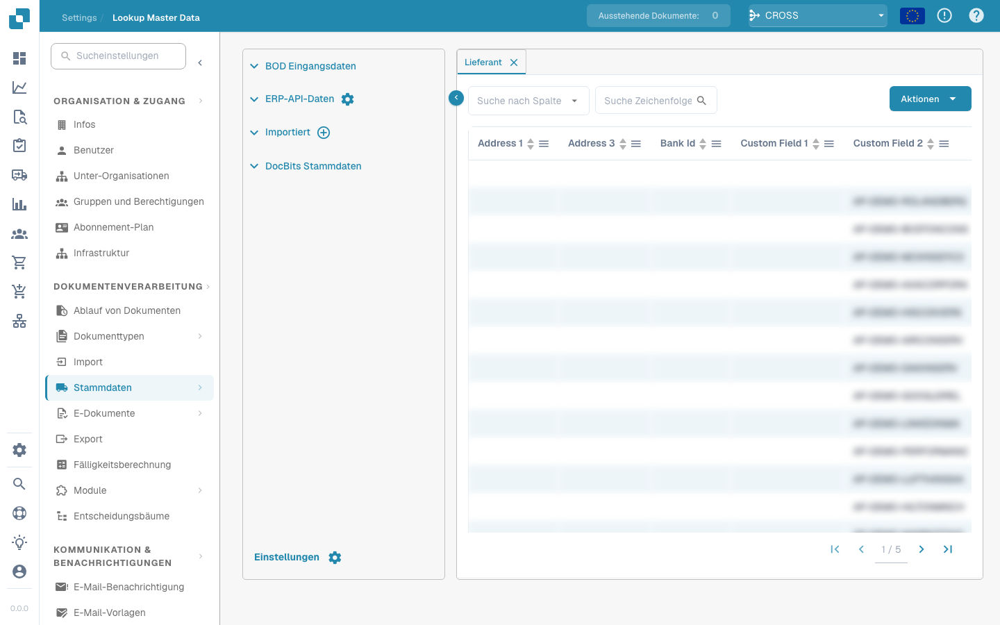
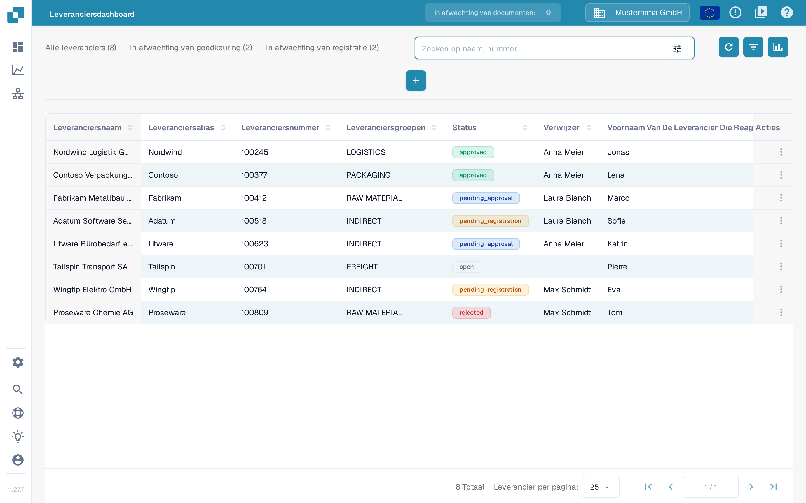

# Een eerste leveranciersimport vanuit Infor M3 starten

Gebruik deze procedure pas nadat je Infor-beheerder het bedrijf, de divisie, de BOD `SupplierPartyMaster` en de DocBits ION-route heeft bevestigd. Een onbeperkte eerste import kan elke in aanmerking komende leverancier versturen, dus spreek eerst een kleine selectie af. De elf onderstaande Infor M3-schermafbeeldingen zijn historische voorbeelden; vergelijk ze met je eigen omgeving voordat je een taak start. Bij deze update van de pagina is geen M3-taak uitgevoerd en zijn geen leveranciers in DocBits geïmporteerd.

Infor beschrijft de [procedure voor een eerste import in EVS006](https://docs.infor.com/m3core/latest/en-us/useradminlib_cloud/m3cecoreag_cloud/hmo1553266924239.html) en de [selectie- en uitvoeringsopties van EVS007](https://docs.infor.com/m3udi/16.x/en-us/m3beud/appfoundhs/spl1567531742751.html). Volg de goedgekeurde procedure van je eigen omgeving als de labels afwijken.

* [ ] Open Infor OS en de M3-toepassing met een account dat bevoegd is voor eerste imports. Bevestig het bedoelde bedrijf en de divisie voordat je verdergaat.

<figure><figcaption>
Historisch Infor M3-startscherm met EVS006 Initial Load en BOD Processor Administration in de lijst Recent.
</figcaption></figure>

* [ ] Open **Initial Load. Open (EVS006)** met de programmazoekfunctie van je eigen omgeving.

<figure><figcaption>
Historisch dialoogvenster Search and Start van Infor M3 met het invoerveld en de knop OK.
</figcaption></figure>

* [ ] Maak in EVS006 een definitie voor een eerste import voor **SupplierPartyMaster**. Het historische voorbeeld gebruikt **CIDMAS** als tabel. Vraag de M3-beheerder te bevestigen dat deze combinatie van BOD en tabel geldig is in jouw versie en integratie.

<figure><figcaption>
Historisch voorbeeld van Search and Start met EVS006 ingevuld in het invoerveld.
</figcaption></figure>

<figure><figcaption>
Historische EVS006-lijst Initial Load met SupplierPartyMaster als BOD noun en CIDMAS als tabel.
</figcaption></figure>

* [ ] Selecteer **Create** en controleer de definitie voordat je verdergaat.

<figure><figcaption>
Historische EVS006-lijst met de knop Create in de werkbalk gemarkeerd.
</figcaption></figure>

<figure><figcaption>
Historisch aanmaakvenster van EVS006 voor CIDMAS met het veld BOD description nog leeg.
</figcaption></figure>

* [ ] Vul een duidelijke **BOD Description** in, bijvoorbeeld **SupplierPartyMaster initial load for DocBits**.

<figure><figcaption>
Historisch aanmaakvenster van EVS006 met SupplierPartyMaster ingevuld als BOD description.
</figcaption></figure>

* [ ] Selecteer **Next** en stel waar mogelijk een afgesproken selectie in. Infor raadt selectiecriteria aan om te voorkomen dat te veel gebeurtenissen worden gestart.

<figure><figcaption>
Historisch aanmaakvenster van EVS006 met de knop Next gemarkeerd.
</figcaption></figure>

* [ ] Ga verder naar de instellingen voor de uitvoering. Controleer bedrijf, divisie en selectie nog een keer.

<figure><figcaption>
Historisch dialoogvenster Text in EVS006 met tekstblokvelden en een knop Next.
</figcaption></figure>

* [ ] Kies in de definitie SupplierPartyMaster **Related → Run**. Daarmee open je **Initial Load Job. Open (EVS007)**; dat is nog geen bewijs dat DocBits de gegevens heeft ontvangen.

<figure><figcaption>
Historische EVS006-lijst met het menu Related → Run geopend op de regel SupplierPartyMaster.
</figcaption></figure>

* [ ] Kies **Sync** alleen als de ontvangende ION-flow Sync.SupplierPartyMaster verwacht. Bevestig de filters en het doel voordat je EVS007 indient. Een volledige eerste import kan veel gebeurtenissen opleveren.

<figure><figcaption>
Historische EVS007 Initial Load Job met CIDMAS, SupplierPartyMaster, Sync en status 1-Pending. De taakidentificatie is gemaskeerd; de status Pending bewijst geen voltooide import.
</figcaption></figure>

## Het resultaat controleren

Controleer na een geautoriseerde uitvoering in EVS006 onder **Related → History** hoeveel records zijn verwerkt en of er fouten zijn opgetreden. Controleer daarna het bericht SupplierPartyMaster in Infor ION en bevestig dat het de geconfigureerde DocBits-organisatie heeft bereikt. Zoek pas daarna in DocBits naar één verwachte leverancier onder **Instellingen → Stamgegevens Opzoeken**, tabblad **Leverancier**. Gebruik het zoekveld met het leveranciersnummer of de naam; ga er niet van uit dat alle M3-leveranciers zijn aangekomen alleen omdat de taak is ingediend.

<figure><figcaption>
DocBits Sandbox 11.27.7: <strong>Instellingen → Stamgegevens Opzoeken</strong>, tabblad <strong>Leverancier</strong>, met het filter <strong>Zoeken op kolom</strong> en het veld <strong>Zoekopdracht Tekenreeks</strong>. De regels SUP-1001 tot en met SUP-1010 zijn verzonnen voorbeeldgegevens en bewijzen geen M3-import; de kolomkoppen van deze weergave blijven in deze versie van de interface Engels.
</figcaption></figure>

De opname toont verzonnen gegevens uit de Sandbox die al in de testorganisatie aanwezig waren. Er was geen M3-omgeving aangesloten bij deze update van de documentatie. Ontbreekt de verwachte leverancier, vergelijk dan de EVS006-geschiedenis, de ION-routering en de DocBits-organisatie voordat je de import opnieuw start. Wat het filter **Zoeken op kolom**, het veld **Zoekopdracht Tekenreeks**, de knop **Acties** en de paginering in deze weergave doen, staat in de handleiding [Stamgegevens opzoeken](../../../administration-and-setup/settings/document-processing/master-data-lookup.md), sectie Gegevenstabel.

### Alternatief: Leveranciersdashboard

Als de leveranciersportal in gebruik is en de ingang **Leveranciersdashboard** in het hoofdmenu staat, verschijnen de geïmporteerde leveranciers daar ook, omdat beide weergaven dezelfde stamgegevens van leveranciers lezen. Zoek op leveranciersnaam of -nummer met **Zoeken op naam, nummer**. De totalen **Alle leveranciers**, **In afwachting van goedkeuring** en **In afwachting van registratie**, de filterknop in het zoekveld en **Leverancier per pagina** worden uitgelegd in de handleiding van de [leveranciersportal](../../../administration-and-setup/setup/supplier-portal/README.md), sectie Admin: leveranciers zoeken en filteren.

<figure><figcaption>
DocBits Sandbox 11.27.7: <strong>Leveranciersdashboard</strong> met het veld <strong>Zoeken op naam, nummer</strong> en de tabbladen <strong>Alle leveranciers</strong>, <strong>In afwachting van goedkeuring</strong> en <strong>In afwachting van registratie</strong>. De acht regels zijn verzonnen voorbeeldgegevens en bewijzen geen M3-import.
</figcaption></figure>
