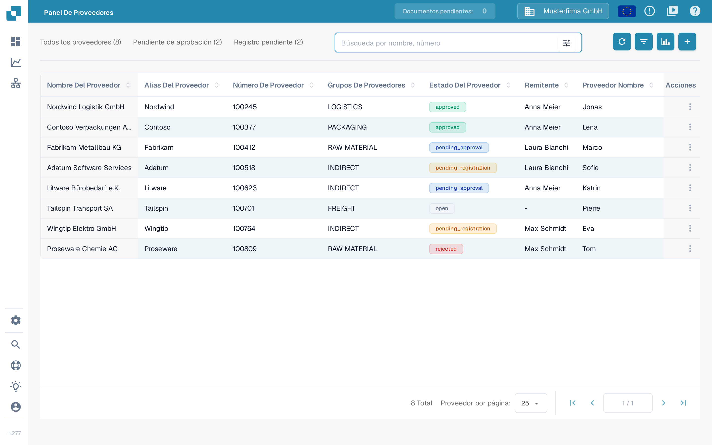

# Iniciar una carga inicial de proveedores desde Infor M3

Use este procedimiento solo después de que su administrador de Infor haya confirmado la empresa, la división, el BOD `SupplierPartyMaster` y la ruta de ION de DocBits. Una carga inicial sin restricciones puede enviar todos los proveedores aptos, por lo que conviene acordar primero una selección reducida. Las once capturas de Infor M3 que aparecen a continuación son ejemplos históricos; compárelas con su propio entorno antes de ejecutar un trabajo. Esta actualización de la página no ejecutó ningún trabajo de M3 ni importó proveedores en DocBits.

Infor documenta el [procedimiento de carga inicial EVS006](https://docs.infor.com/m3core/latest/en-us/useradminlib_cloud/m3cecoreag_cloud/hmo1553266924239.html) y las [opciones de selección y ejecución de EVS007](https://docs.infor.com/m3udi/16.x/en-us/m3beud/appfoundhs/spl1567531742751.html). Si las etiquetas son distintas en su entorno, siga el procedimiento aprobado por su administrador.

* [ ] Abra Infor OS y la aplicación M3 con una cuenta autorizada para cargas iniciales. Confirme la empresa y la división previstas antes de continuar.

<figure><figcaption>
Ejemplo histórico: pantalla de inicio de Infor M3 con EVS006 Initial Load y BOD Processor Administration en la lista Recientes.
</figcaption></figure>

* [ ] Abra **Initial Load. Open (EVS006)** con la búsqueda de programas de su entorno.

<figure><figcaption>
Ejemplo histórico: cuadro de diálogo Search and Start de Infor M3 con su campo de entrada y el botón OK.
</figcaption></figure>

* [ ] En EVS006, cree una definición de carga inicial para **SupplierPartyMaster**. El ejemplo histórico usa **CIDMAS** como tabla. Pida al administrador de M3 que confirme si esa combinación de BOD y tabla es válida en su versión y en su integración.

<figure><figcaption>
Ejemplo histórico: Search and Start con EVS006 escrito en el campo de entrada.
</figcaption></figure>

<figure><figcaption>
Ejemplo histórico: lista Initial Load de EVS006 con SupplierPartyMaster como sustantivo BOD y CIDMAS como tabla.
</figcaption></figure>

* [ ] Seleccione **Create** y revise la definición antes de continuar.

<figure><figcaption>
Ejemplo histórico: lista de EVS006 con el botón Create de la barra de herramientas resaltado.
</figcaption></figure>

<figure><figcaption>
Ejemplo histórico: panel de creación de EVS006 para CIDMAS con el campo de descripción BOD aún vacío.
</figcaption></figure>

* [ ] Introduzca una **BOD Description** clara, por ejemplo **SupplierPartyMaster initial load for DocBits**.

<figure><figcaption>
Ejemplo histórico: panel de creación de EVS006 con SupplierPartyMaster escrito como descripción BOD.
</figcaption></figure>

* [ ] Seleccione **Next** y defina la selección acordada cuando esté disponible. Infor recomienda usar criterios de selección para no generar demasiados eventos.

<figure><figcaption>
Ejemplo histórico: panel de creación de EVS006 con el botón Next resaltado.
</figcaption></figure>

* [ ] Continúe con la configuración de la ejecución. Revise de nuevo la empresa, la división y la selección.

<figure><figcaption>
Ejemplo histórico: cuadro de diálogo de texto de EVS006 con los campos de bloque de texto y el botón Next.
</figcaption></figure>

* [ ] En la definición de SupplierPartyMaster, elija **Related → Run**. Se abre **Initial Load Job. Open (EVS007)**; esto todavía no demuestra que DocBits haya recibido los datos.

<figure> Run"><figcaption>
Ejemplo histórico: lista de EVS006 con el menú Related → Run abierto sobre la fila SupplierPartyMaster.
</figcaption></figure>

* [ ] Elija **Sync** solo si el flujo de ION receptor espera Sync.SupplierPartyMaster. Confirme los filtros y el destino antes de enviar EVS007. Una carga inicial completa puede generar muchos eventos.

<figure><figcaption>
Ejemplo histórico: Initial Load Job de EVS007 con CIDMAS, SupplierPartyMaster, Sync y el estado 1-Pending. El identificador del trabajo está oculto; el estado pendiente no demuestra una importación completada.
</figcaption></figure>

## Verificar el resultado

Después de una ejecución autorizada, compruebe **Related → History** en EVS006 para ver el número de registros procesados y los posibles errores. A continuación, verifique el mensaje de SupplierPartyMaster en Infor ION y confirme que llegó a la organización de DocBits configurada. Solo entonces busque un proveedor concreto en DocBits en **Ajustes → Búsqueda de datos maestros → Proveedor**. Utilice el campo de búsqueda y el número o el nombre del proveedor; no dé por hecho que todos los proveedores de M3 han llegado solo porque se haya enviado el trabajo.

<figure><figcaption>
DocBits Sandbox 11.27.7: Ajustes → Búsqueda de datos maestros con la pestaña Proveedor, el campo Búsqueda por columna y el campo Buscar Cadena. Las filas SUP-1001 a SUP-1010 son datos de ejemplo inventados y no demuestran ninguna importación desde M3.
</figcaption></figure>

La captura muestra datos de ejemplo inventados que ya existían en el entorno de pruebas Test A. Durante esta actualización de la documentación no había ningún entorno de M3 conectado. Si el proveedor esperado no aparece, compare el historial de EVS006, el enrutamiento de ION y la organización de DocBits antes de repetir la carga. En esta tabla, la aplicación todavía muestra algunos encabezados de columna en inglés, como Supplier Id y Supplier Name; son etiquetas de la interfaz y no forman parte de la guía.

### Alternativa: Panel de proveedores

Si utiliza el portal de proveedores, los proveedores importados también aparecen en **Panel De Proveedores**, porque ambas vistas leen los mismos datos maestros de proveedores. Busque por nombre o número de proveedor en el campo **Búsqueda por nombre, número**. El acceso y el registro en ese portal se describen en la [guía del Portal de proveedores](../../../administration-and-setup/setup/supplier-portal/README.md).

<figure><figcaption>
DocBits Sandbox 11.27.7: Panel De Proveedores con el campo Búsqueda por nombre, número y las pestañas de estado. Las ocho filas, sus números y sus nombres son datos de ejemplo inventados y no demuestran ninguna importación desde M3. Los estados de la columna Estado Del Proveedor siguen apareciendo en inglés (approved, pending_approval, pending_registration, open, rejected).
</figcaption></figure>
